<div align="center">
  <br>
  <a href="https://kaeso.app">
    <picture>
      <source media="(prefers-color-scheme: dark)" srcset="https://raw.githubusercontent.com/logicplanes/kaeso/dev/.github/assets/kaeso-logo-dark.svg">
      
    </picture>
  </a>
  <br>
  <br>
  <h3>The open-source AI gateway you run yourself</h3>
  <p>One OpenAI-, Anthropic-, Gemini- and ElevenLabs-compatible API in front of every provider and your own model servers, for chat, embeddings, reranking, decisions, images, video, speech, transcription and music. Single sign-on, SCIM, roles, budgets, guardrails, alias routes, key pools, request logs, a playground and an MCP portal come with it, under the MIT license, with no paid edition.</p>
  <p>
    <a href="https://github.com/logicplanes/kaeso/actions/workflows/ci.yml"></a>
    <a href="https://github.com/logicplanes/kaeso/releases/latest"></a>
    <a href="https://scorecard.dev/viewer/?uri=github.com/logicplanes/kaeso"></a>
    <a href="https://www.bestpractices.dev/projects/15818"></a>
    <a href="LICENSE"></a>
  </p>
  <p>
    <a href="https://kaeso.app"><b>Website</b></a> ·
    <a href="https://docs.kaeso.app"><b>Documentation</b></a> (<a href="https://docs.kaeso.app/de">Deutsch</a>, <a href="https://docs.kaeso.app/zh-CN">简体中文</a>) ·
    <a href="https://demo.kaeso.app"><b>Live demo</b></a> ·
    <a href="https://kaeso.app/benchmarks"><b>Benchmarks</b></a> ·
    <a href="https://kaeso.app/articles"><b>Articles</b></a> ·
    <a href="CHANGELOG.md"><b>Changelog</b></a>
  </p>
  <br>
</div>

<picture>
  <source media="(prefers-color-scheme: dark)" srcset="https://raw.githubusercontent.com/logicplanes/kaeso/dev/.github/assets/demo-dark.gif">
  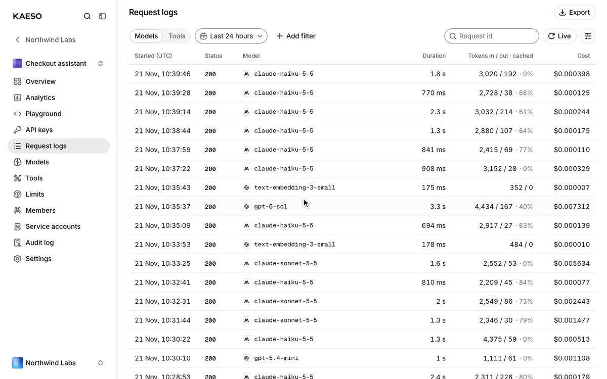
</picture>

## Install

On a Linux server or your computer with Docker and Compose 2.24 or newer:

```sh
curl -fsSL https://kaeso.app/install.sh | sh
```

It installs Kaeso with PostgreSQL, ClickHouse and Valkey into `./kaeso`, starts it at `https://localhost` and prints the link that creates the first user. Add `-s -- --domain kaeso.example.com` to serve your own domain. The [quick start](https://docs.kaeso.app/get-started/quick-start) continues from there, and [install by hand](https://docs.kaeso.app/self-hosting/installation#install-by-hand) sets up the same Compose package step by step.

On Kubernetes, each release publishes a Helm chart next to its images ([Kubernetes](https://docs.kaeso.app/self-hosting/platforms/kubernetes)):

```sh
helm install kaeso oci://ghcr.io/logicplanes/charts/kaeso \
  --namespace kaeso --create-namespace --values values.yaml --wait
```

On a cloud or a hosting platform, the [platform templates](https://docs.kaeso.app/self-hosting/platforms) run the same release:

<p align="center">
  <a href="https://render.com/deploy?repo=https://github.com/logicplanes/kaeso/tree/prod"><picture><source media="(prefers-color-scheme: dark)" srcset="https://raw.githubusercontent.com/logicplanes/kaeso/dev/.github/assets/badges/deploy-to-render-dark.svg"></picture></a>
  <a href="https://railway.com/new/template/cmVV60?utm_medium=integration&utm_source=button&utm_campaign=kaeso"><picture><source media="(prefers-color-scheme: dark)" srcset="https://raw.githubusercontent.com/logicplanes/kaeso/dev/.github/assets/badges/deploy-on-railway-dark.svg"></picture></a>
  <a href="https://cloud.digitalocean.com/apps/new?repo=https://github.com/logicplanes/kaeso/tree/prod&refcode=881255e24b11"><picture><source media="(prefers-color-scheme: dark)" srcset="https://raw.githubusercontent.com/logicplanes/kaeso/dev/.github/assets/badges/deploy-to-digitalocean-dark.svg"></picture></a><br>
  <a href="https://console.aws.amazon.com/cloudformation/home#/stacks/create/review?templateURL=https%3A%2F%2Fkaeso-cloudformation.s3.amazonaws.com%2Flatest%2Fquick-server.yaml&stackName=kaeso"><picture><source media="(prefers-color-scheme: dark)" srcset="https://raw.githubusercontent.com/logicplanes/kaeso/dev/.github/assets/badges/launch-on-aws-dark.svg"></picture></a>
  <a href="https://portal.azure.com/#create/Microsoft.Template/uri/https%3A%2F%2Fraw.githubusercontent.com%2Flogicplanes%2Fkaeso%2Fprod%2Fdeploy%2Fazure%2Fquick-server.json/createUIFormUri/https%3A%2F%2Fraw.githubusercontent.com%2Flogicplanes%2Fkaeso%2Fprod%2Fdeploy%2Fazure%2FcreateUiDefinition.json"><picture><source media="(prefers-color-scheme: dark)" srcset="https://raw.githubusercontent.com/logicplanes/kaeso/dev/.github/assets/badges/deploy-to-azure-dark.svg"></picture></a>
  <a href="https://shell.cloud.google.com/cloudshell/editor?cloudshell_git_repo=https://github.com/logicplanes/kaeso&cloudshell_git_branch=prod&cloudshell_workspace=deploy/gcp/quick-server"><picture><source media="(prefers-color-scheme: dark)" srcset="https://raw.githubusercontent.com/logicplanes/kaeso/dev/.github/assets/badges/open-in-cloud-shell-dark.svg"></picture></a>
</p>
<p align="center">
  <a href="https://docs.kaeso.app/self-hosting/platforms/render">Render</a> ·
  <a href="https://docs.kaeso.app/self-hosting/platforms/railway">Railway</a> ·
  <a href="https://docs.kaeso.app/self-hosting/platforms/digitalocean">DigitalOcean</a> ·
  <a href="https://docs.kaeso.app/self-hosting/platforms/fly">Fly.io</a> ·
  <a href="https://docs.kaeso.app/self-hosting/platforms/aws">AWS</a> ·
  <a href="https://docs.kaeso.app/self-hosting/platforms/azure">Azure</a> ·
  <a href="https://docs.kaeso.app/self-hosting/platforms/gcp">Google Cloud</a> ·
  <a href="https://docs.kaeso.app/self-hosting/platforms/coolify">Coolify</a> ·
  <a href="https://docs.kaeso.app/self-hosting/platforms/dokploy">Dokploy</a> ·
  <a href="https://docs.kaeso.app/self-hosting/platforms/caprover">CapRover</a> ·
  <a href="https://docs.kaeso.app/self-hosting/platforms/kubernetes">Kubernetes</a>
</p>

[Where to run Kaeso](https://kaeso.app/articles/where-to-run-kaeso) compares the deployment paths, with step-by-step guides for a [Linux server](https://kaeso.app/articles/deploy-kaeso-on-a-linux-server), [Kubernetes](https://kaeso.app/articles/deploy-kaeso-on-kubernetes), [Hetzner Cloud](https://kaeso.app/articles/deploy-kaeso-on-hetzner-cloud), [OVHcloud](https://kaeso.app/articles/deploy-kaeso-on-ovhcloud), [Scaleway](https://kaeso.app/articles/deploy-kaeso-on-scaleway), [Oracle Cloud](https://kaeso.app/articles/deploy-kaeso-on-oracle-cloud), [Proxmox VE](https://kaeso.app/articles/deploy-kaeso-on-proxmox) and a [Raspberry Pi](https://kaeso.app/articles/deploy-kaeso-on-a-raspberry-pi). (The DigitalOcean button carries a referral code that credits Kaeso's account, and the Railway button uses a template that pays a referral share to the template author; each platform guide also shows the non-referral CLI or repo path.)

Updates install from the console's **Updates** page or with the installer's `--update`, and check the install's settings before they switch anything ([upgrades](https://docs.kaeso.app/self-hosting/upgrades), [how Kaeso updates itself](https://kaeso.app/articles/updates-and-config-check)).

## Send your first request

Point the OpenAI SDK at Kaeso and call any model in your project, Claude included:

```python
from openai import OpenAI
client = OpenAI(base_url="https://kaeso.example.com/v1", api_key="sk-kso-…")
print(client.responses.create(model="claude-haiku-5-5", input="Hello").output_text)
```

The Anthropic, Google Gen AI, ElevenLabs and Cohere SDKs work the same way with their base URL pointed at Kaeso. Kaeso translates the request and the reply between the formats ([calling models](https://docs.kaeso.app/get-started/calling-models)).

Built in are Amazon Bedrock, Anthropic, AssemblyAI, Azure, Baidu Qianfan, Baseten, Cartesia, Cerebras, Cloudflare AI Gateway, Cohere, Deepgram, DeepInfra, DeepSeek, ElevenLabs, fal, Fireworks AI, Gemini Enterprise Agent Platform, Google AI Studio, Groq, Hugging Face, IONOS AI Model Hub, Jina AI, MiniMax, Mistral, Moonshot, Nebius Token Factory, Novita AI, NVIDIA, Ollama Cloud, OpenAI, OpenRouter, OVHcloud AI Endpoints, Perplexity, QwenCloud, Replicate, SambaNova, Scaleway, SiliconFlow, SpaceX (xAI), Standard Compute, StepFun, Tencent TokenHub, Together AI, TypeSafe, Upstage, Venice, Vercel, Volcengine Ark, Voyage AI and Z.ai ([supported providers](https://docs.kaeso.app/concepts/supported-providers)). A server of your own, such as vLLM, Ollama, LM Studio or llama.cpp, joins as a [custom provider](https://docs.kaeso.app/console/custom-providers).

## What you get

<table>
  <tr>
    <td width="50%" valign="top"><b>One format in, any provider out</b><br>Apps speak OpenAI Chat Completions or Responses, Anthropic Messages, Gemini or ElevenLabs; Kaeso encodes each request for the provider and translates the reply and the stream back (<a href="https://docs.kaeso.app/concepts/format-translation">format translation</a>, <a href="https://kaeso.app/articles/gemini-apps-through-kaeso">Gemini apps</a>).</td>
    <td width="50%" valign="top"><b>More than chat</b><br>Embeddings, reranking in Cohere's format, decision models that answer typed questions with probabilities, images, video, speech, transcription, sound effects, music and OpenAI-format batches, with the same keys, limits and logs (<a href="https://docs.kaeso.app/api">API reference</a>, <a href="https://kaeso.app/articles/media-through-one-gateway">media guide</a>).</td>
  </tr>
  <tr>
    <td width="50%" valign="top"><b>Routes that hold up</b><br>Alias routes with conditions, weighted splits and fallbacks, retries after dropped connections and 5xx answers, key pools that spread a project over several keys of one provider, and a response cache (<a href="https://docs.kaeso.app/concepts/alias-routes">alias routes</a>, <a href="https://kaeso.app/articles/retries-and-fallbacks">retries and fallbacks</a>).</td>
    <td width="50%" valign="top"><b>Model lifecycle</b><br>Replies from retiring models carry <code>Deprecation</code> and <code>Sunset</code> headers, projects see who still calls them, aliases move to the replacement, and model lines such as <code>claude-opus-latest</code> follow the newest model (<a href="https://docs.kaeso.app/concepts/model-lifecycle">model lifecycle</a>, <a href="https://kaeso.app/articles/kpmr-and-model-lifecycle">KPMR and retirements</a>).</td>
  </tr>
  <tr>
    <td width="50%" valign="top"><b>People and access</b><br>Single sign-on per organization over OpenID Connect for any number of people, roles and projects from your identity provider's groups, SCIM 2.0, organization and project roles with single rights, and audit logs (<a href="https://docs.kaeso.app/console/members-and-roles">members and roles</a>, <a href="https://kaeso.app/articles/sso-scim-and-roles">SSO, SCIM and roles</a>).</td>
    <td width="50%" valign="top"><b>Spend under control</b><br>Hard or soft budgets and rate limits per project, member, service account or key, checked before the provider is called; prices from <a href="https://docs.kaeso.app/kpmr">KPMR</a>, shown in your currency; alerts by email or signed webhook (<a href="https://docs.kaeso.app/console/limits-and-budgets">limits and budgets</a>, <a href="https://kaeso.app/articles/budgets-limits-and-usage">hard budgets and currencies</a>).</td>
  </tr>
  <tr>
    <td width="50%" valign="top"><b>Guardrails</b><br>Built-in rules find keys, tokens, email addresses, IBANs and card numbers and mask or block them, and your own HTTP services can allow, block or rewrite a request before the model sees it (<a href="https://docs.kaeso.app/console/guardrails">guardrails</a>, <a href="https://kaeso.app/articles/guardrails-in-kaeso">guardrails guide</a>).</td>
    <td width="50%" valign="top"><b>Logs you decide on</b><br>Every request with its model, status, tokens, cost, timing and caller; content only where the organization, the project or the request allows it; OpenTelemetry traces and Prometheus metrics for your own tools (<a href="https://docs.kaeso.app/console/request-logs">request logs</a>, <a href="https://kaeso.app/articles/request-logs-and-privacy">logs and privacy</a>).</td>
  </tr>
  <tr>
    <td width="50%" valign="top"><b>An MCP portal per project</b><br>Connect your MCP servers once, review their tools, and let claude.ai, ChatGPT, Cursor or any MCP client call them through one signed-in portal (<a href="https://docs.kaeso.app/concepts/mcp-portal">MCP portal</a>, <a href="https://kaeso.app/articles/mcp-portal">MCP portal guide</a>).</td>
    <td width="50%" valign="top"><b>Verifiable releases</b><br>Every image, chart and release file carries signed build provenance that <code>gh attestation verify</code> checks, and the updater installs nothing whose signatures don't match (<a href="https://docs.kaeso.app/self-hosting/upgrades">upgrades</a>, <a href="https://kaeso.app/articles/updates-and-config-check">updater and config check</a>).</td>
  </tr>
</table>

## New in 0.7

Decision models, reranking, guardrails, webhooks, SCIM, key pools, batches and the Helm chart arrived in 0.7, with new providers from Amazon Bedrock and Azure to Deepgram and fal. The [release article](https://kaeso.app/articles/kaeso-0-7) walks through them, and the [changelog](CHANGELOG.md) lists every change.

<table>
  <tr>
    <td width="50%" valign="top">
      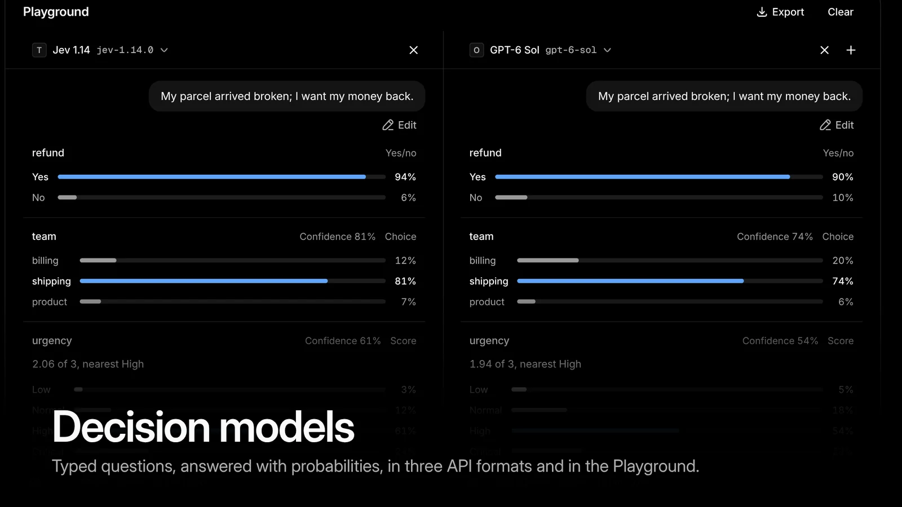
      <p><a href="https://docs.kaeso.app/api/decisions">Decision models</a></p>
    </td>
    <td width="50%" valign="top">
      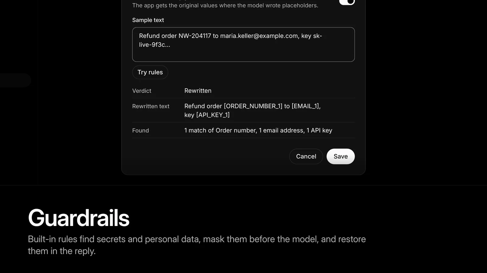
      <p><a href="https://docs.kaeso.app/console/guardrails">Guardrails</a> · <a href="https://kaeso.app/articles/guardrails-in-kaeso">Article</a></p>
    </td>
  </tr>
  <tr>
    <td width="50%" valign="top">
      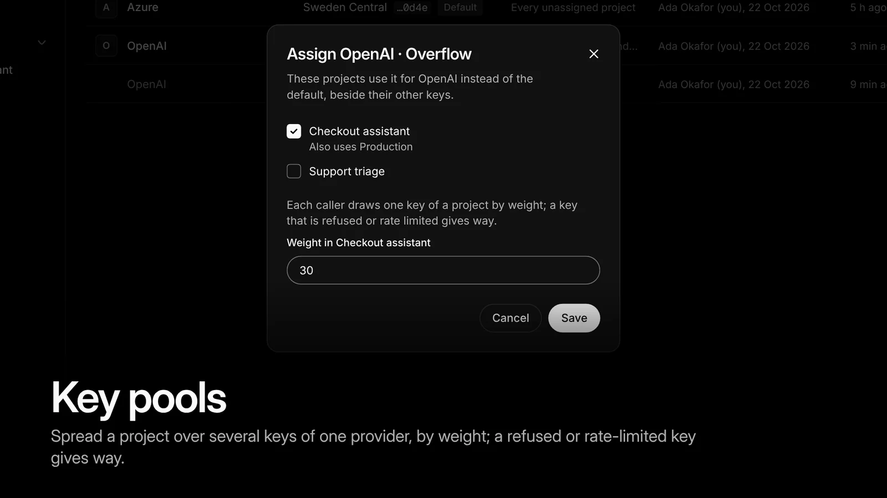
      <p><a href="https://docs.kaeso.app/console/provider-keys#choose-which-key-a-project-uses">Key pools</a> · <a href="https://kaeso.app/articles/provider-key-pools">Article</a></p>
    </td>
    <td width="50%" valign="top">
      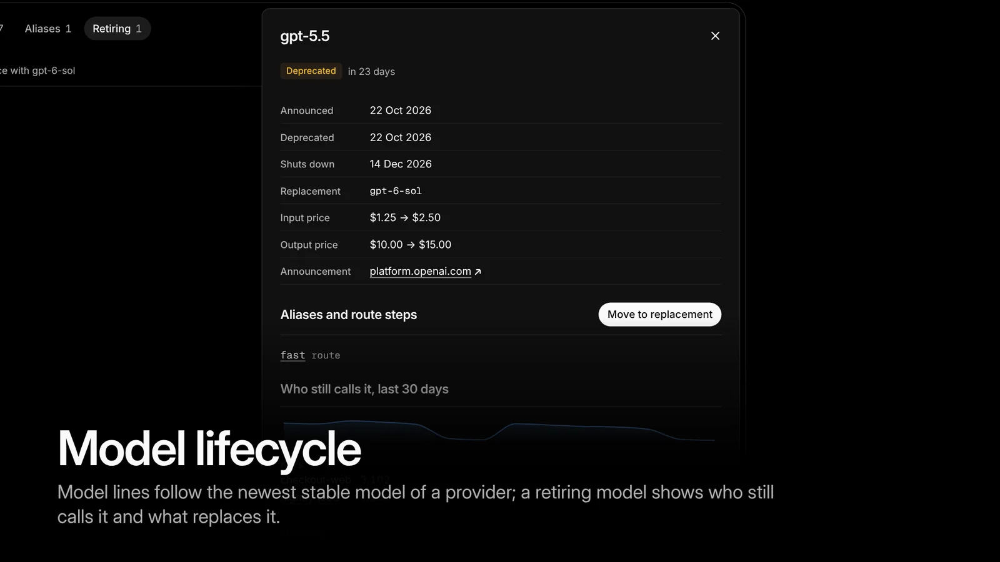
      <p><a href="https://docs.kaeso.app/concepts/model-lifecycle">Model lifecycle</a> · <a href="https://kaeso.app/articles/kpmr-and-model-lifecycle">Article</a></p>
    </td>
  </tr>
  <tr>
    <td width="50%" valign="top">
      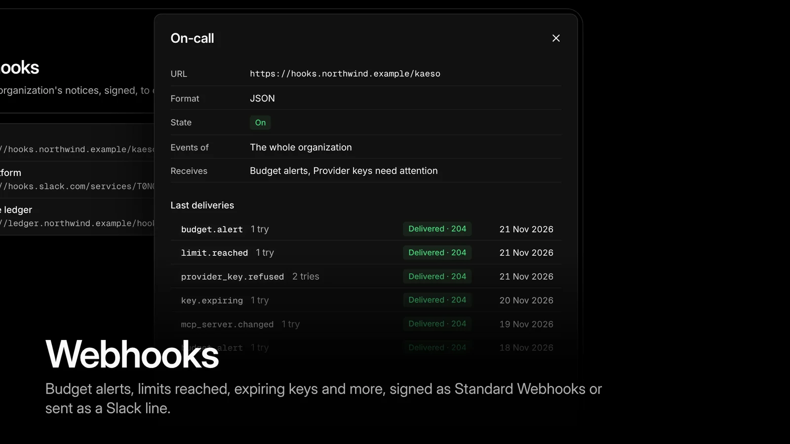
      <p><a href="https://docs.kaeso.app/console/webhooks">Webhooks</a></p>
    </td>
    <td width="50%" valign="top">
      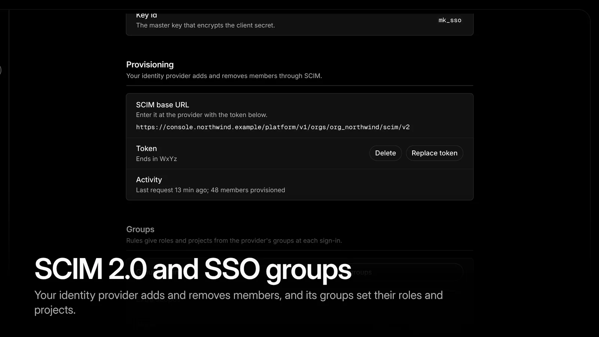
      <p><a href="https://docs.kaeso.app/api/scim">SCIM 2.0 and SSO groups</a> · <a href="https://kaeso.app/articles/sso-scim-and-roles">Article</a></p>
    </td>
  </tr>
</table>

## The console

The pages below show the console with sample data. The [live demo](https://demo.kaeso.app) is a read-only install to try it yourself.

<table>
  <tr>
    <td width="50%" valign="top">
      <picture>
        <source media="(prefers-color-scheme: dark)" srcset="https://raw.githubusercontent.com/logicplanes/kaeso/dev/.github/assets/console-analytics-dark.webp">
        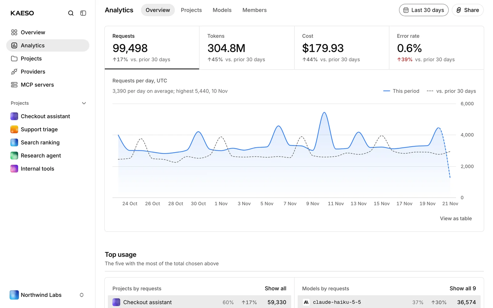
      </picture>
      <p><b><a href="https://docs.kaeso.app/console/organizations-and-projects#read-usage">Analytics</a></b><br>Requests, tokens, cost and errors per organization, project, model, key and member, against the period before.</p>
    </td>
    <td width="50%" valign="top">
      <picture>
        <source media="(prefers-color-scheme: dark)" srcset="https://raw.githubusercontent.com/logicplanes/kaeso/dev/.github/assets/console-logs-dark.webp">
        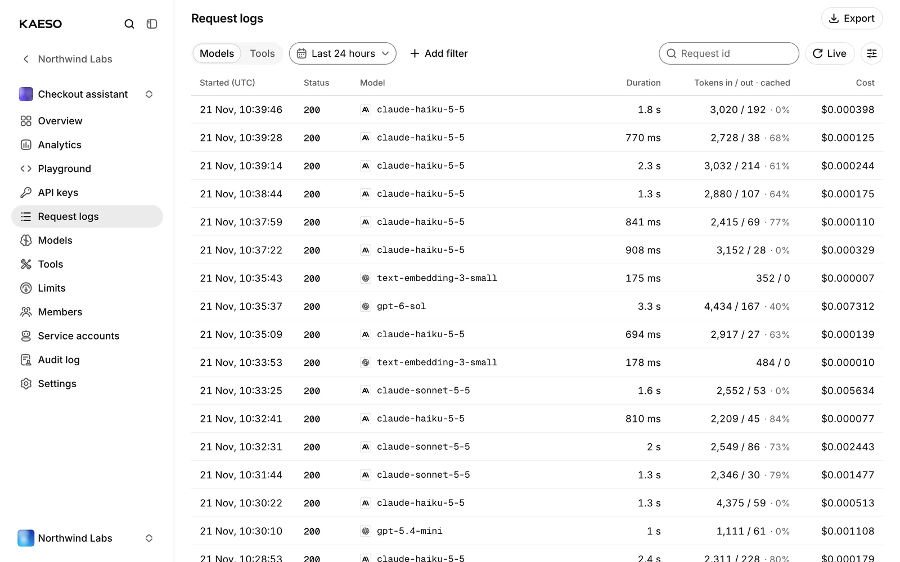
      </picture>
      <p><b><a href="https://docs.kaeso.app/console/request-logs">Request logs</a></b><br>Every request with its model, status, tokens, cost, timing, route and caller, filtered by any of them.</p>
    </td>
  </tr>
  <tr>
    <td width="50%" valign="top">
      <picture>
        <source media="(prefers-color-scheme: dark)" srcset="https://raw.githubusercontent.com/logicplanes/kaeso/dev/.github/assets/console-models-dark.webp">
        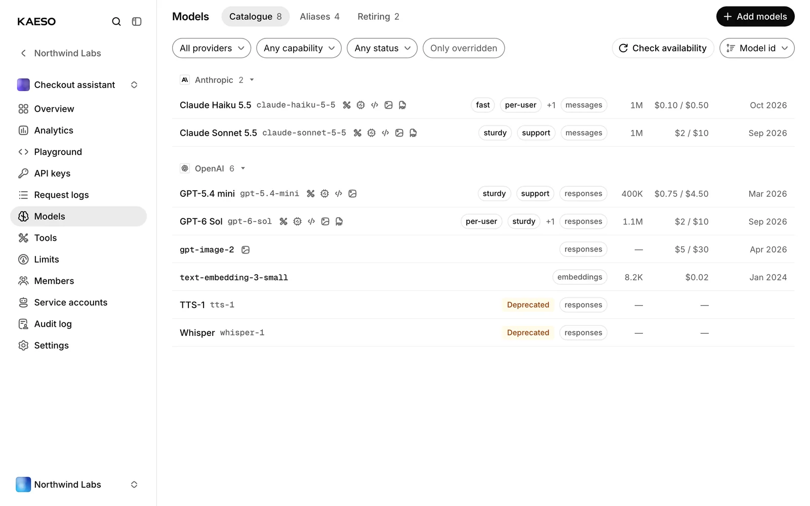
      </picture>
      <p><b><a href="https://docs.kaeso.app/console/models-and-aliases">Models</a></b><br>A catalogue per project with the prices, capabilities and status of every model from <a href="https://docs.kaeso.app/kpmr">KPMR</a>, the Kaeso Provider &amp; Model Registry.</p>
    </td>
    <td width="50%" valign="top">
      <picture>
        <source media="(prefers-color-scheme: dark)" srcset="https://raw.githubusercontent.com/logicplanes/kaeso/dev/.github/assets/console-aliases-dark.webp">
        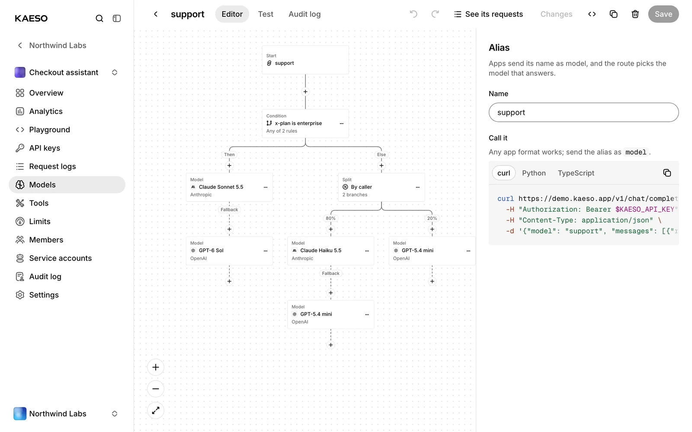
      </picture>
      <p><b><a href="https://docs.kaeso.app/concepts/alias-routes">Alias routes</a></b><br>Name the models behind an alias, with fallbacks, retries, conditions on headers and tokens, and weighted splits.</p>
    </td>
  </tr>
  <tr>
    <td width="50%" valign="top">
      <picture>
        <source media="(prefers-color-scheme: dark)" srcset="https://raw.githubusercontent.com/logicplanes/kaeso/dev/.github/assets/console-limits-dark.webp">
        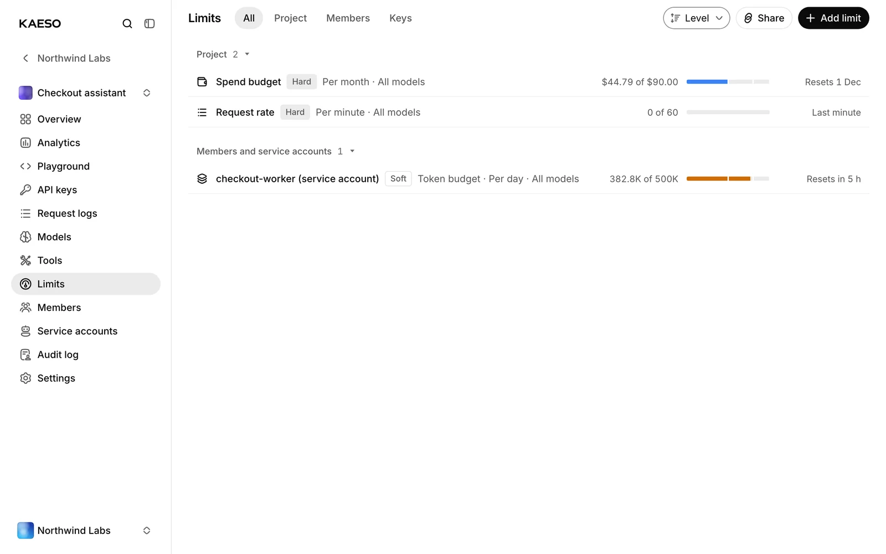
      </picture>
      <p><b><a href="https://docs.kaeso.app/console/limits-and-budgets">Limits and budgets</a></b><br>Hard or soft spend, token and rate limits per project, member, service account or key.</p>
    </td>
    <td width="50%" valign="top">
      <picture>
        <source media="(prefers-color-scheme: dark)" srcset="https://raw.githubusercontent.com/logicplanes/kaeso/dev/.github/assets/console-logging-dark.webp">
        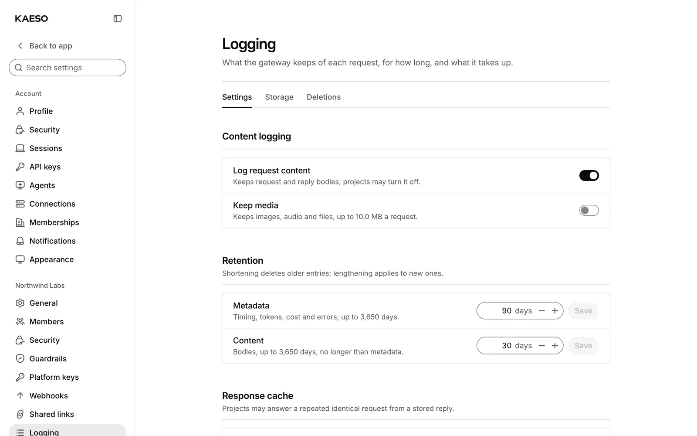
      </picture>
      <p><b><a href="https://docs.kaeso.app/console/request-logs#retention">Logging</a></b><br>Whether request content and media are kept at all, and for how long, per organization and project.</p>
    </td>
  </tr>
</table>

## How it works

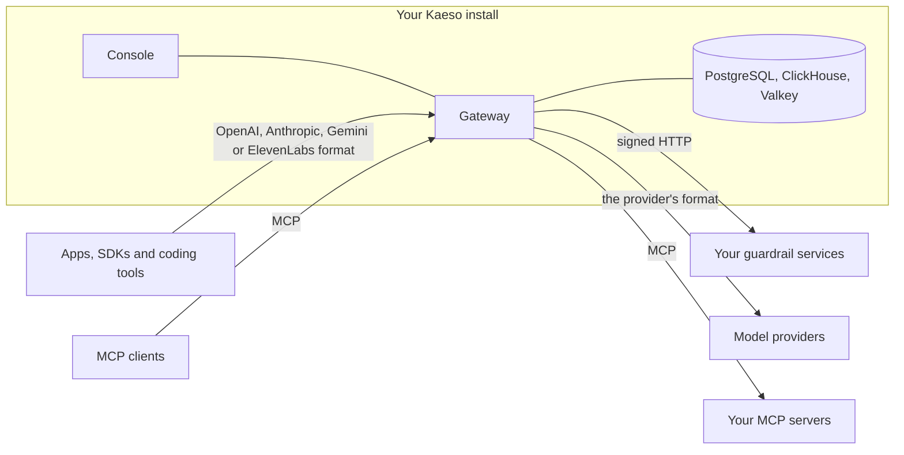

The gateway is one Rust process with no garbage collector between your app and the provider. Run several behind Caddy or a load balancer and they share everything a request depends on ([multiple gateways](https://docs.kaeso.app/self-hosting/scaling)). See [performance](https://docs.kaeso.app/self-hosting/performance) and [kaeso.app/benchmarks](https://kaeso.app/benchmarks) for how Kaeso compares with LiteLLM, Bifrost and Portkey on BerriAI's [`ai-gateway-bench`](https://github.com/BerriAI/ai-gateway-bench), and the [gateway benchmark](https://docs.kaeso.app/development/benchmark) in this repository to measure Kaeso on your own hardware.

## How it compares

These tables compare Kaeso with the gateways people most often weigh it against, as their own documentation, pricing pages and licenses describe them. They were read on 23 November 2026 and every entry is sourced below. Products change: [open an issue](https://github.com/logicplanes/kaeso/issues/new/choose) when an entry is out of date, and we'll correct it.

**Yes** means the free or open-source version has it. **Paid** means a paid plan or enterprise license has it. **Partial** is explained in a note. **–** means we didn't find it in their documentation.

### Running it yourself

|                                     | On your servers                | License                                            | Written in                    | Web console | Docker Compose | Helm chart                  |
| ----------------------------------- | ------------------------------ | -------------------------------------------------- | ----------------------------- | ----------- | -------------- | --------------------------- |
| **Kaeso**                           | Yes                            | MIT                                                | Rust                          | Yes         | Yes            | Yes                         |
| LiteLLM                             | Yes                            | MIT, except `enterprise/`<sup>[1](#note-1)</sup>   | Python<sup>[2](#note-2)</sup> | Yes         | Yes            | Yes                         |
| Bifrost                             | Yes<sup>[3](#note-3)</sup>     | Apache 2.0                                         | Go                            | Yes         | Yes            | Yes                         |
| Portkey                             | Yes                            | MIT                                                | TypeScript                    | Logs only   | Yes            | Paid<sup>[4](#note-4)</sup> |
| Helicone                            | Partial<sup>[5](#note-5)</sup> | Apache 2.0                                         | TypeScript                    | Yes         | Yes            | Yes                         |
| Kong AI Gateway                     | Yes                            | Apache 2.0, AI plugins paid<sup>[6](#note-6)</sup> | Lua                           | Yes         | Yes            | Yes                         |
| Agent Router (was Envoy AI Gateway) | Yes                            | Apache 2.0                                         | Go                            | –           | Yes            | Yes                         |
| OpenRouter                          | Hosted only                    | –                                                  | –                             | Hosted      | –              | –                           |
| Cloudflare AI Gateway               | Hosted only                    | –                                                  | –                             | Hosted      | –              | –                           |

### Teams and control

|                       | Single sign-on | SCIM | Roles                            | Audit log | Budgets                          | PII and secret rules             | Your own guardrail service       |
| --------------------- | -------------- | ---- | -------------------------------- | --------- | -------------------------------- | -------------------------------- | -------------------------------- |
| **Kaeso**             | Yes            | Yes  | Yes                              | Yes       | Yes                              | Yes                              | Yes                              |
| LiteLLM               | Up to 5 users  | Paid | Partial<sup>[7](#note-7)</sup>   | Paid      | Yes                              | Partial<sup>[8](#note-8)</sup>   | Yes                              |
| Bifrost               | Paid           | Paid | Paid                             | Paid      | Yes                              | Paid                             | Partial<sup>[9](#note-9)</sup>   |
| Portkey               | Paid           | Paid | Paid                             | Paid      | Paid                             | Paid                             | Yes                              |
| Helicone              | Paid           | –    | –                                | –         | Partial<sup>[10](#note-10)</sup> | –                                | –                                |
| Kong AI Gateway       | Paid           | Paid | Paid                             | Paid      | Paid                             | Paid                             | Paid                             |
| Agent Router          | –              | –    | –                                | –         | Partial<sup>[11](#note-11)</sup> | –                                | Partial<sup>[12](#note-12)</sup> |
| OpenRouter            | Paid           | Paid | Partial<sup>[13](#note-13)</sup> | Paid      | Yes<sup>[14](#note-14)</sup>     | Yes                              | –                                |
| Cloudflare AI Gateway | Yes            | Paid | Partial<sup>[15](#note-15)</sup> | Yes       | Yes                              | Partial<sup>[16](#note-16)</sup> | –                                |

### APIs your apps can call

|                       | OpenAI Chat Completions and Responses | Anthropic Messages               | Gemini                           | ElevenLabs                       | Rerank                           | OpenAI batches                   |
| --------------------- | ------------------------------------- | -------------------------------- | -------------------------------- | -------------------------------- | -------------------------------- | -------------------------------- |
| **Kaeso**             | Yes                                   | Yes                              | Yes                              | Yes                              | Yes                              | Partial<sup>[17](#note-17)</sup> |
| LiteLLM               | Yes                                   | Yes                              | Yes                              | –                                | Yes                              | Yes                              |
| Bifrost               | Yes                                   | Yes                              | Yes                              | Yes                              | Yes                              | Yes                              |
| Portkey               | Yes                                   | Yes                              | Partial<sup>[18](#note-18)</sup> | Partial<sup>[19](#note-19)</sup> | Yes                              | Paid                             |
| Helicone              | Yes                                   | Partial<sup>[20](#note-20)</sup> | Partial<sup>[20](#note-20)</sup> | –                                | –                                | –                                |
| Kong AI Gateway       | Partial<sup>[21](#note-21)</sup>      | Paid<sup>[21](#note-21)</sup>    | Yes                              | –                                | Paid<sup>[21](#note-21)</sup>    | Paid<sup>[21](#note-21)</sup>    |
| Agent Router          | Yes                                   | Yes                              | –                                | –                                | Yes                              | –                                |
| OpenRouter            | Yes                                   | Yes                              | –                                | –                                | Yes                              | Yes                              |
| Cloudflare AI Gateway | Yes                                   | Yes                              | Yes<sup>[22](#note-22)</sup>     | Yes<sup>[22](#note-22)</sup>     | Partial<sup>[23](#note-23)</sup> | –                                |

### Media

|                       | Images                           | Video                         | Speech                        | Transcription                 | Music |
| --------------------- | -------------------------------- | ----------------------------- | ----------------------------- | ----------------------------- | ----- |
| **Kaeso**             | Yes                              | Yes                           | Yes                           | Yes                           | Yes   |
| LiteLLM               | Yes                              | Yes                           | Yes                           | Yes                           | Yes   |
| Bifrost               | Yes                              | Yes                           | Yes                           | Yes                           | –     |
| Portkey               | Yes                              | Yes                           | Yes                           | Yes                           | –     |
| Helicone              | Partial<sup>[24](#note-24)</sup> | –                             | –                             | –                             | –     |
| Kong AI Gateway       | Paid<sup>[21](#note-21)</sup>    | Paid<sup>[21](#note-21)</sup> | Paid<sup>[21](#note-21)</sup> | Paid<sup>[21](#note-21)</sup> | –     |
| Agent Router          | Yes                              | –                             | –                             | Yes                           | –     |
| OpenRouter            | Yes                              | Yes                           | Yes                           | Yes                           | –     |
| Cloudflare AI Gateway | Yes                              | Yes                           | Yes                           | Yes                           | –     |

### Routing and operations

|                       | Several keys per provider        | Fallbacks | Retries | Model retirements                | MCP gateway                      | Logs without content |
| --------------------- | -------------------------------- | --------- | ------- | -------------------------------- | -------------------------------- | -------------------- |
| **Kaeso**             | Yes, weighted                    | Yes       | Yes     | Yes<sup>[25](#note-25)</sup>     | Yes                              | Yes                  |
| LiteLLM               | Yes                              | Yes       | Yes     | Partial<sup>[26](#note-26)</sup> | Yes                              | Yes                  |
| Bifrost               | Yes, weighted                    | Yes       | Yes     | Partial<sup>[27](#note-27)</sup> | Yes                              | Yes                  |
| Portkey               | Yes, weighted                    | Yes       | Yes     | –                                | Partial<sup>[28](#note-28)</sup> | Paid                 |
| Helicone              | –                                | Yes       | Yes     | –                                | –                                | Yes                  |
| Kong AI Gateway       | –                                | Paid      | Paid    | –                                | Paid                             | Yes                  |
| Agent Router          | Partial<sup>[29](#note-29)</sup> | Yes       | Yes     | –                                | Yes                              | Yes                  |
| OpenRouter            | Partial<sup>[30](#note-30)</sup> | Yes       | Yes     | Partial<sup>[31](#note-31)</sup> | –                                | Yes                  |
| Cloudflare AI Gateway | Partial<sup>[32](#note-32)</sup> | Yes       | Yes     | –                                | –<sup>[33](#note-33)</sup>       | Yes                  |

### Paid plans, as published

| Product               | Paid plans                                                                                                                   |
| --------------------- | ---------------------------------------------------------------------------------------------------------------------------- |
| **Kaeso**             | None. Everything above is in the MIT-licensed release; there is no paid edition or support contract.                         |
| LiteLLM               | Enterprise license, priced on request.                                                                                       |
| Bifrost               | Enterprise, custom pricing.                                                                                                  |
| Portkey               | Pro at $49 a month and Enterprise at custom pricing; Portkey is now offered by Palo Alto Networks as Prisma AIRS AI Gateway. |
| Helicone              | Pro at $79 and Team at $799 a month, Enterprise on request.                                                                  |
| Kong AI Gateway       | Konnect Plus from $25 a month plus usage, with AI model proxies at $100 a month each; Enterprise at custom pricing.          |
| Agent Router          | None; an Apache 2.0 project.                                                                                                 |
| OpenRouter            | A 5.5% fee on credits on Standard and 8% on Business, Enterprise on request.                                                 |
| Cloudflare AI Gateway | Core features free; a 5% fee on Unified Billing credits; logs billed as Workers Logs.                                        |

### Performance on BerriAI's benchmark

We ran [`BerriAI/ai-gateway-bench`](https://github.com/BerriAI/ai-gateway-bench) (`44365ca`) with Kaeso 0.7 beside the four gateways that benchmark compares, each pinned to two dedicated cores on the same 4-vCPU machine (median of three randomized rounds; full method, image digests, scripts and raw JSON on [kaeso.app/benchmarks](https://kaeso.app/benchmarks), product-by-product pages on [kaeso.app/compare](https://kaeso.app/compare), [performance docs](https://docs.kaeso.app/self-hosting/performance) and [Kaeso on LiteLLM's own benchmark](https://kaeso.app/articles/kaeso-on-litellms-benchmark)):

| Gateway                            | Requests/s (64 clients) | Added p50 / p99 (16 clients) | CPU per request | Peak memory                        | Checked and kept per request                           |
| ---------------------------------- | ----------------------- | ---------------------------- | --------------- | ---------------------------------- | ------------------------------------------------------ |
| **Kaeso 0.7**                      | 6,338                   | +0.54 / +1.47 ms             | 314 µs          | 164 + 271 MB (PostgreSQL + Valkey) | Project API key, model allow-list, usage in PostgreSQL |
| **Kaeso 0.7, request logs on**     | 5,324                   | +0.62 / +1.45 ms             | 373 µs          | 450 + 1,163 MB (+ ClickHouse)      | Same, plus every request logged to ClickHouse          |
| LiteLLM Rust (`main` at `d4e8f96`) | 3,211                   | +0.69 / +2.26 ms             | 573 µs          | 86 MB                              | One static master key; no database                     |
| Bifrost 2.6.0                      | 2,806                   | +0.71 / +4.08 ms             | 708 µs          | 405 MB                             | No key; logging and stores off                         |
| Portkey 1.15.2                     | 779                     | +3.13 / +20.40 ms            | 1,449 µs        | 293 MB                             | No key; logging off                                    |
| LiteLLM Python 1.110.2             | 74                      | +188 / +216 ms               | 13,563 µs       | 743 MB                             | One static master key; no database                     |

Where LiteLLM Rust is ahead: it used at most 86 MB of memory and needs no database (Kaeso reached 164 MB plus 271 MB for PostgreSQL and Valkey), and with a single client at a time its p99 was +0.98 ms against Kaeso's +1.66 ms. Added time to first token (+0.87 vs +0.96 ms) and the replayed Claude Code session (+41.5 vs +41.0 ms) were within each other's range. Kaeso's author ran this single-host benchmark; [how to benchmark an AI gateway without fooling yourself](https://kaeso.app/articles/benchmarking-ai-gateways-honestly) documents the methodology and how to rerun it on your own machine.

### When another tool fits better

Kaeso runs as containers next to PostgreSQL, ClickHouse and Valkey, on at least 2 vCPUs and 4 GB of memory ([requirements](https://docs.kaeso.app/self-hosting/requirements)), and it has no hosted version and no paid support. If you want a hosted service with nothing to run, OpenRouter or Cloudflare AI Gateway fit better, and OpenRouter bills hundreds of models through one account. If your platform team already runs Kong or Envoy Gateway, Kong AI Gateway or Agent Router put model traffic under the same policies and Kubernetes resources. LiteLLM serves more kinds of endpoints, such as realtime, OCR and vector stores, and comes as a Python SDK as well as a proxy. Helicone goes further into observability, with sessions, evaluations, datasets and prompt management. If you need a vendor contract, LiteLLM, Bifrost, Portkey, Helicone and Kong sell enterprise plans.

TensorZero is not in the tables: its website says it is no longer maintained.

#### Notes

1. <a id="note-1"></a>The repository's license is MIT except for `enterprise/` folders, whose code needs a BerriAI Enterprise license in production.
2. <a id="note-2"></a>GitHub lists Python as the repository's main language; its description reads "Rust core with Python SDK".
3. <a id="note-3"></a>Running several open-source Bifrost nodes against one PostgreSQL is not supported; clustering is part of Enterprise.
4. <a id="note-4"></a>The official chart pulls enterprise images with credentials Portkey shares.
5. <a id="note-5"></a>The self-hosted stack forwards OpenAI and Anthropic traffic; Vertex AI, Bedrock and Azure OpenAI are not supported there, and the AI gateway is documented as a cloud endpoint.
6. <a id="note-6"></a>Kong Gateway is Apache 2.0; most AI plugins, such as AI Proxy Advanced, AI Sanitizer and AI MCP Proxy, are part of AI Gateway Enterprise.
7. <a id="note-7"></a>Global proxy roles carry no enterprise label; roles scoped to organizations or teams are a premium feature.
8. <a id="note-8"></a>PII masking with Presidio is in the open-source version; secret detection and redaction are enterprise-only.
9. <a id="note-9"></a>No webhook guardrail in the open-source version; Go or WASM plugins can inspect requests, and named guardrail vendors are Enterprise.
10. <a id="note-10"></a>Cost-based rate limits per user or property, set with a request header.
11. <a id="note-11"></a>Token quotas per model, not money.
12. <a id="note-12"></a>Envoy's external authorization hook, not a guardrail feature of its own.
13. <a id="note-13"></a>Organization admins and members; workspace roles need a higher plan.
14. <a id="note-14"></a>The workspace budgets page says budgets are on every plan; the pricing page lists them as not included on Free.
15. <a id="note-15"></a>Cloudflare account roles and API token permissions; no role for AI Gateway members alone.
16. <a id="note-16"></a>Data loss prevention flags or blocks prompts and replies; two predefined profiles without a Zero Trust subscription, no masking documented.
17. <a id="note-17"></a>For providers whose batch API takes OpenAI's batches as they are, today OpenAI.
18. <a id="note-18"></a>Google Gen AI SDK requests pass through for Gemini models on Vertex AI only.
19. <a id="note-19"></a>Speech and transcription go through OpenAI-style `/v1/audio` endpoints; other ElevenLabs APIs through a custom host.
20. <a id="note-20"></a>Through a provider-specific proxy that Helicone maintains but no longer develops.
21. <a id="note-21"></a>Documented for AI Proxy from Kong Gateway 3.10 or 3.11; the open-source releases on GitHub are 3.9. The open-source AI Proxy takes Chat Completions.
22. <a id="note-22"></a>The provider's own API, passed through to that provider only.
23. <a id="note-23"></a>Cohere's API passes through to Cohere.
24. <a id="note-24"></a>One image model, through Google AI Studio.
25. <a id="note-25"></a>`Deprecation`, `Sunset` and `Link` headers, 410 after the shutdown, and aliases that move to the replacement.
26. <a id="note-26"></a>Deprecation reminders 30 days and 1 day before a provider's date, with a recommended replacement.
27. <a id="note-27"></a>Requests to a retired model are recognized and handled like other failures; no warnings or move to a replacement are documented.
28. <a id="note-28"></a>In Portkey's hosted and enterprise platform, not in the open-source gateway.
29. <a id="note-29"></a>Weighted backends, each with its own credentials.
30. <a id="note-30"></a>Several of your own keys, tried in the order you set; no weights.
31. <a id="note-31"></a>The models API returns a model endpoint's deprecation date.
32. <a id="note-32"></a>Several keys per provider, chosen per request by an alias header.
33. <a id="note-33"></a>MCP server portals are a separate Cloudflare One product.

<details>
<summary><b>Sources</b>, all read on 23 November 2026</summary>

**Kaeso:** [license](LICENSE), [installation](https://docs.kaeso.app/self-hosting/installation), [Kubernetes](https://docs.kaeso.app/self-hosting/platforms/kubernetes), [single sign-on and SCIM](https://docs.kaeso.app/console/organizations-and-projects#single-sign-on), [roles](https://docs.kaeso.app/console/members-and-roles), [audit log](https://docs.kaeso.app/console/organizations-and-projects#read-the-audit-log), [budgets](https://docs.kaeso.app/console/limits-and-budgets), [guardrails](https://docs.kaeso.app/console/guardrails), [model API](https://docs.kaeso.app/api/model-api), [ElevenLabs API](https://docs.kaeso.app/api/elevenlabs), [rerank](https://docs.kaeso.app/api/rerank), [batches](https://docs.kaeso.app/api/batches), [images](https://docs.kaeso.app/api/images), [videos](https://docs.kaeso.app/api/videos), [audio](https://docs.kaeso.app/api/audio), [key pools](https://docs.kaeso.app/console/provider-keys#choose-which-key-a-project-uses), [fallbacks and retries](https://docs.kaeso.app/concepts/alias-routes#fallbacks), [KPMR](https://docs.kaeso.app/kpmr), [model lifecycle](https://docs.kaeso.app/concepts/model-lifecycle), [MCP portal](https://docs.kaeso.app/concepts/mcp-portal), [keeping content out of the log](https://docs.kaeso.app/api/model-api#keeping-content-out-of-the-log), [performance](https://docs.kaeso.app/self-hosting/performance), [benchmarks](https://kaeso.app/benchmarks), [requirements](https://docs.kaeso.app/self-hosting/requirements).

**LiteLLM:** [license](https://github.com/BerriAI/litellm/blob/main/LICENSE), [enterprise license](https://github.com/BerriAI/litellm/blob/main/litellm/enterprise/LICENSE.md), [repository](https://github.com/BerriAI/litellm), [pricing](https://www.litellm.ai/pricing), [enterprise features](https://docs.litellm.ai/docs/enterprise), [Docker](https://docs.litellm.ai/docs/proxy/docker_quick_start), [Helm](https://docs.litellm.ai/docs/proxy/deploy), [SSO](https://docs.litellm.ai/docs/proxy/admin_ui_sso), [SCIM](https://docs.litellm.ai/docs/tutorials/scim_litellm), [roles](https://docs.litellm.ai/docs/proxy/access_control), [audit logs](https://docs.litellm.ai/docs/proxy/audit_logs), [budgets](https://docs.litellm.ai/docs/proxy/users), [PII masking](https://docs.litellm.ai/docs/proxy/guardrails/pii_masking_v2), [generic guardrail API](https://docs.litellm.ai/docs/adding_provider/generic_guardrail_api), [supported endpoints](https://docs.litellm.ai/docs/supported_endpoints), [Responses](https://docs.litellm.ai/docs/response_api), [Anthropic format](https://docs.litellm.ai/docs/anthropic_unified), [generateContent](https://docs.litellm.ai/docs/generateContent), [pass-through](https://docs.litellm.ai/docs/pass_through/intro), [rerank](https://docs.litellm.ai/docs/rerank), [batches](https://docs.litellm.ai/docs/batches), [images](https://docs.litellm.ai/docs/image_generation), [speech](https://docs.litellm.ai/docs/text_to_speech), [transcription](https://docs.litellm.ai/docs/audio_transcription), [music](https://docs.litellm.ai/release_notes/v1.102.0/v1-102-0), [load balancing](https://docs.litellm.ai/docs/proxy/load_balancing), [fallbacks and retries](https://docs.litellm.ai/docs/proxy/reliability), [deprecation alerts](https://docs.litellm.ai/blog/model-deprecation-alerts), [MCP gateway](https://docs.litellm.ai/docs/mcp), [logging](https://docs.litellm.ai/docs/proxy/logging).

**Bifrost:** [license](https://github.com/maximhq/bifrost/blob/main/LICENSE), [repository](https://github.com/maximhq/bifrost), [pricing](https://www.getmaxim.ai/bifrost/pricing), [setup](https://docs.getbifrost.ai/quickstart/gateway/setting-up), [multiple nodes](https://docs.getbifrost.ai/deployment-guides/how-to/multinode), [Helm](https://docs.getbifrost.ai/deployment-guides/helm), [SSO and SCIM](https://docs.getbifrost.ai/enterprise/user-provisioning), [RBAC](https://docs.getbifrost.ai/enterprise/rbac), [audit logs](https://docs.getbifrost.ai/enterprise/audit-logs), [budgets](https://docs.getbifrost.ai/features/governance/budget-and-limits), [guardrails](https://docs.getbifrost.ai/enterprise/guardrails), [plugins](https://docs.getbifrost.ai/plugins/getting-started), [OpenAI](https://docs.getbifrost.ai/integrations/openai-sdk/overview), [Anthropic](https://docs.getbifrost.ai/integrations/anthropic-sdk/overview), [Google GenAI](https://docs.getbifrost.ai/integrations/genai-sdk/overview), [ElevenLabs](https://docs.getbifrost.ai/integrations/elevenlabs-sdk/overview), [Cohere](https://docs.getbifrost.ai/integrations/cohere-sdk/overview), [batches](https://docs.getbifrost.ai/integrations/openai-sdk/files-and-batch), [media](https://docs.getbifrost.ai/quickstart/gateway/multimodal), [video](https://docs.getbifrost.ai/providers/supported-providers/gemini), [keys](https://docs.getbifrost.ai/features/keys-management), [retries and fallbacks](https://docs.getbifrost.ai/features/retries-and-fallbacks), [MCP](https://docs.getbifrost.ai/mcp/overview), [content logging](https://docs.getbifrost.ai/features/observability/content-logging).

**Portkey:** [license](https://github.com/Portkey-AI/gateway/blob/main/LICENSE), [repository](https://github.com/Portkey-AI/gateway), [deployment](https://github.com/Portkey-AI/gateway/blob/main/docs/installation-deployments.md), [Helm chart](https://github.com/Portkey-AI/helm/blob/main/charts/portkey-gateway/README.md), [plans and features](https://docs.portkey.ai/docs/product/product-feature-comparison), [SSO](https://docs.portkey.ai/docs/product/enterprise-offering/org-management/sso), [audit logs](https://docs.portkey.ai/docs/product/enterprise-offering/audit-logs), [budgets](https://docs.portkey.ai/docs/product/ai-gateway/virtual-keys/budget-limits), [PII redaction](https://docs.portkey.ai/docs/product/guardrails/pii-redaction), [webhook guardrails](https://docs.portkey.ai/docs/integrations/guardrails/bring-your-own-guardrails), [Responses](https://docs.portkey.ai/docs/product/ai-gateway/responses-api), [Messages](https://docs.portkey.ai/docs/product/ai-gateway/messages-api), [Vertex AI](https://docs.portkey.ai/docs/integrations/llms/vertex-ai), [ElevenLabs](https://docs.portkey.ai/docs/integrations/llms/elevenlabs), [rerank](https://docs.portkey.ai/docs/api-reference/inference-api/rerank), [batches](https://docs.portkey.ai/docs/product/ai-gateway/batches), [images](https://docs.portkey.ai/docs/product/ai-gateway/multimodal-capabilities/image-generation), [video](https://docs.portkey.ai/docs/integrations/llms/openai), [speech](https://docs.portkey.ai/docs/product/ai-gateway/multimodal-capabilities/text-to-speech), [transcription](https://docs.portkey.ai/docs/product/ai-gateway/multimodal-capabilities/speech-to-text), [load balancing](https://docs.portkey.ai/docs/product/ai-gateway/load-balancing), [fallbacks](https://docs.portkey.ai/docs/product/ai-gateway/fallbacks), [retries](https://docs.portkey.ai/docs/product/ai-gateway/automatic-retries), [MCP gateway](https://docs.portkey.ai/docs/product/mcp-gateway), [request logging](https://docs.portkey.ai/docs/product/administration/configuring-request-logging), [Prisma AIRS AI Gateway](https://www.paloaltonetworks.com/ai-security/ai-gateway), where portkey.ai/pricing leads.

**Helicone:** [license](https://github.com/Helicone/helicone/blob/main/LICENSE), [repository](https://github.com/Helicone/helicone), [pricing](https://www.helicone.ai/pricing), [self-hosting with Docker](https://docs.helicone.ai/getting-started/self-host/docker), [Kubernetes](https://docs.helicone.ai/getting-started/self-host/kubernetes), [custom rate limits](https://docs.helicone.ai/features/advanced-usage/custom-rate-limits), [gateway](https://docs.helicone.ai/gateway/overview), [Responses](https://docs.helicone.ai/gateway/concepts/responses-api), [Anthropic proxy](https://docs.helicone.ai/integrations/anthropic/curl), [Gemini proxy](https://docs.helicone.ai/integrations/gemini/api/curl), [gateway OpenAPI](https://docs.helicone.ai/ai-gateway.openapi.json), [batches](https://docs.helicone.ai/guides/cookbooks/openai-batch-api), [images](https://docs.helicone.ai/gateway/concepts/image-generation), [provider routing](https://docs.helicone.ai/gateway/provider-routing), [retries](https://docs.helicone.ai/features/advanced-usage/retries), [MCP](https://docs.helicone.ai/integrations/tools/mcp), [headers](https://docs.helicone.ai/helicone-headers/header-directory).

**Kong AI Gateway:** [license](https://github.com/Kong/kong/blob/master/LICENSE), [repository](https://github.com/Kong/kong), [Helm charts](https://github.com/Kong/charts), [pricing](https://konghq.com/pricing), [AI Proxy](https://developer.konghq.com/plugins/ai-proxy/), [AI Proxy Advanced](https://developer.konghq.com/plugins/ai-proxy-advanced/), [open-source AI Proxy formats](https://github.com/Kong/kong/blob/3.9.5/kong/plugins/ai-proxy/schema.lua), [AI Rate Limiting Advanced](https://developer.konghq.com/plugins/ai-rate-limiting-advanced/), [AI Sanitizer](https://developer.konghq.com/plugins/ai-sanitizer/), [AI Custom Guardrail](https://developer.konghq.com/plugins/ai-custom-guardrail/), [load balancing](https://developer.konghq.com/ai-gateway/load-balancing/), [AI MCP Proxy](https://developer.konghq.com/plugins/ai-mcp-proxy/), [payload logging](https://github.com/Kong/kong/blob/master/kong/llm/schemas/init.lua).

**Agent Router:** [license](https://github.com/theagentrouter/agent-router/blob/main/LICENSE), [repository](https://github.com/theagentrouter/agent-router), [installation](https://theagentrouter.ai/docs/getting-started/installation/), [CLI](https://theagentrouter.ai/docs/cli/aigwinstall/), [security](https://theagentrouter.ai/docs/capabilities/security/), [quota policy](https://theagentrouter.ai/docs/capabilities/traffic/quota-policy/), [supported endpoints](https://theagentrouter.ai/docs/capabilities/llm-integrations/supported-endpoints/), [API](https://theagentrouter.ai/docs/api/), [provider fallback](https://theagentrouter.ai/docs/capabilities/traffic/provider-fallback/), [MCP](https://theagentrouter.ai/docs/capabilities/mcp/), [tracing](https://theagentrouter.ai/docs/capabilities/observability/tracing/). The former address, aigateway.envoyproxy.io, redirects there.

**OpenRouter:** [pricing](https://openrouter.ai/pricing), [FAQ](https://openrouter.ai/docs/faq), [SSO](https://openrouter.ai/docs/guides/features/sso), [SCIM and audit log](https://openrouter.ai/docs/guides/features/scim-mappings), [workspaces](https://openrouter.ai/docs/guides/features/workspaces), [spend controls](https://openrouter.ai/docs/guides/best-practices/spend-controls), [sensitive information](https://openrouter.ai/docs/guides/features/guardrails/sensitive-info), [guardrails](https://openrouter.ai/docs/guides/features/guardrails), [compatibility](https://openrouter.ai/docs/guides/features/compatibility), [Anthropic Messages](https://openrouter.ai/docs/api/api-reference/anthropic-messages/create-a-message), [rerank](https://openrouter.ai/docs/api/api-reference/rerank/submit-a-rerank-request), [your own keys](https://openrouter.ai/docs/guides/overview/auth/byok), [fallbacks](https://openrouter.ai/docs/guides/routing/model-fallbacks), [provider selection](https://openrouter.ai/docs/guides/routing/provider-selection), [models API](https://openrouter.ai/docs/guides/overview/models), [MCP server](https://openrouter.ai/docs/guides/overview/mcp-server), [data collection](https://openrouter.ai/docs/guides/privacy/data-collection).

**Cloudflare AI Gateway:** [pricing](https://developers.cloudflare.com/ai-gateway/reference/pricing/), [dashboard SSO](https://developers.cloudflare.com/fundamentals/manage-members/dashboard-sso/), [SCIM](https://developers.cloudflare.com/fundamentals/account/account-security/scim-setup/), [roles](https://developers.cloudflare.com/fundamentals/manage-members/roles/), [audit logs](https://developers.cloudflare.com/ai-gateway/reference/audit-logs/), [spend limits](https://developers.cloudflare.com/ai-gateway/features/spend-limits/), [guardrails](https://developers.cloudflare.com/ai-gateway/features/guardrails/), [REST API](https://developers.cloudflare.com/ai-gateway/usage/rest-api/), [Google AI Studio](https://developers.cloudflare.com/ai-gateway/usage/providers/google-ai-studio/), [ElevenLabs](https://developers.cloudflare.com/ai-gateway/usage/providers/elevenlabs/), [Cohere](https://developers.cloudflare.com/ai-gateway/usage/providers/cohere/), [your own keys](https://developers.cloudflare.com/ai-gateway/configuration/bring-your-own-keys/), [fallbacks](https://developers.cloudflare.com/ai-gateway/configuration/fallbacks/), [request handling](https://developers.cloudflare.com/ai-gateway/configuration/request-handling/), [MCP server portals](https://developers.cloudflare.com/cloudflare-one/access-controls/ai-controls/mcp-portals/), [logging](https://developers.cloudflare.com/ai-gateway/observability/logging/).

**TensorZero:** [website](https://www.tensorzero.com/), [repository](https://github.com/tensorzero/tensorzero), archived on GitHub.

</details>

## Works with

| Tool                                                                                                                                                                                                                                                                                                                                                                    | How                                                                                                                                                      |
| ----------------------------------------------------------------------------------------------------------------------------------------------------------------------------------------------------------------------------------------------------------------------------------------------------------------------------------------------------------------------- | -------------------------------------------------------------------------------------------------------------------------------------------------------- |
| [Claude Code](https://docs.kaeso.app/get-started/coding-tools#set-up-claude-code) and [Codex](https://docs.kaeso.app/get-started/coding-tools#set-up-codex)                                                                                                                                                                                                             | Kaeso is their model provider, so every session is logged and budgeted                                                                                   |
| The Kaeso plugins for [Claude Code](https://docs.kaeso.app/api/mcp#claude-code) and [Cursor](https://docs.kaeso.app/api/mcp#cursor)                                                                                                                                                                                                                                     | Manage Kaeso through its MCP server, from keys to limits; the Claude Code plugin's skill connects the server for you                                     |
| [claude.ai](https://docs.kaeso.app/console/tools#connect-a-client), ChatGPT and any MCP client                                                                                                                                                                                                                                                                          | Call your MCP servers' tools through a project's [MCP portal](https://docs.kaeso.app/concepts/mcp-portal)                                                |
| The [OpenAI](https://docs.kaeso.app/get-started/calling-models), [Anthropic](https://docs.kaeso.app/get-started/calling-models#use-the-anthropic-sdk), [Google Gen AI](https://docs.kaeso.app/get-started/calling-models#use-the-google-gen-ai-sdk) and [ElevenLabs](https://docs.kaeso.app/api/elevenlabs) SDKs, in any language, and anything with a base URL setting | Point the base URL at Kaeso; [supported providers](https://docs.kaeso.app/concepts/supported-providers) lists what each provider can do through each API |
| OpenTelemetry collectors and Prometheus                                                                                                                                                                                                                                                                                                                                 | Receive a trace per request and the gateway's metrics ([monitoring](https://docs.kaeso.app/self-hosting/monitoring))                                     |

## In this repository

| Part                                                                                         | What it is                                                                                                                                                                     |
| -------------------------------------------------------------------------------------------- | ------------------------------------------------------------------------------------------------------------------------------------------------------------------------------ |
| [`crates/`](crates)                                                                          | The gateway, the updater and KPP, the protocol every request is decoded to; `kaeso-kpp` and `kaeso-codecs` are on crates.io                                                    |
| [`apps/console`](apps/console)                                                               | The web console                                                                                                                                                                |
| [`packages/ui`](packages/ui) and [`packages/tokens`](packages/tokens)                        | The UI library and design tokens behind it, on npm, with a [showcase](https://ui.kaeso.app)                                                                                    |
| [`apps/docs`](apps/docs)                                                                     | The documentation at [docs.kaeso.app](https://docs.kaeso.app), in English, German and Chinese                                                                                  |
| [`deploy/`](deploy), [`render.yaml`](render.yaml), [`.railway/`](.railway) and [`.do/`](.do) | The Compose package, the Helm chart, the container images and the templates for Render, Railway, DigitalOcean, Fly.io, AWS, Azure, Google Cloud, Coolify, Dokploy and CapRover |
| [`plugins/`](plugins)                                                                        | The Claude Code and Cursor plugins for Kaeso's MCP server                                                                                                                      |

[Architecture](https://docs.kaeso.app/development/architecture) explains how the parts fit, and [contributing](https://docs.kaeso.app/development/contributing) how to work in them.

## Community

- [Discussions](https://github.com/logicplanes/kaeso/discussions) for questions, ideas and what you built.
- [Articles](https://kaeso.app/articles) on kaeso.app for releases and guides, and [@kaesoapp on X](https://x.com/kaesoapp) for news.
- [Good first issues](https://github.com/logicplanes/kaeso/issues?q=is%3Aissue%20state%3Aopen%20label%3A%22good%20first%20issue%22) to start contributing, with the [contributing guide](https://docs.kaeso.app/development/contributing).

## License

[MIT](LICENSE). The Kaeso name and logo are not covered by the license. All trademarks belong to their owners; Kaeso is not affiliated with any provider, client or product it names, including those in the comparison. Third-party notices, trademarks included, are in [NOTICE.md](NOTICE.md).
