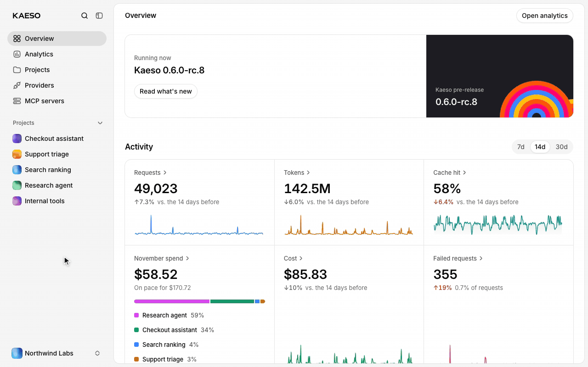
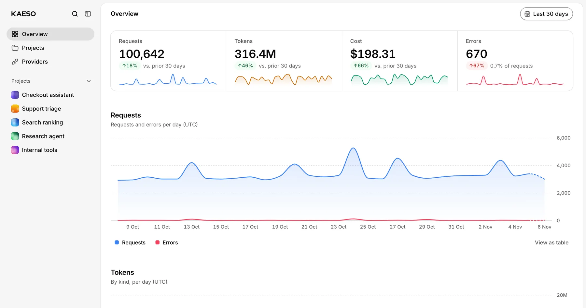
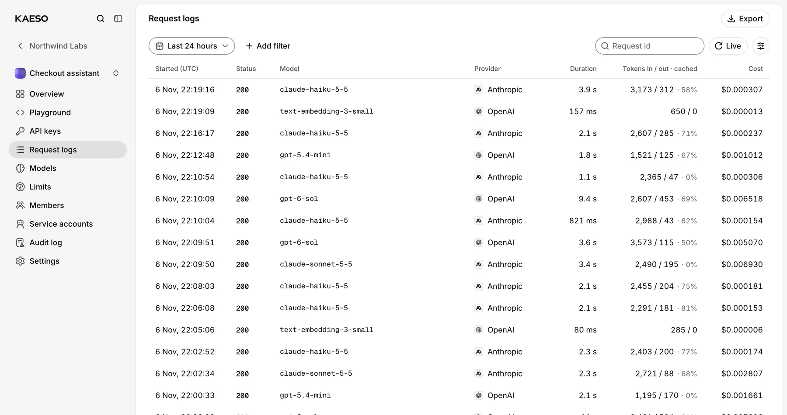
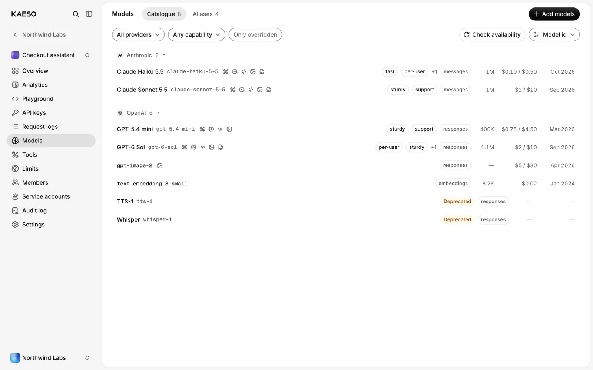
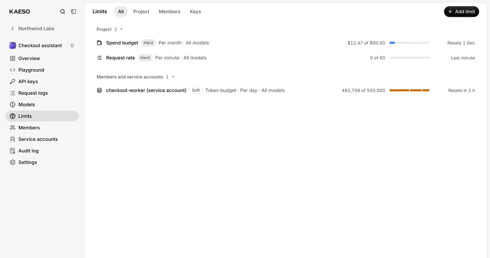
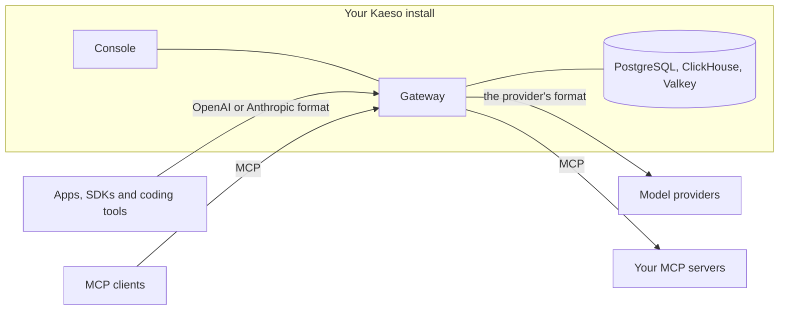

<div align="center">
  <br>
  <a href="https://kaeso.app">
    <picture>
      <source media="(prefers-color-scheme: dark)" srcset="https://raw.githubusercontent.com/logicplanes/kaeso/dev/.github/assets/kaeso-logo-dark.svg">
      
    </picture>
  </a>
  <br>
  <br>
  <h3>The open-source AI gateway you run yourself</h3>
  <p>One OpenAI- and Anthropic-compatible API in front of every provider, with single sign-on, roles, budgets, request logs and an MCP portal, in one Rust process.</p>
  <p>
    <a href="https://github.com/logicplanes/kaeso/actions/workflows/ci.yml"></a>
    <a href="https://scorecard.dev/viewer/?uri=github.com/logicplanes/kaeso"></a>
    <a href="https://www.bestpractices.dev/projects/15818"></a>
    <a href="LICENSE"></a>
  </p>
  <p>
    <a href="https://kaeso.app"><b>Website</b></a> ·
    <a href="https://docs.kaeso.app"><b>Documentation</b></a> ·
    <a href="https://demo.kaeso.app"><b>Live demo</b></a> ·
    <a href="https://github.com/logicplanes/kaeso/discussions"><b>Discussions</b></a> ·
    <a href="CHANGELOG.md"><b>Changelog</b></a>
  </p>
  <br>
</div>

<picture>
  <source media="(prefers-color-scheme: dark)" srcset="https://raw.githubusercontent.com/logicplanes/kaeso/dev/.github/assets/demo-dark.gif">
  
</picture>

## Install

On a server or your computer with Docker and Compose 2.24 or newer:

```sh
curl -fsSL https://kaeso.app/install.sh | sh
```

It installs Kaeso with PostgreSQL, ClickHouse and Valkey into `./kaeso`, starts it at `https://localhost` and prints the link that creates the first user. Add `-s -- --domain kaeso.example.com` to serve your own domain. The [quick start](https://docs.kaeso.app/get-started/quick-start) continues from there, and [install by hand](https://docs.kaeso.app/self-hosting/installation#install-by-hand) shows each step.

On a managed platform, the [platform templates](https://docs.kaeso.app/self-hosting/platforms) run the same release with the platform's TLS and databases:

<p align="center">
  <a href="https://render.com/deploy?repo=https://github.com/logicplanes/kaeso/tree/prod"><picture><source media="(prefers-color-scheme: dark)" srcset="https://raw.githubusercontent.com/logicplanes/kaeso/dev/.github/assets/badges/deploy-to-render-dark.svg"></picture></a>
  <a href="https://cloud.digitalocean.com/apps/new?repo=https://github.com/logicplanes/kaeso/tree/prod&refcode=881255e24b11"><picture><source media="(prefers-color-scheme: dark)" srcset="https://raw.githubusercontent.com/logicplanes/kaeso/dev/.github/assets/badges/deploy-to-digitalocean-dark.svg"></picture></a>
  <a href="https://console.aws.amazon.com/cloudformation/home#/stacks/create/review?templateURL=https%3A%2F%2Fkaeso-cloudformation.s3.amazonaws.com%2Flatest%2Fquick-server.yaml&stackName=kaeso"><picture><source media="(prefers-color-scheme: dark)" srcset="https://raw.githubusercontent.com/logicplanes/kaeso/dev/.github/assets/badges/launch-on-aws-dark.svg"></picture></a>
  <a href="https://shell.cloud.google.com/cloudshell/editor?cloudshell_git_repo=https://github.com/logicplanes/kaeso&cloudshell_git_branch=prod&cloudshell_workspace=deploy/gcp/quick-server"><picture><source media="(prefers-color-scheme: dark)" srcset="https://raw.githubusercontent.com/logicplanes/kaeso/dev/.github/assets/badges/open-in-cloud-shell-dark.svg"></picture></a>
</p>
<p align="center">
  <a href="https://docs.kaeso.app/self-hosting/platforms/render">Render</a> ·
  <a href="https://docs.kaeso.app/self-hosting/platforms/railway">Railway</a> ·
  <a href="https://docs.kaeso.app/self-hosting/platforms/digitalocean">DigitalOcean</a> ·
  <a href="https://docs.kaeso.app/self-hosting/platforms/aws">AWS</a> ·
  <a href="https://docs.kaeso.app/self-hosting/platforms/gcp">Google Cloud</a>
</p>

## Send your first request

Point the OpenAI SDK at Kaeso and call any model in your project, Claude included:

```python
from openai import OpenAI
client = OpenAI(base_url="https://kaeso.example.com/v1", api_key="sk-kso-…")
print(client.responses.create(model="claude-haiku-5-5", input="Hello").output_text)
```

The Anthropic SDK works the same way with `base_url="https://kaeso.example.com"`. Kaeso translates the request and the reply between the formats ([calling models](https://docs.kaeso.app/get-started/calling-models)).

## The console

Every page below is the [live demo](https://demo.kaeso.app), a read-only install with sample data.

<table>
  <tr>
    <td width="50%" valign="top">
      <picture>
        <source media="(prefers-color-scheme: dark)" srcset="https://raw.githubusercontent.com/logicplanes/kaeso/dev/.github/assets/console-overview-dark.webp">
        
      </picture>
      <p><b><a href="https://docs.kaeso.app/console/organizations-and-projects">Overview</a></b><br>Requests, tokens, cost and errors per organization and project, against the prior period.</p>
    </td>
    <td width="50%" valign="top">
      <picture>
        <source media="(prefers-color-scheme: dark)" srcset="https://raw.githubusercontent.com/logicplanes/kaeso/dev/.github/assets/console-logs-dark.webp">
        
      </picture>
      <p><b><a href="https://docs.kaeso.app/console/request-logs">Request logs</a></b><br>Every request with its model, status, tokens, cost, timing and caller, and its content if you keep it.</p>
    </td>
  </tr>
  <tr>
    <td width="50%" valign="top">
      <picture>
        <source media="(prefers-color-scheme: dark)" srcset="https://raw.githubusercontent.com/logicplanes/kaeso/dev/.github/assets/console-models-dark.webp">
        
      </picture>
      <p><b><a href="https://docs.kaeso.app/console/models-and-aliases">Models and aliases</a></b><br>A catalogue per project with prices and capabilities, and aliases that fall back to the next model when one fails.</p>
    </td>
    <td width="50%" valign="top">
      <picture>
        <source media="(prefers-color-scheme: dark)" srcset="https://raw.githubusercontent.com/logicplanes/kaeso/dev/.github/assets/console-limits-dark.webp">
        
      </picture>
      <p><b><a href="https://docs.kaeso.app/console/limits-and-budgets">Limits and budgets</a></b><br>Hard or soft spend, token and rate limits per project, member, service account or key, checked before the provider is called.</p>
    </td>
  </tr>
</table>

## How it works



<table>
  <tr>
    <td width="33%" valign="top"><b>Single sign-on and roles</b><br>Each organization signs in through its own OpenID Connect provider, for any number of people at no cost, with organization and project roles and single rights on top (<a href="https://docs.kaeso.app/console/members-and-roles">members and roles</a>).</td>
    <td width="33%" valign="top"><b>One format in, any provider out</b><br>Apps speak the OpenAI or Anthropic API; Kaeso decodes every request, encodes it for the provider and translates the reply and the stream back (<a href="https://docs.kaeso.app/concepts/format-translation">format translation</a>).</td>
    <td width="33%" valign="top"><b>Alias routes with fallbacks</b><br>An alias names the models behind it in order; a failing step is skipped for every gateway at once, and the next one answers (<a href="https://docs.kaeso.app/concepts/alias-routes">alias routes</a>).</td>
  </tr>
  <tr>
    <td width="33%" valign="top"><b>An MCP portal per project</b><br>Connect your own MCP servers once, review their tools, and let claude.ai, ChatGPT, Cursor or any MCP client call them through one signed-in portal (<a href="https://docs.kaeso.app/concepts/mcp-portal">MCP portal</a>).</td>
    <td width="33%" valign="top"><b>Verifiable releases</b><br>Every image and release file carries signed build provenance; <code>gh attestation verify</code> checks it, and the updater installs nothing whose signatures don't match (<a href="https://docs.kaeso.app/self-hosting/upgrades">upgrades</a>).</td>
    <td width="33%" valign="top"><b>Rust, and more gateways when you need them</b><br>One process with no garbage collector between your app and the provider; run several behind Caddy or a load balancer and they share everything a request depends on (<a href="https://docs.kaeso.app/self-hosting/scaling">multiple gateways</a>).</td>
  </tr>
</table>

## How it compares

Checked on 6 November 2026 against each project's repository and documentation. [Open an issue](https://github.com/logicplanes/kaeso/issues/new/choose) when a row is out of date.

|                                          | Kaeso               | LiteLLM                                                                           | Bifrost                                                 | Portkey Gateway                                                                                               |
| ---------------------------------------- | ------------------- | --------------------------------------------------------------------------------- | ------------------------------------------------------- | ------------------------------------------------------------------------------------------------------------- |
| Gateway written in                       | Rust                | Python                                                                            | Go                                                      | TypeScript                                                                                                    |
| License                                  | MIT                 | MIT, except [`enterprise/`](https://github.com/BerriAI/litellm/blob/main/LICENSE) | Apache 2.0                                              | MIT                                                                                                           |
| Single sign-on when self-hosted for free | Yes, OpenID Connect | Up to 5 users ([docs](https://docs.litellm.ai/docs/proxy/admin_ui_sso))           | Enterprise ([pricing](https://www.getmaxim.ai/pricing)) | Enterprise ([docs](https://portkey.ai/docs/product/enterprise-offering/org-management/sso))                   |
| Budgets when self-hosted for free        | Yes                 | Yes ([docs](https://docs.litellm.ai/docs/proxy/users))                            | Yes ([pricing](https://www.getmaxim.ai/pricing))        | Enterprise and some Pro plans ([docs](https://portkey.ai/docs/product/ai-gateway/virtual-keys/budget-limits)) |
| Web console when self-hosted             | Yes                 | Yes                                                                               | Yes                                                     | Request logs only ([README](https://github.com/Portkey-AI/gateway#readme))                                    |
| MCP portal for your own MCP servers      | Yes, per project    | Yes ([docs](https://docs.litellm.ai/docs/mcp))                                    | Yes ([docs](https://docs.getbifrost.ai/mcp/gateway))    | Yes ([docs](https://portkey.ai/docs/product/mcp-gateway))                                                     |

## Works with

| Tool                                                                                                                                                                                                                        | How                                                                                                                                                   |
| --------------------------------------------------------------------------------------------------------------------------------------------------------------------------------------------------------------------------- | ----------------------------------------------------------------------------------------------------------------------------------------------------- |
| [Claude Code](https://docs.kaeso.app/get-started/coding-tools#set-up-claude-code) and [Codex](https://docs.kaeso.app/get-started/coding-tools#set-up-codex)                                                                 | Kaeso is their model provider, so every session is logged and budgeted                                                                                |
| [Cursor](https://docs.kaeso.app/api/mcp#cursor) and Claude Code                                                                                                                                                             | Manage Kaeso through its MCP server, from keys to limits                                                                                              |
| [claude.ai](https://docs.kaeso.app/console/tools#connect-a-client), ChatGPT and any MCP client                                                                                                                              | Call your MCP servers' tools through a project's [MCP portal](https://docs.kaeso.app/concepts/mcp-portal)                                             |
| The [OpenAI SDK](https://docs.kaeso.app/get-started/calling-models) and the [Anthropic SDK](https://docs.kaeso.app/get-started/calling-models#use-the-anthropic-sdk), in any language, and anything with a base URL setting | Point the base URL at Kaeso; [supported providers](https://docs.kaeso.app/concepts/supported-providers) lists what each one can do through either API |

## In this repository

| Part                                                                          | What it is                                                                                                                  |
| ----------------------------------------------------------------------------- | --------------------------------------------------------------------------------------------------------------------------- |
| [`crates/`](crates)                                                           | The gateway, the updater and KPP, the protocol every request is decoded to; `kaeso-kpp` and `kaeso-codecs` are on crates.io |
| [`apps/console`](apps/console)                                                | The web console                                                                                                             |
| [`packages/ui`](packages/ui) and [`packages/tokens`](packages/tokens)         | The UI library and design tokens behind it, on npm, with a [showcase](https://ui.kaeso.app)                                 |
| [`apps/docs`](apps/docs)                                                      | The documentation at [docs.kaeso.app](https://docs.kaeso.app), in English, German and Chinese                               |
| [`deploy/`](deploy), [`render.yaml`](render.yaml) and [`.railway/`](.railway) | The Compose package, the container images and the templates for Render, Railway, AWS and Google Cloud                       |
| [`plugins/`](plugins)                                                         | The Claude Code and Cursor plugins for Kaeso's MCP server                                                                   |

[Architecture](https://docs.kaeso.app/development/architecture) explains how the parts fit, and [contributing](https://docs.kaeso.app/development/contributing) how to work in them.

## Community

- [Discussions](https://github.com/logicplanes/kaeso/discussions) for questions, ideas and what you built.
- [@kaesoapp on X](https://x.com/kaesoapp) for releases.
- [Good first issues](https://github.com/logicplanes/kaeso/issues?q=is%3Aissue%20state%3Aopen%20label%3A%22good%20first%20issue%22) to start contributing, with the [contributing guide](https://docs.kaeso.app/development/contributing).

## License

[MIT](LICENSE). The Kaeso name and logo are not covered by the license. All trademarks belong to their owners; Kaeso is not affiliated with any provider or client it names. Third-party notices, trademarks included, are in [NOTICE.md](NOTICE.md).
