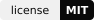

<div align="center">
  <br>
  <a href="https://kaeso.app"></a>
  <br>
  <br>
  <p>The open-source AI gateway you run yourself: one OpenAI- and Anthropic-compatible API in front of your providers, with keys, limits and logs under your control.</p>
  <p>
    <a href="https://github.com/logicplanes/kaeso/actions/workflows/ci.yml"></a>
    <a href="LICENSE"></a>
  </p>
  <p>
    <a href="https://kaeso.app">Website</a> ·
    <a href="https://docs.kaeso.app">Documentation</a> ·
    <a href="#quick-start">Quick start</a> ·
    <a href="CHANGELOG.md">Changelog</a>
  </p>
</div>

<br>


## Quick start

On a machine with Docker Compose, in an empty folder:

```sh
curl -fsSLO https://github.com/logicplanes/kaeso/releases/latest/download/compose.yaml
cat > .env <<EOF
KAESO_DOMAIN=localhost
KAESO_MAIL_TRANSPORT=log
POSTGRES_PASSWORD=$(openssl rand -hex 24)
POSTGRES_SUPERUSER_PASSWORD=$(openssl rand -hex 24)
CLICKHOUSE_PASSWORD=$(openssl rand -hex 24)
VALKEY_PASSWORD=$(openssl rand -hex 24)
EOF
docker run --rm ghcr.io/logicplanes/kaeso-gateway:latest master-key generate > master-keys
chmod 644 master-keys
docker compose up -d
```

Open the setup link that `docker compose logs gateway | grep setup_url` prints, connect a provider and create an API key. The [quick start](https://docs.kaeso.app/get-started/quick-start) walks through the first request and running on your own domain with email; the [self-hosting guide](https://docs.kaeso.app/self-hosting) covers everything after that.

## Development

Kaeso is one repository: a Cargo workspace for the gateway and KPP, and a pnpm workspace for the console, the UI library and the documentation. [Local setup](https://docs.kaeso.app/development/local-setup) takes a fresh clone to a running stack and passing tests, and [contributing](https://docs.kaeso.app/development/contributing) has the rules every change follows.

| Path              | What lives there                                                                                                           |
| ----------------- | -------------------------------------------------------------------------------------------------------------------------- |
| `crates/`         | The gateway (`kaeso`) and KPP, the format every request is translated through, published as `kaeso-kpp` and `kaeso-codecs` |
| `apps/console`    | The web console, served beside the gateway as `ghcr.io/logicplanes/kaeso-console`                                          |
| `apps/docs`       | The documentation at [docs.kaeso.app](https://docs.kaeso.app), in English, German and Simplified Chinese                   |
| `apps/showcase`   | The UI library's showcase at [ui.kaeso.app](https://ui.kaeso.app)                                                          |
| `packages/ui`     | `@logicplanes/kaeso-ui`, the React components every Kaeso interface is built from                                          |
| `packages/tokens` | `@logicplanes/kaeso-tokens`, every design value as CSS variables, a Tailwind theme and TypeScript constants                |
| `deploy/`         | The Compose package for self-hosting, the development stack and the container images                                       |
| `e2e/`            | The official OpenAI and Anthropic SDKs against KPP, the gateway and a fresh install                                        |

## License

[MIT](LICENSE). The Kaeso name and logo are not covered by the license. Third-party notices are in [NOTICE.md](NOTICE.md).
