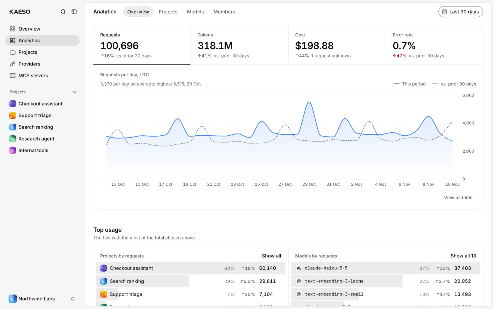
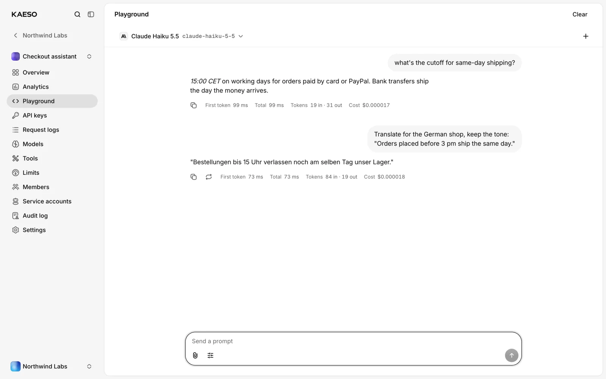
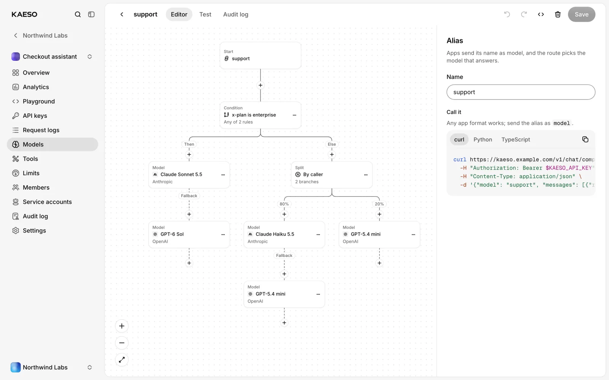
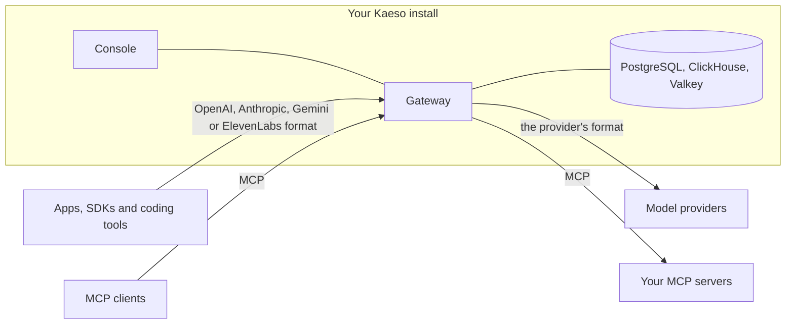

<div align="center">
  <br>
  <a href="https://kaeso.app">
    <picture>
      <source media="(prefers-color-scheme: dark)" srcset="https://raw.githubusercontent.com/logicplanes/kaeso/dev/.github/assets/kaeso-logo-dark.svg">
      
    </picture>
  </a>
  <br>
  <br>
  <h3>The open-source AI gateway you run yourself</h3>
  <p>One OpenAI-, Anthropic-, Gemini- and ElevenLabs-compatible API in front of every provider, for chat, embeddings, images, video, speech, transcription and music, with single sign-on, roles, budgets, alias routes, request logs, a playground and an MCP portal, in one Rust process.</p>
  <p>
    <a href="https://github.com/logicplanes/kaeso/actions/workflows/ci.yml"></a>
    <a href="https://scorecard.dev/viewer/?uri=github.com/logicplanes/kaeso"></a>
    <a href="https://www.bestpractices.dev/projects/15818"></a>
    <a href="LICENSE"></a>
  </p>
  <p>
    <a href="https://kaeso.app"><b>Website</b></a> ·
    <a href="https://docs.kaeso.app"><b>Documentation</b></a> ·
    <a href="https://demo.kaeso.app"><b>Live demo</b></a> ·
    <a href="https://github.com/logicplanes/kaeso/discussions"><b>Discussions</b></a> ·
    <a href="CHANGELOG.md"><b>Changelog</b></a>
  </p>
  <br>
</div>

<picture>
  <source media="(prefers-color-scheme: dark)" srcset="https://raw.githubusercontent.com/logicplanes/kaeso/dev/.github/assets/demo-dark.gif">
  
</picture>

## Install

On a server or your computer with Docker and Compose 2.24 or newer:

```sh
curl -fsSL https://kaeso.app/install.sh | sh
```

It installs Kaeso with PostgreSQL, ClickHouse and Valkey into `./kaeso`, starts it at `https://localhost` and prints the link that creates the first user. Add `-s -- --domain kaeso.example.com` to serve your own domain. The [quick start](https://docs.kaeso.app/get-started/quick-start) continues from there, and [install by hand](https://docs.kaeso.app/self-hosting/installation#install-by-hand) shows each step.

On a cloud or a hosting platform, the [platform templates](https://docs.kaeso.app/self-hosting/platforms) run the same release:

<p align="center">
  <a href="https://render.com/deploy?repo=https://github.com/logicplanes/kaeso/tree/prod"><picture><source media="(prefers-color-scheme: dark)" srcset="https://raw.githubusercontent.com/logicplanes/kaeso/dev/.github/assets/badges/deploy-to-render-dark.svg"></picture></a>
  <a href="https://railway.com/new/template/cmVV60?utm_medium=integration&utm_source=button&utm_campaign=kaeso"><picture><source media="(prefers-color-scheme: dark)" srcset="https://raw.githubusercontent.com/logicplanes/kaeso/dev/.github/assets/badges/deploy-on-railway-dark.svg"></picture></a>
  <a href="https://cloud.digitalocean.com/apps/new?repo=https://github.com/logicplanes/kaeso/tree/prod&refcode=881255e24b11"><picture><source media="(prefers-color-scheme: dark)" srcset="https://raw.githubusercontent.com/logicplanes/kaeso/dev/.github/assets/badges/deploy-to-digitalocean-dark.svg"></picture></a><br>
  <a href="https://console.aws.amazon.com/cloudformation/home#/stacks/create/review?templateURL=https%3A%2F%2Fkaeso-cloudformation.s3.amazonaws.com%2Flatest%2Fquick-server.yaml&stackName=kaeso"><picture><source media="(prefers-color-scheme: dark)" srcset="https://raw.githubusercontent.com/logicplanes/kaeso/dev/.github/assets/badges/launch-on-aws-dark.svg"></picture></a>
  <a href="https://portal.azure.com/#create/Microsoft.Template/uri/https%3A%2F%2Fraw.githubusercontent.com%2Flogicplanes%2Fkaeso%2Fprod%2Fdeploy%2Fazure%2Fquick-server.json/createUIFormUri/https%3A%2F%2Fraw.githubusercontent.com%2Flogicplanes%2Fkaeso%2Fprod%2Fdeploy%2Fazure%2FcreateUiDefinition.json"><picture><source media="(prefers-color-scheme: dark)" srcset="https://raw.githubusercontent.com/logicplanes/kaeso/dev/.github/assets/badges/deploy-to-azure-dark.svg"></picture></a>
  <a href="https://shell.cloud.google.com/cloudshell/editor?cloudshell_git_repo=https://github.com/logicplanes/kaeso&cloudshell_git_branch=prod&cloudshell_workspace=deploy/gcp/quick-server"><picture><source media="(prefers-color-scheme: dark)" srcset="https://raw.githubusercontent.com/logicplanes/kaeso/dev/.github/assets/badges/open-in-cloud-shell-dark.svg"></picture></a>
</p>
<p align="center">
  <a href="https://docs.kaeso.app/self-hosting/platforms/render">Render</a> ·
  <a href="https://docs.kaeso.app/self-hosting/platforms/railway">Railway</a> ·
  <a href="https://docs.kaeso.app/self-hosting/platforms/digitalocean">DigitalOcean</a> ·
  <a href="https://docs.kaeso.app/self-hosting/platforms/fly">Fly.io</a> ·
  <a href="https://docs.kaeso.app/self-hosting/platforms/aws">AWS</a> ·
  <a href="https://docs.kaeso.app/self-hosting/platforms/azure">Azure</a> ·
  <a href="https://docs.kaeso.app/self-hosting/platforms/gcp">Google Cloud</a> ·
  <a href="https://docs.kaeso.app/self-hosting/platforms/coolify">Coolify</a> ·
  <a href="https://docs.kaeso.app/self-hosting/platforms/dokploy">Dokploy</a> ·
  <a href="https://docs.kaeso.app/self-hosting/platforms/caprover">CapRover</a>
</p>

## Send your first request

Point the OpenAI SDK at Kaeso and call any model in your project, Claude included:

```python
from openai import OpenAI
client = OpenAI(base_url="https://kaeso.example.com/v1", api_key="sk-kso-…")
print(client.responses.create(model="claude-haiku-5-5", input="Hello").output_text)
```

The Anthropic SDK works the same way with `base_url="https://kaeso.example.com"`. Kaeso translates the request and the reply between the formats ([calling models](https://docs.kaeso.app/get-started/calling-models)).

Built in are Anthropic, Baseten, Cerebras, Cohere, DeepInfra, DeepSeek, ElevenLabs, Fireworks AI, Gemini Enterprise Agent Platform, Google AI Studio, Groq, Hugging Face, MiniMax, Mistral, Moonshot, Nebius Token Factory, NVIDIA, Ollama Cloud, OpenAI, OpenRouter, QwenCloud, SambaNova, Scaleway, SiliconFlow, SpaceX (xAI), Together AI, Vercel and Z.ai ([supported providers](https://docs.kaeso.app/concepts/supported-providers)). A server of your own, such as vLLM, Ollama, LM Studio or llama.cpp, joins as a [custom provider](https://docs.kaeso.app/console/custom-providers).

## The console

The pages below show the console with sample data. The [live demo](https://demo.kaeso.app) is a read-only install to try it yourself.

<table>
  <tr>
    <td width="50%" valign="top">
      <picture>
        <source media="(prefers-color-scheme: dark)" srcset="https://raw.githubusercontent.com/logicplanes/kaeso/dev/.github/assets/console-analytics-dark.webp">
        
      </picture>
      <p><b><a href="https://docs.kaeso.app/console/organizations-and-projects#read-usage">Analytics</a></b><br>Requests, tokens, cost and errors per organization, project, model and member, against the period before.</p>
    </td>
    <td width="50%" valign="top">
      <picture>
        <source media="(prefers-color-scheme: dark)" srcset="https://raw.githubusercontent.com/logicplanes/kaeso/dev/.github/assets/console-playground-dark.webp">
        
      </picture>
      <p><b><a href="https://docs.kaeso.app/console/playground">Playground</a></b><br>Try any model in the project, up to four side by side, for text, images, speech, music, transcription and video.</p>
    </td>
  </tr>
  <tr>
    <td width="50%" valign="top">
      <picture>
        <source media="(prefers-color-scheme: dark)" srcset="https://raw.githubusercontent.com/logicplanes/kaeso/dev/.github/assets/console-logs-dark.webp">
        
      </picture>
      <p><b><a href="https://docs.kaeso.app/console/request-logs">Request logs</a></b><br>Every request with its model, status, tokens, cost, timing and caller, and its content and media if you keep them.</p>
    </td>
    <td width="50%" valign="top">
      <picture>
        <source media="(prefers-color-scheme: dark)" srcset="https://raw.githubusercontent.com/logicplanes/kaeso/dev/.github/assets/console-models-dark.webp">
        
      </picture>
      <p><b><a href="https://docs.kaeso.app/console/models-and-aliases">Models</a></b><br>A catalogue per project with the prices and capabilities of every model from KPMR, the Kaeso Provider &amp; Model Registry.</p>
    </td>
  </tr>
  <tr>
    <td width="50%" valign="top">
      <picture>
        <source media="(prefers-color-scheme: dark)" srcset="https://raw.githubusercontent.com/logicplanes/kaeso/dev/.github/assets/console-aliases-dark.webp">
        
      </picture>
      <p><b><a href="https://docs.kaeso.app/concepts/alias-routes">Alias routes</a></b><br>Name the models behind an alias, with fallbacks, conditions on headers and tokens, and weighted splits.</p>
    </td>
    <td width="50%" valign="top">
      <picture>
        <source media="(prefers-color-scheme: dark)" srcset="https://raw.githubusercontent.com/logicplanes/kaeso/dev/.github/assets/console-limits-dark.webp">
        
      </picture>
      <p><b><a href="https://docs.kaeso.app/console/limits-and-budgets">Limits and budgets</a></b><br>Hard or soft spend, token and rate limits per project, member, service account or key, checked before the provider is called.</p>
    </td>
  </tr>
</table>

## How it works



<table>
  <tr>
    <td width="33%" valign="top"><b>Single sign-on and roles</b><br>Each organization signs in through its own OpenID Connect provider, for any number of people at no cost, with organization and project roles and single rights on top (<a href="https://docs.kaeso.app/console/members-and-roles">members and roles</a>).</td>
    <td width="33%" valign="top"><b>One format in, any provider out</b><br>Apps speak the OpenAI, Anthropic, Gemini or ElevenLabs API, for chat, images, audio and video; Kaeso decodes every request, encodes it for the provider and translates the reply and the stream back (<a href="https://docs.kaeso.app/concepts/format-translation">format translation</a>).</td>
    <td width="33%" valign="top"><b>Media through the same gateway</b><br>Images, video, speech, transcription, sound effects and music go through the same keys, limits, request logs and costs as chat, on every provider that makes them (<a href="https://docs.kaeso.app/api/images">images</a>, <a href="https://docs.kaeso.app/api/audio">audio</a>, <a href="https://docs.kaeso.app/api/videos">videos</a>).</td>
  </tr>
  <tr>
    <td width="33%" valign="top"><b>An MCP portal per project</b><br>Connect your own MCP servers once, review their tools, and let claude.ai, ChatGPT, Cursor or any MCP client call them through one signed-in portal (<a href="https://docs.kaeso.app/concepts/mcp-portal">MCP portal</a>).</td>
    <td width="33%" valign="top"><b>Verifiable releases</b><br>Every image and release file carries signed build provenance; <code>gh attestation verify</code> checks it, and the updater installs nothing whose signatures don't match (<a href="https://docs.kaeso.app/self-hosting/upgrades">upgrades</a>).</td>
    <td width="33%" valign="top"><b>Rust, and more gateways when you need them</b><br>One process with no garbage collector between your app and the provider; run several behind Caddy or a load balancer and they share everything a request depends on (<a href="https://docs.kaeso.app/self-hosting/scaling">multiple gateways</a>).</td>
  </tr>
</table>

## How it compares

Checked on 6 November 2026 against each project's repository and documentation. [Open an issue](https://github.com/logicplanes/kaeso/issues/new/choose) when a row is out of date.

|                                          | Kaeso               | LiteLLM                                                                           | Bifrost                                                 | Portkey Gateway                                                                                               |
| ---------------------------------------- | ------------------- | --------------------------------------------------------------------------------- | ------------------------------------------------------- | ------------------------------------------------------------------------------------------------------------- |
| Gateway written in                       | Rust                | Python                                                                            | Go                                                      | TypeScript                                                                                                    |
| License                                  | MIT                 | MIT, except [`enterprise/`](https://github.com/BerriAI/litellm/blob/main/LICENSE) | Apache 2.0                                              | MIT                                                                                                           |
| Single sign-on when self-hosted for free | Yes, OpenID Connect | Up to 5 users ([docs](https://docs.litellm.ai/docs/proxy/admin_ui_sso))           | Enterprise ([pricing](https://www.getmaxim.ai/pricing)) | Enterprise ([docs](https://portkey.ai/docs/product/enterprise-offering/org-management/sso))                   |
| Budgets when self-hosted for free        | Yes                 | Yes ([docs](https://docs.litellm.ai/docs/proxy/users))                            | Yes ([pricing](https://www.getmaxim.ai/pricing))        | Enterprise and some Pro plans ([docs](https://portkey.ai/docs/product/ai-gateway/virtual-keys/budget-limits)) |
| Web console when self-hosted             | Yes                 | Yes                                                                               | Yes                                                     | Request logs only ([README](https://github.com/Portkey-AI/gateway#readme))                                    |
| MCP portal for your own MCP servers      | Yes, per project    | Yes ([docs](https://docs.litellm.ai/docs/mcp))                                    | Yes ([docs](https://docs.getbifrost.ai/mcp/gateway))    | Yes ([docs](https://portkey.ai/docs/product/mcp-gateway))                                                     |

## Works with

| Tool                                                                                                                                                                                                                                                                                                                                                                    | How                                                                                                                                                      |
| ----------------------------------------------------------------------------------------------------------------------------------------------------------------------------------------------------------------------------------------------------------------------------------------------------------------------------------------------------------------------- | -------------------------------------------------------------------------------------------------------------------------------------------------------- |
| [Claude Code](https://docs.kaeso.app/get-started/coding-tools#set-up-claude-code) and [Codex](https://docs.kaeso.app/get-started/coding-tools#set-up-codex)                                                                                                                                                                                                             | Kaeso is their model provider, so every session is logged and budgeted                                                                                   |
| The Kaeso plugins for [Claude Code](https://docs.kaeso.app/api/mcp#claude-code) and [Cursor](https://docs.kaeso.app/api/mcp#cursor)                                                                                                                                                                                                                                     | Manage Kaeso through its MCP server, from keys to limits; the Claude Code plugin's skill connects the server for you                                     |
| [claude.ai](https://docs.kaeso.app/console/tools#connect-a-client), ChatGPT and any MCP client                                                                                                                                                                                                                                                                          | Call your MCP servers' tools through a project's [MCP portal](https://docs.kaeso.app/concepts/mcp-portal)                                                |
| The [OpenAI](https://docs.kaeso.app/get-started/calling-models), [Anthropic](https://docs.kaeso.app/get-started/calling-models#use-the-anthropic-sdk), [Google Gen AI](https://docs.kaeso.app/get-started/calling-models#use-the-google-gen-ai-sdk) and [ElevenLabs](https://docs.kaeso.app/api/elevenlabs) SDKs, in any language, and anything with a base URL setting | Point the base URL at Kaeso; [supported providers](https://docs.kaeso.app/concepts/supported-providers) lists what each provider can do through each API |

## In this repository

| Part                                                                                         | What it is                                                                                                                                                     |
| -------------------------------------------------------------------------------------------- | -------------------------------------------------------------------------------------------------------------------------------------------------------------- |
| [`crates/`](crates)                                                                          | The gateway, the updater and KPP, the protocol every request is decoded to; `kaeso-kpp` and `kaeso-codecs` are on crates.io                                    |
| [`apps/console`](apps/console)                                                               | The web console                                                                                                                                                |
| [`packages/ui`](packages/ui) and [`packages/tokens`](packages/tokens)                        | The UI library and design tokens behind it, on npm, with a [showcase](https://ui.kaeso.app)                                                                    |
| [`apps/docs`](apps/docs)                                                                     | The documentation at [docs.kaeso.app](https://docs.kaeso.app), in English, German and Chinese                                                                  |
| [`deploy/`](deploy), [`render.yaml`](render.yaml), [`.railway/`](.railway) and [`.do/`](.do) | The Compose package, the container images and the templates for Render, Railway, DigitalOcean, Fly.io, AWS, Azure, Google Cloud, Coolify, Dokploy and CapRover |
| [`plugins/`](plugins)                                                                        | The Claude Code and Cursor plugins for Kaeso's MCP server                                                                                                      |

[Architecture](https://docs.kaeso.app/development/architecture) explains how the parts fit, and [contributing](https://docs.kaeso.app/development/contributing) how to work in them.

## Community

- [Discussions](https://github.com/logicplanes/kaeso/discussions) for questions, ideas and what you built.
- [@kaesoapp on X](https://x.com/kaesoapp) for releases.
- [Good first issues](https://github.com/logicplanes/kaeso/issues?q=is%3Aissue%20state%3Aopen%20label%3A%22good%20first%20issue%22) to start contributing, with the [contributing guide](https://docs.kaeso.app/development/contributing).

## License

[MIT](LICENSE). The Kaeso name and logo are not covered by the license. All trademarks belong to their owners; Kaeso is not affiliated with any provider or client it names. Third-party notices, trademarks included, are in [NOTICE.md](NOTICE.md).
