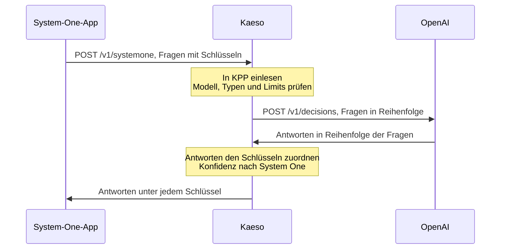

Apps stellen Entscheidungsmodellen über Kaeso typisierte Fragen und erhalten jede Antwort mit ihren Wahrscheinlichkeiten. Kaeso nimmt die Decisions-API von OpenAI, die System-One-API von TypeSafe und die Decisions-API von Gemini an und sendet jede Anfrage im eigenen Format des Anbieters an das Modell.

```bash tab="curl"
curl https://kaeso.example.com/v1/systemone \
  -H "Authorization: Bearer $KAESO_API_KEY" \
  -H "content-type: application/json" \
  -d '{"model": "gpt-6-luna", "state": "I was charged twice; please refund me.", "questions": {"refund": {"type": "noul", "instructions": "Does the customer ask for a refund?"}, "team": {"type": "choice", "instructions": "Which team handles it?", "criteria": {"billing": "Payments and refunds.", "support": "Everything else."}}}}'
```

```python tab="Python"
import os
from openai import OpenAI

client = OpenAI(base_url="https://kaeso.example.com/v1", api_key=os.environ["KAESO_API_KEY"])

decision = client.decisions.create(
    model="gpt-6-luna",
    input="I was charged twice; please refund me.",
    questions=[
        {"type": "predicate", "name": "refund", "instructions": "Does the customer ask for a refund?"},
        {"type": "choice", "name": "team", "instructions": "Which team handles it?",
         "choices": [{"value": "billing"}, {"value": "support"}]},
    ],
)
print(decision.answers[0].probability, decision.answers[1].choice)
```

```ts tab="TypeScript"
import OpenAI from "openai";

const client = new OpenAI({ baseURL: "https://kaeso.example.com/v1", apiKey: process.env.KAESO_API_KEY });

const decision = await client.decisions.create({
  model: "gpt-6-luna",
  input: "I was charged twice; please refund me.",
  questions: [
    { type: "predicate", name: "refund", instructions: "Does the customer ask for a refund?" },
    { type: "choice", name: "team", instructions: "Which team handles it?", choices: [{ value: "billing" }, { value: "support" }] },
  ],
});
console.log(decision.answers);
```

Das Python-SDK von TypeSafe und google-genai funktionieren genauso. Richten Sie den TypeSafe-Client auf die Wurzel von Kaeso aus und setzen Sie die API-Version von google-genai auf `v1beta`:

```python tab="TypeSafe SDK"
import os
from typesafe_sdk import TypeSafeClient

with TypeSafeClient(api_key=os.environ["KAESO_API_KEY"], base_url="https://kaeso.example.com") as client:
    decision = client.system_one(
        "I was charged twice; please refund me.",
        {"refund": {"type": "noul", "instructions": "Does the customer ask for a refund?"}},
        model="typesafe/jev-1.14",
    )
print(decision.answers["refund"].noul)
```

```python tab="google-genai"
import os
from google import genai
from google.genai import types

client = genai.Client(
    api_key=os.environ["KAESO_API_KEY"],
    http_options=types.HttpOptions(base_url="https://kaeso.example.com", api_version="v1beta"),
)
decision = client.decisions.create(
    model="gemini-decision-1",
    input="I was charged twice; please refund me.",
    questions={"refund": {"type": "noul", "instructions": "Does the customer ask for a refund?"}},
)
print(decision.answers["refund"].noul)
```

## Endpunkte

| Endpunkt | Format | Schlüssel | Body |
| --- | --- | --- | --- |
| `POST /v1/decisions` | Decisions-API von OpenAI | `Authorization: Bearer` | JSON: `model`, `input`, `questions`, `prompt_cache_key`, `prompt_cache_options`, `safety_identifier` |
| `POST /v1/systemone` | System-One-API von TypeSafe | `Authorization: Bearer` | JSON oder ein Upload, dessen erster Teil `request` das JSON enthält und dessen weitere Teile die Bilder, die `assets` nennt; gzip oder zstd |
| `POST /v1beta/decisions` | Decisions-API von Gemini | `x-goog-api-key` oder `?key=` | JSON: `model`, `input`, `questions` |

Antworten auf Entscheidungen werden nie gestreamt. Den Body jedes Endpunkts begrenzt [`body_limits.decisions`](../self-hosting/configuration.md#anfrage--und-antwortkörper), standardmäßig 64 MiB. Ein System-One-Body an `/v1/decisions`, wie ihn manche SDKs senden, wird mit 400 abgelehnt und auf `/v1/systemone` verwiesen; Kaeso errät ein Format nie aus der Form eines Bodys. `GET /v1/models` von TypeSafe wird nicht bedient: Kein Header unterscheidet sein SDK von dem von OpenAI, daher antwortet `/v1/models` in der Form von OpenAI und listet Entscheidungsmodelle wie jedes Modell.

Schlüssel, die Auflösung von Modellen mit Aliassen und Routen, Limits und Budgets, Anfrage-Logs und Fehler im Format der App funktionieren wie bei jeder anderen Modellanfrage.

## Wie eine Anfrage Formate wechselt

Jedes der drei Formate erreicht jedes Entscheidungsmodell, das Kaeso kennt. Kaeso liest die Anfrage in KPP ein, prüft sie gegen das Modell und seinen Anbieter und schreibt sie im Format des Anbieters. Die Antworten kommen in der Reihenfolge der Fragen zurück, unter den Namen der App.



Die Zuordnung jedes Felds, die Konfidenzregel jedes Formats und die Anpassungen stehen unter [Entscheidungen über Formate hinweg](../development/kpp/decisions-across-formats.md).

## Anbieter

Kaeso sendet Entscheidungen über die eigene Decisions-API jedes Anbieters, gleich welches Format die Chat-Anfragen des Modells nutzen.

| Anbieter | Gesendetes Format | Pfad | Hinweise |
| --- | --- | --- | --- |
| OpenAI | OpenAI Decisions | `/v1/decisions` | `gpt-6-luna`; höchstens 400 Fragen |
| Google AI Studio | Gemini Decisions | `/v1beta/decisions` | `gemini-decision-1`; Text, Bilder, Audio, Video und PDF |
| OpenRouter | System One | `/api/v1/systemone` | Bilder im State oder als Assets |
| Vercel AI Gateway | OpenAI Decisions | `/v1/decisions` | die Entscheidungsmodelle, die Vercel listet |
| Baseten | System One | `/v1/systemone` | Bilder in einer Nutzernachricht, höchstens 16; keine Box-Fragen |
| Fireworks AI | System One | `/inference/v1/systemone` | nur Text; keine Box-Fragen |
| Perplexity | System One | `/v1/decisions` | Decider-Modelle; Bilder als Data-URLs im State, höchstens 8; keine Box-Fragen |

Alle anderen Anbieter, Gemini Enterprise Agent Platform und eigene Anbieter haben in Kaeso noch keine Decisions-API. Eine Anfrage an einen von ihnen wird abgelehnt, bevor etwas gesendet wird, zum Beispiel „Anthropic offers no decisions API Kaeso can call, so `claude-haiku-4-5` can't make decisions.“. Ebenso eine Anfrage an OpenAI in einem Projekt, dessen OpenAI-Schlüssel ein [ChatGPT-Konto](../console/provider-keys.md#mit-einem-chatgpt-konto-anmelden) ist.

Entscheidungsmodelle kommen aus [KPMR](../concepts/kpmr.md#entscheidungsmodelle): Ein Modell der Art `decision` beantwortet nur Fragen, und ein Modell mit einem Eintrag `decisions`, etwa `gpt-6-luna`, erzeugt auch Text. Ein eigenes Modell bei einem Anbieter mit Decisions-API wird mit dem Feld `decisions` zum Entscheidungsmodell ([Modelle und Aliasse](../console/models-and-aliases.md#entscheidungsmodelle)).

## Was abgelehnt wird

Kaeso lehnt vor dem Senden ab, was das Modell oder sein Anbieter nicht annimmt, mit 400 im Format der App:

- ein Generierungsmodell: „The model `gpt-5.5` is a generation model; it can't answer decision questions.“;
- ein Fragetyp, den das Modell nicht beantwortet, etwa Box-Fragen, die nur Jev 1.14 von TypeSafe beantwortet;
- mehr Fragen, Optionen, Stufen oder Bilder, als das Modell annimmt;
- Bilder, Audio, Video oder PDF, die das Modell nicht annimmt;
- eine Bild-URL an einen Anbieter, der nur Daten annimmt: Senden Sie das Bild als Data-URL, denn Kaeso ruft nie URLs ab;
- ein Gespräch an System One oder Gemini: Senden Sie eine einzelne Nutzernachricht.

Ein reines Entscheidungsmodell lehnt Chat, Token-Zählung und Embeddings ab: „The model `gemini-decision-1` is a decision model; send it to `/v1/decisions` or `/v1/systemone`.“. Kaeso emuliert keine Entscheidungen auf Chat-Modellen und teilt keine Anfrage auf.

## Antworten, Anpassungen und weggelassene Hinweise

- **Konfidenz** bedeutet bei jedem Anbieter etwas anderes. Wechselt eine Antwort das Format, berechnet Kaeso sie aus den Wahrscheinlichkeiten nach der Regel des Formats der App; eine Antwort im eigenen Format des Anbieters behält dessen Wert.
- **Ablehnungen.** OpenAI kann einzelne Fragen ablehnen. Eine System-One-App erhält `{"type": "refusal"}` unter dem Schlüssel der Frage; eine Gemini-App, die keine Ablehnung pro Frage kennt, erhält 400 mit den abgelehnten Fragen.
- **`kaeso-adapted`** nennt, was der Anbieter nur in anderer Form annimmt: `names` (Fragen umbenannt in `q0`, `q1` und so weiter), `booleans` (Auswahlwerte `true` und `false` als Text), `levels`, `criteria` (Ja/Nein-Kriterien in die Anweisungen von OpenAI eingefügt), `state` (JSON-State als Text gesendet) und `instructions`.
- **`kaeso-left-out`** nennt Hinweise, für die das Format des Anbieters keinen Platz hat: `cache` (`prompt_cache_*` von OpenAI) und `user` (`safety_identifier`).

## Kosten, Cache und Logs

- **Kosten.** Eine Entscheidung kostet ihre Eingabe-, Cache-Lese- und Cache-Schreib-Tokens zu den Preisen des Modells. Ausgabe wird nie berechnet, auch nicht bei einem Modell mit Ausgabepreis; TypeSafe und Perplexity melden Ausgabe-Tokens, die nichts kosten. Ein Modell ohne Eingabepreis kostet **Unbekannt**, und [Budgets](../console/limits-and-budgets.md) lehnen es ab.
- **Nutzung.** Die gecachten und Cache-Schreib-Tokens von OpenAI werden getrennt gezählt, und die Bild-, Video- und Dokument-Tokens von Gemini zählen als Bild-Tokens, seine Audio-Tokens als Audio-Tokens.
- **Antwort-Cache.** Entscheidungen werden nie gestreamt, daher beantwortet der [Antwort-Cache](../console/response-cache.md) eine wiederholte Entscheidung wie eine wiederholte Chat-Anfrage.
- **Logs.** Das [Anfrageprotokoll](../console/request-logs.md) zeigt den Endpunkt, `decisions` oder `systemone`, die Fragen und jede Antwort mit ihren Wahrscheinlichkeiten. Bilder fehlen in der geloggten Anfrage, außer das Projekt behält Medien.

## Nächste Schritte

- [Entscheidungen über Formate hinweg](../development/kpp/decisions-across-formats.md): Sehen, wie jedes Feld zwischen den drei Formaten wechselt.
- [Modelle und Aliasse](../console/models-and-aliases.md): Entscheidungsmodelle hinzufügen und zwischen ihnen routen.
- [Anfrageprotokolle](../console/request-logs.md): Eine Entscheidung finden und ihre Antworten lesen.
