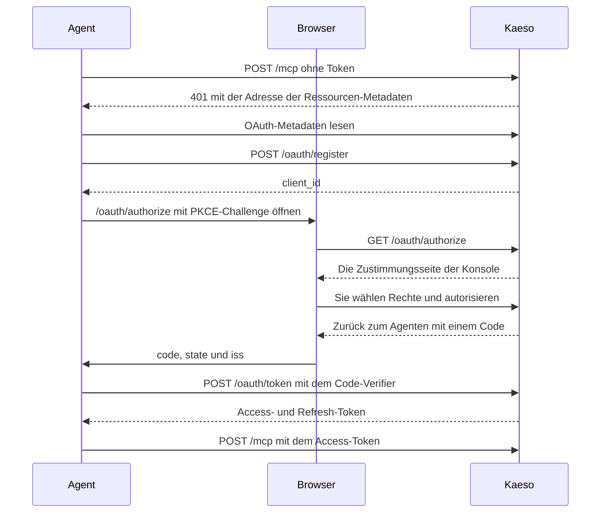

Über den MCP-Server verwaltet ein Agent wie Claude Code oder Codex Ihre Installation mit der Platform API. Der Agent meldet sich über Ihren Browser an, und Sie legen fest, was er darf. Der Server antwortet unter `/mcp` auf der Domain Ihrer Installation.

Fügen Sie ihn mit der Adresse Ihrer Installation zu Claude Code hinzu:

```bash
claude mcp add --transport http kaeso https://kaeso.example.com/mcp
```

Führen Sie dann `/mcp` in Claude Code aus und wählen Sie `kaeso`, um sich anzumelden. Ihr Browser öffnet die Konsole, die fragt, was der Agent darf. Nach **Autorisieren** stehen die Tools des Agenten bereit.

## Harnesses

Jede Harness unten meldet sich selbst per OAuth an. Sie findet die Anmeldung von Kaeso in der ersten Antwort des Servers, registriert sich und öffnet Ihren Browser, sodass Sie nie einen Schlüssel kopieren.

### Claude Code

Der Befehl oben fügt den Server dem aktuellen Projekt hinzu. Mit `--scope user` steht er in jedem Projekt bereit. `/mcp` meldet an, auch erneut, nachdem Sie den Agenten widerrufen haben.

### Codex

Fügen Sie den Server in `~/.codex/config.toml` hinzu:

```toml
[mcp_servers.kaeso]
url = "https://kaeso.example.com/mcp"
```

Melden Sie sich dann in einem Terminal an:

```bash
codex mcp login kaeso
```

### Cursor

Fügen Sie den Server in `.cursor/mcp.json` eines Projekts hinzu, oder in `~/.cursor/mcp.json` für jedes Projekt:

```json
{
  "mcpServers": {
    "kaeso": {
      "url": "https://kaeso.example.com/mcp"
    }
  }
}
```

Cursor führt den Server in seinen MCP-Einstellungen auf und bittet Sie dort um die Anmeldung.

### Gemini CLI

Fügen Sie den Server in `~/.gemini/settings.json` hinzu:

```json
{
  "mcpServers": {
    "kaeso": {
      "httpUrl": "https://kaeso.example.com/mcp"
    }
  }
}
```

Führen Sie dann `/mcp auth kaeso` in Gemini CLI aus.

### OpenCode

Fügen Sie den Server in `opencode.json` hinzu:

```json
{
  "$schema": "https://opencode.ai/config.json",
  "mcp": {
    "kaeso": {
      "type": "remote",
      "url": "https://kaeso.example.com/mcp"
    }
  }
}
```

OpenCode meldet sich an, wenn es den Server zum ersten Mal nutzt. Um sich vorher anzumelden, führen Sie `opencode mcp auth kaeso` aus.

### Andere Clients

Jeder MCP-Client, der Streamable HTTP und OAuth 2.1 mit dynamischer Client-Registrierung spricht, verbindet sich auf dieselbe Weise. Kaeso erkennt Claude Code, Codex, Cursor, Gemini CLI, OpenCode und Pi an dem Namen, den ihr Client registriert, und zeigt jeden anderen Client als Andere. Die Harness können Sie auf der Zustimmungsseite und später ändern.

## Anmeldung

Der Agent meldet sich als öffentlicher OAuth-Client mit PKCE an. Was er darf, entscheiden Sie in der Konsole:



Die Zustimmungsseite liegt unter `https://kaeso.example.com/authorize`, und die Konsole bittet Sie zuerst um die Anmeldung, falls Sie nicht angemeldet sind. Sie zeigt:

- Das Bild des Agenten und seinen Namen, den Sie ändern können.
- Seine **Harness**, erkannt an dem Namen, den sein Client registriert hat, die Sie ebenfalls ändern können.
- Die Vorlagen **Observer**, **Builder**, **Operator** und **Vollzugriff**, mit **Builder** ausgewählt, und eine Zusammenfassung in einfachen Worten, was die Auswahl erlaubt.
- **Ablauf**, wann die Anmeldung des Agenten endet: **7 Tage**, **30 Tage**, **90 Tage** oder **Nie**. **90 Tage** ist der Standard.
- **Anpassen**, das die Rechte jeder Ebene öffnet: **Instanz**, **Organisationen** und **Konto**.

**Autorisieren** schickt Ihren Browser mit einem Code zurück zum Agenten. **Ablehnen** schickt ihn mit `access_denied` zurück. Eine Anmeldeanfrage gilt 15 Minuten, ihr Code 5 Minuten.

## Rechte

Ein Agent handelt für den Benutzer, der ihn autorisiert hat. Bei jeder Anfrage erhält er nur die Rechte, die in allen vier hier enthalten sind:

1. Die Rechte, die Sie ihm gegeben haben.
2. Ihre eigenen Rechte von jetzt. Verlieren Sie ein Recht, verlieren es Ihre Agenten bei ihrer nächsten Anfrage.
3. Die Agenten-Richtlinie der Organisation.
4. Die Agenten-Richtlinie der Instanz.

Die Rechte, die Sie vergeben können, gibt es auf drei Ebenen:

| Ebene | Rechte | Wer sie vergeben kann |
| --- | --- | --- |
| Instanz | `instance.*` | Instanz-Admins, innerhalb der Agenten-Richtlinie der Instanz. Die Instanz-Vorlage ist **Keine**, **Lesen**, **Konfigurieren** oder **Admin** |
| Organisationen | Organisations- und Projektrechte aus dem Katalog der [Rechte](../concepts/rights.md#organisationsrechte) | Jedes Mitglied, innerhalb der Agenten-Richtlinie jeder Organisation |
| Konto | `account.*` | Alle. `account.view` ist immer an |

Unter **Organisationen** haken Sie jede Organisation an, in der der Agent handeln darf. **Auch Organisationen, denen ich später beitrete** gibt Organisationen, denen Sie danach beitreten, dieselbe Auswahl. Organisationen, in denen Sie jetzt Mitglied sind und die Sie nicht anhaken, bleiben ihm verschlossen. Wählen Sie in jeder Organisation ihre Organisationsrechte und entweder **Alle Projekte**, was später erstellte Projekte einschließt, oder einzelne Projekte mit eigenen Rechten.

[Agenten](../concepts/rights.md#agenten) listet, was jede Vorlage enthält, wie die Ebenen zusammenwirken und welche Rechte kein Agent erhält.

### Sensible Rechte

Die Konsole kennzeichnet sensible Rechte mit ⚠. Ein solches Recht zu vergeben, erfordert eine Anmeldung in den letzten 15 Minuten und eine Bestätigung in der Konsole. Danach nutzt der Agent es ohne eigene kürzliche Anmeldung: Sie haben beim Vergeben bestätigt.

### Ihre Anmeldung

Der Agent behält die Anmeldung, aus der Sie ihn autorisiert haben. Eine Organisation, die Single Sign-on oder Zwei-Faktor-Authentifizierung verlangt, lässt den Agenten nur herein, wenn diese Anmeldung die Anforderung erfüllt hat, wie bei Ihrer Sitzung.

### Fehlende Rechte

Braucht ein Tool ein Recht, das der Agent nicht hat, schlägt der Aufruf mit `insufficient_rights` und einem Link für Sie fehl:

```json wrap
{
  "error": {
    "type": "insufficient_rights",
    "right": "limits.manage",
    "message": "This agent doesn't have `limits.manage`; its user can grant it in the console.",
    "approve_url": "https://kaeso.example.com/settings/account/agents/agt_…?add=limits.manage&org=org_…&project=proj_…"
  }
}
```

Der Agent bittet Sie, den Link zu öffnen. Die Konsole bietet genau dieses Recht an, in dieser Organisation und diesem Projekt, und es gelten dieselben Regeln wie auf der Zustimmungsseite. Kaeso meldet die neuen Tools nicht, also listet der Agent sie danach erneut.

## Tools

Jede Operation der Platform API, die ein Agent nutzen kann, ist ein Tool, benannt nach ihrer Operation-ID in Snake Case. `GET /platform/v1/orgs/{org}/usage` ist `get_orgs_org_usage`.

- **Auflistung.** `tools/list` zeigt nur die Tools, die der Agent jetzt nutzen kann, in einer seiner Organisationen und Projekte.
- **Argumente.** Ein Tool nimmt die Pfadparameter der Operation, etwa `org` und `project`, ihre Query-Parameter und `body` für den Anfragekörper. Pfadparameter sind Pflicht, und Kaeso lehnt ein Argument ab, das das Tool nicht hat.
- **Ergebnisse.** Ein Tool antwortet mit dem JSON der Platform API als Text und als `structuredContent`. Eine Antwort über 200 KB wird gekürzt; fordern Sie mit `limit` eine kleinere Seite an.
- **Hinweise.** Lesende Tools tragen `readOnlyHint`, löschende `destructiveHint`.
- **Anweisungen.** Der Server weist den Agenten an, zuerst seine Organisationen mit `get_me_memberships` aufzulisten.

Diese Aktionen brauchen eine Konsolensitzung, daher hat kein Agent ein Tool dafür:

- Ihre Agenten und ihre Rechte sowie die Zustimmungsseite.
- Ihre Sitzungen, E-Mail-Adresse, Ihr Passwort, die Zwei-Faktor-Authentifizierung, Wiederherstellungscodes und Verknüpfungen mit Single Sign-on, eine Organisation erstellen und Ihr Konto löschen.
- Jemanden zum Instanz-Admin machen, Single Sign-on für Instanz-Admins, die Agenten-Richtlinie der Instanz und einen Benutzer oder eine Organisation sofort löschen.
- Die Agenten-Richtlinie einer Organisation und eine Organisation für einen Agenten schließen.
- Plattform-Schlüssel erstellen oder rotieren, Schlüssel mit Plattformzugriff erstellen und der Playground.

Ein Agent kann API-Schlüssel, die Modelle aufrufen, nur in Projekten erstellen, in denen er `api.request` hat.

## Protokoll

| Thema | Regel |
| --- | --- |
| Adresse | `POST https://kaeso.example.com/mcp` |
| Transport | Streamable HTTP mit einer JSON-RPC-Nachricht pro Anfrage, beantwortet mit JSON. Kaeso öffnet keinen Event-Stream: `GET` und `DELETE` erhalten 405 mit `Allow: POST` |
| Protokollversionen | `2025-11-25`, `2025-06-18` und `2025-03-26`. `initialize` erhält die Version des Clients, wenn Kaeso sie spricht, sonst die neueste |
| Methoden | `initialize`, `ping`, `tools/list` und `tools/call`. Benachrichtigungen erhalten 202 |
| Authentifizierung | `Authorization: Bearer kso_at_…` |
| `Origin` | Optional. Wenn gesendet, muss es der Origin Ihrer Installation oder einer aus `KAESO_CORS_ALLOWED_ORIGINS` sein |
| Body | Höchstens `KAESO_BODY_LIMITS_PLATFORM_API`, standardmäßig 1 MiB |

## Fehler

| Status | Wann |
| --- | --- |
| 400 | Der Body ist kein JSON (`-32700`), enthält einen Batch (`-32600`), oder `MCP-Protocol-Version` nennt eine Version, die Kaeso nicht spricht. |
| 401 | Kein Token oder eines, das beendet ist. `WWW-Authenticate` enthält `Bearer resource_metadata="https://kaeso.example.com/.well-known/oauth-protected-resource/mcp"`, bei einem beendeten Token mit `error="invalid_token"`. |
| 403 | Die Installation lässt keine Agenten zu, oder `Origin` nennt eine andere Website. |
| 405 | `GET` oder `DELETE` auf `/mcp`. |
| 413 | Der Body ist zu groß. |
| 503 | Kaeso erreicht seine Datenbank nicht. |

Eine unbekannte Methode erhält den JSON-RPC-Fehler `-32601`, ein unbekanntes Tool `-32602`. Ein fehlgeschlagener Tool-Aufruf antwortet 200 mit `isError: true` und dem Text `<type>: <message>`. Der Typ ist der [Fehlertyp](platform-api.md#fehler) der Platform API oder `insufficient_rights` für ein [fehlendes Recht](#fehlende-rechte).

## Tokens

| Token | Beginnt mit | Gilt |
| --- | --- | --- |
| Access-Token | `kso_at_` | 1 Stunde |
| Refresh-Token | `kso_rt_` | Bis die Anmeldung des Agenten endet. Jede Nutzung ersetzt es durch ein neues |
| Autorisierungscode | `kso_ac_` | 5 Minuten und eine Nutzung |

Wird ein Refresh-Token oder ein Code ein zweites Mal genutzt, endet diese ganze Anmeldung, denn eines davon muss abgeflossen sein. Jedes Token daraus hört auf zu funktionieren, und der Agent muss neu verbunden werden.

Ein Agent hört auf zu funktionieren, wenn seine Anmeldung endet, nach 90 Tagen ohne Anfrage oder wenn Sie ihn widerrufen. Auch das Deaktivieren seines Benutzers stoppt ihn, ebenso das Abschalten von Agenten für die Installation.

## OAuth-Endpunkte

Kaeso ist sein eigener Autorisierungsserver. Sein Issuer ist die öffentliche URL der Installation, etwa `https://kaeso.example.com` ([`KAESO_PUBLIC_URL`](../self-hosting/configuration.md#adressen)).

| Endpunkt | Tut |
| --- | --- |
| `GET /.well-known/oauth-protected-resource/mcp` | Die Ressourcen-Metadaten: die Adresse von `/mcp`, Kaeso als Autorisierungsserver und der Scope `kaeso`. Auch unter `/.well-known/oauth-protected-resource` |
| `GET /.well-known/oauth-authorization-server` | Die Metadaten des Autorisierungsservers: die Endpunkte unten, `S256` als einzige PKCE-Methode, nur öffentliche Clients (`none`) und `iss` in jeder Weiterleitung (RFC 9207) |
| `POST /oauth/register` | Registriert einen Client (RFC 7591) mit 1 bis 10 Weiterleitungs-URIs und antwortet mit seiner `client_id` (`cli_…`). Eine Weiterleitungs-URI nutzt HTTPS, eine Loopback-Adresse mit beliebigem Port oder ein privates Schema |
| `GET /oauth/authorize` | Nimmt `response_type=code`, `client_id`, `redirect_uri`, `state` und `code_challenge` mit `code_challenge_method=S256`. `scope` darf nur `kaeso` sein, und `resource` muss, wenn gesendet, die Adresse von `/mcp` sein |
| `POST /oauth/token` | Formularkodiert. `grant_type=authorization_code` mit `code`, `client_id`, `redirect_uri` und `code_verifier`, oder `grant_type=refresh_token` mit `refresh_token` und `client_id` |
| `POST /oauth/revoke` | Formularkodiertes `token`. Beendet die Anmeldung, zu der das Token gehört, und antwortet 200 auch für ein unbekanntes Token |

Eine Loopback-Weiterleitungs-URI darf ihren Port bei jeder Anmeldung ändern, wie RFC 8252 es erlaubt. Host und Pfad müssen wie registriert bleiben.

## Richtlinien

Zwei Richtlinien begrenzen jeden Agenten, und kein Agent kann sie ändern:

| Richtlinie | Einstellungen | Standard | Geändert von |
| --- | --- | --- | --- |
| Die der Instanz | Ob sich Agenten überhaupt anmelden dürfen, und das Höchste, was Agenten von Instanz-Admins auf der Instanz haben dürfen | An, **Konfigurieren** | Einem Instanz-Admin ([Instanzverwaltung](../console/instance-administration.md#agenten-zulassen)) |
| Die einer Organisation | Ob die Agenten von Mitgliedern in ihr handeln dürfen, und das Höchste, was sie dort haben dürfen | An, **Vollzugriff** | Einem Mitglied mit **Rollen zuweisen** ([Organisationen und Projekte](../console/organizations-and-projects.md#agenten-von-mitgliedern-zulassen)) |

Eine engere Richtlinie gilt für jeden Agenten ab seiner nächsten Anfrage. Sind Agenten für die Installation abgeschaltet, erhält jeder Agent 403. Sind sie für eine Organisation abgeschaltet, erhalten Agenten dort 403 und arbeiten anderswo weiter.

## Aktivität und Audit

Kaeso bewahrt jeden Tool-Aufruf eines Agenten 90 Tage auf: das Tool, sein Ziel, das Ergebnis, die Zeit und die IP-Adresse. Sie lesen ihn auf der Seite des Agenten unter **Konto** › **Agenten** ([Agenten verwalten](../console/account.md#agenten-verwalten)).

Eine Änderung durch einen Agenten landet wie jede andere im Audit-Log, mit der Akteursart `agent`. `actor.id` ist der Benutzer, für den er handelt, und `actor.agent` nennt ihn mit `id`, `name` und `harness`. `by_agents=true` listet nur Änderungen durch Agenten, im Audit-Log der Instanz, einer Organisation und eines Projekts.

| Aktion | Verzeichnet, wenn |
| --- | --- |
| `agent.authorize` | Sie einen Agenten autorisieren |
| `agent.update` | Sie einen Agenten umbenennen oder seine Harness oder seinen Ablauf ändern |
| `agent.rights_update` | Sie die Rechte eines Agenten ändern |
| `agent.revoke` | Sie einen Agenten widerrufen |
| `agent.org_access_revoke` | Ein Admin der Organisation sie für einen Agenten schließt |
| `instance.agents_policy` | Ein Instanz-Admin die Agenten-Richtlinie der Instanz ändert |
| `security.agents_policy` | Eine Organisation ihre Agenten-Richtlinie ändert |

## Routen der Platform API

Die Konsole verwaltet Agenten über diese Routen, in [`openapi.json`](platform-api.md#openapi-dokument) mit `agents` getaggt. Routen unter `me` brauchen eine Konsolensitzung.

| Route | Zugriff | Tut |
| --- | --- | --- |
| `GET me/agents`, `GET me/agents/{agent}` | Sitzung | Ihre Agenten, die neuesten zuerst, mit Harness, gemeldetem Modell, Client, Rechten (`grant`), Erstellung, letzter Nutzung und Ablauf |
| `PATCH me/agents/{agent}` | Sitzung | Ändert `name`, `harness` oder `expiry`: `7d`, `30d`, `90d` oder `never`, ab jetzt gezählt |
| `PUT me/agents/{agent}/rights` | Sitzung | Ersetzt die Rechte des Agenten. Ein sensibles Recht zu geben, das er nicht hatte, erfordert eine [kürzliche Anmeldung](platform-api.md#kürzliche-anmeldung) |
| `DELETE me/agents/{agent}` | Sitzung | Widerruft den Agenten. Seine Tokens hören sofort auf zu funktionieren |
| `GET me/agents/{agent}/activity` | Sitzung | Seine Tool-Aufrufe, die neuesten zuerst |
| `GET me/agents/catalogue` | Sitzung | Jedes Recht, das ein Agent erhalten kann, nach Ebene, die Vorlagen und ihre Obergrenzen, die Instanz-Vorlagen, die Rechte, die kein Agent erhält, und die Harnesses |
| `GET me/agents/grantable` | Sitzung | Was Sie einem Agenten jetzt geben könnten, in jeder Organisation und jedem Projekt |
| `POST me/agent-requests/view`, `…/approve`, `…/deny` | Sitzung | Die Zustimmungsseite. Jede nimmt den `request` aus `#request=` der Seite |
| `GET orgs/{org}/agents` | `members.view` | Die Agenten von Mitgliedern, die in der Organisation handeln dürfen |
| `DELETE orgs/{org}/agents/{agent}` | `members.rights.update`, Sitzung | Schließt die Organisation für den Agenten. Sein Mitglied kann sie wieder öffnen |
| `GET orgs/{org}/security/agents` | `org.view` | Die Agenten-Richtlinie der Organisation, `{"allowed": true, "max": "full"}` |
| `PUT orgs/{org}/security/agents` | `members.rights.update`, Sitzung | Setzt sie. `max` ist `observer`, `builder`, `operator` oder `full` |
| `GET instance/settings/agents` | `instance.system.view` | Die Agenten-Richtlinie der Instanz, `{"allowed": true, "max": "configure"}` |
| `PUT instance/settings/agents` | Instanz-Admin, Sitzung | Setzt sie. `max` ist `none`, `read`, `configure` oder `admin` |

Die Rechte eines Agenten sind ein `grant`, in jeder Route gleich, die sie liest oder setzt:

```json
{
  "preset": "builder",
  "customized": false,
  "instance": [],
  "account": ["account.view", "account.keys.view"],
  "orgs": [
    {
      "org": "org_…",
      "included": true,
      "rights": ["org.view", "usage.org.view"],
      "projects": {
        "all": true,
        "rights": ["project.view", "models.view"],
        "selected": []
      }
    }
  ],
  "future_orgs": null
}
```

- `orgs` hat einen Eintrag pro Organisation des Benutzers. Eine ausgelassene Organisation oder eine mit `"included": false` ist dem Agenten verschlossen.
- Mit `"all": false` listet `selected` Projekte als `{"project": "proj_…", "rights": […]}`, und andere Projekte bleiben verschlossen.
- `future_orgs` ist `null` oder `{"rights": […], "project_rights": […]}` für Organisationen, denen der Benutzer später beitritt.
- `customized` sagt, ob Rechte nach der Wahl der Vorlage geändert wurden. Die Konsole zeigt dann die Vorlage, von der sie ausgingen.
