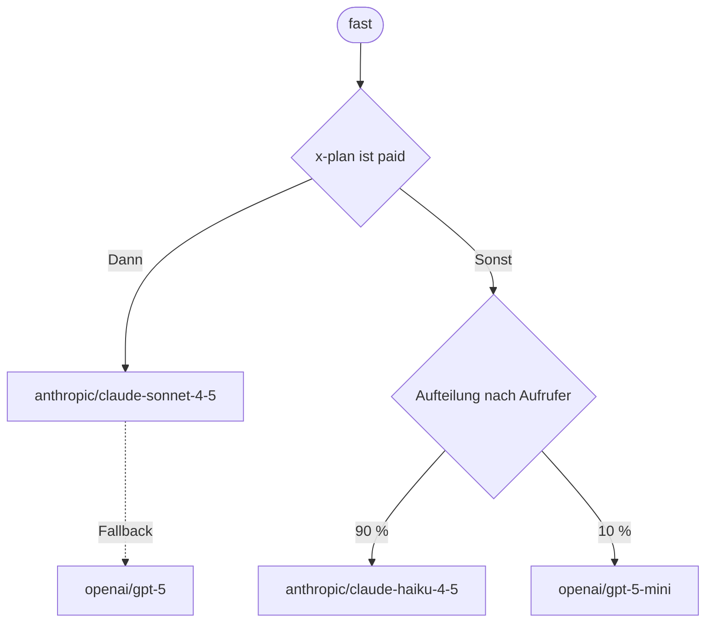

Ein Alias hält eine Route: die Schritte, die eine Anfrage nimmt, wenn eine App den Alias als `model` sendet. Eine Route kann auf ein anderes Modell ausweichen, wenn eines scheitert, nach dem verzweigen, was die Anfrage verlangt, und den Verkehr nach Gewicht auf Modelle aufteilen.



## Schritte

Eine Route ist ein Baum aus drei Arten von Schritten. Eine Route aus einem Modell ist der Alias, wie er immer war.

| Schritt | Was er tut |
| --- | --- |
| Modell | Ruft ein Modell aus dem Katalog des Projekts auf. Sein Fallback, ein Schritt beliebiger Art, übernimmt, wenn das Modell aus einem Grund scheitert, den der Schritt nennt |
| Bedingung | Nimmt `then`, wenn ihre Regeln für die Anfrage gelten, sonst `else`. `all` verlangt jede Regel, `any` eine davon |
| Aufteilung | Schickt jede Anfrage in einen von 2 bis 8 Zweigen, nach Gewichten von 1 bis 99 Prozent, die zusammen 100 ergeben |

Eine Route hat höchstens 32 Schritte und ist höchstens 12 Schritte tief. Jedes Modell, das sie nennt, muss beim Speichern im Katalog des Projekts sein.

## Bedingungen

Eine Bedingung hat 1 bis 10 Regeln. Jede Regel liest eine Angabe über die Anfrage:

| Feld | Gilt, wenn |
| --- | --- |
| `header` | Ein Anfrage-Header `equals`, `not_equals` oder `contains` einen Wert, oder `present` oder `absent` ist. Namen sind kleingeschrieben, Werte werden genau verglichen und haben bis zu 200 Zeichen. Ein zweimal gesendeter Header gilt für `equals` und `contains`, wenn einer der Werte passt |
| `format` | Das API-Format der App ist `in` oder `not_in` einer Liste: `openai_chat`, `openai_responses`, `anthropic_messages`, `openai_embeddings` |
| `feature` | Die Anfrage nutzt `images`, `pdfs`, `tools`, `reasoning`, `structured_output` (ein JSON-Schema) oder `streaming`, oder nicht |
| `input_tokens` | Die Eingabe hat `at_least` oder `below` eine Zahl von Tokens, geschätzt aus der Größe der Anfrage mit 4 Bytes je Token |
| `key`, `member`, `service_account` | Der API-Schlüssel, das Mitglied oder das Dienstkonto, das die Anfrage sendete, ist `in` oder `not_in` einer Liste von bis zu 100 |

Routen können `authorization`, `proxy-authorization`, `cookie`, `x-api-key`, `x-goog-api-key` und `api-key` nicht lesen, weil sie Zugangsdaten enthalten. Um nach Ihren eigenen Benutzern zu leiten, senden Sie aus Ihrer App einen Header wie `x-plan`.

## Aufteilungen

Eine Aufteilung zieht für jede Anfrage eine Zahl und nimmt den Zweig, dessen Gewicht sie abdeckt:

- `by: request` zieht für jede Anfrage neu, aus ihrer Anfrage-ID.
- `by: caller` hält jeden Aufrufer auf einem Zweig: den API-Schlüssel, sonst das Mitglied, sonst das Dienstkonto. Nutzen Sie das für A/B-Tests, damit eine App ein Modell sieht. Solange die Aufteilung ihren Platz in der Route behält, verschiebt eine Änderung der Gewichte nur die Aufrufer, deren Zahl eine neue Grenze überschreitet.
- `by: header` hält jeden Wert des in `header` genannten Headers auf einem Zweig, etwa `x-user-id` mit der ID Ihrer eigenen Nutzer, sodass jeder Ihrer Nutzer hinter einem API-Schlüssel ein Modell sieht. Anfragen ohne den Header werden jedes Mal neu gezogen.

## Fallbacks

Scheitert ein Modellschritt, wechselt Kaeso zu seinem Fallback, wenn `fall_back_on` des Schritts den Grund nennt. Jeder andere Fehler, und der Fehler des letzten Schritts, geht an die App zurück wie ohne Route.

| Grund | Fehler |
| --- | --- |
| `unavailable` | Der Anbieter ist nicht erreichbar, antwortet nicht rechtzeitig, ist überlastet oder antwortet mit 5xx; er lehnt den Anbieter-Schlüssel des Projekts ab oder bedient das Modell nicht; das Projekt hat keinen Anbieter-Schlüssel dafür |
| `limited` | Das Ratenlimit oder Kontingent des Anbieters (429), oder ein Kaeso-[Limit oder -Budget](../console/limits-and-budgets.md) für das Modell des Schritts: 429, oder 403 für ein Ausgabenbudget, das die Anfrage nicht bepreisen kann. Kann Kaeso die Limits gar nicht prüfen (503), weicht kein Schritt aus |
| `unsupported` | Das Modell kann etwas nicht annehmen, das die Anfrage nutzt, etwa Bilder, PDFs, Werkzeuge oder ein JSON-Schema. Kaeso weiß das aus dem Katalog, bevor es etwas sendet |
| `rejected` | Der Anbieter lehnt die Anfrage selbst ab: 400 oder 413, etwa ein zu langer Kontext oder Inhalt, den er filtert |

Ein Schritt weicht bei `unavailable`, `limited` und `unsupported` aus, wenn er keine anderen nennt. Nehmen Sie `rejected` nur für einen Fallback auf, der annehmen kann, was das erste Modell ablehnte, etwa ein Modell mit längerem Kontext.

`timeout_seconds` eines Schritts, 1 bis 3600, ist die Zeit, die Kaeso auf das erste Byte des Modells wartet, und auf eine nicht gestreamte Antwort, bevor der Schritt als `unavailable` scheitert. Ohne den Wert gilt das Zeitlimit des Modells.

Nichts weicht mehr aus, sobald der Anbieter geantwortet hat: Ein Stream, der später abbricht, endet mit einem Fehlerereignis, wie ohne Route.

### Übersprungene Schritte

- **Ein Modell, das der Schlüssel nicht nutzen darf.** Kaeso überspringt den Schritt, ohne ihn zu nennen, damit ein eingeschränkter Schlüssel nichts über die Route erfährt. Eine Anfrage, die keinen erlaubten Schritt findet, erhält 404, wie für ein unbekanntes Modell.
- **Ein aus dem Katalog entferntes Modell.** Kaeso überspringt den Schritt. Das Entfernen eines Modells löscht die Aliasse, die nur zu ihm führen; eine Route, die auch andere Modelle nutzt, behält es als Schritt, den die `models`-Liste des Alias ohne `target` zeigt. Bleibt kein anderer Schritt, erhält die Anfrage 404: ``The alias `fast` has no model left for this request; ask a project admin.`` Umbenennen lässt sich der Alias weiterhin; um seine Route zu ändern, ersetzen oder entfernen Sie zuerst diesen Schritt.

## Limits, Kosten und der Cache

- Jeder Schritt, den eine Anfrage versucht, zählt gegen die Limits seines Modells, Anfrageraten eingeschlossen. Ein Schritt, der scheitert, gibt zurück, was er von einem Budget hielt, bevor der nächste Schritt fragt.
- Nutzung und Kosten sind die des antwortenden Schritts, zu den Preisen seines Modells. Gescheiterte Schritte kosten in Kaeso nichts. Ein Anbieter kann eine Anfrage trotzdem abrechnen, an der er arbeitete, bevor ein Schritt sein Zeitlimit erreichte.
- Der [Antwort-Cache](../console/response-cache.md) wird für das Modell jedes Schritts befragt, also antwortet eine gecachte Antwort jedes Schritts.

## Was Apps und Protokolle sehen

- `kaeso-model` und `kaeso-provider` nennen den Schritt, der antwortete, oder den, der zuletzt scheiterte.
- `kaeso-route` nennt jeden Schritt, den die Anfrage erreichte, der Reihe nach mit seinem Pfad in der Route, wie ein Probelauf ihn nennt, mit Modell und Status und, wenn er scheiterte, seiner Dauer in Millisekunden: `"route";model="anthropic/claude-sonnet-4-5";status=529;dur=1204, "route.fallback";model="openai/gpt-5";status=200`. Ein übersprungener Schritt trägt `skipped` und kein Modell ([Antwort-Header](../api/model-api.md#antwort-header)).
- Das [Anfrageprotokoll](../console/request-logs.md) hält den Alias als angefragtes Modell fest und listet die Schritte, die es zuerst versuchte, jeden mit Status, Fehler und Dauer.
- `/v1/models` listet den Alias mit den Angaben seines Hauptmodells: die `then`-Seite von Bedingungen und der schwerste Zweig von Aufteilungen. Darf der Schlüssel dieses Modell nicht nutzen, zeigt der Alias das erste andere Modell, das er nutzen darf.
- `kaeso_alias_fallbacks_total{provider, reason}` zählt die Schritte, die auswichen ([Zustand und Metriken](../self-hosting/monitoring.md)).

## Eine Route testen

Ein Probelauf schickt eine Anfrage durch eine Route, ohne ein Modell aufzurufen oder etwas zu protokollieren: Er zeigt jede Bedingung mit den Regeln, die zutrafen, die Zahl, die jede Aufteilung zieht, und den Zweig, den sie nimmt, und jedes Modell, das die Anfrage der Reihe nach versuchen würde. Die Route muss nicht gespeichert sein. In der Konsole nutzen Sie den Tab **Testen** des Alias ([Modelle und Aliasse](../console/models-and-aliases.md#eine-route-testen)); per Skript senden Sie die Route und die Merkmale der Anfrage an die Plattform-API:

```bash
curl -X POST "https://kaeso.example.com/platform/v1/orgs/$ORG/projects/$PROJECT/aliases/trace" \
  -H "Authorization: Bearer $KAESO_PLATFORM_KEY" \
  -H "Content-Type: application/json" \
  -d '{
    "alias": "alias_01k7a3f8m2xq4v9c5r6t8w0yz3",
    "route": {
      "type": "model",
      "model": "model_01k7a3f8m2xq4v9c5r6t8w0yz1",
      "fallback": { "type": "model", "model": "model_01k7a3f8m2xq4v9c5r6t8w0yz2" }
    },
    "request": {
      "headers": [{ "name": "x-plan", "value": "enterprise" }],
      "format": "openai_chat",
      "input_tokens": 1200
    }
  }'
```

Mit `alias` ziehen Aufteilungen nach Aufrufer und nach Header so wie für die Anfragen dieses Alias. Aufteilungen, die je Anfrage ziehen, nehmen `seed` anstelle der ID der Anfrage, sodass derselbe `seed` dieselben Zweige zieht. Agenten bekommen denselben Probelauf als lesendes Tool ([MCP](../api/mcp.md)).

Um eine echte Anfrage durch eine Route zu senden, gespeichert oder nicht, geben Sie der Anfrage des [Playgrounds](../console/playground.md) die Route als `route`, den Alias, den sie bearbeitet, als `alias` und die Header als `headers` mit. Die Anfrage läuft als Sie, wird abgerechnet und mit der Quelle `playground` protokolliert, und ihr Header `kaeso-route` zeigt jeden Schritt, den sie versuchte.

## Eine Route setzen

In der Konsole bauen Sie die Route auf der Seite des Alias ([Modelle und Aliasse](../console/models-and-aliases.md#alias-erstellen)). Per Skript senden Sie sie als `route`, wenn Sie einen Alias über die [Plattform-API](../api/platform-api.md) erstellen oder ändern. Dieser Alias versucht Claude Sonnet, und GPT-5, wenn Sonnet nicht verfügbar oder durch ein Ratenlimit begrenzt ist:

```bash
curl -X PATCH "https://kaeso.example.com/platform/v1/orgs/$ORG/projects/$PROJECT/aliases/$ALIAS" \
  -H "Authorization: Bearer $KAESO_PLATFORM_KEY" \
  -H "Content-Type: application/json" \
  -d '{
    "route": {
      "type": "model",
      "model": "model_01k7a3f8m2xq4v9c5r6t8w0yz1",
      "fall_back_on": ["unavailable", "limited"],
      "fallback": { "type": "model", "model": "model_01k7a3f8m2xq4v9c5r6t8w0yz2" }
    }
  }'
```

Anfragen nehmen die neue Route sofort. Eine Route, die Kaeso ablehnt, nennt das Feld im `param` des Fehlers, etwa `route.fallback.model`; ein Probelauf lehnt dieselben Routen ab.

## Nächste Schritte

- [Modelle und Aliasse](../console/models-and-aliases.md): Nehmen Sie Modelle in den Katalog auf und geben Sie ihnen Aliasse.
- [Ablauf einer Anfrage](request-flow.md): Sehen Sie jede Prüfung, die eine Anfrage durchläuft, und welchen Fehler sie erhält.
- [Limits und Budgets](../console/limits-and-budgets.md): Begrenzen Sie ein Modell, damit seine Anfragen zu einem Fallback wechseln.
