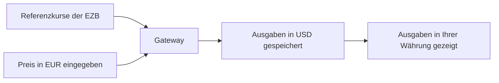

Kaeso speichert und berechnet jeden Preis und alle Kosten in US-Dollar, damit Limits, Protokolle, Exporte und die Platform API genau bleiben und sich addieren lassen. Andere Währungen erscheinen nur an zwei Rändern: wo Sie einen Preis eingeben und wo Sie Ausgaben lesen.

## Woher die Kurse kommen

Die Kurse sind die [Euro-Referenzkurse](https://www.ecb.europa.eu/stats/policy_and_exchange_rates/euro_reference_exchange_rates/html/index.en.html) der Europäischen Zentralbank, etwa 30 Währungen gegen den Euro. Die EZB veröffentlicht sie an jedem Arbeitstag gegen 16:00 MEZ.

- **Täglicher Abruf.** Das Gateway holt sie im Hintergrund und prüft alle sechs Stunden erneut; ein fehlgeschlagener Abruf wird nach 15 Minuten wiederholt. Anfragen warten nie darauf.
- **Erster Abruf.** Eine Installation ohne Kurse holt die letzten 90 Tage, sodass jüngere Ausgaben zu den Kursen ihrer eigenen Tage umgerechnet werden.
- **Kurse je US-Dollar.** Ein Kurs je US-Dollar ist ein Kreuzkurs desselben Tages: der EZB-Kurs der Währung geteilt durch ihren Kurs des US-Dollar, auf 12 Nachkommastellen.
- **Behaltene Kurse.** Schlägt ein Abruf fehl, behält Kaeso seine Kurse, und die Konsole zeigt ihr Datum. Eine Installation ohne Kurse, etwa eine ohne Internetzugang, bietet nur US-Dollar an.

Instanz-Admins schalten den Abruf unter **Wechselkurse** in der [Instanzverwaltung](../console/instance-administration.md#installationseinstellungen-ändern) aus; die schon geholten Kurse bleiben. Betreiber lenken ihn mit `exchange_rates.url` auf einen Spiegel ([Konfiguration](../self-hosting/configuration.md#wechselkurse)).

## Preise in einer anderen Währung

Die Preise eines Modells können eine `currency` tragen, etwa `EUR`, wo Sie sie von Hand setzen: in Überschreibungen eines Modells im Projekt und in eigenen Modellen, auch denen eigener Anbieter. Ohne sie sind Preise in US-Dollar.

- **Wie eingegeben.** Das Modell behält 2,50 € als 2,50 €, und sein Blatt in der Konsole zeigt den Gegenwert in US-Dollar daneben.
- **In US-Dollar berechnet.** Jede Anfrage wird zum neuesten Kurs berechnet, also kosten 2,50 € je Million Token 2,7535 $ bei 1,1014 Dollar je Euro. Umgerechnete Preise behalten neun Nachkommastellen.
- **Kein Kurs, kein Preis.** Eine Währung braucht einen Kurs, wenn Sie sie eingeben. Fehlt ihr Kurs später, zeigen Anfragen zu diesen Preisen unbekannte Kosten statt falscher.

Preise von KPMR bleiben in US-Dollar. Ausgabenbudgets und Warnungen bleiben ebenfalls in US-Dollar, weil ein Budget in einer anderen Währung seine Bedeutung mit dem Kurs ändern würde.

## Ausgaben in einer anderen Währung

Wählen Sie eine Währung unter **Darstellung** in Ihrem Konto oder mit dem Währungsmenü in **Analysen** und **Anfrageprotokolle**. Die Wahl wird in Ihrem Konto gespeichert; `USD` zeigt nur US-Dollar.

- **Eine Schätzung.** Ausgaben stehen zuerst in US-Dollar, mit dem Betrag in Ihrer Währung daneben, etwa `≈ 12,40 €`.
- **Der Kurs jedes Tages.** Eine Summe rechnet die Ausgaben jedes Tages zu dessen Kurs um, ein Wochenende oder einen Feiertag zu dem des Arbeitstags davor. Tage vor den ältesten Kursen nutzen den neuesten, und die Seite sagt das.
- **Das Format Ihrer Sprache.** Symbol, seine Stellung und die Trennzeichen folgen Ihrer Sprache, etwa `€12.40` auf Englisch und `12,40 €` auf Deutsch.

In der Platform API nehmen die Nutzungs-Endpunkte und das Anfrageprotokoll `currency=EUR` und ergänzen `converted_cost`, und `GET /platform/v1/me/exchange-rates` listet die Kurse ([Platform API](../api/platform-api.md)).

## Nächste Schritte

- [Modelle und Aliasse](../console/models-and-aliases.md): Überschreiben Sie die Preise eines Modells, in US-Dollar oder einer anderen Währung.
- [Limits und Budgets](../console/limits-and-budgets.md): Setzen Sie Ausgabenbudgets, die in US-Dollar bleiben.
- [KPMR](kpmr.md): Erfahren Sie, woher die Modellpreise in US-Dollar kommen.
