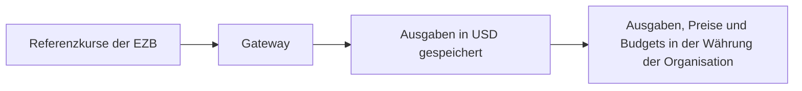

Jede Organisation hat eine Währung, US-Dollar, solange ein Owner oder Admin keine andere setzt. Die Konsole zeigt jeden Betrag der Organisation darin: Ausgaben, Modellpreise und Ausgabenbudgets. Darunter speichert und berechnet Kaeso jeden Preis und alle Kosten in US-Dollar, damit Limits, Protokolle und die Platform API genau bleiben und sich addieren lassen, und rechnet dort zu den täglichen Kursen der Europäischen Zentralbank um, wo Menschen Beträge lesen und eingeben.

## Die Währung der Organisation wählen

Unter **Organisationseinstellungen** › **Allgemein** listet **Währung** US-Dollar und jede Währung, für die die Installation einen Kurs hat, jeweils mit ihrem Namen. Sie zu ändern braucht **Organisation bearbeiten** und landet im Audit-Log; alle Mitglieder sehen die neue Währung sofort. Eine Installation ohne Kurse bietet nur US-Dollar an und sagt, warum.

## Woher die Kurse kommen

Die Kurse sind die [Euro-Referenzkurse](https://www.ecb.europa.eu/stats/policy_and_exchange_rates/euro_reference_exchange_rates/html/index.en.html) der Europäischen Zentralbank, etwa 30 Währungen gegen den Euro. Die EZB veröffentlicht sie an jedem Arbeitstag gegen 16:00 MEZ.

- **Täglicher Abruf.** Das Gateway holt sie im Hintergrund und prüft alle sechs Stunden erneut; ein fehlgeschlagener Abruf wird nach 15 Minuten wiederholt. Anfragen warten nie darauf.
- **Erster Abruf.** Eine Installation ohne Kurse holt die letzten 90 Tage, sodass jüngere Ausgaben zu den Kursen ihrer eigenen Tage umgerechnet werden.
- **Kurse je US-Dollar.** Ein Kurs je US-Dollar ist ein Kreuzkurs desselben Tages: der EZB-Kurs der Währung geteilt durch ihren Kurs des US-Dollar, auf 12 Nachkommastellen.
- **Behaltene Kurse.** Schlägt ein Abruf fehl, behält Kaeso seine Kurse, und die Konsole zeigt ihr Datum. Eine Währung, die die EZB nicht mehr listet, behält ihren letzten Kurs.

Instanz-Admins schalten den Abruf unter **Wechselkurse** in der [Instanzverwaltung](../console/instance-administration.md#installationseinstellungen-ändern) aus; die schon geholten Kurse bleiben. Betreiber lenken ihn mit `exchange_rates.url` auf einen Spiegel ([Konfiguration](../self-hosting/configuration.md#wechselkurse)).

## Ausgaben

Analysen, die Übersichten, die Aufschlüsselungen, die Anfrageprotokolle, der Playground, geteilte Links und die wöchentlichen und monatlichen Kosten-E-Mails zeigen Ausgaben in der Währung der Organisation, etwa `12,40 €`.

- **Der Kurs jedes Tages.** Ausgaben werden zum Kurs des Tages umgerechnet, an dem sie anfielen, ein Wochenende oder Feiertag zu dem des Arbeitstags davor; eine Summe addiert die Beträge der einzelnen Tage. Tage vor den ältesten Kursen nutzen den neuesten, und Analysen sagt, welche Kurse genutzt wurden.
- **Das Format Ihrer Sprache.** Symbol, seine Stellung und die Trennzeichen folgen Ihrer Sprache, etwa `€12.40` auf Englisch und `12,40 €` auf Deutsch.
- **Downloads.** Die CSV einer Aufschlüsselung und der CSV-Export des Anfrageprotokolls haben die Kosten in der Währung der Organisation, nach ihrem Code benannt, und daneben die Kosten in US-Dollar für die Buchhaltung.

Die Seiten der Instanz, die über Organisationen hinweg reichen, bleiben in US-Dollar.

## Preise

Preise von KPMR sind in US-Dollar; die Konsole zeigt sie zum neuesten Kurs in der Währung der Organisation.

Wo Sie Preise von Hand setzen, in Überschreibungen eines Modells im Projekt und in eigenen Modellen, beginnt der Editor in der Währung der Organisation, und **Währung** nimmt jede andere Währung mit Kurs. Preise werden wie eingegeben behalten und zum neuesten Kurs in US-Dollar berechnet, also kosten 2,50 € je Million Token 2,7535 $ bei 1,1014 Dollar je Euro; umgerechnete Preise behalten neun Nachkommastellen. Eine Währung braucht einen Kurs, wenn Sie sie eingeben, und fehlt ihr Kurs später, zeigen Anfragen zu diesen Preisen unbekannte Kosten statt falscher.

## Ausgabenbudgets

Ein Ausgabenbudget wird in der Währung der Organisation gesetzt, gezeigt und gespeichert. Kaeso prüft es zum neuesten Kurs in US-Dollar, also lehnt ein Budget von 40 € Anfragen ab, sobald die Ausgaben des Monats erreichen, was 40 € an diesem Tag wert sind. Eine neue Währung der Organisation rechnet jedes Ausgabenbudget ihrer Projekte zum neuesten Kurs auf den Cent um und schreibt jedes ins Audit-Log. Budgetwarnungen und ihre E-Mails nennen das Budget in seiner Währung.

## In der Platform API

`GET /platform/v1/orgs/{org}` liefert `currency`, und `PATCH` setzt sie. Die Nutzungs- und Zeitverlauf-Endpunkte, das Anfrageprotokoll und geteilte Links geben jede `cost` in US-Dollar und `converted_cost` in der `currency` der Organisation an. `amount` und `used` eines Ausgabenbudgets sind in seiner `currency`, und der Filter `min_cost` des Anfrageprotokolls nimmt einen Betrag in der Währung der Organisation. `GET /platform/v1/me/exchange-rates` listet die Kurse ([Platform API](../api/platform-api.md)).

## Nächste Schritte

- [Organisationen und Projekte](../console/organizations-and-projects.md#organisationseinstellungen-ändern): Setzen Sie die Währung der Organisation.
- [Modelle und Aliasse](../console/models-and-aliases.md): Überschreiben Sie die Preise eines Modells.
- [Limits und Budgets](../console/limits-and-budgets.md): Setzen Sie Ausgabenbudgets in der Währung der Organisation.
