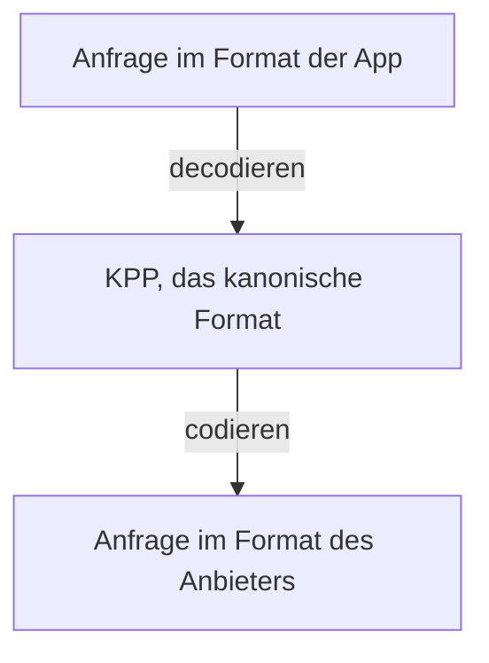

Ihre App kann jedes Chat-Modell in ihrem eigenen Format aufrufen: Das OpenAI SDK kann Claude aufrufen und das Anthropic SDK ein OpenAI-Modell. Diese Seite zeigt Ihnen, was dabei erhalten bleibt, was Kaeso ablehnt und wie sich Reasoning-Einstellungen zwischen den Anbietern übertragen.

KPP, das Kaeso Provider Protocol, hat einen Codec für jedes API-Format: OpenAI Chat Completions, Responses und Embeddings sowie Anthropic Messages. Die Antwort nimmt denselben Weg zurück, bei einem Stream Event für Event. Embeddings gehen nur an die Embeddings-Modelle von OpenAI. Die [Modell-API](../api/model-api.md) listet die Endpunkte jedes Formats.

## Drei Regeln

1. **Gleiches Format, kein Verlust.** Eine Anfrage, die den Anbieter im selben Format erreicht, in dem sie kam, kommt so an, wie sie gesendet wurde. Nur der Modellname wird zur Modell-ID des Anbieters. Ein Stream fordert immer die Nutzung an, doch die App sieht sie nur, wenn sie danach gefragt hat.
2. **Ablehnen, nie weglassen.** Wechselt eine Anfrage das Format, lehnt Kaeso ein Feld, das das Ziel nicht umsetzen kann, mit einem Fehler ab, der es nennt. Weg lässt es nur Hinweise, die nicht ändern, was das Modell schreibt.
3. **Signiertes Reasoning geht nur nach Hause.** Verschlüsseltes oder signiertes Reasoning sendet Kaeso nur an das Format und den Anbieter zurück, die es ausgegeben haben.

## Was erhalten bleibt

- **Unterhaltungen.** Systemanweisungen, Züge von Benutzer und Assistent, Text, Bilder und Dokumente. Eine Systemnachricht mitten in einer Anthropic-Unterhaltung erreicht OpenAI als spätere Systemnachricht.
- **Tools.** Funktions-Tools, Tool-Auswahl, parallele Tool-Aufrufe, Tool-Aufrufe und Tool-Ergebnisse.
- **Tool-Namen und Aufruf-IDs.** Nimmt das Ziel einen Namen oder eine ID nicht an, schreibt Kaeso sie auf feste Weise um und übersetzt sie in der Antwort zurück. Andere Zeichen werden zu `_`, der Name wird passend gekürzt, und ein Hash des Originals wird angehängt. OpenAI nimmt bis zu 64 Buchstaben, Ziffern, `_` und `-` an, Anthropic bis zu 128.
- **Strukturierte Ausgabe.** JSON-Schemas.
- **Sampling.** Temperatur, Top P, maximale Tokens und Stoppsequenzen, wo das Ziel sie hat. Ein Wert behält seine Bedeutung, wird aber so geschrieben, wie das Ziel ihn schreibt. `1` kann also als `1.0` ankommen.
- **Die ID des Endnutzers.** `metadata.user_id` bei Anthropic und `safety_identifier` bei OpenAI.
- **Reasoning.** Aufwandsstufen und Denk-Budgets werden ineinander umgerechnet ([Reasoning](#reasoning)).
- **Streams.** Kaeso übersetzt sie Event für Event in das Format der App.

## Was Kaeso ablehnt

Wechselt eine Anfrage das Format, lehnt Kaeso Folgendes mit einem Fehler ab, der das Feld nennt.

### Anfragen an Anthropic

- `seed`, Frequency- und Presence-Penalties und eine Temperatur über 1
- das Ausgabeformat `json_object` und ein JSON-Schema mit einer Beschreibung oder mit `strict: false`
- Systemnachrichten mitten in einer Unterhaltung aus einem anderen Format und Verweigerungen im Verlauf
- Bilder außer JPEG, PNG, GIF und WebP und Dokumente außer PDF und reinem Text
- die Aufwandsstufe `minimal`

### Anfragen an OpenAI Chat Completions

- `top_k` und mehr als vier Stoppsequenzen
- Textdokumente, Dokument-URLs, Dokumenttitel, Kontext und Zitate
- Bild-Datei-IDs sowie Bilder und Dokumente außerhalb von Benutzernachrichten

### Anfragen an OpenAI Responses

- `top_k`, `seed`, Penalties und Stoppsequenzen
- Textdokumente, Dokumenttitel, Kontext und Zitate

### Anfragen an jeden Anbieter

Diese lehnt Kaeso in jedem Format ab, auch wenn das Format gleich bleibt:

- mehr als eine Auswahl (`n`)
- Audio-Eingaben von Chat Completions (`input_audio`)
- gespeicherter Zustand: `store: true`, `previous_response_id`, `conversation` und `background`

### Anfragen über Formate hinweg

- Felder des App-Formats, für die KPP keinen Platz hat, etwa `logprobs`, `logit_bias` und `service_tier` von Chat Completions
- das veraltete Function Calling von Chat Completions: `functions`, `function_call` und `function`-Nachrichten
- eingebaute Tools eines anderen Formats, etwa die Websuche, und ihre Ergebnisse
- Zitate und Datei-IDs eines anderen Anbieters

## Was Kaeso weglässt

Hat das Ziel keinen Platz für sie, lässt Kaeso Hinweise weg, die nicht ändern, was das Modell schreibt:

- Cache-Hinweise und Prompt-Cache-Keys
- Beta- und Versions-Header
- Bilddetail und Dateinamen
- `thinking.display` von Anthropic und Kontextverwaltung von Anthropic, die nur früheres Denken entfernt
- das Fehler-Flag eines Tool-Ergebnisses, das OpenAI nicht kennt; der Text des Ergebnisses sagt weiterhin, was fehlschlug

Anfragen, die in Responses übersetzt werden, tragen `store: false`, sodass OpenAI nichts speichert.

## Reasoning

So rechnet Kaeso Reasoning-Einstellungen um:

| Von der App | Nach | Wird zu |
| --- | --- | --- |
| Ein Denk-Budget | OpenAI | Eine Aufwandsstufe: unter 4.096 Tokens `low`, 4.096 bis 16.383 `medium`, ab 16.384 `high` |
| Ausgeschaltetes Denken | OpenAI | Die Aufwandsstufe `none` |
| Eine Aufwandsstufe von `low` bis `max` | Claude mit adaptivem Denken | Adaptives Denken mit dieser Aufwandsstufe |
| Eine Aufwandsstufe von `low` bis `max` | Claude ohne adaptives Denken | Ein Budget: `low` 2.048, `medium` 8.192, `high`, `xhigh` und `max` 24.576 Tokens |
| Die Aufwandsstufe `none` | Claude | Keine Einstellung zum Denken; das Modell denkt nur, wenn es das standardmäßig tut |

- **Aufwandsstufe und Budget.** Eine Aufwandsstufe hat Vorrang vor einem Budget in derselben Anfrage. Ein Claude-Modell hat kein adaptives Denken, wenn sein Katalogeintrag das sagt. Claude 4.5 und früher haben keines.
- **Ein Budget anpassen.** Kaeso passt ein Budget an die Regeln von Anthropic an: mindestens 1.024 Tokens und weniger als `max_tokens`. Ist `max_tokens` 1.024 oder kleiner, beträgt das Budget 1.024, und Kaeso erhöht `max_tokens` um 1.024, damit die Antwort ihren Platz behält.
- **Denken und Sampling.** Schaltet Kaeso das Denken von Claude für eine Anfrage aus einem anderen Format ein, lässt es `temperature`, `top_p` und `top_k` weg. Anthropic lehnt sie zusammen mit Denken ab. Die eigenen Einstellungen einer Anthropic-App gehen so hinaus, wie sie kamen.
- **Erzwungene Tool-Aufrufe.** Anthropic lehnt Denken mit Budget zusammen mit einem erzwungenen Tool-Aufruf ab (`required` oder ein benanntes Tool). Kaeso sendet die Anfrage dann ohne Denken. Adaptives Denken behält das erzwungene Tool.
- **Tool-Züge von anderswo.** Bei eingeschaltetem Denken mit Budget enthalten die Tool-Aufrufe des letzten Assistenten-Zugs vielleicht kein Denken, das Claude wiedergeben kann, etwa weil ein anderer Anbieter sie erzeugt hat. Kaeso sendet die Anfrage dann ohne Denken. Adaptives Denken bleibt eingeschaltet.
- **Wann Reasoning eingeschaltet wird.** Der Katalog sagt, ob ein Modell Reasoning nutzt (models.dev `reasoning`). Bei einem solchen Modell schaltet `reasoning: {summary: "auto"}` ohne Aufwandsstufe das Denken von Claude in seiner Standardtiefe ein: adaptives Denken oder das Budget von 8.192 Tokens. Eine Anthropic-App, die Denken ohne Aufwandsstufe einschaltet, erhält das verschlüsselte Reasoning von OpenAI für den nächsten Zug zurück. Kaeso schaltet Reasoning nie für ein Modell ein, das kein Reasoning nutzt oder von dem das nicht bekannt ist. Eine Anfrage, die bei einem solchen Modell eine Aufwandsstufe, Denken oder ein Budget verlangt, lehnt Kaeso ab.

## Reasoning zwischen Zügen

Reasoning von einem anderen Anbieter kommt im eigenen Format der App zurück, mit dem Original darin verpackt, damit die App es zurücksenden kann. Eine Responses-App erhält ein Reasoning-Item, das es in `encrypted_content` enthält. Eine Anthropic-App erhält einen `thinking`-Block, der es in `signature` enthält.

Sendet die App es zurück, stellt KPP das Original für den Anbieter wieder her, der es geschrieben hat. Übersetzte Anfragen mit einer anderen Aufwandsstufe als `none` fordern von OpenAI sein verschlüsseltes Reasoning an, damit auch dieses zurückkommen kann.

### Chat Completions

Chat Completions hat kein Feld für Reasoning. Bedient Claude oder ein OpenAI-Modell über Responses eine Chat-Completions-App, behält das Gateway das Reasoning vor jedem Tool-Aufruf. Es fügt dieses Reasoning wieder ein, wenn die App das Tool-Ergebnis sendet, sodass das Modell seinen Gedankengang durch Tool-Schleifen behält.

- Das Gateway hält es für `KAESO_CONTINUITY_REASONING_TTL` in Valkey, standardmäßig 1 Stunde, und `0s` schaltet es ab. Es ist mit dem Hauptschlüssel verschlüsselt, nur mit dem API-Schlüssel lesbar, der die Anfrage gestellt hat, und wird nie protokolliert.
- Reasoning nach dem letzten Tool-Aufruf behält es nicht, ebenso wenig Reasoning aus einem fehlgeschlagenen Stream.
- Ist das Reasoning weg, weil es abgelaufen ist, ein anderer Schlüssel den Zug sendet oder Valkey nicht erreichbar ist, läuft die Anfrage ohne es weiter.

Die Metrik `kaeso_reasoning_continuity_total` zählt behaltenes, wiederhergestelltes, fehlendes und nicht verfügbares Reasoning ([Zustand und Metriken](../self-hosting/monitoring.md)).

### Lesbares Reasoning

Was eine App vom Reasoning sieht, folgt dem, was sie in ihrem eigenen Format anfordert:

- Eine Responses-App, die `reasoning.summary` setzt, erhält das Denken von Claude als Reasoning-Zusammenfassungen, gestreamt als `response.reasoning_summary_text.delta`-Events. Das Gateway fordert von Claude zusammengefasstes Denken an, das Claude Opus 4.7 und später sonst verbergen.
- Eine Anthropic-App mit eingeschaltetem Denken erhält die Reasoning-Zusammenfassungen eines OpenAI-Modells als Denk-Text. Das Gateway fordert sie bei OpenAI an, es sei denn, die App hat `thinking.display` auf `omitted` gesetzt. OpenAI kann Zusammenfassungen für Organisationen verweigern, die es nicht verifiziert hat, und Kaeso gibt seinen Fehler weiter.
- Eine Chat-Completions-App sieht kein Reasoning.
