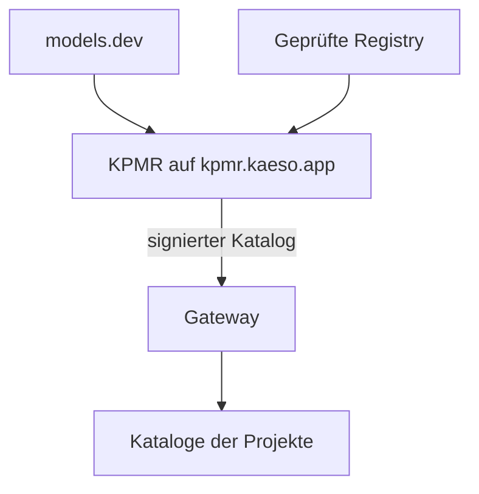
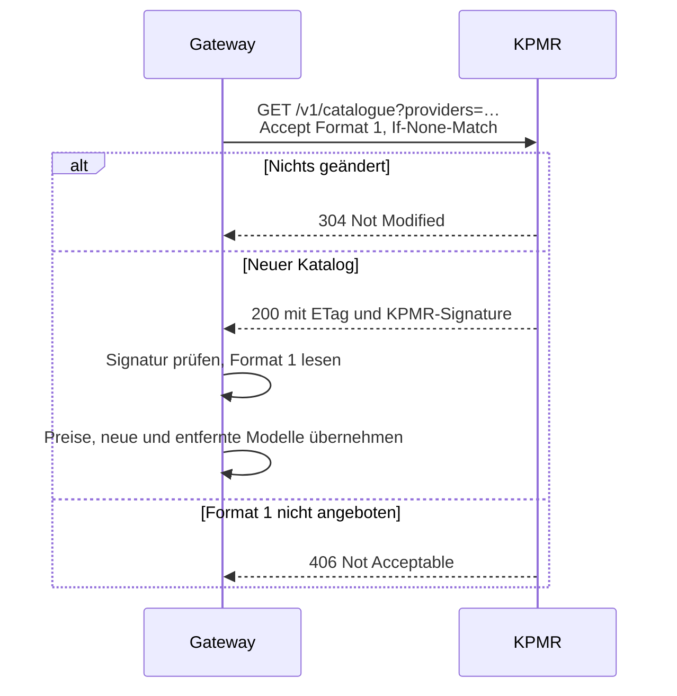

Jedes Modell im Katalog eines Projekts beginnt mit den Werten aus KPMR, der Kaeso Provider & Model Registry: Preise, Limits, Ein- und Ausgaben und was das Modell annimmt. Wenn Sie wissen, woher sie kommen, verstehen Sie, warum sich ein Preis von selbst ändert und wie Sie Kaeso ohne Internetzugang betreiben.



## Was KPMR ist

KPMR ist ein Dienst, den Logicplanes unter [kpmr.kaeso.app](https://kpmr.kaeso.app) betreibt. Alle zehn Minuten ruft er [models.dev](https://models.dev) ab, die offene, MIT-lizenzierte Modelldatenbank, wendet seine eigene geprüfte Registry an und liefert das Ergebnis als ein Dokument aus, den **KPMR-Katalog**. Die Website zeigt außerdem jeden Anbieter und jedes Modell, die Änderungen und woher jeder Wert kommt.

## Warum Kaeso eine eigene Registry hat

models.dev umfasst Hunderte Anbieter und bleibt die Grundlage von KPMR. Ein Gateway braucht aber mehr als eine Liste: Es rechnet Budgets zu diesen Preisen ab und lehnt Anfragen ab, die ein Modell nicht annimmt. KPMR ergänzt, was Kaeso braucht:

- **Korrekturen und Überschreibungen.** Ein falscher Preis, ein falsches Limit oder eine falsche Fähigkeit wird zuerst in KPMR korrigiert, und die Korrektur erreicht jede Installation bei ihrer nächsten Prüfung.
- **Ergänzungen und Entfernungen.** KPMR kann ein Modell oder einen Anbieter aufnehmen, den models.dev noch nicht führt, und eines weglassen, das es nicht anbieten sollte.
- **Fakten für das Gateway.** Ob ein Claude-Modell adaptives Thinking oder eine erzwungene Tool-Wahl annimmt, welche Aufwandsstufen es kennt, den Preis für Ein-Stunden-Cache-Schreibvorgänge und in welchem API-Format Kaeso ein Modell aufruft.

Jeder Eintrag der Registry nennt seine Quellen, etwa die Dokumentation eines Anbieters oder eine aufgezeichnete Live-Anfrage, und Sie können sie auf der Seite des Modells auf kpmr.kaeso.app lesen. Wo KPMR einen Wert setzt, gilt er vor models.dev; alles andere ist der Wert von models.dev, wie er ist.

## Der Katalog

Der Katalog ist ein JSON-Dokument in Kaesos eigenem Format, versioniert durch eine Formatnummer. Er nennt in `provider_ids` jede Anbieter-ID, die KPMR kennt und die ein [eigener Anbieter](../console/custom-providers.md) nicht nehmen darf, und die Anbieter, nach denen das Gateway gefragt hat, mit ihren Modellen:

```json
{
  "format": 1,
  "revision": "2026-10-31T21:40:12Z-3f9c2a7b1d04",
  "generated_at": "2026-10-31T21:40:12Z",
  "refresh_seconds": 3600,
  "provider_ids": ["302ai", "alibaba", "anthropic"],
  "providers": {
    "anthropic": {
      "id": "anthropic",
      "name": "Anthropic",
      "models": {
        "claude-opus-5-5": {
          "id": "claude-opus-5-5",
          "kind": "generation",
          "status": "active",
          "limits": { "context": 1000000, "input": null, "output": 128000 },
          "pricing": { "unit": "usd_per_million_tokens", "input": "5", "output": "25", "cache_read": "0.5", "cache_write": "6.25", "cache_write_1h": "10" },
          "capabilities": { "tool_call": true, "forced_tool_choice": false, "structured_output": true, "temperature": false },
          "reasoning": { "efforts": ["low", "medium", "high", "xhigh", "max"], "adaptive_thinking": true, "thinking_binding": true },
          "gateway": { "egress_dialect": null },
          "origin": "models_dev",
          "corrected": ["capabilities.forced_tool_choice", "reasoning.adaptive_thinking", "reasoning.thinking_binding"]
        }
      }
    }
  }
}
```

- **Jeder Schlüssel ist vorhanden.** Ein unbekannter Wert ist `null`, sodass Kaeso „unbekannt“ von „nein“ unterscheiden kann.
- **Preise sind exakte Dezimalzahlen als Strings** in US-Dollar je Million Token, nie Gleitkommazahlen. `cache_write_1h` ist der Preis eines Cache-Schreibvorgangs, der eine Stunde gilt, wo der Anbieter einen dokumentiert.
- **`gateway.egress_dialect`** nennt das API-Format, in dem Kaeso das Modell aufruft, wenn es nicht das Standardformat des Anbieters ist.
- **`origin`** sagt, ob ein Modell von models.dev kommt oder von KPMR ergänzt wurde, und **`corrected`** nennt die Felder, die KPMR gesetzt hat.
- **Unbekannte Schlüssel werden ignoriert.** Ein neues Feld im Format 1 stört ein älteres Gateway nicht; eine Änderung, die es stören würde, wird Format 2.

## Wie das Gateway ihn abruft

Ein Job prüft alle fünf Minuten, ob das Gateway KPMR wieder fragen muss. Steht `kpmr.interval` auf `auto`, folgt es `refresh_seconds` des Katalogs, gehalten zwischen 5 Minuten und 24 Stunden; eine Dauer wie `6h` ersetzt es. Nach einem fehlgeschlagenen Versuch fragt das Gateway innerhalb einer Stunde erneut.



Die Anfrage nennt die Anbieter, die diese Version von Kaeso aufruft, verlangt `application/vnd.kaeso.kpmr+json; version=1` und sendet `User-Agent: kaeso-gateway/<version>`; Daten der Installation gehen nicht mit. Weiterleitungen müssen auf demselben Host und bei `https` bleiben, höchstens drei. Übernimmt das Gateway einen neuen Katalog, hält es Preisänderungen und nicht mehr geführte Modelle im [Audit-Log](../console/instance-administration.md#audit-log-lesen) der Instanz fest und behält ein Modell eines Projekts, das KPMR nicht mehr führt, mit seinen letzten bekannten Werten.

Schlägt ein Versuch fehl, bleiben die verwendeten Daten in Gebrauch, und **Instanz** › **System** zeigt den Fehler unter **Modelldaten** ([Instanzverwaltung](../console/instance-administration.md#system-prüfen)).

## Signaturen und vertrauenswürdige Schlüssel

KPMR signiert jeden Katalog mit Ed25519 und sendet die Signatur im Header `KPMR-Signature` als `keyid=<key id>, ed25519=<signature>`, über die genauen Bytes des Bodys. Das Gateway vertraut dem eingebauten Schlüssel von KPMR, `kpmr-2026-10`, und den Schlüsseln in `kpmr.public_keys`. Es lehnt einen Katalog ab, der nicht signiert ist, mit einem Schlüssel signiert ist, dem es nicht vertraut, oder dessen Signatur nicht passt, und behält die Daten, die es hat.

Die Signatur macht einen Spiegel sicher: Er darf den Katalog von überall ausliefern, solange er die Antwort von KPMR Byte für Byte mit ihrem Header `KPMR-Signature` weitergibt, etwa als zwischenspeichernder Reverse Proxy, der die Header behält. Eine statische Kopie der Datei hat keinen Signatur-Header und wird abgelehnt. Betreiben Sie eine eigene Registry, tragen Sie ihren öffentlichen Schlüssel als `<key id>:<base64 Ed25519 public key>` in `kpmr.public_keys` ein.

## Ohne Internetzugang

Jedes Release von Kaeso enthält einen Snapshot des Katalogs. Eine neue Installation startet damit, und er bleibt in Gebrauch, solange das Gateway KPMR nicht erreicht. Für eine Installation ohne Internetzugang wählen Sie in der [Konfiguration](../self-hosting/configuration.md#kpmr) eines davon:

- `kpmr.sync = false` behält den eingebauten Snapshot. Jedes Upgrade bringt einen neueren mit.
- `kpmr.url` auf einen Spiegel in Ihrem Netz, der die Antwort von KPMR Byte für Byte mit ihrem Header `KPMR-Signature` weitergibt, etwa einen zwischenspeichernden Reverse Proxy; eine statische Datei wird abgelehnt.

## Nächste Schritte

- [Modelle und Aliasse](../console/models-and-aliases.md): Fügen Sie Modelle aus KPMR zu einem Projekt hinzu und überschreiben Sie ihre Werte.
- [Konfiguration](../self-hosting/configuration.md#kpmr): Schlagen Sie die Einstellungen `kpmr` nach.
- [Anforderungen](../self-hosting/requirements.md): Sehen Sie, welche Verbindungen eine Installation aufbaut, darunter die zu KPMR.
