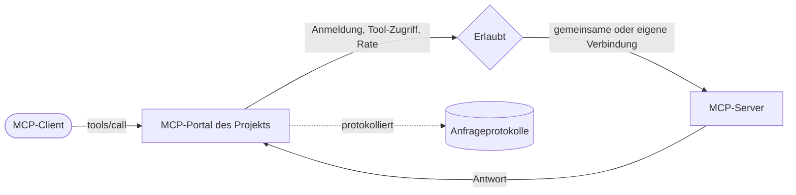

Jedes Projekt hat ein MCP-Portal unter `/mcp/<Projekt-ID>`. MCP-Clients wie claude.ai, ChatGPT und Cursor verbinden sich damit und rufen die Tools der MCP-Server auf, die das Projekt nutzt. Kaeso meldet sich bei jedem Server an, prüft, wer welches Tool aufrufen darf, wendet die Limits des Projekts an und protokolliert jeden Aufruf.

## Server und Projekte

Eine Organisation fügt MCP-Server unter **MCP-Server** hinzu. Jeder Server hat ein Kürzel wie `x`, das seinen Tools für Clients vorangestellt wird: Aus `create_post` des Servers wird `x__create_post`. Bindestriche eines Kürzels werden zu Unterstrichen, und ein Name mit mehr als 64 Zeichen wird gekürzt und bekommt einen kurzen Hash.

Ein Projekt wählt, welche Server es nutzt und welche ihrer Tools an sind. Bei einem Server, den ein Projekt neu nutzt, ist jedes Tool aus, sodass nichts einen Client erreicht, bis jemand es einschaltet.

## Verbindungen

Kaeso meldet sich auf eine von drei Arten bei einem Server an:

| Anmeldung | So funktioniert sie |
| --- | --- |
| Ohne Anmeldung | Der Server antwortet jedem, der seine Adresse kennt |
| Geheimer Header | Kaeso sendet bei jedem Aufruf einen Header wie `Authorization: Bearer …` |
| OAuth | Kaeso meldet sich wie eine App an. Es stellt sich mit seinem Client-Metadatendokument vor, registriert sich selbst oder nutzt einen von Hand registrierten Client |

Eine Verbindung ist gemeinsam, sodass jeder Aufrufer ein Konto nutzt, oder jede Person meldet sich mit ihrem eigenen unter **Konto** › **Verbindungen** an. Kaeso versiegelt Geheimnisse und Tokens mit dem Hauptschlüssel und erneuert OAuth-Tokens, bevor sie ablaufen. Lehnt ein Server eine Verbindung ab, markiert Kaeso sie einmal als abgemeldet und nutzt sie nicht mehr, bis sich jemand erneut anmeldet.

## Geänderte Tools

Kaeso speichert einen Hash der Definition jedes Tools: Name, Titel, Beschreibung, Schemas und Hinweise. Es fragt jeden Server im Abstand `mcp_servers.sync_interval` nach seinen Tools, standardmäßig alle 15 Minuten, und wenn jemand den Server in der Konsole prüft.

Ändert ein Server ein Tool, entscheidet die Richtlinie des Servers. `hold`, der Standard, nimmt das Tool aus jedem Portal, bis ein Admin die Änderung prüft und freigibt. `accept` bietet die neue Definition sofort an. Eine geänderte Beschreibung kann einem Modell etwas anderes auftragen, behalten Sie `hold` also für Server, die Sie nicht selbst betreiben.

## Wer was aufrufen darf

Das Portal bietet ein Tool an, wenn es im Projekt an ist und seine Definition freigegeben ist. Ein Aufrufer braucht außerdem:

- `tools.use` im Projekt, aus seiner Rolle.
- Einen Tool-Zugriff, der das Tool enthält. Der Tool-Zugriff umfasst standardmäßig jedes Tool und lässt sich für ein Mitglied, ein Dienstkonto oder einen Schlüssel einschränken.
- Bei einem API-Schlüssel die Fähigkeit **Tools**.

Ein Client, der sich mit OAuth anmeldet, handelt als die Person, die ihn erlaubt hat, mit deren Tool-Zugriff. Die Tools eines Servers, bei dem sich jede Person anmeldet, funktionieren für einen Aufrufer erst, wenn er sein eigenes Konto verbunden hat.

## Limits und Protokolle

Eine Tool-Aufrufrate begrenzt die Aufrufe pro Minute für ein Projekt, ein Mitglied oder einen Schlüssel. Ein Aufruf darüber bekommt HTTP 429 mit `Retry-After`. Jeder Aufruf erscheint unter **Anfrageprotokolle** bei **Tools**, mit Argumenten und Antwort, wenn das Projekt Inhalte aufbewahrt. Die Nutzung zählt Aufrufe und Fehler pro Tag.

## Nächste Schritte

- [MCP-Server der Organisation](../console/mcp-servers.md): Fügen Sie Server hinzu, melden Sie sich bei ihnen an und prüfen Sie geänderte Tools.
- [Tools](../console/tools.md): Schalten Sie Tools in einem Projekt ein und verbinden Sie Clients mit seinem Portal.
- [MCP-Portal-API](../api/mcp-portal.md): Schlagen Sie Adresse, Anmeldung, Versionen und Fehler des Portals nach.
