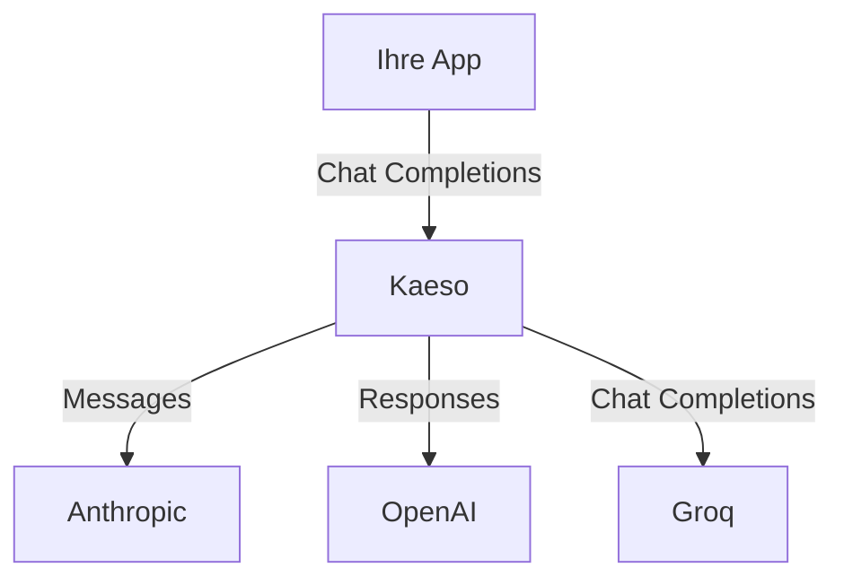

Kaeso ruft die Modelle vieler Anbieter auf, und Ihre App erreicht sie alle über das SDK, das sie schon nutzt. Jedes Chat-Format kann das Chat-Modell jedes Anbieters aufrufen: Kaeso übersetzt die Anfrage in das Format des Anbieters und die Antwort zurück. [Unterstützte Anbieter](supported-providers.md) listet jeden Anbieter.

Diese App ruft mit dem OpenAI SDK ein Claude-Modell und ein Groq-Modell auf. Nur `model` ändert sich:

```bash tab="curl"
curl https://kaeso.example.com/v1/chat/completions \
  -H "Authorization: Bearer $KAESO_API_KEY" \
  -H "content-type: application/json" \
  -d '{
    "model": "claude-haiku-4-5",
    "messages": [
      {"role": "user", "content": "Write a haiku about gateways."}
    ]
  }'

curl https://kaeso.example.com/v1/chat/completions \
  -H "Authorization: Bearer $KAESO_API_KEY" \
  -H "content-type: application/json" \
  -d '{
    "model": "llama-3.3-70b-versatile",
    "messages": [
      {"role": "user", "content": "Write a haiku about gateways."}
    ]
  }'
```

```python tab="Python"
import os
from openai import OpenAI

client = OpenAI(
    base_url="https://kaeso.example.com/v1",
    api_key=os.environ["KAESO_API_KEY"],
)

for model in ["claude-haiku-4-5", "llama-3.3-70b-versatile"]:
    completion = client.chat.completions.create(
        model=model,
        messages=[
            {"role": "user", "content": "Write a haiku about gateways."}
        ],
    )
    print(completion.choices[0].message.content)
```

```ts tab="TypeScript"
import OpenAI from "openai";

const client = new OpenAI({
  baseURL: "https://kaeso.example.com/v1",
  apiKey: process.env.KAESO_API_KEY,
});

for (const model of ["claude-haiku-4-5", "llama-3.3-70b-versatile"]) {
  const completion = await client.chat.completions.create({
    model,
    messages: [{ role: "user", content: "Write a haiku about gateways." }],
  });
  console.log(completion.choices[0].message.content);
}
```

Kaeso sendet die erste Anfrage als Messages an Anthropic und die zweite als Chat Completions an Groq. Beide Antworten kommen als Chat Completions zurück, und ihr Header `kaeso-provider` nennt den Anbieter, der sie beantwortet hat.



## Einen Anbieter nutzen

Drei Schritte machen die Modelle eines Anbieters in einem Projekt aufrufbar:

1. Erstellen Sie beim Anbieter einen Schlüssel und fügen Sie ihn unter **Anbieter** hinzu. Jedes Projekt der Organisation nutzt ihn, außer Sie weisen einem Projekt einen eigenen Schlüssel zu ([Anbieter-Schlüssel](../console/provider-keys.md)).
2. Fügen Sie die Modelle des Anbieters unter **Modelle** dem Katalog des Projekts hinzu. Anfragen an Modelle außerhalb des Katalogs lehnt Kaeso ab ([Modelle hinzufügen](../console/models-and-aliases.md#modelle-hinzufügen)).
3. Rufen Sie ein Modell mit seiner ID aus einer beliebigen App auf, mit einem API-Schlüssel des Projekts, wie im Beispiel oben ([Modelle aufrufen](../get-started/calling-models.md)).

## Worin sich Anbieter unterscheiden

Jedes Chat-Format erreicht jedes Chat-Modell, aber nicht jeder Anbieter bietet dasselbe. Die Spalte **Formate** unter [Unterstützte Anbieter](supported-providers.md) zeigt, was jeder anbietet:

- **Formate.** Kaeso ruft jeden Anbieter in einem Format auf, das er bedient, etwa Anthropic mit Messages. Unterscheidet sich das Format der App, lehnt Kaeso ein Feld, das das Format des Anbieters nicht ausdrücken kann, mit einem Fehler ab, der es nennt. Stillschweigend verworfen wird es nie ([Was Kaeso ablehnt](format-translation.md#was-kaeso-ablehnt)).
- **Felder, die ein Anbieter ablehnt.** Nicht jeder Anbieter, der Chat Completions spricht, nimmt das ganze Format an, und Kaeso kennt die Abweichungen jedes Anbieters. Ein Feld, das nur anders geschrieben wird, benennt Kaeso um, etwa `seed` in Mistrals `random_seed`. Ein Feld, das der Anbieter nicht annimmt, lehnt Kaeso ab, bevor es etwas sendet. Die App erhält 400 in ihrem eigenen Format: „`logit_bias` is not supported by Mistral; remove it from the request.“ Die [Referenz zu Chat Completions](../development/kpp/openai-chat-providers.md#anbieterprofile) listet die Abweichungen jedes Anbieters.
- **Token-Zählung.** `/v1/messages/count_tokens` und `/v1/responses/input_tokens` fragen den Anbieter des Modells nach der Anzahl, und nur Anbieter mit Token-Zählung in ihren Formaten können sie liefern. Für andere Modelle antwortet Kaeso mit 400: „The model `…` cannot count tokens.“ Kaeso schätzt die Anzahl nie.
- **Embeddings.** Nur Anbieter mit Embeddings in ihren Formaten haben Embeddings-Modelle, die `/v1/embeddings` aufruft. Chat-Formate können kein Embeddings-Modell aufrufen, und ein Chat-Modell erzeugt keine Embeddings.
- **Modell-IDs.** Jeder Anbieter benennt seine Modelle auf seine Weise. Manche IDs enthalten `/`, etwa `Qwen/Qwen3.5-9B` von Together AI oder `anthropic/claude-sonnet-4.5` von OpenRouter, das den Hersteller des Modells nennt.
- **Preise.** Kaeso berechnet jede Anfrage zu den Preisen des Modells im Katalog, auch wenn der Anbieter eigene Kosten meldet.

## Zwei Anbieter mit demselben Modell

Manche Modelle bieten mehrere Anbieter an: Groq, OpenRouter und Together AI bedienen alle `openai/gpt-oss-120b`. Hat der Katalog eines Projekts dieselbe ID von mehr als einem Anbieter, erhält eine Anfrage mit der bloßen ID 400 mit einer Meldung, die die Anbieter nennt. Wählen Sie dann auf eine von zwei Arten einen davon:

- **Den Anbieter nennen.** Stellen Sie seine ID voran, etwa `groq/openai/gpt-oss-120b`. Kaeso trennt den Namen am ersten `/`, die Modell-ID behält also ihren eigenen.
- **Einen Alias erstellen.** Ein Alias wie `gpt-oss` zeigt auf das Modell eines Anbieters. Apps senden den Alias, und Sie können ihn später auf einen anderen Anbieter richten, ohne die Apps zu ändern ([Alias erstellen](../console/models-and-aliases.md#alias-erstellen)).

Kaeso sendet jede Anfrage an den einen Anbieter, zu dem ihr Modellname führt, und weicht nicht auf einen anderen aus, wenn dieser ausfällt. [Wie eine Anfrage ein Modell nennt](../console/models-and-aliases.md#wie-eine-anfrage-ein-modell-nennt) zeigt, in welcher Reihenfolge Kaeso Namen liest, und warum ein Name wie `openai/gpt-4o` OpenAI statt OpenRouter erreichen kann.

## Eigene Anbieter

Eine Organisation kann einen Server hinzufügen, den Kaeso nicht mitbringt, etwa ein selbst betriebenes vLLM oder einen internen Proxy, als eigenen Anbieter. Kaeso erkennt aus seiner Basis-URL und seinem Schlüssel, wie es ihn aufruft, und ruft ihn im reinen Format auf, das er spricht. Die Preise seiner Modelle legen Sie fest; Limits und Fähigkeiten trägt Kaeso ein, wo es sie findet ([Eigene Anbieter](../console/custom-providers.md)).

## Ausgehende Verbindungen

Das Gateway ruft jeden Anbieter über HTTPS unter seiner Basis-URL auf. Beschränkt Ihr Netzwerk ausgehende Verbindungen, erlauben Sie den Host jedes Anbieters, den Ihre Organisationen nutzen, etwa `api.groq.com` für Groq. [Unterstützte Anbieter](supported-providers.md) nennt den Host jedes Anbieters, die [Anforderungen](../self-hosting/requirements.md#netzwerk) listen jede Verbindung einer Installation, und [Anbietereinstellungen](../self-hosting/configuration.md#anbietereinstellungen) ändern die Basis-URL eines Anbieters.
