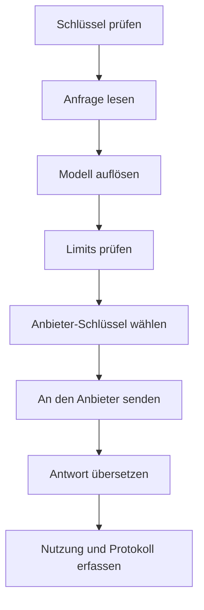

Jede Modellanfrage durchläuft dieselben Prüfungen in derselben Reihenfolge. Wenn Sie sie kennen, wissen Sie, welchen Fehler eine Anfrage erhält und wann sie berechnet wird.

Kaeso übersetzt jede Anfrage, statt sie durchzureichen, und sendet sie genau einmal, ohne Wiederholung. Lehnt ein Schritt eine Anfrage ab, erhält die App den Fehler in ihrem eigenen Format.

## Der Schlüssel

Das Gateway liest den API-Schlüssel aus `x-api-key`, sonst aus `Authorization: Bearer`. Der Schlüssel bestimmt das Projekt und handelt dort mit den Rechten seines Mitglieds oder Dienstkontos.

Der Schlüssel braucht Inferenzzugriff, und sein Inhaber braucht das Recht `api.request`. Plattform-Schlüssel einer Organisation rufen nie Modelle auf.

## Die Anfrage

Der Body einer Anfrage darf bis zu `KAESO_BODY_LIMITS_MODEL_API` groß sein, standardmäßig 8 MiB. Auf einen größeren antwortet Kaeso mit 413.

KPP zählt, was der Body enthält, bevor es etwas decodiert. Mehr als 100.000 Nachrichten oder Eingabeelemente, 10.000 Inhaltsblöcke in einer Nachricht, 10.000 Werkzeuge, 2.048 Embedding-Eingaben oder mehr als 127 Ebenen verschachtelter Objekte und Arrays erhalten 400. Danach schätzt Kaeso den Speicher, den die Anfrage beim Übersetzen und Senden braucht. Solange die laufenden Anfragen `KAESO_BODY_LIMITS_IN_FLIGHT` schon ausschöpfen, standardmäßig 512 MiB, wartet die Anfrage, bis sie fertig sind.

Dann decodiert KPP die Anfrage aus dem Format der App, etwa Chat Completions oder Messages, in sein kanonisches Format. Eine Anfrage, die sich nicht lesen lässt, lehnt Kaeso hier ab. Ebenso eine, die etwas verlangt, das Kaeso nie an einen Anbieter sendet, etwa mehr als eine Auswahl oder gespeicherten Responses-Zustand.

## Das Modell

Kaeso sucht den Modellnamen im Katalog des Projekts: zuerst als Alias, dann als `provider/model`, dann als eigene ID des Modells. Ein Name, der dort nicht steht, erhält 404. Eine ID, die mehrere Anbieter im Projekt bedienen, erhält 400; nennen Sie sie dann als `provider/model`. Darf das Mitglied oder der Schlüssel das Modell nicht nutzen, erhält die Anfrage 403.

Der Katalogeintrag sagt, was das Modell kann. Kaeso antwortet mit 400, wenn eine Anfrage etwas braucht, das dem Modell fehlt:

- Bilder, PDFs, Tools, ein JSON-Schema oder Reasoning;
- eine Aufwandsstufe, die das Modell nicht listet, oder adaptives Denken für ein Claude-Modell ohne adaptives Denken;
- eine erzwungene Tool-Wahl (`required`, `any` oder ein benanntes Tool) für ein Modell, das keine annimmt, etwa Claude Fable 5.1, Opus 5.5 und Sonnet 5.5;
- eine Temperatur ungleich 1 für ein Modell, das keine annimmt, es sei denn, Kaeso schaltet das Denken von Claude ein und lässt die Temperatur weg;
- Embeddings von einem Generierungsmodell oder Text von einem Embeddings-Modell.

Eine Anfrage in einem OpenAI-Format für ein Claude-Modell braucht kein Ausgabelimit: Kaeso sendet das Maximum des Modells. Eine Messages-Anfrage ohne `max_tokens` erhält 400, so wie bei Anthropic.

## Limits

Kaeso prüft jedes zutreffende Limit in einem Schritt: die Raten und Budgets des Schlüssels, seines Mitglieds und des Projekts, für alle Modelle oder für dieses.

| Lage | Ergebnis |
| --- | --- |
| Über einer Rate oder einem harten Budget | 429 mit `Retry-After` |
| Über einem weichen Budget | Die Anfrage geht durch. Weiche Budgets warnen nur |
| Valkey nicht erreichbar | 503 für eine Anfrage unter einem harten Budget. Jede andere Anfrage geht ungeprüft durch |
| Die Limits des Projekts lassen sich nicht laden | 503 für jede Anfrage, weil Kaeso nicht erkennen kann, welche Limits gelten |

Apps in den OpenAI-Formaten erhalten diese 503-Antworten als 500, die ihre SDKs wiederholen. [Limits und Budgets](../console/limits-and-budgets.md) erklärt, wie Sie Limits setzen.

## Der Anbieter-Schlüssel

Kaeso nutzt den Anbieter-Schlüssel, der dem Projekt für den Anbieter des Modells zugewiesen ist, sonst den Standard der Organisation für diesen Anbieter. Fehlen beide, erhält die Anfrage 400. Kaeso entschlüsselt den Schlüssel mit dem Hauptschlüssel und hält ihn höchstens 30 Sekunden im Speicher.

## Senden an den Anbieter

KPP prüft die Anfrage am Format des Anbieters und codiert sie. Was dieses Format nicht ausdrücken kann, lehnt Kaeso ab, bevor etwas den Anbieter erreicht ([Formatübersetzung](format-translation.md)). Für eine Chat-Completions-App, die über ein anderes Format bedient wird, fügt Kaeso zuerst das Reasoning aus früheren Zügen wieder ein ([Reasoning zwischen Zügen](format-translation.md#reasoning-zwischen-zügen)).

Kaeso ruft jeden Anbieter in seinem eigenen API-Format auf, etwa Anthropic mit Messages und Groq mit Chat Completions. [Unterstützte Anbieter](supported-providers.md) listet die Formate jedes Anbieters.

Vier Zeitlimits begrenzen den Aufruf: den Verbindungsaufbau, eine ganze Anfrage, das erste Byte eines Streams und die Stille zwischen zwei Chunks. Ein eigenes Zeitlimit des Modells im Katalog ersetzt die Zeitlimits für Anfrage und erstes Byte. Eine Zeitüberschreitung erhält 504, ein nicht erreichbarer Anbieter 502. Die [Konfiguration](../self-hosting/configuration.md) listet die Einstellungen und ihre Standardwerte.

## Die Antwort

KPP decodiert die Antwort in das kanonische Format und codiert sie im Format der App, bei einem Stream Event für Event. Kaeso lehnt eine Antwort nie wegen ihres Inhalts ab. Was das Format der App nicht ausdrücken kann, fehlt in dem, was die App erhält, und bleibt im Anfrageprotokoll, wenn die Inhaltsprotokollierung eingeschaltet ist.

Ein Fehler des Anbieters erreicht eine App im selben Format genau so, wie der Anbieter ihn gesendet hat. Eine App in einem anderen Format erhält dieselbe Bedeutung in ihrem eigenen Format. Die Ausnahme ist ein Anbieter, der den Anbieter-Schlüssel des Projekts ablehnt: Jede App erhält dann einen Anbieterfehler, 502, der auf einen Organisations-Admin verweist. [Fehler](../api/errors.md) listet jeden Fehler.

Antworten tragen die Header `kaeso-model` und `kaeso-provider`. Die Header eines Streams gehen hinaus, sobald der Anbieter antwortet. Solange ein Stream offen und still ist, schreibt Kaeso Keepalives, die das SDK der App ignoriert.

## Fehlgeschlagene Streams

Sind die Header eines Streams gesendet, kann sich sein Status nicht mehr ändern. Ein Stream, der danach fehlschlägt, endet mit einem Fehler-Event im Format der App, und das Anfrageprotokoll verzeichnet den Fehler:

| Ursache | Protokollierter Status | Fehlerart |
| --- | --- | --- |
| Der Anbieter sendet ein Fehler-Event | Der Status des Fehlers, sonst 502 | Die Art des Fehlers |
| Die Verbindung zum Anbieter bricht ab, oder der Stream endet zu früh | 502 | `stream_interrupted` |
| Der Anbieter schweigt länger als das Leerlauf-Zeitlimit | 504 | `timeout` |
| Der Stream erreicht `KAESO_STREAMS_MAX_DURATION` oder `KAESO_STREAMS_MAX_BYTES` | 502 | `stream_limit` |
| KPP kann ein Event nicht für die App codieren | Der Status des Fehlers, sonst 500 | Die Art des Fehlers |

Nach einem Fehler-Event des Anbieters hört Kaeso auf zu lesen und schließt die Anfrage beim Anbieter, sodass der Anbieter aufhört zu generieren.

Die Nutzung zählt einen solchen Stream als Fehler. Das Anfrageprotokoll zeigt in `stream_progress`, wie weit er kam: die Events des Anbieters, die an die App geschriebenen Bytes und Keepalives und die Zeit bis zu den ersten Bytes. Die Metrik `kaeso_requests_total` zählt ihn trotzdem als 200, den gesendeten Status ([Zustand und Metriken](../self-hosting/monitoring.md)).

Eine App, die so lange wie `KAESO_UPSTREAM_STREAM_IDLE_TIMEOUT` nichts von ihrem Stream liest, gilt als getrennt: Kaeso stoppt die Anfrage beim Anbieter und protokolliert einen Verbindungsabbruch.

## Verbindungsabbrüche

Schließt eine App die Verbindung, stoppt Kaeso die Anfrage beim Anbieter sofort, sodass der Anbieter aufhört zu generieren. Die Anfrage wird als 499 mit der Fehlerart `client_disconnected` protokolliert.

Eine solche Anfrage, und ebenso einen abgebrochenen Stream, berechnet Kaeso mit dem, was der Anbieter gemeldet hat, plus einer Schätzung des Rests:

- die Eingabe aus der Nutzung, die der Anbieter zu Beginn des Streams meldet, sonst aus seinem Endpunkt zum Zählen von Token, sonst aus der Größe der Anfrage;
- die Ausgabe aus dem empfangenen Inhalt.

Eine nicht gestreamte Anfrage wird mit ihrer Eingabe berechnet, aus ihrer Größe geschätzt, sobald Kaeso sie an den Anbieter gesendet hat.

Eine Antwort oder ein Stream, die ohne jede Nutzungsangabe des Anbieters enden, wie sie manche OpenAI-kompatiblen Anbieter weglassen, werden genauso geschätzt, die Ausgabe aus der ganzen Antwort.

Diese Protokolleinträge enthalten `usage.estimated: true`, und Kosten und Limits verwenden dieselben Zahlen. Schätzungen der Ausgabe fallen bei Reasoning, das der Anbieter nicht streamt, zu niedrig aus. Die Metrik `kaeso_usage_estimates_total` zählt sie nach Anbieter und Grund ([Zustand und Metriken](../self-hosting/monitoring.md)).

## Herunterfahren

Bei einem Shutdown-Signal nimmt das Gateway keine neuen Verbindungen mehr an. Offene Anfragen und Streams erhalten `KAESO_SHUTDOWN_GRACE` zum Abschluss, standardmäßig 30 Sekunden.

Eine danach noch offene Anfrage erhält den Fehler „Kaeso is restarting and ended this request. Send it again.“ im Format der App: 503, in den OpenAI-Formaten 500. Ein bereits gestarteter Stream endet stattdessen mit einem Fehler-Event. Kaeso berechnet und protokolliert beide mit der Fehlerart `shutdown`, einen Stream mit geschätzter Nutzung. Eine Sekunde später schließt Kaeso die Verbindungen, die noch offen sind.

## Nutzung und Protokolle

Kaeso berechnet die Token zu den Preisen des Modells zum Zeitpunkt der Anfrage, dem Schlüssel, dem Mitglied und dem Projekt, und rechnet sie auf ihre Budgets an. Das Anfrageprotokoll hält die Metadaten fest. Anfrage und Antwort hält es fest, wenn die Inhaltsprotokollierung für Organisation und Projekt eingeschaltet ist.

Die Protokollierung hält nie eine Anfrage auf: Die Antwort geht zuerst hinaus. Unter einem harten Budget oder einer Token-Rate berechnet Kaeso die Anfrage, bevor ihre Antwort endet, sodass die nächste Anfrage der App sie bereits mitzählt. Einträge warten im Speicher und gehen stapelweise an ClickHouse. Ist der Puffer voll, verwirft Kaeso die ältesten Einträge ([Anfrageprotokolle](../console/request-logs.md)).
