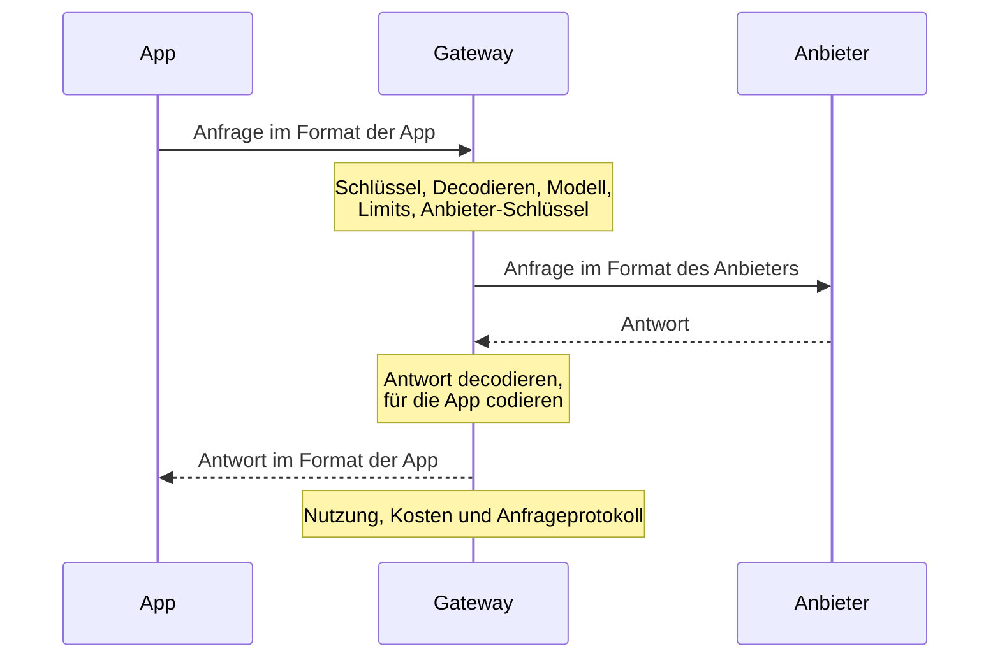

Jede Modellanfrage nimmt denselben Weg durch das Gateway. Jede Anfrage wird übersetzt, nie unverändert durchgereicht, und einmal gesendet, nie wiederholt. Eine Ablehnung in irgendeinem Schritt erreicht die App als Fehler in ihrem eigenen Format.

## Schlüssel

Das Gateway liest den API-Schlüssel aus `x-api-key`, sonst aus `Authorization: Bearer`. Der Schlüssel bestimmt das Projekt und handelt dort mit den Rechten seines Mitglieds oder Dienstkontos. Er braucht Inferenzzugriff, sein Inhaber das Recht `api.request`; Plattform-Schlüssel von Organisationen rufen nie Modelle auf. Ein Schlüssel, der in den letzten 30 Sekunden nachgeschlagen wurde, wird aus dem Speicher beantwortet.

## Decodieren

Der Body darf bis zu `KAESO_BODY_LIMITS_MODEL_API` (32 MiB) groß sein; ein größerer wird mit 413 abgelehnt. KPP decodiert die Anfrage aus dem Format der App, etwa Chat Completions oder Messages, in sein kanonisches Format. Eine Anfrage, die sich nicht lesen lässt, wird hier abgelehnt, ebenso eine, die etwas verlangt, das Kaeso nie an einen Anbieter sendet, etwa mehr als eine Auswahl oder gespeicherten Responses-Zustand.

## Modell

Der Modellname wird im Katalog des Projekts gesucht: zuerst als Alias, dann als `provider/model`, dann als eigene ID des Modells. Ein Name, der dort nicht steht, wird mit 404 abgelehnt, eine ID, die mehrere Anbieter im Projekt bedienen, mit 400. Danach wird der Modellzugriff von Mitglied und Schlüssel geprüft (403).

Der Katalogeintrag enthält Limits, Preise und Fähigkeiten des Modells, das Format, in dem sein Anbieter aufgerufen wird, ob es Reasoning nutzt, ob es adaptives Denken hat, und sein Zeitlimit. Eine Anfrage, die etwas braucht, das dem Modell fehlt, wird mit 400 abgelehnt:

- Bilder, PDFs, Tools, ein JSON-Schema oder Reasoning;
- eine Aufwandsstufe, die das Modell nicht listet, oder adaptives Denken für ein Claude-Modell ohne adaptives Denken;
- eine erzwungene Tool-Wahl (`required`, `any` oder ein benanntes Tool) für ein Modell, das keine annimmt, etwa Claude Fable 5.1, Opus 5.5 und Sonnet 5.5; die Meldung nennt Feld und Wert, die die App gesendet hat;
- eine Temperatur ungleich 1 für ein Modell, das keine annimmt, es sei denn, Kaeso schaltet das Denken von Claude ein und lässt die Temperatur weg;
- Embeddings von einem Generierungsmodell oder Text von einem Embedding-Modell.

Eine Anfrage in einem OpenAI-Format für ein Claude-Modell ohne Höchstzahl an Ausgabe-Token erhält das Ausgabelimit des Modells. Eine Messages-Anfrage ohne `max_tokens` wird mit 400 abgelehnt, so wie Anthropic sie ablehnt.

## Limits

Jedes zutreffende Limit wird auf einmal geprüft, in einem Schritt in Valkey: die Raten und Budgets des Schlüssels, seines Mitglieds und des Projekts, für alle Modelle oder für dieses.

| Lage | Ergebnis |
| --- | --- |
| Über einer Rate oder einem harten Budget | 429 mit `Retry-After` |
| Über einem weichen Budget | Geht durch; weiche Budgets warnen nur |
| Valkey nicht erreichbar | 503 für eine Anfrage unter einem harten Budget; jede andere Anfrage geht ungeprüft durch |
| Die Limits des Projekts lassen sich nicht aus PostgreSQL laden | 503 für jede Anfrage, weil Kaeso nicht erkennen kann, welche Limits gelten |

## Anbieter-Schlüssel

Das Gateway nutzt den Anbieter-Schlüssel, der dem Projekt für den Anbieter des Modells zugewiesen ist, sonst den Standard der Organisation für diesen Anbieter. Fehlen beide, wird die Anfrage mit 400 abgelehnt. Der Schlüssel wird mit dem Hauptschlüssel entschlüsselt und nur im Speicher der Instanz gehalten, höchstens 30 Sekunden lang.

## Codieren und senden

KPP prüft die Anfrage am Format des Anbieters und codiert sie. Was dieses Format nicht ausdrücken kann, wird hier abgelehnt, bevor etwas den Anbieter erreicht ([Formatübersetzung](format-translation.md)). Für eine Chat-Completions-App, die über ein anderes Format bedient wird, wird zuerst das Reasoning aus früheren Zügen wieder eingefügt ([Reasoning zwischen Zügen](format-translation.md#reasoning-zwischen-zügen)).

| Anbieter | Aufgerufene API |
| --- | --- |
| OpenAI | Responses, oder Chat Completions, wenn der Katalog das vorgibt; Embeddings für Embeddings |
| Anthropic | Messages |

Token-Zählungen gehen an `/v1/messages/count_tokens` von Anthropic und `/v1/responses/input_tokens` von OpenAI. `KAESO_PROVIDERS_OPENAI_BASE_URL` und `KAESO_PROVIDERS_ANTHROPIC_BASE_URL` legen fest, wo die Anbieter liegen.

| Zeitlimit | Einstellung | Standard | Begrenzt |
| --- | --- | --- | --- |
| Verbindung | `KAESO_UPSTREAM_CONNECT_TIMEOUT` | 10 s | Den Verbindungsaufbau zum Anbieter, TCP und TLS |
| Anfrage | `KAESO_UPSTREAM_REQUEST_TIMEOUT` | 600 s | Eine ganze Anfrage, die nicht streamt |
| Erstes Byte | `KAESO_UPSTREAM_FIRST_BYTE_TIMEOUT` | 60 s | Einen Stream, bis der Anbieter antwortet |
| Leerlauf | `KAESO_UPSTREAM_STREAM_IDLE_TIMEOUT` | 300 s | Einen Stream, die längste Stille zwischen zwei Chunks |

Ein eigenes Zeitlimit des Modells im Katalog ersetzt die Zeitlimits für Anfrage und erstes Byte. Eine Zeitüberschreitung wird mit 504 beantwortet, ein nicht erreichbarer Anbieter mit 502 ([Aufrufe an Anbieter](../self-hosting/configuration.md#aufrufe-an-anbieter)).

## Antwort

Die Antwort wird in das kanonische Format decodiert und im Format der App codiert, bei einem Stream Event für Event. Eine Antwort wird nie wegen ihres Inhalts abgelehnt: Was das Format der App nicht ausdrücken kann, fehlt in dem, was die App erhält, und bleibt im Anfrageprotokoll erhalten, wenn die Inhaltsprotokollierung eingeschaltet ist.

Ein Fehler des Anbieters erreicht eine App, die das Format des Anbieters spricht, so, wie der Anbieter ihn gesendet hat, und jede andere App mit derselben Bedeutung in ihrem eigenen Format. Für ein Modell, das der Anbieter dem Anbieter-Schlüssel des Projekts nicht anbietet, kommt stattdessen Kaesos eigene Meldung ([Fehler des Anbieters](../api/errors.md#fehler-des-anbieters)).

Antworten tragen `kaeso-model` und `kaeso-provider`. Die Header eines Streams gehen hinaus, sobald der Anbieter antwortet, und solange der Stream offen und still ist, schreibt das Gateway Keepalives, die das SDK der App ignoriert ([lange Streams](../self-hosting/domains-and-tls.md#lange-streams)).

## Wenn ein Stream fehlschlägt

Sind die Header eines Streams gesendet, kann sich sein Status nicht mehr ändern. Ein Stream, der danach fehlschlägt, endet mit einem Fehler-Event im Format der App, und das Anfrageprotokoll verzeichnet den Fehler:

| Ursache | Protokollierter Status | Fehlerart |
| --- | --- | --- |
| Der Anbieter sendet ein Fehler-Event | Der Status des Fehlers, sonst 502 | Die Art des Fehlers |
| Die Verbindung zum Anbieter bricht ab, oder der Stream endet, bevor die Antwort vollständig ist | 502 | `stream_interrupted` |
| Der Anbieter schweigt länger als `KAESO_UPSTREAM_STREAM_IDLE_TIMEOUT` | 504 | `timeout` |
| KPP kann ein Event nicht für die App codieren | Der Status des Fehlers, sonst 500 | Die Art des Fehlers |

Nutzung und `kaeso_stream_failures_total` zählen einen solchen Stream als Fehler, `kaeso_requests_total` dagegen als 200, den gesendeten Status ([Monitoring](../self-hosting/monitoring.md)). Jeder gestreamte Eintrag im Anfrageprotokoll hält in `stream_progress` fest, wie weit er kam: die Events des Anbieters, die an die App geschriebenen Bytes und Keepalives und die Zeit bis zu den ersten Antwort-Bytes.

## Wenn die App verschwindet

Schließt eine App die Verbindung, stoppt das Gateway die Anfrage beim Anbieter sofort, sodass der Anbieter aufhört zu generieren. Die Anfrage wird als 499 `client_disconnected` protokolliert.

Ein solcher Stream, und ebenso einer, der abbricht, wird mit dem berechnet, was der Anbieter gemeldet hat, plus einer Schätzung des Rests:

- die Eingabe aus der Nutzung, die der Anbieter zu Beginn des Streams meldet, sonst aus seinem Endpunkt zum Zählen von Token, sonst aus der Größe der Anfrage;
- die Ausgabe aus dem empfangenen Inhalt.

Diese Protokolleinträge enthalten `usage.estimated: true`, und Kosten und Limits verwenden dieselben Zahlen. Schätzungen der Ausgabe fallen bei Reasoning, das der Anbieter nicht streamt, zu niedrig aus.

## Wenn das Gateway herunterfährt

Bei einem Shutdown-Signal nimmt das Gateway keine neuen Verbindungen mehr an und gibt offenen Anfragen und Streams `KAESO_SHUTDOWN_GRACE` (30 Sekunden) zum Abschluss. Eine dann noch offene Anfrage erhält den Fehler „Kaeso is restarting“ im Format der App: 503, bei Apps in einem OpenAI-Format 500, was die SDKs wiederholen. Ein bereits gestarteter Stream endet stattdessen mit einem Fehler-Event. Beide werden mit der Fehlerart `shutdown` berechnet und protokolliert, ein Stream mit geschätzter Nutzung. Danach wartet das Gateway bis zu 10 Sekunden auf diese Einträge, bevor es Nutzung und Protokolle ein letztes Mal schreibt.

## Nutzung und Protokolle

Die Token der Anfrage werden zu den Preisen des Modells zum Zeitpunkt der Anfrage berechnet, dem Schlüssel, dem Mitglied und dem Projekt, und auf ihre Budgets angerechnet. Das Anfrageprotokoll verzeichnet die Metadaten, dazu Anfrage und Antwort, wenn die Inhaltsprotokollierung für Organisation und Projekt eingeschaltet ist.

Die Protokollierung hält nie eine Anfrage auf. Einträge warten im Speicher und werden stapelweise in ClickHouse geschrieben; ist der Puffer voll, werden die ältesten verworfen.
