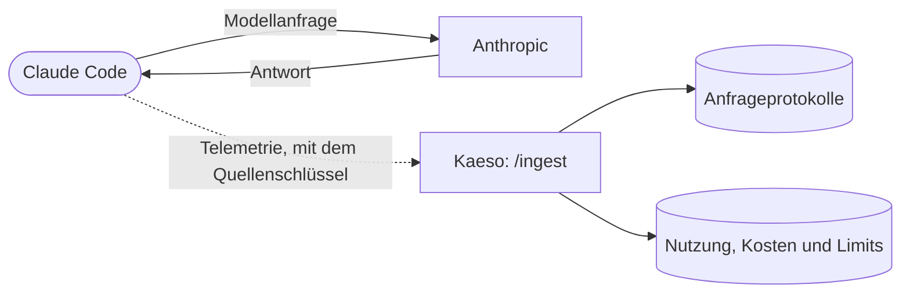

Coding-Agents wie Claude Code und Codex und Gateways wie LiteLLM rufen ihre Anbieter direkt auf. Eine Quelle lässt sie diese Aufrufe an Kaeso melden, sodass Ihre Anfrageprotokolle, Nutzung, Kosten und Limits sie enthalten, während die Aufrufe selbst nie über Kaeso laufen.

## Beobachtet, nicht geroutet

Kaeso beobachtet die Anfragen einer Quelle, es routet sie nicht. Der Client behält seinen eigenen Anbieterschlüssel, seine Basis-URL und sein Modell, und Kaeso erfährt von einer Anfrage erst, wenn sie beendet ist. Deshalb ändert, verzögert oder verweigert Kaeso eine solche Anfrage nie: Aliasse, Guardrails, Fallbacks und der Antwort-Cache gelten nicht.

Alles nach der Anfrage funktioniert wie bei den eigenen Anfragen des Gateways. Jede bekommt eine Zeile im Anfrageprotokoll, markiert als **Beobachtet**, und zählt in Nutzung, Kosten und Analysen für das Mitglied, zu dem sie gehört. In der Konsole listet **Quellen** die Quellen eines Projekts, und das Anfrageprotokoll, die Analysen und das Tool-Aufruf-Protokoll können nur zeigen, was eine Quelle gemeldet hat.

## Was eine Quelle sendet

Eine Quelle gehört zu einem Projekt und hat eine Art, die bestimmt, wie Kaeso liest, was sie sendet:

| Art | Was sie sendet |
| --- | --- |
| Claude Code | OpenTelemetry-Log-Ereignisse über OTLP/HTTP |
| Codex | OpenTelemetry-Log-Ereignisse über OTLP/HTTP |
| Gemini CLI | OpenTelemetry-Log-Ereignisse über OTLP/HTTP |
| Antigravity | Die Modellaufrufe seines Transkripts, aus einem Hook-Skript, als JSON |
| LiteLLM | Die generischen API-Logs des Proxys als JSON |
| OpenRouter | Broadcast-Traces über OTLP/HTTP |
| OpenTelemetry | GenAI-Spans oder -Log-Ereignisse aus jeder App oder jedem Collector, über OTLP/HTTP |
| HTTP | Stapel von Anfragen und Tool-Aufrufen in Kaesos eigenem JSON |

OTLP geht an `/ingest/otlp/v1/logs`, `/ingest/otlp/v1/traces` und `/ingest/otlp/v1/metrics`, als Protobuf oder JSON, mit gzip oder ohne. JSON geht an `/ingest/v1/events`, `/ingest/v1/litellm` und `/ingest/v1/antigravity`. Jede Deployment-Vorlage leitet `/ingest` an das Gateway.

Kaeso zählt Anfragen nur aus Log-Ereignissen und Spans. Metriken halten den Status einer Quelle aktuell, fügen aber nie Anfragen hinzu, sodass ein Client, der beides exportiert, nicht doppelt zählt. Von den Tool-Aufrufen, die Claude Code, Codex, Gemini CLI und OpenTelemetry melden, behält Kaeso nur MCP-Tool-Aufrufe; die eigenen Tools eines Clients, etwa eine Shell, bleiben außen vor.

## Wessen Anfragen es sind

Eine Anfrage zählt für ein Mitglied oder für ein Dienstkonto, wie jede Anfrage über das Gateway. Nennt das Ereignis eine E-Mail-Adresse und ordnet die Quelle Mitglieder per E-Mail zu, zählt die Anfrage für das Mitglied der Organisation mit dieser Adresse. Sonst zählt sie für das Mitglied oder Dienstkonto der Quelle, das beim Hinzufügen gewählt wurde.

In beiden Fällen muss das Mitglied das Projekt sehen können, und ein Dienstkonto muss darin noch aktiv sein. Ein Datensatz, der für niemanden zählen würde, der das kann, wird abgelehnt, sodass eine Anfrage nie für jemanden außerhalb des Projekts zählt.

## Tokens und Kosten

Clients zählen Tokens unterschiedlich: Claude Code lässt gecachte Eingabe aus seiner Eingabe heraus, während Codex, Gemini CLI und OpenTelemetry sie mitzählen. Kaeso macht aus jeder Zählung seine eigene: Eingabe ohne das, was aus dem Cache kam oder in ihn ging, und Ausgabe mit dem Reasoning darin.

Eine Anfrage kostet, was der Katalog des Projekts für das Modell angibt. Ohne Katalogeintrag nutzt Kaeso den Preis des Modells aus [KPMR](../kpmr/index.md). Hat keiner einen Preis, behält die Anfrage die Kosten, die die Quelle gemeldet hat, etwa die von Claude Code oder LiteLLM, und ihre Details sagen das. Cache-Schreibvorgänge, die Anthropic eine Stunde lang behält, kosten den Preis für eine Stunde.

## Duplikate und Ablehnungen

Clients senden ein Ereignis erneut, wenn ein Export fehlschlug, deshalb behält Kaeso jede Anfrage und jeden Tool-Aufruf einmal. Meldet eine Quelle dieselbe ID innerhalb von sieben Tagen, zählt Kaeso sie einmal, und die Aktivität der Quelle zählt den Rest als Duplikate.

Kaeso lehnt einen Datensatz ab, der:

- kein Modell oder kein Tool nennt oder keine ID hat;
- älter als sieben Tage ist oder mehr als fünf Minuten in der Zukunft liegt;
- eine Token-Zahl über 100 Millionen hat oder mehr als 10.000 $ kostet;
- einen Status hat, der kein HTTP-Status ist;
- für niemanden zählen würde, der das Projekt sehen kann.

Ein abgelehnter Datensatz ändert nichts, und die Detailansicht der Quelle zeigt den Grund für den letzten. Einen Stapel, den Kaeso nicht lesen kann, lehnt es ganz ab.

## Limits und Warnungen

Beobachtete Anfragen zählen auf die Limits und Budgets des Projekts und auf die jedes Mitglieds und Dienstkontos, sodass Budgetwarnungen sie einschließen. Die Ansicht eines Limits zeigt, wie viel seiner Nutzung Quellen gemeldet haben.

> [!IMPORTANT]
> Kaeso kann eine beobachtete Anfrage nicht stoppen, weil es nicht in ihrem Weg liegt. Ein hartes Budget, das beobachtete Anfragen aufbrauchen, verweigert trotzdem die Anfragen, die über Kaeso laufen.

## Prompts und Antworten

Eine Quelle behält die Prompts, Antworten und Tool-Argumente, die ihr Client sendet, nur wenn **Prompts und Antworten behalten** für sie an ist und das Projekt Anfrageinhalte behält. Die meisten Clients lassen Inhalte aus ihrer Telemetrie heraus, solange Sie sie nicht einschalten; die Anleitung zu jedem sagt, wie.

## Der Quellenschlüssel

Jede Quelle hat einen Schlüssel, `sk-kso-src-…`, den Kaeso einmal zeigt und nur als Hash behält. Er funktioniert nur an `/ingest`: Er ruft kein Modell auf und erreicht weder die Platform-API noch das MCP-Portal. Ein Client sendet ihn als `Authorization: Bearer sk-kso-src-…` oder im Header `X-Kaeso-Source-Key`.

Ein Stapel enthält höchstens 1.000 Datensätze und 8 MiB, entpackt 16 MiB oder 8 MiB bei JSON. Eine Quelle darf 600 Stapel pro Minute senden, drei gleichzeitig, und 6.000 Datensätze (Anfragen und Tool-Aufrufe) pro Minute und 200.000 pro Tag; darüber hinaus antwortet Kaeso mit 429 und `Retry-After` und behält nichts vom Stapel. Ein Stapel mit mehr Feldern oder Werten, als Kaeso auf einmal lesen kann, wird mit 413 abgelehnt. Die Stapel einer deaktivierten oder archivierten Quelle oder einer Quelle in einem archivierten Projekt werden abgelehnt. Quellen zu sehen braucht das Recht `sources.view`, das jede Projektrolle hat; sie hinzuzufügen und zu ändern braucht `sources.manage`, das Admins und Entwickler haben.

## Nächste Schritte

- [Quellen verbinden](../sources/index.md): Fügen Sie in der Konsole eine Quelle hinzu und verfolgen Sie, was sie meldet.
- [Claude Code](../sources/claude-code.md): Zählen Sie die Anfragen und MCP-Tool-Aufrufe von Claude Code.
- [HTTP](../sources/http.md): Senden Sie Anfragen und Tool-Aufrufe aus eigenen Skripten.
