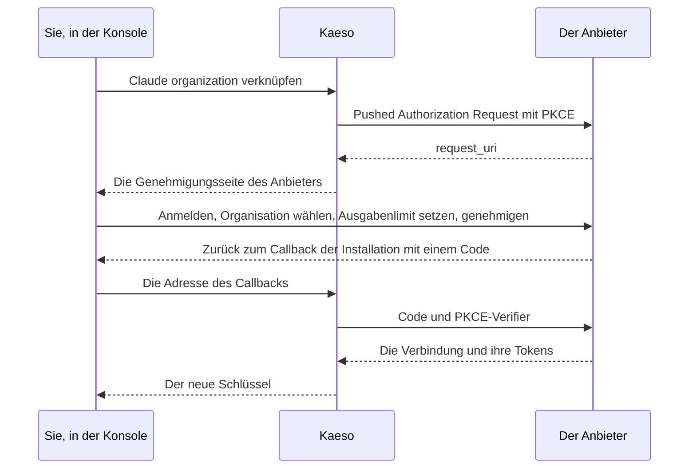

Mit verknüpfter Abrechnung ist ein Anbieter-Schlüssel kein Secret, sondern eine Verknüpfung zum eigenen Konto Ihrer Organisation beim Anbieter. Sie genehmigen die Verknüpfung einmal beim Anbieter, der Anbieter rechnet Ihre Anfragen über Kaeso mit diesem Konto ab, und Sie legen das Ausgabenlimit dort fest, wo Ihr Geld verwaltet wird, und sehen dort die Ausgaben. Kein API-Schlüssel verlässt Ihr Konto, und Sie können die Verknüpfung jederzeit trennen, in Kaeso oder beim Anbieter.

Jede Installation von Kaeso ist beim Anbieter eine eigene Plattform mit einer eigenen OAuth-App: Ein Instanz-Admin richtet sie einmal ein, danach kann jede Organisation der Installation verknüpfen. Anbieter mit verknüpfter Abrechnung zeigen die Option unter **Anbieter-Schlüssel hinzufügen**, die anderen nicht. Heute ist das **Anthropic**, dessen verknüpfte Abrechnung in der Beta ist.

## Wie eine Verknüpfung entsteht

Kaeso fordert die Verknüpfung beim Anbieter mit einem [Pushed Authorization Request](https://www.rfc-editor.org/rfc/rfc9126) und PKCE an, bindet sie zehn Minuten lang an Sie und Ihre Organisation und bewahrt die Tokens der Verbindung wie jeden Anbieter-Schlüssel verschlüsselt mit dem Hauptschlüssel der Installation auf. Das Zugriffstoken erneuert es im Hintergrund, bevor es abläuft, sodass keine Anfrage darauf wartet.

## Ihre Organisation verknüpfen

1. Wählen Sie unter **Anbieter** **Anbieter-Schlüssel hinzufügen** und dann den Anbieter, etwa **Anthropic**.
2. Wählen Sie **Claude organization** statt eines API-Schlüssels.
3. Geben Sie dem Schlüssel einen Namen und wählen Sie, ob er zum Standard wird.
4. Wählen Sie **Claude organization verknüpfen**. Die Genehmigungsseite des Anbieters öffnet sich im selben Tab: Melden Sie sich an, wählen Sie die Organisation, legen Sie ein monatliches Ausgabenlimit für die Installation fest und genehmigen Sie. Sie brauchen dort die Rolle **Admin** oder **Billing**.

Der Anbieter schickt Sie zurück zu Kaeso, das die Verknüpfung abschließt und **Anbieter** mit dem neuen Schlüssel öffnet. Brechen Sie ab oder können Sie nicht genehmigen, sagt Kaeso, dass die Verknüpfung nicht abgeschlossen wurde; prüfen Sie dann, mit welchem Konto Sie angemeldet waren und welche Rolle es hat.

Bevor Sie verknüpfen:

- Anfragen laufen in der eigenen Organisation der Installation beim Anbieter, daher gelten die IP-Allowlists, Schlüssel zur Verschlüsselung und Aufbewahrung von Daten Ihrer Organisation für sie nicht.
- Nur eine Organisation, die den Anbieter direkt bezahlt, lässt sich verknüpfen, keine, die über einen Cloud-Marktplatz abgerechnet wird.
- Eine Organisation beim Anbieter lässt sich nur mit einer Organisation der Installation verknüpfen. Ist sie schon mit einer anderen verknüpft, sagt Kaeso das und fügt den Schlüssel nicht hinzu.
- Jede Organisation der Installation hat einen verknüpften Schlüssel je Anbieter. **Erneut verknüpfen** ersetzt seine Verknüpfung.

## Einen verknüpften Schlüssel nutzen

Ein verknüpfter Schlüssel funktioniert wie jeder Anbieter-Schlüssel: Er kann der Standard des Anbieters sein oder Projekten zugewiesen werden, und **Verfügbarkeit prüfen** listet seine Modelle. Anfragen senden das Zugriffstoken der Verbindung und keinen API-Schlüssel, und der Anbieter rechnet sie mit der verknüpften Organisation ab.

Eine Verknüpfung zahlt für Nachrichten und Token-Zählung. Andere Endpunkte, etwa Batches, lehnt Kaeso ab, bevor etwas gesendet wird, mit einem Fehler, der für sie einen API-Schlüssel verlangt.

### Wer zahlt, wenn die Verknüpfung nicht zahlen kann

Standardmäßig zahlt nur die verknüpfte Organisation: Eine Anfrage, die ihr Ausgabenlimit ablehnt oder die die Verknüpfung nicht mehr vorfindet, schlägt fehl. Damit ein Projekt weiterläuft, wählen Sie im Menü des Schlüssels **Wer zahlt ersatzweise**, wählen das Projekt und **Auf** einen anderen Schlüssel des Anbieters **ausweichen**. Solche Anfragen gehen dann mit diesem Schlüssel hinaus.

Das Anfrage-Log nennt zu jeder Anfrage den Schlüssel, der gezahlt hat (`billed_to`), und **Analysen** zeigt **Nach zahlendem Schlüssel**. Die **Übersicht** der Organisation sagt, wie viel der Kosten des Monats über verknüpfte Abrechnung bezahlt wurde, zum Abgleich mit den Ausgaben, die der Anbieter für die App der Installation zeigt.

## Wenn eine Verknüpfung nicht mehr zahlt

| Ereignis | Was Kaeso tut |
| --- | --- |
| Die verknüpfte Organisation hat ihr Ausgabenlimit erreicht | Apps bekommen einen Fehler, der das Ausgabenlimit nennt und wo es sich erhöhen lässt. Der Schlüssel zeigt **Ausgabenlimit erreicht**, bis wieder eine Anfrage durchgeht, spätestens bis der Monat des Anbieters endet. Wer Anbieter-Schlüssel ändern darf, bekommt eine E-Mail, und der Webhook `provider_key.spend_limit_reached` wird ausgelöst. Ein Ersatzschlüssel zahlt stattdessen, wenn einer gewählt ist. |
| Die Verknüpfung wurde beim Anbieter beendet, oder ihre Tokens ließen sich nicht erneuern | Der Schlüssel zeigt **In Claude Console getrennt** mit **Erneut verknüpfen**. Die E-Mail und der Webhook `provider_key.unlinked` gehen hinaus. Anfragen schlagen klar fehl oder nutzen den Ersatzschlüssel. |
| **Verknüpfung trennen** in Kaeso | Kaeso beendet die Verbindung beim Anbieter und entfernt dann den Schlüssel; das Audit-Log verzeichnet es. Solange der Anbieter nicht erreichbar ist, bleibt der Schlüssel. |
| Die OAuth-App der Installation wird entfernt, durch einen anderen Client ersetzt oder abgelehnt | Jeder verknüpfte Schlüssel des Anbieters zeigt **Instanz muss eingerichtet werden**. Instanz-Admins bekommen eine E-Mail, nicht eine je Schlüssel. |

**Ausgabenlimit in Claude Console festlegen** im Menü des Schlüssels öffnet die Seite des Anbieters, auf der die verknüpfte Organisation das Limit für die Installation festlegt.

## Anthropic

Anthropic nennt die Verknüpfung eine Verbindung und das Konto eine Claude-Organisation ([Leitfaden von Anthropic](https://platform.claude.com/docs/en/manage-claude/oauth-apps/organization-billing-connections)). Anthropic gibt keine Client-Secrets aus: Eine App weist sich mit einem JWT aus, das ihr eigener Identitätsanbieter signiert. Kaeso ist dieser Identitätsanbieter für die Installation: Es signiert kurzlebige ES256-Client-Assertions mit einem eigenen Schlüssel und veröffentlicht den öffentlichen Schlüssel als OpenID-Aussteller.

### Die OAuth-App der Installation einrichten

Ein Instanz-Admin tut das einmal unter **Instanz** › **Verknüpfte Abrechnung**, die jeden zu registrierenden Wert zeigt:

1. Öffnen Sie in der Claude Console [OAuth apps](https://platform.claude.com/settings/oauth-apps), erstellen Sie eine App, die **Bill and link to organizations** darf, und registrieren Sie die **Weiterleitungs-URI**, die Kaeso zeigt. Sie entsteht aus der öffentlichen URL der Installation (`https://kaeso.example.com/linked-billing/callback`).
2. Registrieren Sie auf dem Tab **Client authentication** der App einen neuen Aussteller mit dem **Aussteller**, den Kaeso zeigt. Anthropic findet seine Schlüssel über das Discovery-Dokument des Ausstellers; für eine Installation, die Anthropic nicht erreicht, registrieren Sie die **JWKS-URL** oder fügen das **Schlüsselset** ein. Setzen Sie das Subject-Muster auf das **Subject**, das Kaeso zeigt.
3. Legen Sie das Operator-Dienstkonto und eine Federation-Regel für denselben Aussteller und dasselbe Subject an ([Workload Identity Federation](https://platform.claude.com/docs/en/manage-claude/workload-identity-federation)), wählen Sie es als Operator-Dienstkonto der App, wählen Sie den Workspace der App und schalten Sie auf dem Tab **Permissions** **Offline access** mit `billing:attribution` ein.
4. Geben Sie in Kaeso die **Client-ID** der App ein, die **Audience** vom Tab Client authentication, die **Organisations-ID** der Installation und die **Federation-Regel**, sowie Workspace und Dienstkonto, wenn die Regel sie braucht. Wählen Sie **Prüfen**: Kaeso holt ein Token für das Dienstkonto, hält ein eigenes Benutzerprofil für Prüfungen und stellt eine Verknüpfungsanfrage, die niemand genehmigt. So zeigen sich eine falsche Client-ID, Audience oder ein falscher Aussteller, eine Weiterleitungs-URI, die die App nicht listet, oder ein fehlender Scope.

Kaeso legt in der Claude-Organisation der Installation ein Benutzerprofil für jede Organisation der Installation an, die verknüpft, und nutzt es für jede spätere Verknüpfung wieder.

**Verknüpftes Profil in jeder Anfrage nennen** sendet mit jeder Anfrage `billing_policy`, den Header `anthropic-user-profile-id` und den Beta-Header `user-profiles-billing-2026-10-01`. Das eigene Token einer Verbindung braucht sie nicht; schalten Sie es nur ein, wenn Anthropic Ihnen sagt, dass Ihre App sie während der Beta braucht.

Solange eine App bei Anthropic im Test ist, können nur ihre Testnutzer verknüpfen, mit einem Ausgabenlimit von höchstens 50 $ im Monat.

## Nächste Schritte

- [Anbieter-Schlüssel](provider-keys.md): alle anderen Arten von Schlüsseln.
- [Webhooks](webhooks.md): die Ereignisse eines verknüpften Schlüssels.
- [Instanzverwaltung](instance-administration.md): die übrigen Einstellungen der Installation.
