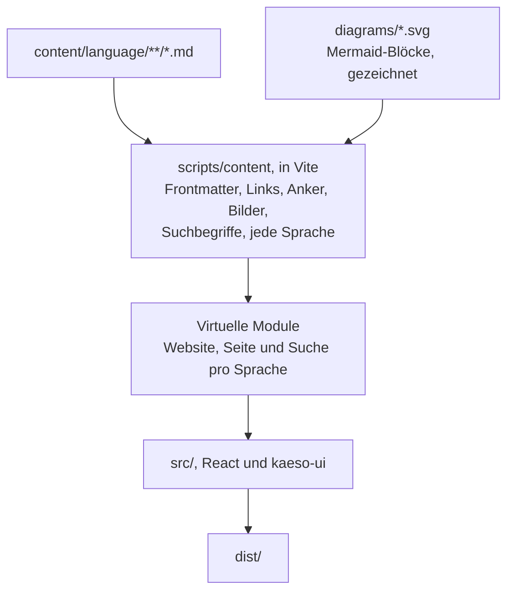

Die Dokumentation ist das Paket `kaeso-docs` in `apps/docs`: Markdown-Seiten, beim Build zu einer statischen Website kompiliert, die nur mit `@logicplanes/kaeso-ui` gezeichnet wird. [Dokumentation schreiben](../documentation.md) behandelt die Seiten; diese Seite behandelt den Code, der daraus die Website macht.

## Der Build

`apps/docs/scripts/content` macht aus den Seiten die Module der Website:

| Datei | Aufgabe |
| --- | --- |
| `frontmatter.ts` | Die vier Felder der Frontmatter, mit einer Meldung für jeden Fehler |
| `slug.ts` | Die Überschriften-Anker von GitHub und die Adressen aus Dateinamen |
| `compile.ts` | Eine Seite: der Lexer von marked mit abgeschaltetem Roh-HTML, dann das Seitenformat aus `src/markdown/ast.ts`, mit geprüften Links, Code-Gruppen aus aufeinanderfolgenden Fences mit `tab`, Link-Karten aus Listen von Seitenlinks und gesammelten Suchbegriffen |
| `site.ts` | Eine Sprache: Adressen, die Seitenleiste, vorherige und nächste Seite, relative Links so aufgelöst wie auf GitHub, Bilder und ihre Größen |
| `docs.ts` | Alle Sprachen und die Prüfung, dass sie dieselben Seiten in derselben Reihenfolge enthalten |
| `changelog.ts` | Die Seite `/changelog`, gebaut aus `CHANGELOG.md` über `history` in `scripts/changelog.mjs` |
| `diagram.ts`, `mermaid.ts`, `diagrams.ts` | Die Diagramme: ihre Mermaid-Konfiguration aus den Tokens von Kaeso, ihr Zeichnen in Headless-Chromium und `pnpm --filter kaeso-docs diagrams` |
| `redirects.ts` | Die Seiten unter alten Adressen aus `redirects.json` |
| `plugin.ts` | Das Vite-Plugin: virtuelle Module, Neuladen in der Entwicklung, eine HTML-Datei pro Seite und Sprache, die `404.html`-Dateien und die Sitemap |
| `check.ts` | `pnpm --filter kaeso-docs check:content`: dieselben Prüfungen, ohne die App zu bauen |

In der Entwicklung wird ein Problem ausgegeben, und die Seite wird trotzdem gezeichnet. Der Build und `check:content` schlagen daran fehl und nennen die Datei.

## Sicherheit

Jeder kann eine Seite im Browser auf GitHub vorschlagen, daher behandelt der Build Seiten als nicht vertrauenswürdigen Text:

- marked zerlegt nur in Tokens, mit abgeschalteten HTML-Tokenizern, sodass `<script>`, `` und jedes andere Tag wörtlicher Text bleiben.
- Link-Referenzen sind abgeschaltet, und Links behalten nur http, https und mailto. Das Schema wird geprüft, nachdem Leerraum und Steuerzeichen entfernt sind, sodass `java\nscript:` auffällt.
- Bilder kommen nur aus `content/`.
- Der Browser erhält einfache Objekte, nie HTML, und nichts setzt `innerHTML`.

`scripts/content/compile.test.ts` enthält die Fälle.

## Diagramme

Ein `mermaid`-Block wird beim Build zu zwei statischen SVG-Dateien, sodass kein Mermaid-Code den Browser erreicht und die strenge Content Security Policy bestehen bleibt. `mermaid.ts` zeichnet jedes Diagramm in Chromium mit den Farben, der Schrift und dem Radius von `@logicplanes/kaeso-tokens`, einmal hell und einmal dunkel. Dann schreibt es jeden berechneten Stil auf sein Element und entfernt das Stylesheet, sodass ein mit `` gezeigtes SVG nichts von der Seite braucht.

Die Zeichnungen sind in `apps/docs/diagrams/` committet, benannt nach einem Hash aus Quelltext des Diagramms, Mermaid-Version und Konfiguration. Ein Build ohne Chromium liest sie nur. Die Seite zeigt beide mit `ThemeImage`, und die zum aktuellen Theme passende ist sichtbar.

## Laden

`src/router.tsx` hat einen Routenbaum pro Sprache. Sein Layout lädt das Website-Modul der Sprache, das die Seitenleiste sowie Titel und Beschreibung jeder Seite enthält, sodass die Seitenleiste mit dem Rahmen gezeichnet wird und nie springt. Jede Adresse lädt den eigenen Chunk ihrer Seite.

- Fährt jemand mit der Maus über einen Link oder fokussiert ihn, wird der Chunk der Seite geladen (`defaultPreload: "intent"`), sodass sich Seiten sofort öffnen.
- Die Suche und ihr Index laden kurz nach dem ersten Zeichnen. Was jemand tippt, bevor sie geladen ist, wird zu ihrer Abfrage.
- Das HTML jeder Seite lädt die Chunks ihrer Sprache und der Seite selbst vorab.
- `vite.config.ts` schreibt Importe aus `@logicplanes/kaeso-ui` auf die Einstiegspunkte der einzelnen Komponenten um (`uiEntryImports`), wie in der Konsole.
- Die Website lädt nichts außer ihren eigenen Chunks, die die Loader des Routers behalten, und braucht daher kein TanStack Query.

Der erste Besuch einer englischen Adresse folgt den Sprachen des Browsers und wechselt ohne Navigation nach `/de` oder `/zh-CN`. Eine im Menü oder in der Suche gewählte Sprache wird als `kaeso-docs:locale` gespeichert. Der Tab, den jemand in einer Code-Gruppe wählt, wird als `kaeso-docs:code-tab` gespeichert, und jede Gruppe mit einem Tab dieses Namens öffnet sich auf jeder Seite mit ihm.

## Ausgabe

`pnpm --filter kaeso-docs build` schreibt `apps/docs/dist`: eine HTML-Datei für jede Seite in jeder Sprache, mit ihrem `<head>` für Suchmaschinen und Linkvorschauen. Daneben liegen eine `404.html` pro Sprache, `sitemap.xml`, `robots.txt`, eine Seite unter jeder alten Adresse aus `redirects.json` und die [Content Security Policy](../releasing.md#content-security-policy) der Website in `csp.txt` und `_headers`.

Der Build endet mit zwei Prüfungen. `scripts/budget.ts` prüft den Rahmen und jede Seite gegen ihre Bundle-Budgets, und `scripts/check-site.mjs` prüft die Sitemap und den `<head>` jeder Seite. `pnpm --filter kaeso-docs licenses:check` prüft danach die Lizenz jedes Pakets im Build.
