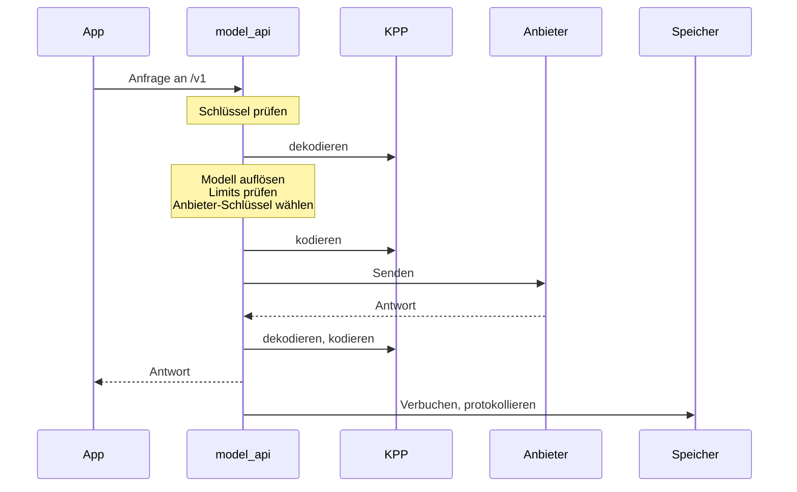

Das Gateway ist der eine Server einer Installation, gebaut aus dem Rust-Workspace in `crates/` zu einem Binary, `kaeso`. Apps rufen es mit den offiziellen SDKs von OpenAI und Anthropic auf, und Konsole und Skripte verwalten es über die Platform API. [Ablauf einer Anfrage](../../concepts/request-flow.md) beschreibt eine Anfrage von außen; diese Seite beschreibt das Innere.

## Der Anfrageweg

Eine Modellanfrage durchläuft immer dieselben Schritte in derselben Reihenfolge:



In einem Projekt mit eingeschaltetem [Antwort-Cache](../../console/response-cache.md) schlägt das Gateway die kodierte Anfrage in Valkey nach, bevor es sie sendet. Ein Treffer wird aus seinem versiegelten Eintrag dekodiert und für die App kodiert, ohne den Anbieter (`crates/kaeso-server/src/services/response_cache.rs`).

Eine Anfrage an die Platform API authentifiziert sich mit einem Sitzungscookie, einem API-Schlüssel mit Plattformzugriff, einem Plattform-Schlüssel oder dem Access-Token eines Agenten. Jeder Endpunkt prüft dann genau ein Recht, und ein Service ändert PostgreSQL und schreibt ein Audit-Ereignis.

| Code | Wo |
| --- | --- |
| Die Modell-API (`/v1`) | `crates/kaeso-server/src/model_api` |
| Die Platform API (`/platform/v1`) | `crates/kaeso-server/src/platform` |
| Der MCP-Server und seine OAuth-Anmeldung (`/mcp`, `/oauth`) | `crates/kaeso-server/src/mcp` |
| Die Services, die beide nutzen | `crates/kaeso-server/src/services` |

## Crates

| Crate | Aufgabe |
| --- | --- |
| `kaeso` | Das Binary: seine Befehlszeile (`serve`, `migrate`, `master-key`, `user`, `sso`, `instance`, `setup-link`, `healthcheck`, `openapi`), Start und Herunterfahren. Das einzige Crate, das `anyhow` nutzen darf |
| `kaeso-server` | Die Router für `/v1`, `/platform/v1`, `/mcp`, Health und Metriken, mit Extraktoren, Fehlerzuordnung, dem OpenAPI-Dokument, CSRF-Prüfungen, Anfrage-IDs und Größenlimits. Außerdem die Services hinter beiden APIs, die Konfiguration, Hintergrund-Jobs und Telemetrie |
| `kaeso-core` | Fachregeln ohne I/O: IDs, Rechte und Rollen, das Schlüsselformat, die Modellauflösung, der Katalog, Fähigkeiten, Limits, Kosten und der Assembler für Stream-Antworten. `data/` enthält die Modelldaten, die jedes Release mitliefert |
| `kaeso-store` | PostgreSQL über sqlx, ClickHouse, die Valkey-Verbindungen (eine für Limitprüfungen und Zähler, zwei für Cache-Einträge und aufbewahrtes Reasoning) mit der Cache-Invalidierung und die Migrationen beider Datenbanken |
| `kaeso-upstream` | Der Transport zu den Anbietern: HTTP-Clients, Auth-Header, Basis-URLs, Timeouts, gestreamte Bodies und Abbruch |
| `kaeso-crypto` | Envelope-Verschlüsselung (AES-256-GCM), der Schlüsselring der Hauptschlüssel, Passwörter, TOTP und die schwärzenden Typen für Geheimnisse |
| `kaeso-mail` | Der SMTP-Versand und jede E-Mail, in drei Sprachen ([E-Mails](emails.md)) |
| `kaeso-update` | Updates ohne I/O: das Release-Manifest, die Update-Richtlinie und das Protokoll des Updaters ([Updates](updates.md)) |
| `kaeso-updater` | Der optionale Updater, der einzige Teil von Kaeso, der mit Docker spricht ([Updates](updates.md)) |
| `kaeso-testkit` | Nur für Tests: Datenbanken für Entwicklung und Tests, der aus den Fixtures von KPP gebaute Mock-Anbieter und ein Mock-Identitätsanbieter |
| `kaeso-bench` | Der [Gateway-Benchmark](../benchmark.md): das ganze Gateway in einem eigenen Prozess, zwischen echten Clients und dem Mock-Anbieter |
| `kaeso-kpp`, `kaeso-codecs` | Die Typen und Codecs von KPP ([KPP-Interna](../kpp/index.md)) |
| `kpp-conformance` | Der Server hinter der [SDK-Konformität](../testing.md#sdk-konformität) |
| `xtask` | `cargo xtask kpmr` aktualisiert die Modelldaten, und `cargo xtask record` [zeichnet Antworten der Anbieter auf](../kpp/fixtures.md#live-antworten-aufzeichnen) |

Jedes Crate übernimmt Version, Edition und Lints aus der `Cargo.toml` im Wurzelverzeichnis. Nur `kaeso-kpp` und `kaeso-codecs` erscheinen auf crates.io.

## Regeln

Jede Änderung am Gateway folgt diesen Regeln, und Lints und Tests setzen die meisten davon durch.

1. **Wire-Formate gibt es nur in KPP.** Das Gateway parst oder baut nie von Hand JSON von OpenAI oder Anthropic; das übernimmt `kaeso_codecs::dispatch`. Eigenes JSON des Gateways sind nur die Platform API und ihr Fehler-Envelope.
2. **Kein Passthrough.** Jede Modellanfrage wird nach KPP dekodiert und neu kodiert, auch wenn App und Anbieter dasselbe Format sprechen.
3. **Keine Wiederholungen und keine Fallbacks.** Ein fehlgeschlagener Aufruf beim Anbieter schlägt fehl, im Format der App.
4. **Nie stillschweigend Daten verwerfen.** Was KPP ablehnt (`Unsupported`), geht als Fehler im Format der App zurück, bevor etwas einen Anbieter erreicht. Ein `KppError` wird nie abgefangen und ignoriert.
5. **Keine Panics in Bibliotheks-Crates.** Kein `unwrap`, `expect`, `panic!`, `todo!`, `unimplemented!`, keine panikauslösende Indizierung und kein `unsafe` außerhalb von Tests und dem Start des Binarys. Die Workspace-Lints und `#![forbid(unsafe_code)]` setzen das durch.
6. **Geheimnisse verlassen den Speicher nie ungeschützt.** Anbieter-Schlüssel, Hauptschlüssel, Geheimnisse von API-Schlüsseln, Sitzungs-IDs, Anmelde-Tokens, TOTP-Geheimnisse und Passwörter stecken in schwärzenden Wrapper-Typen. Sie werden nie protokolliert, in Traces geschrieben, ausgegeben, in ClickHouse gespeichert, von einer API zurückgegeben oder in eine Fehlermeldung geschrieben.
7. **Geld ist nie eine Gleitkommazahl.** Nutzen Sie `rust_decimal::Decimal` in Rust, `NUMERIC` in PostgreSQL und `Decimal` in ClickHouse. Die laufenden Ausgabenzähler in Valkey sind ganzzahlige Nano-Dollar, aufgerundet.
8. **Ein Recht pro Endpunkt, jede Änderung auditiert.** Jeder Endpunkt der Platform API prüft genau ein Recht aus `crates/kaeso-core/src/rights/catalogue.rs` ([Rechte](../../concepts/rights.md)), außer `me/*` und `auth/*`. `instance/*` prüft das Admin-Flag der Instanz. Routen werden mit ihrem Recht registriert, sodass eine fehlende Prüfung einen Test scheitern lässt.
9. **Organisationen sind voneinander isoliert.** Jede Abfrage, die Daten einer Organisation liest, filtert nach der Organisation aus dem authentifizierten Kontext, nie allein nach Benutzereingaben.
10. **Migrationen laufen nur vorwärts.** Sie laufen beim Start unter einer Sperre, aus `crates/kaeso-store/migrations/postgres` und `crates/kaeso-store/migrations/clickhouse`. Eine veröffentlichte Datei wird nie geändert, eine Schemaänderung ist also eine neue Datei. Eine Migration, die einen Schritt von Hand braucht, macht das Release zu einem Major-Release.
11. **Das OpenAPI-Dokument wird erzeugt.** Zusammenfassungen und Beschreibungen von Operationen stehen in `#[utoipa::path(summary = …, description = …)]`, Typbeschreibungen in `#[schema(description = …)]` und Beschreibungen von Feldern, Varianten und Query-Parametern in `#[doc = "…"]`. Schreiben Sie das Dokument mit `cargo run -q -p kaeso -- openapi > openapi.json` neu.
12. **Tests sind deterministisch.** Uhren und Zufallsquellen werden injiziert, und nichts schläft, um sich zu synchronisieren; Tests pollen mit Fristen.

## Konfiguration

Jede Einstellung ist eine Zeile der Tabelle in `crates/kaeso-server/src/config/settings.rs`: TOML-Schlüssel, Umgebungsvariable, Typ, Standardwert, ob sie geheim ist, und eine Beschreibung in einem Satz. Anbietereinstellungen sind eine einzige Musterzeile, `providers.<id>.<field>`. Die Tabelle wiederholt sie für jeden Anbieter in `crates/kaeso-core/src/provider.rs` und jedes Feld in `PROVIDER_FIELDS`.

`config/load.rs` führt die Standardwerte, die TOML-Datei aus `KAESO_CONFIG` und die `KAESO_*`-Variablen zusammen, einschließlich der `_FILE`-Variablen für Geheimnisse. Es liest die Datei mit dem Crate `toml`, und jeder Fehler nennt seine Einstellung. Ein Konfigurations-Crate wie figment wäre eine zweite Quelle der Wahrheit für Schlüssel und Standardwerte.

Tests prüfen, dass jede Variable ihrem Schlüssel folgt und eindeutig zurückführt und dass Variablennamen nicht kollidieren können. Sie prüfen außerdem, dass Pflichteinstellungen und Geheimnisse keinen Standardwert haben und dass `deploy/kaeso.example.toml` jede Einstellung außer den Geheimnissen auf ihren Standardwert setzt. Sie schreiben die Tabelle außerdem in einen geprüften Snapshot. Eine geänderte Einstellung ändert diesen Snapshot, und [Konfiguration](../../self-hosting/configuration.md) wird danach aktualisiert.

## Anbieter-IDs

Eine Anbieter-ID besteht aus Kleinbuchstaben und Ziffern mit einzelnen Bindestrichen dazwischen, `^[a-z0-9]+(-[a-z0-9]+)*$`. Die Regel steht in `ProviderId` und `ID_PATTERN` in `crates/kaeso-core/src/provider.rs`, und jede ID, die ins Gateway gelangt, geht durch sie. Das betrifft Konfigurationsschlüssel und -variablen, Anbieter-Schlüssel und Katalogmodelle in der Platform API, und den Import von KPMR.

Eine Prüfung zur Compile-Zeit stellt sicher, dass jede ID in `PROVIDERS` der Regel folgt. Die CHECK-Constraints von PostgreSQL auf den Spalten `provider` nutzen dasselbe Muster, was ein Store-Test vergleicht. Ein weiterer Test prüft jeden Anbieter im mitgelieferten KPMR-Snapshot.

## Eigene Anbieter

Die eigenen Anbieter einer Organisation liegen in der Tabelle `custom_providers`, eine Zeile pro Organisation und ID. `OrgProviders` in `crates/kaeso-core/src/providers.rs` löst eine ID zu einer `ProviderRef` auf: zuerst der eigene Anbieter der Organisation, dann der eingebaute, sodass ein eingebauter Anbieter, den ein späteres Release unter einer vergebenen ID aufnimmt, nie die Schlüssel dieser Organisation erhält. Der Anfragepfad fragt dafür keine Datenbank ab: Die gecachten `ProjectModels` eines Projekts tragen die eigenen Anbieter seiner Organisation, und jede Änderung an einem vergisst die gecachten Modelle der Projekte der Organisation.

Ein eigener Anbieter spricht den reinen Dialekt, `ChatProfile::OPENAI` für Chat Completions, ohne Meldungen für abgelehnte Schlüssel und ohne Konto-Anmeldung. Seine Aufrufe gehen durch `kaeso_upstream::guard`, dieselbe Adressprüfung, die die OIDC-Discovery nutzt. Der Resolver prüft bei jeder neuen Verbindung jede Adresse, zu der ein Name auflöst, `check_literal` prüft eine IP-Adresse in der URL vor jedem Aufruf, und überwachte Clients nutzen keinen Proxy und einen eigenen Verbindungspool. Metriken kennzeichnen jeden eigenen Anbieter als `custom`; Anfrageprotokolle und Nutzung behalten seine ID.

## Modelldaten

`crates/kaeso-core/data/kpmr.json` ist ein Snapshot des [KPMR](../../concepts/kpmr.md)-Katalogs im Format 1 für die Anbieter, die Kaeso aufruft, damit eine frische Installation ohne Netzzugang funktioniert. Seine `provider_ids` nennen jeden Anbieter, den KPMR kennt und dessen ID ein eigener Anbieter nicht nehmen darf. Die `README.md` des Ordners hält Revision, Erstellungszeitpunkt bei KPMR und SHA-256 des Snapshots fest.

`kaeso_core::kpmr` liest einen Katalog: Es prüft das Format, behält die Anbieter, die Kaeso aufruft, überspringt ein Modell, das sich nicht lesen lässt oder in einer anderen Einheit bepreist ist, und prüft die Ed25519-Signatur gegen die vertrauenswürdigen Schlüssel. `Fields::from_kpmr` macht aus einem Modell Katalogfelder. Neben Namen, Preisen, Limits und Fähigkeiten liefert KPMR diese:

| Feld | Aus | Bedeutung |
| --- | --- | --- |
| `adaptive_thinking` | `reasoning.adaptive_thinking` | Anthropic-Modelle: ob das Modell `thinking: {type: "adaptive"}` annimmt. Bei `false` macht KPP aus einer Aufwandsstufe eines anderen Formats ein Thinking-Budget |
| `thinking_binding` | `reasoning.thinking_binding` | `true` für ein Anthropic-Modell, das einen wiedergegebenen Thinking-Block mit der Unterhaltung abgleicht, die ihn erzeugt hat (Preserved Thinking, etwa Claude Fable 5.1, Opus 5.5, Sonnet 5.5 und Haiku 5.5). Bei einem solchen Modell bittet eine Anfrage aus einem anderen Format, die Claudes Thinking wiedergibt, Anthropic, einen Block zu verwerfen, dessen Unterhaltung sich geändert hat ([Anthropic Messages](../kpp/anthropic-messages.md)). Es wirkt nur mit adaptivem Thinking, das `block_binding` braucht. Fehlt es, prüft das Modell nicht |
| `forced_tool_choice` | `capabilities.forced_tool_choice` | `false` für ein Modell, das eine erzwungene Tool-Wahl ablehnt (Anthropics `tool_choice` `any` oder `tool`), sodass das Gateway `required`, `any` oder ein benanntes Tool ablehnt, bevor es den Anbieter aufruft. Fehlt es, nimmt das Modell eine an |
| `efforts` | `reasoning.efforts` | Die Aufwandsstufen, die das Modell unterstützt; Stufen, die diese Version nicht kennt, fallen weg |
| `egress_dialect` | `gateway.egress_dialect` | Das Format, das Kaeso sendet: einer der Dialekte des Anbieters, standardmäßig sein Generierungsdialekt (`openai_responses` für OpenAI). Ein Modell der Art `embedding` wird als Embeddings gesendet, wenn sein Anbieter dieses Format hat |
| `cache_write_1h_price` | `pricing.cache_write_1h` | Der Preis eines Cache-Schreibvorgangs für eine Stunde; fehlt er oder setzt eine Anpassung den Eingabepreis, gilt das Doppelte des Eingabepreises |

Der Wert eines Katalogeintrags ist sein Override, sonst der von KPMR. Sofern `KAESO_KPMR_SYNC` nicht `false` ist, prüft der Job `kpmr_sync` alle 5 Minuten, ob das Gateway KPMR wieder fragen muss, nach `KAESO_KPMR_INTERVAL` oder `refresh_seconds` des Katalogs. Er sendet das gespeicherte ETag, nimmt `304` als unverändert, lehnt einen Katalog ab, den kein vertrauenswürdiger Schlüssel signiert hat, und speichert das Ergebnis mit seinem ETag in PostgreSQL. Andere Instanzen laden es über Valkey neu. Beim Start gewinnt der neuere von gespeichertem und eingebautem Snapshot. Daten, die ein Release mit weniger Anbietern oder Feldern gespeichert hat, erhalten die fehlenden Anbieter aus dem eingebauten Snapshot und werden sofort neu abgerufen, auch wenn sich KPMR nicht geändert hat.

Aktualisieren Sie den Snapshot vor einem Release:

```bash
cargo xtask kpmr
```

Die Aufgabe lädt `https://kpmr.kaeso.app/v1/catalogue` für die Anbieter herunter, die Kaeso aufruft, prüft die Signatur gegen den eingebauten Schlüssel und prüft, dass das Gateway jedes Modell liest. `--url` oder `KPMR_URL` ändert die Adresse, und `--public-keys` oder `KPMR_PUBLIC_KEYS` vertraut weiteren Schlüsseln. Danach schreibt sie den Katalog genau so, wie KPMR ihn gesendet hat, und die Tabelle in `crates/kaeso-core/data/README.md`, und ein Test prüft, dass beide übereinstimmen.

## Nutzung und Anfrageprotokolle

Die Modell-API übergibt jede beendete Anfrage an eine Senke. Sie addiert die Nutzung der Anfrage zu einem Stapel im Speicher, geordnet nach Tag, Projekt, Schlüssel, Mitglied, Modell und Route, und schreibt den Stapel alle 10 Sekunden in `usage_daily` in PostgreSQL. Dieselbe Senke bucht die Limit-Zähler in Valkey, die aus `usage_daily` neu aufgebaut werden. Die Nutzungsseiten, die `usage`-Endpunkte der Platform API und die Summen der Organisationen für die Instanz lesen nur `usage_daily`.

Anfrageprotokolle gehen über einen eigenen Puffer an `request_log` und `request_content` in ClickHouse. Ohne `clickhouse.url` ist `AppState::clickhouse` `None`: Das Gateway führt keine ClickHouse-Migrationen aus, startet keinen Protokollschreiber, behält keine Inhalte zum Protokollieren, und die Protokoll-Endpunkte antworten mit `404`. Die ClickHouse-Migration 0007 hat das eigene `usage_daily` von ClickHouse entfernt, als die Nutzung nach PostgreSQL wechselte.

## Protokollierte Antworten

Bei eingeschalteter Inhaltsprotokollierung speichert das Gateway jede Antwort als serde-JSON von `kaeso_kpp::Response` in der Spalte `reply` von `request_content` in ClickHouse. Der Log-Inspektor der Konsole zeichnet sie so, wie sie gespeichert ist. Eine Organisation darf Inhalte bis zu 36.500 Tage aufbewahren, also muss jede spätere Konsole eine heute protokollierte Antwort noch lesen können.

- **Die erste Form hat kein Versionsfeld.** Snapshots in `crates/kaeso-server/src/services/snapshots/` halten sie für repräsentative Antworten fest, und `logged_replies_keep_the_v0_1_form` schlägt bei einer serde-Änderung an einem KPP-Typ fehl.
- **Eine Änderung dieser Form ist eine Formatänderung.** Ab der ersten Änderung schreibt das Gateway eine Nummer `format` in die Antwort, `2` für die zweite Form. Die Konsole lernt die neue Form und behält ihren Renderer für jede ältere. Die geänderten Snapshots nur zu akzeptieren, reicht nie.
- **Die Konsole liest nur, was sie kennt.** Eine Antwort ohne `format` zeichnet sie mit ihrem aktuellen Renderer, eine Antwort mit einem beliebigen Wert in `format` zeigt sie als gespeichertes JSON mit einem Hinweis (`isKnownReplyForm` in `apps/console/src/features/project/logs/render.ts`).

## Fehlermeldungen

Die Konsole zeigt die `message` der Platform API unverändert in einem Toast, daher ist jede Meldung ein kurzer Satz:

- Höchstens 90 Zeichen, wie im Code geschrieben, Platzhalter eingeschlossen, und höchstens 120, wenn sie gefüllt sind. Sie endet mit einem Punkt.
- Ein Satz: Verbinden Sie zwei Gedanken mit einem Semikolon (`Your session has ended; sign in again.`) oder lassen Sie den zweiten weg. Keine Abkürzungen wie „e.g.“ und keine Zeilenumbrüche.
- Sagen Sie, was falsch ist, und, wo es passt, was zu tun ist. Nennen Sie Felder als Code-Spans und setzen Sie das Feld in `param`.
- Keine internen Namen wie ClickHouse, Valkey, Konfigurationsschlüssel oder Modulpfade und keine angehängten technischen Details. Protokollieren Sie diese mit `tracing`.
- Interne Ursachen wie `ApiError::internal` und Logzeilen beginnen mit einem Kleinbuchstaben. Meldungen für Menschen beginnen mit einem Großbuchstaben oder einem Code-Span.

`crates/kaeso-server/tests/error_copy.rs` durchsucht den Code hinter der Platform API und schlägt bei einer Meldung fehl, die gegen diese Regeln verstößt. Die Integrationstests prüfen jede Antwort, die sie erhalten (`crates/kaeso-server/tests/common/copy.rs`). Die Modell-API behält die Fehlerformate ihrer Anbieter, daher gelten diese Regeln für sie nicht.
