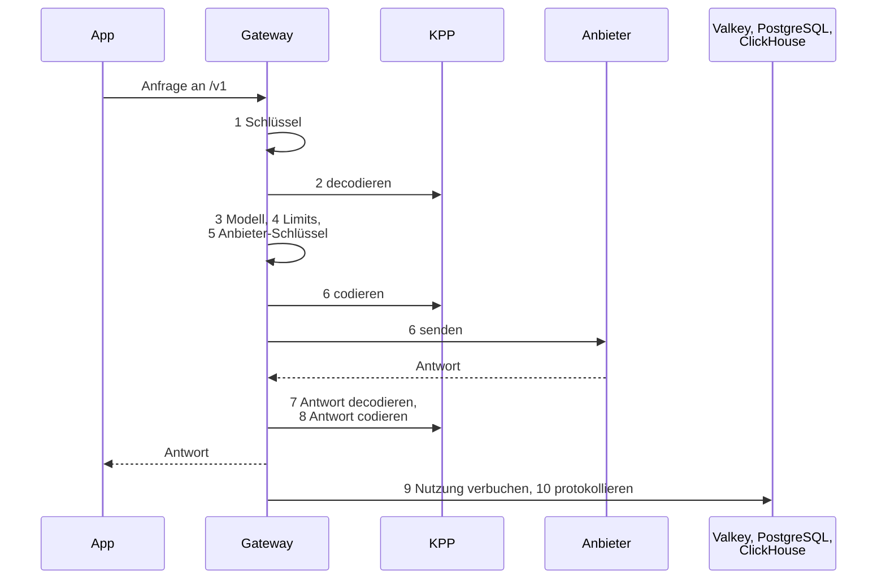
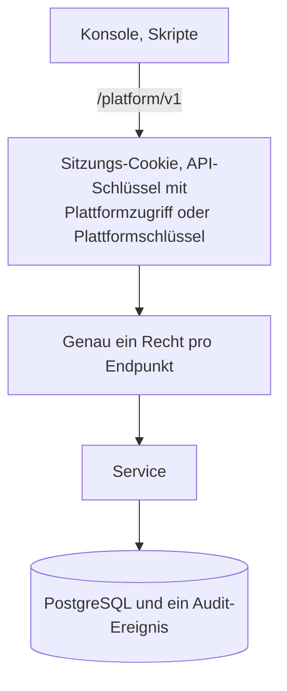

Das Gateway ist der eine Server einer Installation. Apps rufen es mit den offiziellen SDKs von OpenAI und Anthropic auf; Konsole und Skripte verwalten es über die Platform API. Es ist der Rust-Workspace in `crates/`, gebaut zu einem einzigen Binary, `kaeso`. [Ablauf einer Anfrage](../../concepts/request-flow.md) beschreibt eine Anfrage von außen; diese Seite beschreibt das Innere.

## Der Anfrageweg



Eine Anfrage an die Platform API nimmt diesen Weg:



| Code | Ort |
| --- | --- |
| Die Modell-API (`/v1`) | `crates/kaeso-server/src/model_api` |
| Die Platform API (`/platform/v1`) | `crates/kaeso-server/src/platform` |
| Die Services, die beide nutzen | `crates/kaeso-server/src/services` |

[Architektur](index.md#der-rust-workspace) listet alle Crates auf.

## Regeln

Jede Änderung am Gateway folgt diesen Regeln; die meisten erzwingen Lints und Tests.

1. **Wire-Formate gibt es nur in KPP.** Das Gateway parst oder baut nie von Hand das JSON von Anfragen, Antworten, Streams, Fehlern oder Modelllisten von OpenAI oder Anthropic; das übernimmt `kaeso_codecs::dispatch`. Eigenes JSON des Gateways sind nur die Platform API und ihr Fehler-Envelope.
2. **Kein Passthrough.** Jede Modellanfrage wird nach KPP dekodiert und neu kodiert, auch wenn App und Anbieter dasselbe Format sprechen.
3. **Keine Wiederholungen und keine Fallbacks.** Ein fehlgeschlagener Aufruf beim Anbieter schlägt fehl, im Format der App.
4. **Nie stillschweigend Daten verwerfen.** Was KPP ablehnt (`Unsupported`), geht als Fehler im Format der App zurück, bevor irgendetwas an einen Anbieter gesendet wird. Ein `KppError` wird nie abgefangen und ignoriert.
5. **Keine Panics in Library-Crates.** Kein `unwrap`, `expect`, `panic!`, `todo!`, `unimplemented!`, keine panikende Indizierung und kein `unsafe` außerhalb von Tests und dem Start des Binarys. Die Workspace-Lints in `Cargo.toml` und `#![forbid(unsafe_code)]` erzwingen das.
6. **Geheimnisse verlassen den Speicher nie ungeschützt.** Anbieter-Schlüssel, Hauptschlüssel, Geheimnisse von API-Schlüsseln, Sitzungs-IDs, Anmelde-Tokens, TOTP-Geheimnisse und Passwörter werden nie protokolliert, in Traces geschrieben, ausgegeben, in ClickHouse gespeichert, von einer API zurückgegeben oder in eine Fehlermeldung geschrieben. Sie stecken in schwärzenden Wrapper-Typen.
7. **Geld ist nie ein Float.** `rust_decimal::Decimal` in Rust, `NUMERIC` in PostgreSQL, `Decimal` in ClickHouse; die laufenden Ausgabenzähler in Valkey sind ganzzahlige Nano-Dollar, aufgerundet.
8. **Ein Recht pro Endpunkt, jede Änderung auditiert.** Jeder Endpunkt der Platform API prüft genau ein Recht aus `crates/kaeso-core/src/rights/catalogue.rs` ([Rechte](../../concepts/rights.md)), außer `me/*` und `auth/*`; `instance/*` prüft das Instanz-Admin-Flag. Routen werden mit ihrem Recht registriert, sodass eine fehlende Prüfung einen Test scheitern lässt.
9. **Organisationen sind voneinander isoliert.** Jede Abfrage an PostgreSQL und ClickHouse, die Daten einer Organisation liest, filtert nach der Organisation aus dem authentifizierten Kontext, nie allein nach Benutzereingaben.
10. **Migrationen laufen nur vorwärts** und werden beim Start unter einer Sperre ausgeführt: `crates/kaeso-store/migrations/postgres` (sqlx) und `crates/kaeso-store/migrations/clickhouse` (geordnete SQL-Dateien). Eine veröffentlichte Datei wird nie geändert; eine Schemaänderung ist eine neue Datei. Eine Migration, die einen manuellen Schritt braucht, macht das Release zu einem Major-Release.
11. **Das OpenAPI-Dokument wird generiert.** Zusammenfassungen und Beschreibungen von Operationen stehen in `#[utoipa::path(summary = …, description = …)]`, Typbeschreibungen in `#[schema(description = …)]` und Beschreibungen von Feldern, Varianten und Query-Parametern in `#[doc = "…"]`-Attributen, der einzigen Form, die utoipa dort liest. `cargo run -q -p kaeso -- openapi > openapi.json` schreibt das Dokument neu.
12. **Tests sind deterministisch.** Uhren und Zufallsquellen werden injiziert, und nichts schläft, um sich zu synchronisieren; Tests pollen mit Fristen.

## Konfiguration

Jede Einstellung ist eine Zeile der Tabelle in `crates/kaeso-server/src/config/settings.rs`: TOML-Schlüssel, Umgebungsvariable, Typ, Standardwert, ob sie geheim ist, und eine Beschreibung in einem Satz. Anbietereinstellungen sind eine einzige Musterzeile, `providers.<id>.<field>`, die die Tabelle für jeden Anbieter in `crates/kaeso-core/src/provider.rs` und jedes Feld in `PROVIDER_FIELDS` wiederholt ([Anbietereinstellungen](../../self-hosting/configuration.md#anbietereinstellungen) nennt die Namensregel).

`config/load.rs` führt die Standardwerte, die TOML-Datei aus `KAESO_CONFIG` und die `KAESO_*`-Variablen zusammen, einschließlich der `_FILE`-Variablen für Geheimnisse. Es nutzt direkt das Crate `toml`, und jeder Fehler nennt seine Einstellung. Ein Konfigurations-Crate wie figment gibt es nicht, weil es eine zweite Quelle der Wahrheit für Schlüssel und Standardwerte wäre.

Tests prüfen, dass:

- jede Umgebungsvariable ihrem Schlüssel folgt und jede Anbietervariable eindeutig auf ihren Anbieter und ihr Feld zurückführt;
- kein Feldname auf `_` und den Namen eines anderen Felds endet, damit Variablennamen nicht kollidieren;
- Pflichteinstellungen und Geheimnisse keinen Standardwert haben und jede Beschreibung ein Satz ist;
- `deploy/kaeso.example.toml` sich laden lässt und jede Einstellung außer den Geheimnissen auf ihren Standardwert setzt.

Die Tests schreiben die Tabelle außerdem in einen geprüften Snapshot in `crates/kaeso-server/tests/snapshots/`. Eine geänderte Einstellung ändert diesen Snapshot, und [Konfiguration](../../self-hosting/configuration.md) wird danach aktualisiert.

## Anbieter-IDs

Eine Anbieter-ID besteht aus Kleinbuchstaben und Ziffern mit einzelnen Bindestrichen dazwischen: `^[a-z0-9]+(-[a-z0-9]+)*$`. Die Regel steht an genau einer Stelle, `ProviderId` und `ID_PATTERN` in `crates/kaeso-core/src/provider.rs`, und jede ID, die ins Gateway gelangt, geht durch sie: Konfigurationsschlüssel und -variablen, Anbieter-Schlüssel und Katalogmodelle in der Platform API (deren OpenAPI-Dokument das Muster als Schema `ProviderId` angibt), das Supplement und der Import von models.dev.

Drei Prüfungen halten die Regel an einer Stelle:

- eine Prüfung zur Compile-Zeit hält jede ID in `PROVIDERS` an sie;
- die CHECK-Constraints von PostgreSQL auf den Spalten `provider` von `provider_credentials`, `catalogue_models` und `usage_daily` verwenden dasselbe Muster, was ein Store-Test vergleicht;
- ein Test prüft, dass jeder Anbieter im mitgelieferten models.dev-Snapshot ihr folgt, da Einträge von models.dev unter der eigenen ID des Anbieters gelesen werden.

## Modelldaten

`crates/kaeso-core/data` enthält die Modelldaten, die jedes Release mitliefert:

| Datei | Inhalt |
| --- | --- |
| `models-dev.json` | Ein Snapshot von [models.dev](https://models.dev), gefiltert auf die Anbieter, die Kaeso aufruft, sodass eine frische Installation ohne Netzwerkzugang funktioniert. Die `README.md` des Ordners hält fest, wann er abgerufen wurde, und seinen SHA-256. |
| `supplement.toml` | Felder, die models.dev nicht hat, jeder Eintrag mit seiner Quelle in der `README.md` des Ordners: `adaptive_thinking` für Anthropic-Modelle, `forced_tool_choice: false` für Modelle, die eine erzwungene Tool-Auswahl ablehnen, `efforts`, wo models.dev keine nennt, und `egress_dialect`, das Format, das Kaeso an ein OpenAI-Modell sendet. |

Der Wert eines Katalogeintrags ist sein Override, sonst models.dev, sonst das Supplement, sonst leer. Das Gateway synchronisiert models.dev standardmäßig alle 24 Stunden (`KAESO_MODELS_DEV_INTERVAL`), wendet denselben Filter an und speichert das Ergebnis in PostgreSQL; beim Start gewinnt der neuere der gespeicherten und des eingebauten Snapshots. Nur Anbieter aus `crates/kaeso-core/src/provider.rs` bleiben erhalten.

Vor einem Release den Snapshot aktualisieren:

```bash
cargo xtask models-dev
```

Die Aufgabe lädt `https://models.dev/api.json` herunter (`--url` oder `MODELS_DEV_URL` ändert die Adresse), filtert die Daten und prüft, dass das Gateway das Ergebnis lesen kann. Dann schreibt sie den Snapshot, die Tabelle in `crates/kaeso-core/data/README.md` und den Abrufzeitpunkt in `crates/kaeso-core/src/models_dev.rs` und gibt den neuen Hash aus. Tests prüfen, dass die drei übereinstimmen.

## Protokollierte Antworten

Bei eingeschalteter Inhaltsprotokollierung speichert das Gateway jede Antwort in KPP-Form, dem serde-JSON von `kaeso_kpp::Response`, in der Spalte `reply` von `request_content` in ClickHouse. Die Platform API gibt sie unverändert zurück, und der Log-Inspektor der Konsole zeichnet sie. Eine Organisation darf Inhalte bis zu 36.500 Tage aufbewahren; eine heute protokollierte Antwort überdauert also viele Releases, und jede spätere Konsole muss sie noch lesen können.

- **Die erste Form hat kein Versionsfeld.** Snapshots in `crates/kaeso-server/src/services/snapshots/` halten sie für repräsentative Antworten fest: Text mit Zitaten, Tool-Aufrufe, Reasoning in jeder Form, eine Verweigerung, unbekannte Blöcke sowie Stoppgründe mit und ohne Wert. Eine serde-Änderung an einem KPP-Typ lässt `logged_replies_keep_the_v0_1_form` scheitern.
- **Eine Änderung dieser Form ist eine Formatänderung.** Ab der ersten Änderung schreibt das Gateway eine Nummer `format` in das Antwortobjekt, `2` für die zweite Form, und die Konsole lernt die neue Form und behält ihren Renderer für jede ältere. Die geänderten Snapshots nur zu akzeptieren, reicht nie.
- **Die Konsole liest nur, was sie kennt.** Eine Antwort ohne `format` wird mit dem aktuellen Renderer gezeichnet; eine Antwort mit einem beliebigen Wert in `format` wird als gespeichertes JSON mit einem Hinweis gezeigt, sodass eine Konsole, die älter als das Gateway ist, nie bricht (`isKnownReplyForm` in `apps/console/src/features/project/logs/render.ts`).

## Fehlermeldungen

Die Konsole zeigt die `message` der Platform API unverändert in einem Toast, daher ist jede Meldung ein kurzer Satz:

- Höchstens 90 Zeichen, wie im Code geschrieben, Platzhalter eingeschlossen, und höchstens 120, wenn sie gefüllt sind. Sie endet mit einem Punkt.
- Ein Satz: Zwei Gedanken mit einem Semikolon verbinden (`Your session has ended; sign in again.`) oder den zweiten weglassen. Keine Abkürzungen wie „e.g.“ und keine Zeilenumbrüche.
- Sagen, was falsch ist, und, wo es passt, was zu tun ist. Felder als Code-Spans nennen (`` `amount` must be positive. ``) und das Feld in `param` setzen.
- Keine internen Namen (ClickHouse, Valkey, Konfigurationsschlüssel, Modulpfade) und keine angehängten technischen Details wie Fehler von Anbietern, SMTP oder serde: Diese mit `tracing` protokollieren.
- Interne Ursachen (`ApiError::internal`, das `#[error]` interner Typen, Logzeilen) beginnen mit einem Kleinbuchstaben; Meldungen für Menschen beginnen mit einem Großbuchstaben oder einem Code-Span.

`crates/kaeso-server/tests/error_copy.rs` durchsucht den Code hinter der Platform API und schlägt bei jeder Meldung fehl, die gegen diese Regeln verstößt, und die Integrationstests prüfen jede Antwort der Platform API, die sie erhalten (`crates/kaeso-server/tests/common/copy.rs`). Die Modell-API behält die Fehlerformate ihrer Anbieter, daher gelten diese Regeln für sie nicht.
