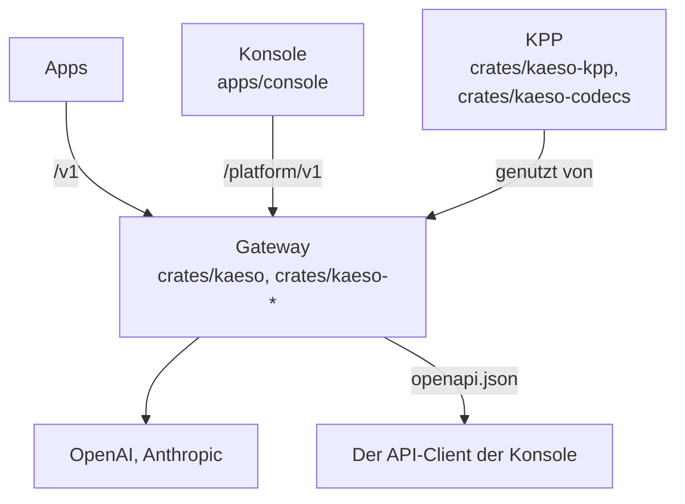
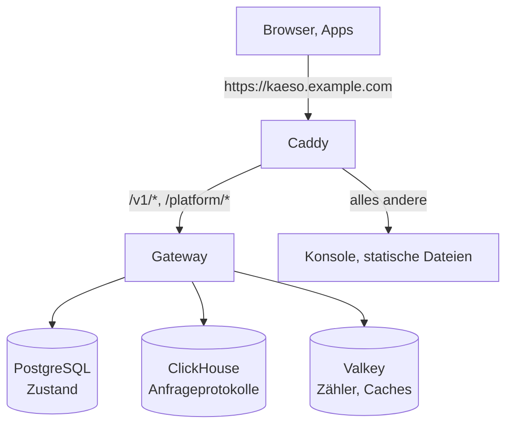

Vier Verbindungen halten die Teile zusammen:

- **Das Gateway nutzt KPP für jede Modellanfrage.** KPP dekodiert das Format der App in seine kanonische Form und kodiert diese für den Anbieter; die Antwort nimmt denselben Weg zurück. Das Gateway liest und schreibt nie selbst das JSON eines Anbieters. Es bindet KPP per Pfad im Cargo-Workspace ein, daher ist eine Änderung an beiden ein einziger Pull Request.
- **Die Konsole nutzt die Platform API und nichts sonst**, sodass ein Skript alles kann, was die Konsole kann. Ihr API-Client wird aus `openapi.json` erzeugt, das das Gateway aus seinem eigenen Code erzeugt; beide ändern sich also gemeinsam.
- **Konsole, Dokumentation und Showcase sind mit der UI-Bibliothek gezeichnet.** Jedes sichtbare Element stammt aus `@logicplanes/kaeso-ui`, aufgebaut auf `@logicplanes/kaeso-tokens`, beide aus dem Workspace eingebunden (`workspace:*`). Die E-Mails des Gateways verwenden dieselben Token-Werte.
- **Alles teilt eine Version.** Die `compose.yaml` eines Releases pinnt die Gateway- und Konsolen-Images genau dieses Releases.

## Seiten

| Seite | Inhalt |
| --- | --- |
| [Gateway](gateway.md) | Der Anfrageweg, die Konfiguration, die Modelldaten und die Regeln für den Code des Gateways |
| [Konsole](console.md) | Wie die Web-Konsole Daten liest, Seiten zeichnet, Code lädt und Fehler zeigt |
| [Dokumentations-Website](docs-site.md) | Wie aus den Markdown-Seiten docs.kaeso.app wird |
| [E-Mails](emails.md) | Wie das Gateway die E-Mails baut, die es sendet |
| [KPP-Interna](../kpp/index.md) | Das kanonische Format, die Codecs und jedes Wire-Mapping |

## Der Rust-Workspace

| Crate | Aufgabe |
| --- | --- |
| `kaeso` | Das Gateway-Binary: seine Kommandozeile (`serve`, `migrate`, `master-key`, `user`, `setup-link`, `healthcheck`, `openapi`), Start und Herunterfahren. Das einzige Crate, das `anyhow` verwenden darf. |
| `kaeso-server` | Die HTTP-Schnittstellen: Router für `/v1`, `/platform/v1`, Health und Metriken; Extraktoren, Fehlerabbildung, das OpenAPI-Dokument, CSRF-Prüfungen, Request-IDs und Body-Limits. Dazu die Services hinter beiden APIs (darunter die Limit-Zähler als Lua-Skripte für Valkey), die Konfiguration, Hintergrundjobs und Telemetrie. |
| `kaeso-core` | Fachregeln ohne I/O: IDs, Rechte und Rollen, das Schlüsselformat, die Modellauflösung, der Katalog, Fähigkeitsprüfungen, Limits, Kosten und der Assembler für Stream-Antworten. Ohne Datenbanken getestet. `data/` enthält den models.dev-Snapshot, den jedes Release mitliefert. |
| `kaeso-store` | PostgreSQL über sqlx (Offline-Abfragedaten in `.sqlx/` im Repository-Wurzelverzeichnis), ClickHouse, die Valkey-Verbindung mit ihrer Cache-Invalidierung und die Migrationen beider Datenbanken, ausgeführt unter einer Sperre. |
| `kaeso-upstream` | Transport zu den Anbietern: HTTP-Clients, Auth-Header, Basis-URLs, Timeouts, gestreamte Bodys und Abbruch. |
| `kaeso-crypto` | Envelope-Verschlüsselung (AES-256-GCM), der Hauptschlüssel-Ring, Passwörter, TOTP und die schwärzenden Typen für Geheimnisse. |
| `kaeso-mail` | SMTP-Versand und jede E-Mail in einem Layout, in drei Sprachen ([E-Mails](emails.md)). |
| `kaeso-testkit` | Nur für Tests: Entwicklungs- und Testdatenbanken, der Mock-Anbieter aus den Fixtures von KPP und ein Mock-Identitätsanbieter. |
| `kaeso-kpp`, `kaeso-codecs` | Die Typen und Codecs von KPP, auf crates.io veröffentlicht ([KPP-Interna](../kpp/index.md)). |
| `kpp-conformance` | Ein Server, der die Ausgabe der KPP-Encoder an die offiziellen Python-SDKs für die [Konformitätssuite](../testing.md#sdk-konformität) gibt. |
| `xtask` | Repository-Aufgaben: `cargo xtask models-dev` aktualisiert den models.dev-Snapshot, und `cargo xtask record` [zeichnet Anbieterantworten auf](../kpp/fixtures.md#live-antworten-aufzeichnen). |

Jedes Crate übernimmt Version, Edition und Lints aus der `Cargo.toml` im Wurzelverzeichnis. Nur `kaeso-kpp` und `kaeso-codecs` werden veröffentlicht; die übrigen setzen `publish = false`.

## Der TypeScript-Workspace

| Paket | Ordner | Aufgabe |
| --- | --- | --- |
| `kaeso-console` | `apps/console` | Die Web-Konsole, eine statische React-App, die neben dem Gateway ausgeliefert wird ([Konsole](console.md)) |
| `kaeso-docs` | `apps/docs` | Diese Dokumentation ([Dokumentations-Website](docs-site.md)) |
| `kaeso-showcase` | `apps/showcase` | Jede Komponente der UI-Bibliothek in jedem Zustand, mit ihren Leitfäden; `pnpm --filter kaeso-showcase dev` startet sie lokal |
| `@logicplanes/kaeso-ui` | `packages/ui` | Die Komponentenbibliothek: React-Komponenten auf Base UI, gestaltet mit Tailwind CSS und den Tokens |
| `@logicplanes/kaeso-tokens` | `packages/tokens` | Die Design-Tokens als CSS-Variablen, Tailwind-Theme, TypeScript-Konstanten und JSON |

Die Apps lesen die Builds der Bibliotheken, daher vor allem, was sie braucht, `pnpm build:packages` ausführen. Die UI-Bibliothek liefert eigene Regeln und eine Komponenten-Registry für die Menschen und Werkzeuge, die mit ihr bauen (`packages/ui/AGENTS.md`, `packages/ui/foundations/`, `packages/ui/ai/`).

## Im Produktivbetrieb

Die Konsole besteht aus statischen Dateien in einem eigenen kleinen Container und wird unter der Domain des Gateways ausgeliefert. Ihr Sitzungs-Cookie ist daher First-Party, und sie braucht kein CORS; nur Web-Apps, die die Modell-API aus dem Browser aufrufen, brauchen ihre Origins in `KAESO_CORS_ALLOWED_ORIGINS`. [Self-Hosting](../../self-hosting/index.md) beschreibt eine Installation.
