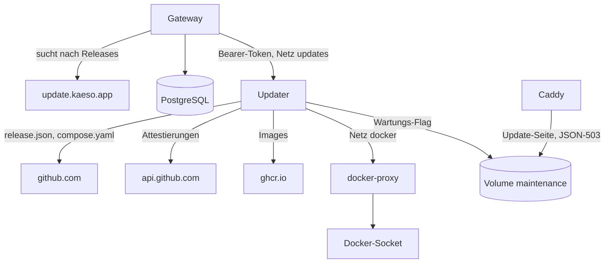

Das Gateway findet Releases und bittet den Updater, eines anzuwenden; der Updater prüft das Release und tauscht die Container aus. [Upgrades](../../self-hosting/upgrades.md) behandelt, was Betreiber sehen. Diese Seite behandelt das Protokoll zwischen den Teilen und die Prüfungen dahinter.



## Der Release-Feed

`update.kaeso.app` ist ein Dienst außerhalb dieses Repositorys, der die Releases auf GitHub liest. `v1/releases.json` listet die neuesten Releases, immer mit dem neuesten stabilen, in der Form der Releases-API von GitHub, Notes nach 64 KiB gekürzt und die ganze Datei unter 3 MiB, da das Gateway höchstens 4 MiB liest. Die `release.json` jedes Releases liegt Byte für Byte gespiegelt unter `download/v<version>/`, da das Gateway ein Manifest nur vom Origin seines eigenen Feeds annimmt. Jeder Eintrag trägt außerdem `art`, das Artwork des Releases, das update.kaeso.app einmal wählt und für immer behält: ein Stil, eine Palette und ein Seed, die `ReleaseArt` der UI-Bibliothek zeichnet. Das Gateway speichert das erste `art`, das es für eine Version sieht, in `update_releases.art` und ersetzt es nie, `me/whats-new` gibt es zurück, und die Konsole zeichnet eines aus der Version, wenn ein Release keines hat.

## Das Gateway

`services/updates.rs` und der Job `update_check` suchen nach Releases. Alle fünf Minuten fragt der Job, ob die nächste Prüfung fällig ist (`update_settings.next_check_at`).

- **Liste.** Eine Prüfung ruft `releases_url?per_page=50` mit `If-None-Match` ab und folgt den Links auf die nächste Seite, höchstens zehn Seiten, da ein Feed Releases nicht nach Version sortiert. Eine geänderte Liste ersetzt `update_releases` in einer Transaktion.
- **Manifeste.** Für jedes Release, das neuer als die laufende Version ist, holt und speichert die Prüfung seine `release.json` oder den Grund, warum das nicht ging. Sie holt höchstens zwölf pro Prüfung, vier gleichzeitig, die neuesten zuerst. Ein Manifest kommt nur von `https://github.com/logicplanes/kaeso/releases/download/` oder, bei einem Spiegel, vom Origin von `updates.releases_url`, und der Client folgt nie einer Weiterleitung von HTTPS auf HTTP.
- **Zeitpunkt.** Die nächste Prüfung folgt 12 Stunden später plus einem zufälligen Teil einer Stunde. Nach einem Fehler folgt sie frühestens eine Stunde später, oder später, wenn `Retry-After` oder `x-ratelimit-reset` von GitHub das verlangen. Bis dahin verhindert `update_settings.blocked_until`, dass auch `instance/updates/check` anfragt.
- **Automatische Updates.** Steht `update_settings.mode` auf `automatic`, berechnet derselbe Job das Update-Fenster mit `kaeso_update::schedule`: die Stunde in der IANA-Zeitzone der Instanz, über `jiff` und dessen mitgelieferte Zeitzonendaten, sodass die Sommerzeit sie verschiebt. Innerhalb der Stunde des Fensters beansprucht der Job das Fenster in `update_settings.auto_window_at`, sodass ein Fenster höchstens ein Update startet. Er sucht nach Releases, wenn der letzte Erfolg mehr als eine Stunde zurückliegt, und startet das Ziel des Plans wie `apply`, mit gesetztem `update_jobs.automatic` und ohne Benutzer. Eine Änderung des Modus oder des Fensters setzt `auto_window_at` auf jetzt, sodass eine Änderung nie sofort ein Update startet.

`kaeso_update::policy::plan` wählt, was angeboten wird: das neueste Release im Kanal, das neuer als die laufende Version ist. Ein Release, das der Feed als Vorabversion markiert, zählt als solche, egal welche Version es hat. Das Angebot verlangt Schritte von Hand bei einer neuen Major-Version, bei `manual: true` im Manifest eines übersprungenen Releases oder wenn ein Manifest fehlt. Auch `manual_since` des Ziels zählt, sodass ein übersprungenes Release, das das Gateway nie gesehen hat, das Update trotzdem manuell macht.

`update_jobs` enthält jedes Update, und ein eindeutiger Index erlaubt nur eine Zeile `running` zugleich. `apply` committet die Zeile, bevor es den Updater aufruft:

- Lehnt der Updater ab (jede Antwort außer `202`) oder ist er nicht erreichbar, endet die Zeile sofort mit `failed`, mit `updater_refused` oder `updater_unreachable`.
- Ging die Anfrage hinaus, kam aber keine klare Antwort zurück, bleibt die Zeile `running`, und der eigene Eintrag des Updaters entscheidet.
- Solange eine Zeile läuft, fragt jedes Lesen den Updater nach seinem Zustand und hält das Ende einmal fest, meist vom neuen Gateway nach dem Austausch.
- Ein Job, den der Updater zwei Minuten nach dem Start noch nicht kennt, endet als `interrupted`. Einer, zu dem der Updater eine Stunde lang nicht antwortet, endet als `updater_unreachable`.

## Was ein Release mitbringt

Der Release-Workflow baut `kaeso-gateway`, `kaeso-console` und `kaeso-updater` und attestiert ihre Build-Provenienz. Danach schreibt er `release.json` (`scripts/release-manifest.mjs`), und ein Job, der nur diese Datei sieht, attestiert sie. Derselbe Schritt schreibt die `compose.yaml` des Releases: `deploy/compose.yaml`, in der jedes Kaeso-Image auf die Version und den Digest seines Index festgelegt ist, etwa `ghcr.io/logicplanes/kaeso-gateway:1.4.2@sha256:…`. `release.json` nennt den Hash dieser Datei. Das Release entsteht nur, wenn `release.json` und jedes Image mit `gh attestation verify` gegen diesen Workflow auf `refs/heads/prod` und den Commit bestehen, den `release.json` nennt:

```json
{
  "schema": 1,
  "version": "1.4.2",
  "commit": "5388ad0b98aa3d957fea99e200259842bf746680",
  "manual": false,
  "manual_since": "1.3.0",
  "updater_protocol": 1,
  "images": {
    "gateway": { "name": "ghcr.io/logicplanes/kaeso-gateway", "digest": "sha256:…" },
    "console": { "name": "ghcr.io/logicplanes/kaeso-console", "digest": "sha256:…" },
    "updater": { "name": "ghcr.io/logicplanes/kaeso-updater", "digest": "sha256:…" }
  },
  "compose": { "name": "compose.yaml", "sha256": "…" },
  "migrations": { "postgres": "20261017140001_updates", "clickhouse": "0002_usage_rollups" }
}
```

| Feld | Bedeutung |
| --- | --- |
| `commit` | Der Commit, auf dem der Release-Workflow lief und den die Attestierungen nennen, nicht der Release-Commit darüber ([Commits und Attestierungen](../releasing.md#commits-und-attestierungen)) |
| `manual` | Wahr, wenn die Eingabe **manual** des Workflows es sagt oder wenn sich `compose.yaml` von der des vorigen Releases in mehr als den Image-Versionen und Digests unterscheidet |
| `manual_since` | Das neueste Release bis zu diesem mit `manual: true`, übernommen aus der `release.json` des vorigen Releases |
| `migrations` | Die neueste PostgreSQL- und ClickHouse-Migration des Releases |

`kaeso_update::manifest` parst die Datei, lehnt ein anderes Schema ab und prüft jeden Namen, Digest, jede Migration, `manual_since` und den Commit.

## Der Updater

`crates/kaeso-updater` ist ein kleiner Server auf Port 8081. `GET /healthz` braucht kein Token; `GET /v1/status`, `POST /v1/updates` (`{ "id", "version" }`) und `GET /v1/updates/{id}` brauchen `Authorization: Bearer` mit dem gemeinsamen Token. Er führt jeweils nur ein Update aus und hält es in `/state/job.json`, das nach jeder Änderung atomar geschrieben wird. Ein Update durchläuft diese Schritte (`engine.rs`):

1. **Prüfen.** Er lädt `release.json` herunter und prüft sie vor allem anderen, dann prüft er die laufende Installation dagegen ([die Prüfungen](#was-der-updater-prüft)). Außerdem prüft er, dass die lokale `compose.yaml` mit den neuen Image-Versionen und Digests Byte für Byte der des Releases gleicht, und legt eine Kopie in `/state` ab.
2. **Herunterladen.** Er zieht die drei Images per Digest, und das Versions-Label jedes Images muss dem Release entsprechen. Die `release.json` des laufenden Releases prüft er genauso und vergleicht die Migrationen. Unterscheiden sie sich oder lässt sich dieses Manifest nicht beschaffen, gilt das Update als Migration der Datenbank.
3. **Austauschen.** Er schreibt das Wartungs-Flag. Dann stoppt er für die Konsole und danach für das Gateway den Container, benennt ihn in `…-previous` um und legt den neuen mit den Einstellungen des alten an (`clone.rs`). Alles, was das alte Image mitbrachte, fällt weg, sodass Umgebung, Befehl und Healthcheck des neuen Images gelten.
4. **Migrieren.** Er wartet auf jeden Healthcheck: 2 Minuten für die Konsole und 10 für die Migrationen des Gateways. Ein Absturz, ein Neustart oder ein gestoppter Container schlägt sofort fehl.
5. **Online.** Er schreibt die neuen Versionen und Digests in `compose.yaml`, wenn die Datei noch die geprüfte ist, taggt die Images, entfernt die vorigen Container und löscht das Flag.

Ein Fehler vor dem Austausch ändert nichts (`failed`). Ein Fehler danach startet die vorigen Container wieder und wartet auf sie (`rolled_back` oder `rollback_failed`). Kann das neue Gateway die Datenbank schon migriert haben, wird nichts wiederhergestellt: Das neue Gateway und die neue Konsole bleiben, und das Update endet mit `needs_attention`. Dasselbe gilt, wenn sich das Wartungs-Flag oder ein Container `…-previous` nicht entfernen lässt. Lässt sich `compose.yaml` nicht schreiben oder hat sich die Datei während des Updates geändert, endet das Update trotzdem mit `succeeded`, mit `compose_unwritable` oder `compose_changed` als Grund.

Beim Start wartet der Updater bis zu zwei Minuten auf Docker. Dann schließt er ein Update ab, das `online` war, schließt eines ab, dessen neues Gateway gesund wird, und rollt jedes andere zurück.

Der Updater erreicht Docker nur unter `http://docker-proxy:2375/v1.44/`, dessen Allow-List in `compose.yaml` jeden Pfad nennt, den er nutzt. Der Proxy filtert nur nach Methode und Pfad, und den Body von `containers/create` wählt der Updater. Deshalb kommt der Updater Root-Rechten auf dem Host gleich und muss ausdrücklich aktiviert werden.

### Was der Updater prüft

`verify.rs` lehnt das Update ab, wenn nicht alle diese Bedingungen gelten:

- Der Updater spricht das `updater_protocol` des Releases.
- Er findet die Container von Gateway und Konsole seines eigenen Compose-Projekts anhand der Labels seines eigenen Containers, und kein Container `…-previous` ist von einem früheren Update übrig.
- Die laufende Version, aus `org.opencontainers.image.version` des Gateway-Images, ist älter als das Release, und das Release ist keine neue Major-Version.
- Weder `manual` noch `manual_since` verlangen nach der laufenden Version Schritte von Hand.
- Jede Attestierung, geholt von `api.github.com/repos/logicplanes/kaeso/attestations/sha256:…`, ist ein Sigstore-Bundle, das [sigstore-rs](https://github.com/sigstore/sigstore-rs) gegen den Trust Root in `data/trusted_root.json` prüft. Das umfasst die Zertifikatskette zu Fulcio, den SCT, die DSSE-Signatur und den Eintrag im Transparenzlog.
- Das Zertifikat nennt `https://github.com/logicplanes/kaeso/.github/workflows/release.yml@refs/heads/prod`, ausgestellt von `https://token.actions.githubusercontent.com`.
- Der signierte Eintragszeitstempel des Logs besteht die Prüfung mit dem Rekor-Schlüssel, die der Updater selbst vornimmt. Ein Bundle ohne ihn, wie Rekor v2 sie schreibt, wird mit einer Meldung abgelehnt, die das sagt.
- Jede Fulcio-Zertifizierungsstelle, jedes CT-Log und jeder Rekor-Schlüssel zählt nur innerhalb seines `validFor` im Trust Root, zum Integrationszeitpunkt des Eintrags.
- Die In-toto-Aussage ist SLSA-Provenienz v1 für Namen und Digest des Gegenstands, aus dem Workflow und dem Commit, den `release.json` nennt. Bei einem Image ist der Gegenstand sein Index, per Digest von `ghcr.io` geholt.

## Der Edge-Proxy

Caddy liest das Wartungs-Flag aus dem Volume `maintenance`. Solange es existiert, bekommt jede Anfrage sofort die Wartungsantwort; sonst bekommt sie ein `502`, `503` oder `504` des Gateways oder der Konsole. `/kaeso-maintenance.json` liefert das Flag aus, etwa `{"state":"updating","step":"migrating"}`, sodass die Seite den Schritt nennen kann. Die Seite steht inline in `compose.yaml`, mit einer Content Security Policy, die ihren eigenen Stil und ihr eigenes Skript per Hash erlaubt. `crates/kaeso-server/tests/edge.rs` prüft, dass die JSON-Antworten dem entsprechen, was `ApiError` und `kaeso_codecs::dispatch::encode_error` erzeugen, und dass die Hashes stimmen.

## Tests

| Wo | Was |
| --- | --- |
| `crates/kaeso-update` | Versions-Tags, Kanäle, der Plan mit Major-Versionen, Schritten von Hand und Vorabversionen, das Manifest und das Protokoll |
| `crates/kaeso-server/tests/updates.rs` | Das Gateway gegen ein Mock-GitHub und einen Mock-Updater: bedingte Anfragen, Backoff, Manifeste, Rechte, das Audit-Log, die Sperre für ein Update und jedes Ende |
| `crates/kaeso-updater/tests/verify.rs` | Die echten Attestierungen von Kaeso 0.1.0 bestehen; ein anderes Image, ein anderer Commit, Workflow, eine andere Signatur oder ein anderer Logeintrag nicht |
| `crates/kaeso-updater/tests/engine.rs`, `server.rs` | Der Updater gegen eine nachgebildete Docker-API: ein vollständiges Update, jede Ablehnung, Rollbacks, Neustarts bei jedem Schritt, die Zustandsdatei und die API |
| `scripts/release-manifest.test.mjs` | Das Manifest, die festgelegte `compose.yaml`, `manual_since`, die neuesten Migrationen und der Commit |
| `e2e/install` | Die Installation mit dem Profil des Updaters, der Proxy und die Antworten von Caddy in jedem Format, solange Kaeso nicht erreichbar ist |
| `apps/console` | Die Seite Updates in jedem Zustand und die Update-Seite in drei Sprachen |
