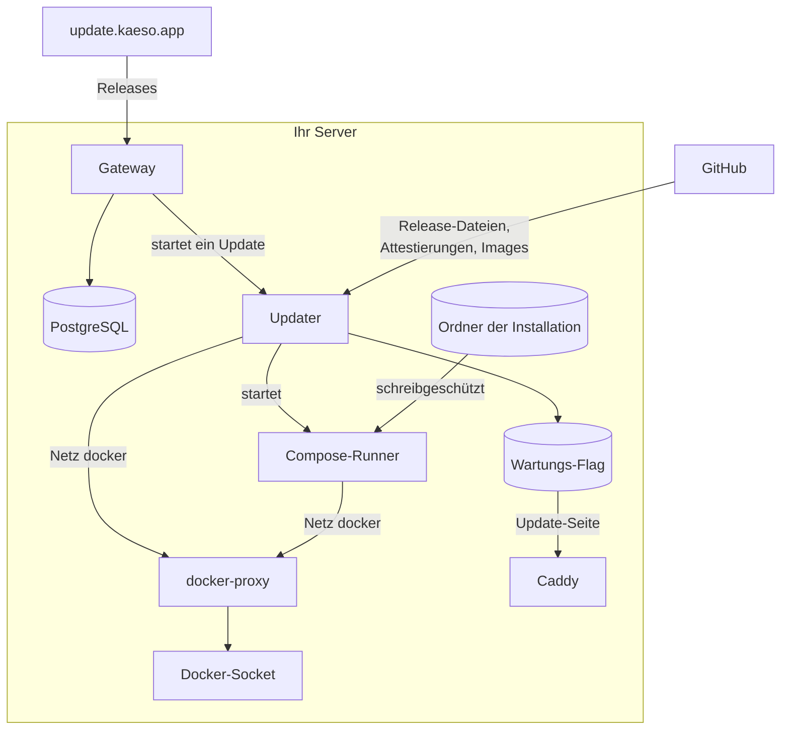

Das Gateway findet Releases und bittet den Updater, eines anzuwenden; der Updater prüft das Release und tauscht die Container aus. [Upgrades](../../self-hosting/upgrades.md) behandelt, was Betreiber sehen. Diese Seite behandelt das Protokoll zwischen den Teilen und die Prüfungen dahinter.



## Der Release-Feed

`update.kaeso.app` ist ein Dienst außerhalb dieses Repositorys, der die Releases auf GitHub liest. `v1/releases.json` listet die neuesten Releases in der Form der Releases-API von GitHub, immer mit dem neuesten stabilen. Der Dienst kürzt Notes nach 64 KiB und hält die ganze Datei unter 3 MiB, da das Gateway höchstens 4 MiB liest. Die `release.json` jedes Releases liegt Byte für Byte gespiegelt unter `download/v<version>/`, da das Gateway ein Manifest nur vom Origin seines eigenen Feeds annimmt.

Jeder Eintrag trägt außerdem `art`, das Artwork des Releases, das update.kaeso.app einmal gewählt hat und für immer behält. Es besteht aus einem Stil, einer Palette und einem Seed, die `ReleaseArt` der UI-Bibliothek zeichnet. Das Gateway speichert das erste `art`, das es für eine Version sieht, in `update_releases.art` und ersetzt es nie. `me/whats-new` gibt es zurück, und die Konsole zeichnet eines aus der Version, wenn ein Release keines hat.

Jede Antwort von `v1/releases.json`, auch ein `304`, trägt den Header `Kaeso-Stars` mit der Zahl der Sterne von logicplanes/kaeso auf GitHub. Das Gateway behält die Zahl seiner letzten erfolgreichen Prüfung im Speicher und gibt sie als `github_stars` in `instance/updates` zurück. Ohne den Header, etwa von einem Spiegel, ist sie `null`. **Instanz** › **Updates** zeigt sie ab 100 Sternen neben **GitHub-Stern geben**.

## Das Gateway

`services/updates.rs` und der Job `update_check` suchen nach Releases. Jede Minute fragt der Job, ob die nächste Prüfung fällig ist (`update_settings.next_check_at`).

- **Liste.** Eine Prüfung ruft `releases_url?per_page=50` mit `If-None-Match` ab und folgt den Links auf die nächste Seite, höchstens zehn Seiten, da ein Feed Releases nicht nach Version sortiert. Eine geänderte Liste ersetzt `update_releases` in einer Transaktion.
- **Manifeste.** Für jedes Release, das neuer als die laufende Version ist, holt und speichert die Prüfung seine `release.json` oder den Grund, warum das nicht ging. Sie holt höchstens zwölf pro Prüfung, vier gleichzeitig, die neuesten zuerst. Ein Manifest kommt nur von `https://github.com/logicplanes/kaeso/releases/download/` oder, bei einem Spiegel, vom Origin von `updates.releases_url`, und der Client folgt nie einer Weiterleitung von HTTPS auf HTTP.
- **Zeitpunkt.** Der Job `update_check` läuft jede Minute, und die nächste Prüfung folgt 5 Minuten später plus einem zufälligen Teil einer Minute, damit Installationen nicht im Gleichschritt fragen. Nach einem Fehler folgt sie frühestens 15 Minuten später, oder später, wenn `Retry-After` des Feeds oder `x-ratelimit-reset` von GitHub das verlangen. Sie folgt nie mehr als eine Stunde später (`MAX_WAIT`), so lange, wie GitHubs stündliches Rate-Limit höchstens verlangt. Bis dahin hält `update_settings.blocked_until` die Prüfungen des Jobs zurück. Eine Prüfung, die ein Instanz-Admin über `instance/updates/check` startet, wartet darauf höchstens eine Minute nach der letzten Prüfung. So kann ein Feed sie nicht aufhalten, und erneutes Klicken überlastet den Feed nicht. Auch eine Wartezeit, die eine frühere Version gespeichert hat, zählt höchstens eine Stunde. Ein Job, der in Panic gerät, gilt als fehlgeschlagen und läuft beim nächsten Durchgang wieder.
- **Automatische Updates.** Steht `update_settings.mode` auf `automatic`, berechnet derselbe Job das Update-Fenster mit `kaeso_update::schedule`. Das Fenster ist die Stunde in der IANA-Zeitzone der Instanz, berechnet über `jiff` und dessen mitgelieferte Zeitzonendaten, sodass die Sommerzeit sie verschiebt. Innerhalb der Stunde des Fensters sucht der Job nach Releases, wenn der letzte Erfolg mehr als eine Stunde zurückliegt und die nächste Prüfung fällig ist. Er überspringt das Ziel des Plans, wenn der letzte Job zu dieser Version mit `rolled_back`, `rollback_failed` oder `needs_attention` endete. Sonst startet er das Ziel wie `apply`, mit gesetztem `update_jobs.automatic` und ohne Benutzer, und beansprucht das Fenster in derselben Transaktion in `update_settings.auto_window_at`, sodass ein Fenster höchstens ein Update startet. Bis dahin versucht es jeder Lauf innerhalb der Stunde erneut. Eine Änderung des Modus oder des Fensters setzt `auto_window_at` auf jetzt, sodass eine Änderung nie sofort ein Update startet.

`kaeso_update::policy::plan` wählt, was angeboten wird: das neueste Release im Kanal, das neuer als die laufende Version ist. Ein Release, das der Feed als Vorabversion markiert, zählt als solche, egal welche Version es hat. Das Angebot verlangt Schritte von Hand bei einer neuen Major-Version, bei `manual: true` im Manifest eines übersprungenen Releases oder wenn ein Manifest fehlt. Auch `manual_since` des Ziels zählt, sodass ein übersprungenes Release, das das Gateway nie gesehen hat, das Update trotzdem manuell macht. Der Plan braucht außerdem das höchste `updater_protocol` des Ziels und jedes übersprungenen Releases, denn die Änderungen eines übersprungenen Releases an der `compose.yaml` stecken auch in der des Ziels. Ein Updater, der weniger spricht oder weniger als das eigene Protokoll des Gateways, ist `outdated`, und die Konsole zeigt den Befehl des Installationsskripts.

`update_jobs` enthält jedes Update, und ein eindeutiger Index erlaubt nur eine Zeile `running` zugleich. `apply` committet die Zeile, bevor es den Updater aufruft:

- Lehnt der Updater ab (jede Antwort außer `202`) oder ist er nicht erreichbar, endet die Zeile sofort mit `failed`, mit `updater_refused` oder `updater_unreachable`.
- Ging die Anfrage hinaus, kam aber keine klare Antwort zurück, bleibt die Zeile `running`, und der eigene Eintrag des Updaters entscheidet.
- Solange eine Zeile läuft, fragt jedes Lesen den Updater nach seinem Zustand und hält das Ende einmal fest, meist vom neuen Gateway nach dem Austausch.
- Ein Job, den der Updater zwei Minuten nach dem Start noch nicht kennt, endet als `interrupted`. Einer, zu dem der Updater eine Stunde lang nicht antwortet, endet als `updater_unreachable`.

## Was ein Release mitbringt

Der Release-Workflow baut `kaeso-gateway`, `kaeso-console` und `kaeso-updater` und attestiert ihre Build-Provenienz. Danach schreibt er `release.json` (`scripts/release-manifest.mjs`), und ein Job, der nur diese Datei sieht, attestiert sie. Derselbe Schritt schreibt die `compose.yaml` des Releases: `deploy/compose.yaml`, in der jedes Kaeso-Image auf die Version und den Digest seines Index festgelegt ist, etwa `ghcr.io/logicplanes/kaeso-gateway:1.4.2@sha256:…`. `release.json` nennt den Hash dieser Datei.

Das Release entsteht nur, wenn `release.json` und jedes Image mit `gh attestation verify` gegen diesen Workflow auf `refs/heads/prod` und den Commit bestehen, den `release.json` nennt:

```json
{
  "schema": 1,
  "version": "1.4.2",
  "commit": "5388ad0b98aa3d957fea99e200259842bf746680",
  "manual": false,
  "manual_since": "1.3.0",
  "updater_protocol": 2,
  "images": {
    "gateway": {
      "name": "ghcr.io/logicplanes/kaeso-gateway",
      "digest": "sha256:…"
    },
    "console": {
      "name": "ghcr.io/logicplanes/kaeso-console",
      "digest": "sha256:…"
    },
    "updater": {
      "name": "ghcr.io/logicplanes/kaeso-updater",
      "digest": "sha256:…"
    }
  },
  "compose": { "name": "compose.yaml", "sha256": "…" },
  "migrations": {
    "postgres": "20261017140001_updates",
    "clickhouse": "0002_usage_rollups"
  }
}
```

| Feld | Bedeutung |
| --- | --- |
| `commit` | Der Commit, auf dem der Release-Workflow lief und den die Attestierungen nennen, nicht der Release-Commit darüber ([Commits und Attestierungen](../releasing.md#commits-und-attestierungen)) |
| `manual` | Wahr, wenn die Eingabe **manual** des Workflows es sagt oder wenn sich der Dienst `docker-proxy` oder das Netz `docker` von denen des vorigen Releases unterscheiden, so wie das Paket `yaml` beide Dateien liest |
| `updater_protocol` | Das Updater-Protokoll, das das Release braucht. Es ist 2 für jedes Release, seit der Updater die `compose.yaml` einspielt und sich selbst ersetzt |
| `manual_since` | Das neueste Release bis zu diesem mit `manual: true`, übernommen aus der `release.json` des vorigen Releases |
| `migrations` | Die neueste PostgreSQL- und ClickHouse-Migration des Releases |

`kaeso_update::manifest` parst die Datei, lehnt ein anderes Schema ab und prüft jeden Namen, Digest, jede Migration, `manual_since` und den Commit.

## Der Updater

`crates/kaeso-updater` ist ein kleiner Server auf Port 8081. `GET /healthz` braucht kein Token; `GET /v1/status`, `POST /v1/updates` (`{ "id", "version" }`) und `GET /v1/updates/{id}` brauchen `Authorization: Bearer` mit dem gemeinsamen Token. Er führt jeweils nur ein Update aus und hält es in `/state/job.json`, das nach jeder Änderung atomar geschrieben wird. Ein Update durchläuft diese Schritte (`engine.rs`):

1. **Prüfen.** Er lädt `release.json` herunter und prüft sie vor allem anderen, dann prüft er die laufende Installation dagegen ([die Prüfungen](#was-der-updater-prüft)). Er legt eine Kopie der lokalen `compose.yaml` in `/state` ab. Gleicht diese Datei mit den neuen Image-Versionen und Digests Byte für Byte der des Releases, tauscht das Update Container aus. Sonst spielt es die Datei des Releases ein: Er prüft die `release.json` des laufenden Releases, prüft dessen `compose.yaml` dagegen und verlangt, dass die lokale Datei ihr gleicht, mit oder ohne die Digests.
2. **Herunterladen.** Er zieht die drei Images per Digest, und das Versions-Label jedes Images muss dem Release entsprechen. Die `release.json` des laufenden Releases prüft er genauso und vergleicht die Migrationen. Unterscheiden sie sich oder lässt sich dieses Manifest nicht beschaffen, gilt das Update als Migration der Datenbank. Ein Pull darf so lange dauern, wie die Images brauchen, und endet, wenn Docker 2 Minuten lang keinen Fortschritt meldet. Um eine Datei einzuspielen, schreibt er dann die neue `compose.yaml` und führt die Aufgabe `pull` aus.
3. **Austauschen.** Er schreibt das Wartungs-Flag. Dann stoppt er für die Konsole und danach für das Gateway den Container, benennt ihn in `…-previous` um und legt den neuen mit den Einstellungen des alten an (`clone.rs`). Alles, was das alte Image mitbrachte, fällt weg, sodass Umgebung, Befehl und Healthcheck des neuen Images gelten. Um eine Datei einzuspielen, stoppt stattdessen die Aufgabe `stop` jeden Gateway- und Konsolen-Container.
4. **Migrieren.** Er wartet auf jeden Healthcheck: 2 Minuten für die Konsole und 10 für die Migrationen des Gateways, einschließlich eines Docker-Aufrufs, der am Ende noch wartet. Ein Absturz, ein Neustart oder ein gestoppter Container schlägt sofort fehl. Um eine Datei einzuspielen, startet die Aufgabe `up` die neue Konfiguration und wartet bis zu 10 Minuten darauf.
5. **Online.** Er schreibt die neuen Versionen und Digests in `compose.yaml`, wenn die Datei noch die geprüfte ist, taggt die Images, entfernt die vorigen Container und löscht das Flag. Ist das Ende des Updates gespeichert, startet er die Aufgabe `replace` und wartet nicht auf sie.

Ein Fehler vor dem Austausch ändert nichts (`failed`) und legt die alte `compose.yaml` zurück, wenn das Update die neue schon geschrieben hatte. Ein Fehler danach startet die vorigen Container wieder und wartet auf sie (`rolled_back` oder `rollback_failed`). Hat das Update eine Datei eingespielt, schreibt das Zurücksetzen die alte Datei zurück und führt mit ihr `stop` und `up` aus.

Kann das neue Gateway die Datenbank schon migriert haben, wird nichts wiederhergestellt: Das neue Gateway und die neue Konsole bleiben, und das Update endet mit `needs_attention`. Dasselbe gilt, wenn sich das Wartungs-Flag oder ein Container `…-previous` nicht entfernen lässt. Lässt sich `compose.yaml` nicht schreiben oder hat sich die Datei während des Updates geändert, endet das Update trotzdem mit `succeeded`, mit `compose_unwritable` oder `compose_changed` als Grund.

Jeder andere Docker-Aufruf hat ein eigenes Limit: 30 Sekunden, um die Version zu melden, aufzulisten, zu inspizieren, zu starten oder umzubenennen, die Wartezeit des Stopps plus 15 Sekunden zum Stoppen und 10 Minuten zum Erstellen, Taggen oder Entfernen.

Beim Start wartet der Updater bis zu zwei Minuten auf Docker. Dann wartet er, bis jeder übrig gebliebene Compose-Runner endet, und entfernt ihn. Er schließt ein Update ab, das `online` war, schließt eines ab, dessen neues Gateway gesund wird, und rollt jedes andere zurück. Ein Update, das eine Datei eingespielt hat, schließt er ab, wenn dessen Aufgabe `up` gut endete, führt `up` erneut aus, wenn das neue Gateway die Datenbank womöglich migriert hat, und rollt es sonst zurück.

### Der Compose-Runner

Docker Compose kann nicht im Container des Updaters laufen: Den Updater neu anzulegen, würde es beenden. Für ein Release, das die `compose.yaml` ändert, und um sich selbst zu ersetzen, legt der Updater über den Proxy einen Container an, der `kaeso-updater compose <task>` aus dem geprüften Updater-Image des Releases ausführt (`runner.rs`). Das Image enthält ein festgelegtes, statisches Docker-Compose-Programm.

- Er läuft als `0:0` ohne jede Capability außer `DAC_READ_SEARCH`, damit er `.env` und `compose.override.yaml` des installierenden Benutzers liest, mit `no-new-privileges`, schreibgeschütztem Root-Dateisystem, 256 MiB und 128 Prozessen.
- Er bindet `KAESO_DIR` schreibgeschützt unter demselben Pfad ein und arbeitet dort, damit relative Pfade in der `compose.yaml` die Host-Pfade ergeben, die der Proxy prüft. Der Updater startet keinen, wenn `KAESO_DIR` nicht gesetzt ist oder nicht der Ordner ist, aus dem seine eigene `compose.yaml` kommt (`install_unknown`).
- Er tritt nur dem Netz `docker` bei, mit dem Alias `updater-runner`, den `-allowfrom` des Proxys nennt, und erreicht Docker unter `tcp://docker-proxy:2375`. Er legt keine API-Version fest, damit Compose sich auf dieselbe einigt wie ein von Hand ausgeführtes `docker compose`, und die Image-Labels, die es schreibt, übereinstimmen.
- `guard.rs` lehnt alle anderen Einstellungen für ihn ab, und ein Label nennt sein Update.

Der Updater fragt den Runner ab, bis er endet, behält die letzten Zeilen seines Logs als Details des Fehlers und entfernt ihn. Ein Runner, der länger als sein Limit läuft, wird entfernt, und seine Aufgabe schlägt fehl. Die Aufgaben führen Docker Compose mit ausdrücklich genannten Diensten aus (`compose_cli.rs`):

| Aufgabe | Führt aus | Dienste |
| --- | --- | --- |
| `pull` | `pull --quiet --policy missing` | Jeder Dienst außer `updater`, `updater-init` und `docker-proxy`; ein Image, das nicht per Digest festgelegt ist, lehnt es ab, da der Proxy Compose es nicht inspizieren ließe |
| `stop` | `stop gateway console` | Jedes Gateway-Replikat und die Konsole |
| `up` | `up --detach --wait --wait-timeout 600` | Dieselben wie bei `pull` |
| `replace` | `up --detach --no-deps --wait` | Jeder Dienst mit einem Image von Kaeso außer Gateway und Konsole, etwa der Updater und Caddy |

`replace` lässt Gateway und Konsole aus, weil sie schon laufen: Ein Update, das sie ausgetauscht hat, hat ihre Container selbst angelegt, mit dem alten Konfigurations-Hash in ihren Labels, sodass ein späteres `docker compose up -d` im Ordner der Installation sie einmal neu anlegt.

Der Updater erreicht Docker nur unter `http://docker-proxy:2375/`, dessen Allow-List in `compose.yaml` jeden Pfad nennt, den er und der Runner nutzen, für jede API-Version ab 1.44:

- `HEAD` erreicht `/_ping`.
- `GET` erreicht die Version, die Container-Liste, einen Container per kurzer oder voller ID, das Log eines Containers per voller ID, ein Image per ID oder per Name mit festgelegtem Digest sowie die Netzwerke und Volumes, als Liste oder per Name.
- `POST` erreicht `images/create`, das Taggen eines Kaeso-Images per Digest, `containers/create`, Start, Stopp und Umbenennen eines Containers per voller ID sowie `networks/create` und `volumes/create`.
- `PUT` erreicht das `archive` eines Containers per voller ID, mit dem Compose `configs` in einen Container kopiert.
- `DELETE` entfernt einen Container per voller ID.

Außerdem erlaubt der Proxy Bind-Mounts nur aus `KAESO_DIR`, dem Ordner der Installation, den die `.env` nennt, und lehnt `VolumesFrom` ab. Ohne `KAESO_DIR` startet er nicht, weil ein leerer Wert jeden Bind-Mount erlauben würde.

Der Proxy prüft den Pfad, aber nicht die Query, und kann `images/create` deshalb nicht auf die Images von Kaeso beschränken. Auch den übrigen Body von `containers/create` kann er nicht lesen, etwa Rechte, Capabilities, Geräte oder Namespaces des Hosts. Außerdem darf ein Runner Dateien in jeden Container kopieren. Die Inspektion eines Containers zeigt seine Umgebung, sodass der Updater die Passwörter jedes Containers lesen kann. Deshalb kommt der Updater Root-Rechten auf dem Host gleich und muss ausdrücklich aktiviert werden. Ein Release, das die `compose.yaml` ändert, kann die Installation innerhalb dieser Grenzen beliebig konfigurieren, sodass das Einspielen der Signatur des Releases vertraut.

`docker-proxy` lässt sich nicht über sich selbst neu anlegen, deshalb kennzeichnet `scripts/release-manifest.mjs` ein Release als manuell, wenn sich der Dienst des Proxys oder sein Netz ändert.

`guard.rs` prüft jeden Body, bevor er hinausgeht. Ein neuer Container muss seinen Namen und jedes `HostConfig`-Feld, das einen Container erweitern kann, vom ersetzten übernehmen. Diese Felder umfassen:

- Rechte und Capabilities
- Geräte, Namespaces und das Netzwerk
- Mounts, `ReadonlyRootfs`, `Tmpfs`, `MaskedPaths` und `ReadonlyPaths`
- Veröffentlichte Ports und die Namensauflösung (`ExtraHosts`, `Dns`, `Links`)
- `GroupAdd` und `CgroupParent`
- Die Limits (`Memory`, `PidsLimit`, `Ulimits`)
- `Init` und `LogConfig`

Ein Pull muss ein Kaeso-Image per Digest nennen, und ein Compose-Runner muss genau die Einstellungen oben bekommen. Diese Prüfungen fangen einen Fehler im Updater ab, nicht jemanden, der ihn kontrolliert.

### Was der Updater prüft

`verify.rs` lehnt das Update ab, wenn nicht alle diese Bedingungen gelten:

- Der Updater spricht das `updater_protocol` des Releases.
- Bei einem Release, das die `compose.yaml` ändert, ist die lokale Datei die des laufenden Releases, deren Hash dessen geprüfte `release.json` nennt, und `KAESO_DIR` ist der Ordner, aus dem sie kommt.
- Er findet die Container von Gateway und Konsole seines eigenen Compose-Projekts anhand der Labels seines eigenen Containers, und kein Container `…-previous` ist von einem früheren Update übrig.
- Die laufende Version, aus `org.opencontainers.image.version` des Gateway-Images, ist älter als das Release, und das Release ist keine neue Major-Version.
- Weder `manual` noch `manual_since` verlangen nach der laufenden Version Schritte von Hand.
- Jede Attestierung, geholt von `api.github.com/repos/logicplanes/kaeso/attestations/sha256:…`, ist ein Sigstore-Bundle, das [sigstore-rs](https://github.com/sigstore/sigstore-rs) gegen den Trust Root in `data/trusted_root.json` prüft. Das umfasst die Zertifikatskette zu Fulcio, den SCT, die DSSE-Signatur und den Eintrag im Transparenzlog.
- Das Zertifikat nennt `https://github.com/logicplanes/kaeso/.github/workflows/release.yml@refs/heads/prod`, ausgestellt von `https://token.actions.githubusercontent.com`.
- Der signierte Eintragszeitstempel des Logs besteht die Prüfung mit dem Rekor-Schlüssel, die der Updater selbst vornimmt. Ein Bundle ohne ihn, wie Rekor v2 sie schreibt, wird mit einer Meldung abgelehnt, die das sagt.
- Jede Fulcio-Zertifizierungsstelle, jedes CT-Log und jeder Rekor-Schlüssel zählt nur innerhalb seines `validFor` im Trust Root, zum Integrationszeitpunkt des Eintrags.
- Die In-toto-Aussage ist SLSA-Provenienz v1 für Namen und Digest des Gegenstands, aus dem Workflow und dem Commit, den `release.json` nennt. Bei einem Image ist der Gegenstand sein Index, per Digest von `ghcr.io` geholt.

## Der Edge-Proxy

Caddy liest das Wartungs-Flag aus dem Volume `maintenance`. Solange es existiert, bekommt jede Anfrage sofort die Wartungsantwort; sonst bekommt sie ein `502`, `503` oder `504` des Gateways oder der Konsole.

`/kaeso-maintenance.json` liefert das Flag aus, etwa `{"state":"updating","step":"migrating"}`, sodass die Seite den Schritt nennen kann. Die Seite steht inline in `compose.yaml`, mit einer Content Security Policy, die ihren eigenen Stil und ihr eigenes Skript per Hash erlaubt. `crates/kaeso-server/tests/edge.rs` prüft, dass die JSON-Antworten dem entsprechen, was `ApiError` und `kaeso_codecs::dispatch::encode_error` erzeugen, und dass die Hashes stimmen.

## Tests

| Wo | Was |
| --- | --- |
| `crates/kaeso-update` | Versions-Tags, Kanäle, der Plan mit Major-Versionen, Schritten von Hand, Vorabversionen und dem Protokoll, das er braucht, das Manifest und das Protokoll |
| `crates/kaeso-server/tests/updates.rs` | Das Gateway gegen ein Mock-GitHub und einen Mock-Updater: bedingte Anfragen, Backoff und seine Obergrenze von einer Stunde, Manifeste, Rechte, das Audit-Log, die Sperre für ein Update und jedes Ende |
| `crates/kaeso-updater/tests/verify.rs` | Die echten Attestierungen von Kaeso 0.1.0 bestehen; ein anderes Image, ein anderer Commit, Workflow, eine andere Signatur oder ein anderer Logeintrag nicht |
| `crates/kaeso-updater/src/guard.rs` | Container, die in einem erweiternden `HostConfig`-Feld vom ersetzten abweichen, andere Namen und andere Images werden abgelehnt, ebenso ein Compose-Runner mit weiteren Einstellungen |
| `crates/kaeso-updater/src/compose_cli.rs` | Der Docker-Compose-Befehl jeder Aufgabe gegen ein nachgebildetes Programm und abgelehnte Images ohne Digest |
| `crates/kaeso-updater/tests/engine.rs`, `server.rs` | Der Updater gegen eine nachgebildete Docker-API mit nachgebildeten Compose-Runnern: ein vollständiges Update, eine eingespielte `compose.yaml`, jede Ablehnung, Rollbacks, Runner, die nie enden, Neustarts bei jedem Schritt, das Selbstersetzen, die Zustandsdatei und die API |
| `scripts/release-manifest.test.mjs` | Das Manifest, die festgelegte `compose.yaml`, ein geänderter `docker-proxy`, `manual_since`, die neuesten Migrationen und der Commit |
| `e2e/install` | Die Installation mit dem Profil des Updaters, der Proxy und seine Allow-List, ein Compose-Runner, der darüber eine geänderte `compose.yaml` einspielt, ein abgelehnter Bind-Mount außerhalb der Installation und die Antworten von Caddy in jedem Format, solange Kaeso nicht erreichbar ist |
| `apps/console` | Die Seite Updates in jedem Zustand und die Update-Seite in drei Sprachen |
