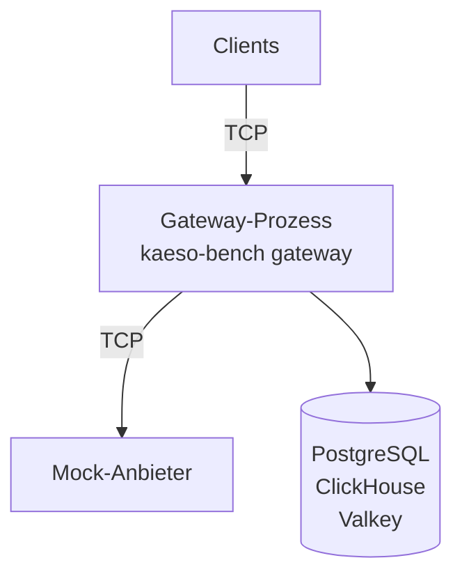

Der Benchmark betreibt das ganze Gateway zwischen echten Clients und dem Mock-Anbieter, sodass jede Zahl allein Kaeso misst. Starten Sie den [Entwicklungs-Stack](stack.md) und führen Sie dann jedes Szenario in voller Größe aus:

```bash
cargo run --release -p kaeso-bench
```

Er gibt eine Tabelle aus und schreibt `target/bench/report.md`, `target/bench/report.json` und das Log des Gateways, `target/bench/gateway.log`.

## Funktionsweise

Der Benchmark legt frische Datenbanken auf dem Entwicklungs-Stack an, startet den Mock-Anbieter aus `kaeso-testkit` und das Gateway in einem eigenen Prozess. Die Clients und der Mock-Anbieter teilen sich den Prozess des Benchmarks. Jede Anfrage läuft auf beiden Seiten des Gateways über echte Sockets:



- **Das Gateway** läuft wie bei `kaeso serve`, mit demselben Router, derselben Verbindungsverwaltung, denselben Limits, Anfrageprotokollen und Metriken. Vor jedem Szenario bekommt es einen frischen Prozess, und 50 Anfragen und 8 Streams wärmen es auf.
- **Der Anfrageweg** ist der, den die meisten Apps nehmen: Die Clients rufen `POST /v1/chat/completions` im Format OpenAI Chat Completions für `gpt-4o` auf. Kaeso übersetzt jede Anfrage für den Mock in das Format OpenAI Responses und jede Antwort zurück.
- **Der Mock-Anbieter** schreibt den ersten Chunk einer Antwort sofort und die weiteren in einem festen Abstand, standardmäßig 100 ms. Bei vier Tokens pro Chunk sind das 40 Tokens pro Sekunde und Stream.
- **Die Clients** öffnen eine Verbindung pro Stream, höchstens 100 auf einmal. Sie schließen Verbindungen mit einem Reset, damit ein Lauf mit Tausenden Streams die lokalen Ports nicht aufbraucht.

## Ausführen

Diese Optionen wählen die Szenarien und ihre Größen; ohne sie gelten alle Szenarien und Standardwerte:

| Option | Standard | Legt fest |
| --- | --- | --- |
| `--scenarios` | Alle fünf | Die Szenarien, durch Kommas getrennt: `baseline`, `streams`, `cancellation`, `slow-clients`, `mixed` |
| `--baseline-requests`, `--baseline-concurrency` | 20.000, 64 | Nicht gestreamte Anfragen der Baseline und die Verbindungen, über die sie laufen |
| `--streams` | 100, 1.000, 5.000 | Anzahlen gleichzeitiger Streams, je ein Lauf |
| `--gap-ms`, `--chunks` | 100, 100 | Der Abstand des Mocks zwischen zwei Chunks und die Chunks eines Streams |
| `--cancel-streams`, `--cancel-share` | 1.000, 0,3 | Streams im Abbruch-Szenario und der Anteil, der die Verbindung trennt |
| `--slow-streams`, `--slow-share` | 1.000, 0,1 | Streams im Szenario mit langsamen Clients und der Anteil, der langsam liest |
| `--slow-read-every-ms` | Nie | Wie oft ein langsamer Client nach seinem ersten Chunk liest |
| `--idle-timeout-ms` | 5.000 | `KAESO_UPSTREAM_STREAM_IDLE_TIMEOUT` des Gateways |
| `--mixed-streams` | 1.000 | Streams im gemischten Szenario |
| `--opening` | 100 | Streams, die die Clients gleichzeitig öffnen |
| `--smoke` | Aus | Kleine Größen, wie CI sie ausführt |
| `--out` | `target/bench` | Wohin die Berichte und das Log kommen |

Um zum Beispiel 2.000 Streams mit einem Chunk alle 10 ms zu messen:

```bash
cargo run --release -p kaeso-bench -- \
  --scenarios streams --streams 2000 --gap-ms 10
```

Jeder Stream belegt einen Socket im Client, zwei im Gateway und einen im Mock. Erhöhen Sie das Limit offener Dateien, bevor Sie 5.000 Streams ausführen:

```bash
ulimit -n 65536
```

## Szenarien

Jedes Szenario beginnt mit einem frischen Gateway:

| Szenario | Was passiert |
| --- | --- |
| Baseline | Die Clients senden nicht gestreamte Anfragen, so schnell das Gateway sie beantwortet |
| Gleichzeitige Streams | Die Clients öffnen jede Anzahl Streams, lesen jeden Chunk und schließen. Dieselben Streams laufen auch gegen den Mock-Anbieter allein, ohne Kaeso |
| Abbrüche | Ein Anteil der Streams trennt die Verbindung an einer Stelle zwischen einem Fünftel und vier Fünfteln des Streams. Ihre Mock-Streams enden nie von selbst, sodass jeder Abbruch eine Anfrage beim Anbieter zu schließen hat. Die anderen lesen bis zum Ende |
| Langsame Clients | Ein Anteil der Clients liest den ersten Chunk und hört dann auf, mit einem kleinen Empfangspuffer, während der Mock ohne Ende jede Millisekunde ein Text-Delta von 4 KiB schreibt. Sie nutzen ein zweites Projekt, das keine Inhalte protokolliert, sodass der Speicher des Gateways zeigt, was es für sie puffert, und nicht die Antwort, die es für das Protokoll behält. Die anderen lesen normal |
| Gemischt | Streams, Abbrüche und langsame Clients zugleich, neben nicht gestreamten Anfragen, so schnell das Gateway sie beantwortet |

## Zahlen lesen

Jede Zeit erscheint als Perzentile über alle Anfragen oder Chunks eines Laufs:

| Zahl | Bedeutet |
| --- | --- |
| Requests/s | Nicht gestreamte Anfragen, die das Gateway pro Sekunde beantwortet hat, die Zeit des Mocks eingeschlossen |
| Overhead | Die eigene Zeit von Kaeso, bevor es den Anbieter aufrief, aus dem Eintrag `kaeso` des [Headers `server-timing`](../api/model-api.md#antwort-header). Sie beginnt, wenn die Anfrage den Handler von Kaeso erreicht, und lässt die Zeit aus, die der Client zum Senden des Bodys brauchte |
| Latency | Die Zeit des Clients für eine ganze nicht gestreamte Anfrage |
| Added time to first byte | Die Zeit des Clients bis zum ersten Chunk minus die Zeit des Anbieters bis zur Antwort, den Eintrag `upstream` von `server-timing`. Sie enthält den Overhead, die Arbeit von Kaeso am ersten Chunk und die zusätzliche Verbindung |
| Added chunk gap | Ein Perzentil der Abstände zwischen den Lesevorgängen des Clients über Kaeso, minus dasselbe Perzentil mit dem Mock allein. Werte um null bedeuten, dass Kaeso zwischen Chunks keine Verzögerung hinzufügt |
| Gateway memory | Der residente Speicher des Gateway-Prozesses, mit `ps` gelesen: nach dem Aufwärmen, am Höchststand und als die meisten Streams offen waren |
| Per open stream | Der Speicher mit den meisten offenen Streams, minus der Speicher nach dem Aufwärmen, geteilt durch die dann offenen Streams |
| Disconnect to upstream closed | Vom Reset eines Clients, bis der Mock-Anbieter seinen Stream geschlossen sieht |
| Ended after the last read | Vom letzten Lesen eines langsamen Clients, bis der Mock-Anbieter seinen Stream geschlossen sieht. Das ist das Leerlauf-Zeitlimit plus der Moment, den der Mock braucht, um die Sockets und die Warteschlange von Kaeso zu füllen |
| Logged as client_stalled | Hängende Streams, gezählt von `kaeso_stream_failures_total{kind="client_stalled"}` |
| Growth per stream | Der Speicher am Höchststand minus der Speicher nach dem Aufwärmen, geteilt durch die Streams des Szenarios |
| Left open | Streams, die der Mock-Anbieter nach dem Szenario noch offen hatte |

Ein Gateway, das alles behält, was eine hängende App nicht liest, wächst bis zum Leerlauf-Zeitlimit um die Chunks des Mocks. Das zeigt sich als Wachstum pro Stream weit über dem Wert pro offenem Stream eines Laufs ohne langsame Clients.

Der Bericht nennt auch die Version von Kaeso, den Commit und den Build, CPU, Kerne und Speicher des Rechners sowie jeden Parameter. Vergleichen Sie Läufe vom selben Rechner mit Release-Builds: Die Clients und der Mock-Anbieter nehmen dem Gateway auf demselben Rechner CPU weg.

## Prüfungen

Ein Lauf schlägt fehl, und der Befehl endet mit einem Fehler, wenn eine Prüfung fehlschlägt. Die Prüfungen gelten der Korrektheit, nie der Zeit:

- Jede Anfrage und jeder Stream wurde abgeschlossen, außer denen, die die Verbindung trennten oder nicht mehr lasen.
- Jeder Abbruch erreichte den Mock-Anbieter als geschlossener Stream.
- Jeder hängende Stream endete, und Kaeso protokollierte jeden als `client_stalled`.
- Der Speicher des Gateways wuchs um weniger als 1 MiB pro Stream, während einige Clients nicht mehr lasen.
- Nach keinem Szenario blieb beim Mock-Anbieter ein Stream offen.

`cargo coverage-gateway` führt den Benchmark mit `--smoke` aus (`crates/kaeso-bench/tests/smoke.rs`), sodass CI bei jeder Änderung am Gateway jedes Szenario in kleiner Größe ausführt.

## Nächste Schritte

- [Tests](testing.md): Führen Sie jede Prüfung aus, die eine Änderung bestehen muss.
- [Zustand und Metriken](../self-hosting/monitoring.md): Beobachten Sie den Overhead von Kaeso in einer laufenden Installation.
- [Ablauf einer Anfrage](../concepts/request-flow.md#fehlgeschlagene-streams): Sehen Sie, wie Kaeso Streams beendet, die scheitern oder hängen.
