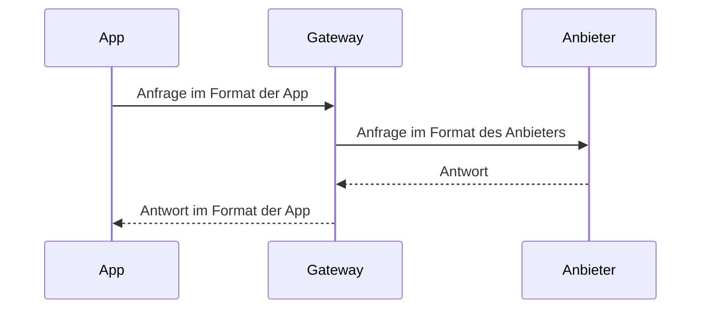

Jede Seite dieser Website ist eine Markdown-Datei in `apps/docs/content`, mit einem Ordner pro Sprache (`en`, `de`, `zh-CN`) und denselben Dateinamen in jedem. Nur hier wird Dokumentation geführt; READMEs im Code bleiben kurz und verlinken hierher. Bemerken Personen, die Kaeso nutzen, betreiben oder integrieren, eine Änderung, aktualisiert ihr Pull Request diese Seiten.

## Eine Seite bearbeiten

**Auf GitHub:** am Fuß jeder Seite **Auf GitHub bearbeiten** wählen oder die Datei in `apps/docs/content` öffnen und die Änderung gegen `dev` vorschlagen. GitHub stellt die Seite weitgehend so dar wie die Website, und Links zwischen Seiten funktionieren auch dort.

**Auf dem eigenen Rechner:**

```bash
pnpm build:packages
pnpm --filter kaeso-docs dev
```

Die Website läuft unter http://localhost:4480 und lädt beim Speichern neu; das Terminal nennt alles, was zu beheben ist. `KAESO_DOCS_PORT` wählt einen anderen Port.

| Befehl | Wirkung |
| --- | --- |
| `pnpm --filter kaeso-docs check:content` | Prüft Frontmatter, Links, Anker, Bilder und Adressen jeder Seite und dass jede Sprache dieselben Seiten mit derselben `order` hat, ohne zu bauen |
| `pnpm --filter kaeso-docs build` | Baut die Website nach `apps/docs/dist` und prüft danach die [Bundle-Budgets](performance.md#die-dokumentations-website) |
| `pnpm --filter kaeso-docs preview` | Liefert den Build so aus, wie es ein statischer Host täte |

Der eigene Code der Website wird wie jedes andere Paket getestet ([Tests](testing.md#die-dokumentations-website)).

## Eine Seite

```markdown
---
title: API keys
description: Create keys for apps and scripts, and keep them under control.
order: 5
---

Every request to the model API carries a **key**.

## Create a key
```

| Feld | Pflicht | Bedeutung |
| --- | --- | --- |
| `title` | ja | Die Überschrift der Seite, ihr Name in der Seitenleiste und in der Suche und ihr Browser-Tab |
| `description` | ja | Ein Satz unter dem Titel, höchstens 140 Zeichen; auch die Beschreibung, die Suchmaschinen und Linkvorschauen zeigen |
| `order` | nein | Eine ganze Zahl; kleinere stehen im Ordner weiter vorn. Seiten ohne oder mit gleicher Zahl folgen nach Dateiname |
| `nav` | nein | Eine kürzere Beschriftung für die Seitenleiste |

Jedes andere Feld ist ein Fehler. Der Titel ist die einzige `#`-Überschrift der Seite, deshalb beginnen Überschriften auf der Seite bei `##`. Damit sie sich auf GitHub gut liest, darf eine Seite trotzdem mit `# ` und genau ihrem Titel beginnen; die Website zeigt ihn nur einmal. **Auf dieser Seite** listet die Überschriften `##` und `###` auf.

## Wo eine Seite liegt

| Datei | Adresse | In der Seitenleiste |
| --- | --- | --- |
| `content/en/index.md` | `/` | „Introduction“, an erster Stelle |
| `content/en/console/index.md` | `/console` | Benennt die Gruppe mit ihrem `title`, ordnet sie mit ihrer `order` ein und steht dort als „Overview“ |
| `content/en/console/api-keys.md` | `/console/api-keys` | In dieser Gruppe |
| `content/de/console/api-keys.md` | `/de/console/api-keys` | Dieselbe Seite auf Deutsch |
| `content/zh-CN/console/api-keys.md` | `/zh-CN/console/api-keys` | Dieselbe Seite auf vereinfachtem Chinesisch |

Der Name einer Datei ist ihre Adresse: Kleinbuchstaben, Wörter mit Bindestrichen verbunden (`provider-keys.md`). Wer eine Datei umbenennt oder verschiebt, ändert ihre Adresse in jeder Sprache, und jeder Link darauf muss folgen; der Build nennt die, die es nicht tun. Links von anderswo und Lesezeichen behalten die alte Adresse, daher kommt sie mit der Seite, und wahlweise der Überschrift, an die sie gezogen ist, in `apps/docs/redirects.json`: `"development/kpp/extras-allowlist": "development/kpp/cross-format.md#extras"`. Der Build schreibt dann in jeder Sprache eine Seite an die alte Adresse, die den Leser weiterschickt, zur selben Überschrift der Übersetzung. Ein Ordner innerhalb einer Gruppe braucht eine `index.md`, und Ordner sind höchstens drei Ebenen tief verschachtelt. Dateien und Ordner, deren Name mit `_` beginnt, werden nicht veröffentlicht.

## Links

Auf eine andere Seite über ihre Datei verlinken, relativ zur aktuellen Seite und genau so, wie GitHub dem Link folgt:

```markdown
See [rate limits](limits-and-budgets.md#rates) and [the API](../api/index.md).
```

- Ein Anker ist die Überschrift so, wie GitHub sie umformt: kleingeschrieben, ohne Satzzeichen, Leerzeichen als Bindestriche. Eine Überschrift auf derselben Seite ist `[budgets](#budgets)`.
- Ein Link auf eine Seite oder Überschrift, die es nicht gibt, lässt den Build mit Datei und Link fehlschlagen.
- Referenzlinks (`[text][ref]`) werden nicht unterstützt und erscheinen als Text; Links inline schreiben.
- Andere Websites nur mit `http`-, `https`- und `mailto`-Adressen. Repository-Dateien, die keine Seiten sind, auf GitHub verlinken (`https://github.com/logicplanes/kaeso/blob/dev/<path>`) oder als Code nennen: `crates/kaeso-mail`.

## Bilder

Das Bild neben die Seite oder in einen Ordner `images/` daneben legen und mit einem Alternativtext versehen, der sagt, was es zeigt:

```markdown

```

PNG, JPEG, GIF, WebP, AVIF und SVG funktionieren. Bilder von anderen Websites werden nicht angezeigt, und ein Bild ohne Alternativtext lässt den Build fehlschlagen. Bilder wählen, die auf hellem und dunklem Hintergrund lesbar sind; ein SVG kann seine Farben selbst mit `@media (prefers-color-scheme: dark)` umschalten. Ein Link auf jede andere Datei in `content/` veröffentlicht diese Datei. Ein Bild zeigt nie ein Diagramm: Diagramme sind [Mermaid-Blöcke](#diagramme).

## Die Aufnahme im README

Das README beginnt mit einer kurzen Aufnahme der Konsole in einer hellen und einer dunklen Fassung, `.github/assets/demo-light.gif` und `.github/assets/demo-dark.gif`; GitHub zeigt die, die zum Design des Lesers passt. `apps/console/scripts/demo.mjs` nimmt beide mit Playwright gegen den Entwicklungs-Stack und seine geseedete Organisation auf, sodass nur der Mock-Anbieter, seine Platzhalter-Schlüssel und die erfundenen Personen des Seeds zu sehen sind. Das Skript verbindet auf **Anbieter** einen Anthropic-Schlüssel, erstellt auf **API-Schlüssel** einen Schlüssel, sendet damit eine Anfrage aus einem Terminal-Fenster, das es über die Seite legt, und wartet auf **Anfrageprotokolle** mit eingeschaltetem **Live**, bis die Anfrage erscheint.

Für eine neue Aufnahme mit einem frisch geseedeten Stack und laufender Konsole beginnen und vorher `ffmpeg` installieren, zum Beispiel mit `brew install ffmpeg`:

```bash
pnpm stack:down
pnpm stack:up
pnpm seed
pnpm dev
```

Dann in einem zweiten Terminal:

```bash
pnpm demo
```

Das Skript nimmt mit 1280 × 800 und dem Geräte-Skalierungsfaktor 2 auf, macht aus den Bildern GIFs mit 20 Bildern pro Sekunde und je einer Palette, schreibt beide nach `.github/assets` und nennt ihre Größe; jedes sollte unter 4 MB bleiben. Es läuft auch auf einem Stack, auf dem es schon aufgenommen hat: Vorher entfernt es den Anthropic-Schlüssel und archiviert seinen eigenen Schlüssel, die früheren Anfragen bleiben aber in den Protokollen. Das README verlinkt die GIFs auf `dev`, eine neue Aufnahme erscheint dort also, sobald ihr Pull Request gemergt ist.

## Hinweisboxen

Die Alerts von GitHub, mit der Art allein in der ersten Zeile:

```markdown
> [!NOTE]
> A key's secret is shown once.
```

`NOTE`, `TIP`, `IMPORTANT`, `WARNING` und `CAUTION` haben jeweils ein eigenes Aussehen und einen eigenen Titel. Sparsam einsetzen.

## Diagramme

Jedes Diagramm eines Systems, einer Architektur, eines Anfrage- oder Datenflusses, einer Abfolge, eines Zustands oder eines Lebenszyklus ist ein Mermaid-Block. Der Build zeichnet es in Kaesos eigenem Look, als helles und dunkles Bild, die dem Theme der Website folgen; kein Mermaid-Code erreicht die Lesenden. Ein Diagramm wird nie mit Rahmenzeichen oder Pfeilen in einem Codeblock gezeichnet und nie als Screenshot oder Bild gezeigt: Der Build schlägt bei einem Codeblock fehl, der mit Zeichen wie `─`, `│`, `└`, `▶` oder `→` zeichnet.

````markdown

````

- Den passenden Typ wählen: `flowchart` für Teile und wie sie verbunden sind, `sequenceDiagram` für Anfragen und Antworten zwischen Beteiligten, `stateDiagram-v2` für einen Lebenszyklus. `flowchart TD`, von oben nach unten, bleibt auf dem Telefon lesbar; ein Diagramm, das breiter als die Spalte ist, scrollt in seinem eigenen Rahmen.
- `accTitle:` benennt das Diagramm in wenigen Wörtern und ist Pflicht. `accDescr:` sagt in ein oder zwei Sätzen, was es zeigt; Screenreader lesen beides vor, und die Suche findet es zusammen mit den Beschriftungen des Diagramms.
- Beschriftungen kurz halten, in der Sprache der Seite; Namen aus dem Code bleiben, wie sie sind. `<br>` bricht eine Beschriftung in eine zweite Zeile um.
- Ein Diagramm nur zeichnen, wo es hilft; eine kurze Liste oder eine Tabelle ist oft klarer.
- Keine `%%`-Kommentare und kein `%%{init}`: Die Website setzt Farben, Schrift und Radius aus Kaesos Tokens.

Die Zeichnungen liegen committet in `apps/docs/diagrams/`. `pnpm --filter kaeso-docs diagrams` zeichnet neue und geänderte Diagramme mit Chromium und entfernt die, die keine Seite mehr nutzt; der Dev-Server und `pnpm build` zeichnen Fehlendes nebenbei. `check:content` schlägt fehl, wenn sich ein Diagramm seit dem Zeichnen geändert hat, und ein Diagramm, das sich nicht parsen lässt, schlägt mit Datei und Zeile fehl.

## Alles andere

Seiten sind GitHub-Flavoured Markdown: **fett**, _kursiv_, ~~durchgestrichen~~, `Code`, Listen, Aufgabenlisten, Tabellen (eine Spalte mit `--:` ist rechtsbündig, für Zahlen), Zitate, horizontale Linien und abgegrenzter Code. Ein Codeblock nennt seine Sprache und kann seine Datei nennen:

````markdown
```ts title="support-bot/src/client.ts"
export const client = new OpenAI({ baseURL: "https://kaeso.example.com/v1" });
```
````

TypeScript, TSX, JavaScript, JSON, Bash (`sh`, `shell`, `console`), Python, YAML und Diff werden hervorgehoben; andere Sprachen erscheinen als einfacher Text. Rohes HTML wird nicht gerendert und erscheint als Text. Codeblöcke enthalten nie Kommentare: Einen Befehl im Satz davor erklären.

Die aktuelle Version als `\{{version}}` schreiben. Der Build ersetzt sie in Text, Code und Frontmatter durch die Version des Releases, sodass keine Seite hinter dem nächsten Release zurückbleibt. Ein Backslash davor lässt die Zeichen stehen, wie auf dieser Seite.

## Schreiben

- **Kaeso so beschreiben, wie der Code es tut.** Einstellungen an der Konfiguration des Gateways prüfen, Beschriftungen am englischen Katalog der Konsole und Verhalten an Gateway, KPP und Konsole. Nie ein Feature dokumentieren, das es nicht gibt.
- **Den aktuellen Stand beschreiben.** Pläne, offene Fragen und To-do-Listen gehören in Issues.
- **Mit dem beginnen, was Lesende brauchen**, ein Gedanke pro Absatz. Tabellen für Referenzdaten, nummerierte Listen für Schritte, Fließtext, wo es um Begründungen geht. Auf die Seite verlinken, die ein Thema behandelt, statt es zu wiederholen.
- **Titel und Überschriften** in normaler Satzschreibung, schlichte Wörter, kurze Sätze, keine Ausrufezeichen.
- **Beschriftungen der Konsole** fett und genau so, wie die Konsole sie zeigt: **API-Schlüssel**, **Schlüssel erstellen**, **Einstellungen** › **Instanz**.
- **Beispiele** nutzen Kaesos eigene Platzhalter (`kaeso.example.com`, `sk-kso-…`, `owner@example.com`), nie echte Schlüssel oder personenbezogene Daten.

## Übersetzen

Eine Änderung an einer englischen Seite wird im selben Pull Request auch in `content/de` und `content/zh-CN` vorgenommen.

- **Gleiche Struktur:** derselbe Dateiname, dieselbe `order`, dieselben Überschriften in derselben Reihenfolge und dieselben Codeblöcke, Byte für Byte. Titel, Beschreibung, Text, Tabellen und Hinweisboxen übersetzen.
- **Links** behalten ihre Datei; ein Anker wird zum Anker der übersetzten Überschrift.
- **Unverändert bleiben** Code, Befehle, Einstellungen (`KAESO_*`), Pfade, Feldnamen, Rechte (`keys.all.view`), Produktnamen und Modell-IDs.
- **Beschriftungen der Konsole** in deren eigener Übersetzung, aus `apps/console/src/i18n/locales/de` und `apps/console/src/i18n/locales/zh-CN`.
- **Natürlich schreiben**, nicht Wort für Wort, und jede Tatsache und jede Zahl behalten.

Hausstil und Glossar stehen unter [Übersetzungen](translations.md#hausstil). Zwei Regeln zählen auf Seiten besonders:

| | Deutsch | Vereinfachtes Chinesisch |
| --- | --- | --- |
| Schritte | Infinitiv, Verb am Ende: „Schlüssel erstellen“ | Zuerst ein Verb: “创建密钥” |
| Beschreibungen | Ein Satz | Ein Satz, endet auf “。” |

Die eigenen Texte der Website, etwa **Auf GitHub bearbeiten** oder die Suche, stehen in `apps/docs/src/i18n/messages/en.ts`, `de.ts` und `zh-CN.ts`, so typisiert, dass eine fehlende Übersetzung den Typecheck scheitern lässt.
