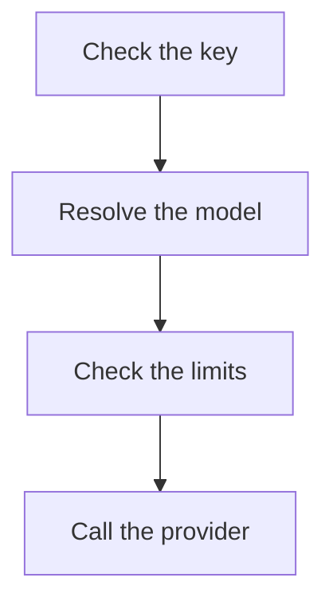
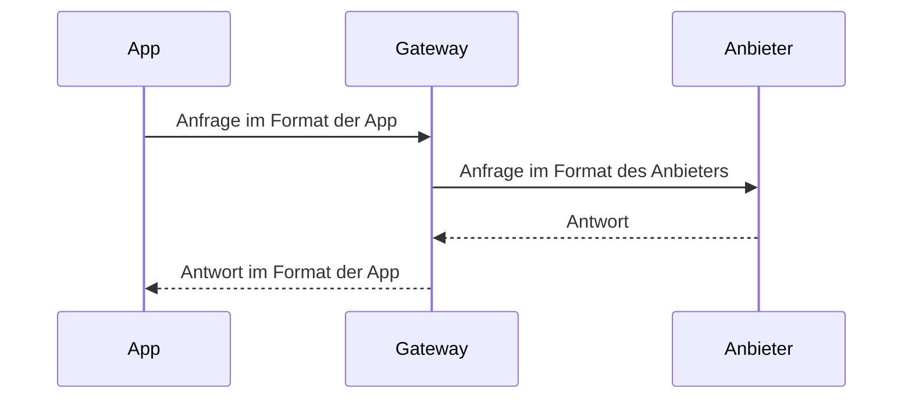

Jede Seite dieser Website ist eine Markdown-Datei in `apps/docs/content`, mit einem Ordner pro Sprache (`en`, `de`, `zh-CN`) und denselben Dateinamen in jedem. Dokumentation gibt es nur hier; READMEs im Code bleiben kurz und verlinken hierher. Bemerken Personen, die Kaeso nutzen, betreiben oder integrieren, eine Änderung, aktualisiert ihr Pull Request diese Seiten.

Die Regeln auf dieser Seite sind verbindlich. Ein Pull Request, der eine Seite hinzufügt oder ändert, hält sie ein, und das Review prüft sie anhand der [Checkliste](#vor-dem-merge).

## Eine Seite bearbeiten

**Auf GitHub:** Wählen Sie am Fuß jeder Seite **Auf GitHub bearbeiten**, oder öffnen Sie die Datei in `apps/docs/content`, und schlagen Sie die Änderung gegen `dev` vor. GitHub stellt die Seite weitgehend so dar wie die Website, und Links zwischen Seiten funktionieren auch dort.

**Auf Ihrem Rechner:**

```bash
pnpm build:packages
pnpm --filter kaeso-docs dev
```

Die Website läuft unter http://localhost:4480 und lädt beim Speichern neu; das Terminal nennt alles, was zu beheben ist. `KAESO_DOCS_PORT` wählt einen anderen Port.

| Befehl | Wirkung |
| --- | --- |
| `pnpm --filter kaeso-docs check:content` | Prüft Frontmatter, Links, Anker, Bilder und Adressen jeder Seite und dass jede Sprache dieselben Seiten mit derselben `order` hat, ohne zu bauen |
| `pnpm --filter kaeso-docs build` | Baut die Website nach `apps/docs/dist` und prüft danach die Bundle-Budgets in `apps/docs/scripts/budget.ts` |
| `pnpm --filter kaeso-docs preview` | Liefert den Build so aus, wie es ein statischer Host täte |

Der eigene Code der Website wird wie jedes andere Paket getestet ([Tests](testing.md#die-dokumentations-website)).

## Verdient die Seite ihren Platz

Eine Seite gibt es, weil echte Leser sie öffnen, um etwas zu erledigen. Bevor Sie eine Seite anlegen, und jedes Mal, wenn Sie eine ändern, beantworten Sie vier Fragen:

1. **Wer liest sie?** Nennen Sie die Leser: jemand, der aus einer App Modelle aufruft, jemand, der eine Installation betreibt, jemand, der die Konsole nutzt, oder jemand, der Kaesos Code ändert.
2. **Welcher Aufgabe dient sie?** Die Leser können danach etwas Bestimmtes tun oder entscheiden. „Wissen, wie es innen funktioniert“ ist nur dann eine Aufgabe, wenn jemand gleich diesen Code ändert.
3. **Steht es schon woanders?** Ein Thema hat eine Seite. Überschneiden sich zwei Seiten, erklärt eine davon, und die andere verlinkt darauf.
4. **Würde ein Absatz auf einer anderen Seite reichen?** Eine Seite unter etwa 150 Wörtern, oder eine, die nur Links aufzählt, wird zum Abschnitt der Seite, von der ihre Leser kommen.

Eine Seite, die an einer dieser Fragen scheitert, wird entfernt oder zusammengelegt, nicht gekürzt. Zahlen und Listen, nach denen nur CI handelt, etwa Bundle-Budgets oder Coverage-Schwellen, bleiben im Code oder in der Konfiguration, die sie durchsetzt. Die Dokumentation nennt den Befehl, der sie prüft.

Um eine Seite zu entfernen, löschen Sie sie in allen drei Sprachen. Tragen Sie ihre Adresse mit der passendsten Seite in `apps/docs/redirects.json` ein ([Wo eine Seite liegt](#wo-eine-seite-liegt)), und reparieren Sie dann die Links, die der Build nennt.

## Seitentypen

Jede Seite gehört zu einem von fünf Typen. Wählen Sie den Typ, bevor Sie schreiben: Er bestimmt die Form der Seite, und eine Seite, die zwei Typen mischt, wird geteilt.

| Typ | Die Leser wollen | Beispiel |
| --- | --- | --- |
| Schnellstart | Von Anfang bis Ende ein erstes funktionierendes Ergebnis erreichen | [Schnellstart](../get-started/quick-start.md) |
| Anleitung | Eine Aufgabe erledigen, von der sie schon wissen, dass sie sie brauchen | [Modelle aufrufen](../get-started/calling-models.md) |
| Konzept | Verstehen, wie etwas funktioniert, bevor sie sich darauf verlassen | [Ablauf einer Anfrage](../concepts/request-flow.md) |
| Referenz | Eine genaue Tatsache nachschlagen: einen Endpunkt, eine Einstellung, einen Fehler | [Modell-API](../api/model-api.md) |
| Fehlerbehebung | Etwas reparieren, das schiefgegangen ist | [Fehlerbehebung](../self-hosting/troubleshooting.md) |

Anleitungen zeigen, wie eine Aufgabe geht, und verlinken für jede Option auf die Referenz. Referenzseiten führen jede Option auf und erzählen keine Geschichte. Dieselbe Tabelle steht nie auf beiden.

Die `index.md` eines Ordners ist eine Übersicht: ein oder zwei Sätze dazu, was der Bereich abdeckt, dann eine [Linkliste](#nächste-schritte) seiner Seiten mit je einem Satz.

### Schnellstart

~~~markdown
---
title: Quick start
description: Install Kaeso with Docker Compose, connect a provider and send your first request.
---

Install Kaeso on a server, connect a provider and send your first request through it.

## Before you begin

- A server with Docker Engine and Docker Compose 2.24 or newer.
- An API key from OpenAI or Anthropic.

## Start Kaeso

Start every service and wait until each one is healthy:

```bash
docker compose up -d --wait
```

The command returns once the gateway, the console and the databases are healthy.

## Next steps

- [Calling models](calling-models.md): Call models from your app with the OpenAI and Anthropic SDKs.
~~~

- Ein Weg von Anfang bis Ende, ohne Abzweigungen. Optionen und Alternativen stehen auf den Anleitungen, auf die die Schritte verlinken.
- Jeder Schritt ist eine `##`-Überschrift, die die Aufgabe im Infinitiv nennt. Darunter sagt ein Satz, was der Schritt tut, gefolgt von einem Befehl oder einer Codegruppe. Ein letzter Satz sagt, was die Leser sehen, wenn es geklappt hat.
- Höchstens zehn Schritte. Der letzte Schritt beweist, dass es funktioniert, etwa eine erste Anfrage und ihre Antwort.

### Anleitung

~~~markdown
---
title: Stream replies
description: Show a model's reply as it is written, with the OpenAI and Anthropic SDKs.
---

Ask for a stream and Kaeso sends the reply as server-sent events, in the format of the app's SDK.

```python tab="Python"
…
```

## Handle a stream that fails

…

## Next steps

- [Model API](../api/model-api.md#streaming): Keepalives, failures and disconnects in detail.
~~~

- Der erste Bildschirm zeigt die erledigte Aufgabe: ein, zwei Sätze, dann ein funktionierendes Beispiel.
- Abschnitte sind die Varianten, die Leser brauchen, jeder eine `##`-Überschrift, die die Aufgabe im Infinitiv nennt.
- Jede Option, die die Anleitung nicht braucht, verlinkt auf ihre Referenz, statt hier erklärt zu werden.

### Konzept

~~~markdown
---
title: Request flow
description: The steps a model request takes through the gateway, from the key to the reply.
---

Every model request passes the same checks in the same order. Knowing them tells you which error a request gets and when it is charged.



## Check the key

…
~~~

- Beginnen Sie in ein oder zwei Sätzen damit, warum es die Leser betrifft, dann folgt ein Diagramm oder ein kurzes Beispiel.
- Überschriften sind Substantive oder kurze Wendungen, in der Reihenfolge, in der die Dinge geschehen.
- Erklären Sie in Fließtext, wo es um Begründungen geht; eine Konzeptseite hat wenige Tabellen.

### Referenz

~~~markdown
---
title: Model API
description: The endpoints apps call, how they authenticate and how they name models.
---

Call the model API with the OpenAI or Anthropic SDK you already use, at your install's address.

```bash tab="curl"
…
```

```python tab="Python"
…
```

```ts tab="TypeScript"
…
```

## Endpoints

| Method and path | Format |
| --- | --- |
| `POST /v1/chat/completions` | OpenAI Chat Completions |
~~~

- Eine API-Referenz beginnt mit einer minimalen, lauffähigen Anfrage als [Codegruppe](#codebeispiele), dann folgen die Fakten.
- Fakten stehen in Tabellen: eine Zeile pro Endpunkt, Einstellung, Feld, Header oder Fehler, jede Zelle höchstens zwei kurze Sätze.
- Überschriften benennen die Sache (`## Endpunkte`, `### Modellliste`), nie eine Aufgabe.

### Fehlerbehebung

~~~markdown
---
title: Troubleshooting
description: Common problems with an install and how to fix them.
---

Find the message or the symptom you see, then follow its fix.

## Requests fail with 401

The key is wrong, expired or disabled.

1. Open **API keys** in the project and find the key by its last characters.
2. If it shows **Expired** or **Disabled**, create a new key.
~~~

- Ein `##`-Abschnitt pro Problem. Die Überschrift ist das Symptom, wie es den Lesern begegnet, oder die genaue Meldung.
- Darunter: die Ursache in einem Satz, dann die Lösung als nummerierte Schritte.
- Ordnen Sie die Probleme danach, wie oft Leser auf sie stoßen.

## Ton

Schreiben Sie so, wie eine hilfsbereite Kollegin etwas am Whiteboard erklärt: direkt, in einfachen Worten, ohne Füllwörter.

- **Sprechen Sie die Leser an.** Im Deutschen mit „Sie“, nie mit „du“. Anweisungen stehen im Imperativ: „Erstellen Sie einen Schlüssel“, nicht „Ein Schlüssel wird erstellt“.
- **Aktiv und im Präsens.** „Kaeso antwortet mit 404“, nicht „Es wird 404 zurückgegeben werden“. Nennen Sie, wer handelt: Kaeso, das Gateway, die Konsole, die App, Sie.
- **Zuerst, was die Leser brauchen**, dann die Begründung. Die Antwort oder die Handlung steht vorn im Absatz und vorn im Satz.
- **Ein Gedanke pro Satz.** Zielen Sie auf Sätze unter 20 Wörtern, und teilen Sie jeden über 30. Reihen Sie keine Satzteile mit Semikolons aneinander; höchstens ein Semikolon pro Absatz.
- **Kurze Absätze.** Höchstens vier Sätze. Ein Absatz, der vier oder mehr Dinge aufzählt, wird zur Liste.
- **Einfache Wörter.** „Verwenden“, nicht „zur Anwendung bringen“; „um“, nicht „zum Zwecke“. Kein „einfach“, „nur“, „ganz leicht“, „bitte“, „beachten Sie, dass“, „grundsätzlich“ oder „sehr“.
- **Kein Marketing, kein Herumdrucksen.** Kein „leistungsstark“, „nahtlos“, „blitzschnell“ oder „erstklassig“. „Kann“ und „könnte“ nur bei echter Unsicherheit; Grenzen stehen als Tatsachen da.
- **Keine Ausrufezeichen**, keine Witze, kein „wir“.
- **Dieselben Wörter für dieselben Dinge.** Verwenden Sie die Begriffe des [Glossars](translations.md#glossar) und die Beschriftungen der Konsole, jedes Mal.
- **Titel und Überschriften** in deutscher Groß- und Kleinschreibung, sonst wie ein Satz. Eine Überschrift, die eine Aufgabe nennt, steht im Infinitiv mit dem Verb am Ende („Schlüssel erstellen“); eine, die eine Sache nennt, ist ein Substantiv („Modellnamen“).
- **Beschreiben Sie Kaeso so, wie der Code es tut.** Prüfen Sie Einstellungen an der Konfiguration des Gateways, Beschriftungen am englischen Katalog der Konsole und Verhalten an Gateway, KPP und Konsole. Dokumentieren Sie nie ein Feature, das es nicht gibt, und nie einen Plan: Pläne gehören in Issues.

Aus Kaesos eigenen Seiten:

| Statt | Schreiben Sie |
| --- | --- |
| Eine Compose-Datei betreibt die ganze Installation: das Gateway, die Konsole, PostgreSQL, ClickHouse, Valkey und Caddy. Diese Seite führt von einem leeren Server bis zur ersten Anfrage. | Installieren Sie Kaeso auf einem Server, verbinden Sie einen Anbieter, und senden Sie Ihre erste Anfrage darüber. |
| Caddy ist gesund, sobald es ausliefert, und fordert das Zertifikat für eine neue Domain im Hintergrund an, sodass HTTPS-Anfragen noch fehlschlagen können, bis es eines hat; `docker compose logs caddy` zeigt, wann es eines erhält oder warum nicht. | HTTPS-Anfragen können eine Minute lang fehlschlagen, während Caddy das Zertifikat holt. Mit `docker compose logs caddy` sehen Sie, wann es da ist. |
| Seine **Modelle** und **Limits** lassen sich dort jederzeit ändern. | Sie können dort jederzeit seine **Modelle** und **Limits** ändern. |
| `/v1/embeddings` ruft nur Embedding-Modelle auf, die nur OpenAI anbietet, und ein Embedding-Modell bedient keinen anderen Endpunkt; eine Anfrage, die beides mischt, wird mit 400 abgelehnt. | `/v1/embeddings` bedient nur Embedding-Modelle, und diese bedienen keinen anderen Endpunkt. Kaeso antwortet mit 400 auf eine Anfrage, die beides mischt. |
| Wer ohne Sitzung eine Seite der Konsole öffnet, landet auf der Anmeldeseite mit dieser Seite in `next` und kehrt nach der Anmeldung zu ihr zurück. | Öffnen Sie eine Seite der Konsole, ohne angemeldet zu sein, bittet die Konsole Sie um die Anmeldung und bringt Sie danach zu dieser Seite zurück. |

## Hervorhebung

Formatierung zeigt, was etwas ist, nie, wie wichtig es ist.

| Format | Wofür | Beispiel |
| --- | --- | --- |
| **Fett** | Beschriftungen der Konsole, genau so, wie die Konsole sie zeigt, verbunden mit › | **Einstellungen** › **Instanz** |
| **Fett** mit Punkt | Der Name am Anfang eines Listeneintrags, wenn die Liste mehrere benannte Dinge erklärt | **Keepalives.** Nach 15 Sekunden … |
| `Code` | Alles, was die Leser eingeben oder was der Code benennt: Befehle, Pfade, Dateinamen, Einstellungen, Felder, Header, Modell-IDs, Werte, HTTP-Methoden mit ihrem Pfad | `KAESO_DOMAIN`, `POST /v1/messages`, `claude-haiku-4-5` |
| Anführungszeichen | Eine Meldung der Konsole, genau zitiert | „Einladung widerrufen“ |
| Ein Link | Eine andere Seite oder Überschrift, benannt nach dem, was die Leser dort finden | [Ratenlimits](../console/limits-and-budgets.md) |

- Kein Fettdruck zur Betonung im Fließtext. Ist ein Satz so wichtig, wird er zur [Hinweisbox](#hinweisboxen) oder zum ersten Satz seines Abschnitts.
- Keine Kursivschrift, keine Unterstreichung, keine Großbuchstaben zur Betonung.
- Statuscodes, Zahlen und Einheiten sind normaler Text: 404, 15 Sekunden, 4 GB.
- Überschriften tragen keine Links und keine Formatierung, außer Code auf Referenzseiten, die ein Feld benennen.

## Codebeispiele

Leser kopieren Code, bevor sie den Text lesen, deshalb muss der Code so funktionieren, wie er dasteht.

- **Mit einem lauffähigen Beispiel beginnen.** Jede API-Seite und jede Anleitung, in der eine App Kaeso aufruft, zeigt auf ihrem ersten Bildschirm eine minimale Anfrage, die funktioniert: direkt nach der Einleitung, vor der ersten `##`-Überschrift.
- **Lauffähig, wie eingefügt.** Die Leser ändern nur die Platzhalter: die Adresse `kaeso.example.com`, den Schlüssel in der Umgebungsvariable `KAESO_API_KEY` und das Modell `claude-haiku-4-5` oder `gpt-5-mini`. Wo ein Schlüssel als Literal unvermeidbar ist, schreiben Sie ihn als `sk-kso-…`. Verwenden Sie auf einer Seite durchgehend denselben Prompt: „Write a haiku about gateways.“
- **Minimal.** Nur die Felder, die das Beispiel braucht. Ein Block in einer Anleitung bleibt unter 25 Zeilen; längerer Code verlinkt auf eine Datei auf GitHub.
- **Schlüssel kommen aus der Umgebung.** Der Code liest `KAESO_API_KEY`: `os.environ["KAESO_API_KEY"]` in Python, `process.env.KAESO_API_KEY` in TypeScript, `$KAESO_API_KEY` in curl. Schreiben Sie nie einen Schlüssel in SDK-Code.
- **Die offiziellen SDKs.** Python nutzt `openai` und `anthropic` mit ihren synchronen Clients; TypeScript nutzt `openai` und `@anthropic-ai/sdk` als ES-Module mit Top-Level-`await`. Die Basis-URL des OpenAI SDK ist `https://kaeso.example.com/v1`, die des Anthropic SDK `https://kaeso.example.com`. Die App der Leser installiert sie mit `pip install openai anthropic` und `npm install openai @anthropic-ai/sdk`; Befehle für die Arbeit an diesem Repository nutzen pnpm.
- **Die Antwort zeigen**, wo die Leser ihre Form brauchen: ein `json`-Block nach der Anfrage, eingeleitet von einem Satz. Kürzen Sie lange Antworten auf die Felder, auf die es ankommt.
- **Keine Kommentare, keine Prompts.** Codeblöcke enthalten nie Kommentare; erklären Sie einen Befehl im Satz davor. Shell-Blöcke enthalten Befehle ohne `$`-Prompt, damit sie sich kopieren und ausführen lassen.
- **Ein Block, ein Zweck.** Befehle, die die Leser ausführen, und Ausgaben, die sie lesen, stehen in getrennten Blöcken.
- **Zeilen passen auf die Seite.** Ein Desktop zeigt etwa 78 Zeichen einer Codezeile. Setzen Sie einen längeren Befehl mit `\` in der nächsten Zeile fort, schreiben Sie jedes Feld eines Request-Bodys in eine eigene Zeile, und formatieren Sie anderen Code so, wie sein Formatierer es bei dieser Breite tut. Auf Smartphones bricht Code um, und ein `markdown`- oder `text`-Block bricht bei jeder Breite um, darin darf Fließtext also lang sein.

### Codegruppen

Wo eine App Kaeso aufrufen würde, zeigen Sie dieselbe Anfrage in curl, Python und TypeScript als eine Codegruppe: aufeinanderfolgende Codeblöcke, jeder mit einem `tab`, der ihn benennt. Die Website zeigt sie als Tabs und merkt sich die Wahl der Leser auf jeder Seite; GitHub zeigt sie nacheinander.

~~~markdown
```bash tab="curl"
curl https://kaeso.example.com/v1/responses \
  -H "Authorization: Bearer $KAESO_API_KEY" \
  -H "content-type: application/json" \
  -d '{"model": "claude-haiku-4-5", "input": "Write a haiku about gateways."}'
```

```python tab="Python"
import os
from openai import OpenAI

client = OpenAI(
    base_url="https://kaeso.example.com/v1",
    api_key=os.environ["KAESO_API_KEY"],
)

response = client.responses.create(
    model="claude-haiku-4-5",
    input="Write a haiku about gateways.",
)
print(response.output_text)
```

```ts tab="TypeScript"
import OpenAI from "openai";

const client = new OpenAI({
  baseURL: "https://kaeso.example.com/v1",
  apiKey: process.env.KAESO_API_KEY,
});

const response = await client.responses.create({
  model: "claude-haiku-4-5",
  input: "Write a haiku about gateways.",
});
console.log(response.output_text);
```
~~~

- Die Tabs heißen `curl`, `Python` und `TypeScript`, in dieser Reihenfolge und genau so geschrieben, denn die gemerkte Wahl folgt dem Namen. Lassen Sie einen Tab nur weg, wenn diese Sprache den Aufruf nicht machen kann.
- Jeder Tab tut dasselbe. Eine Gruppe hat mindestens zwei Codeblöcke, und zwischen ihnen stehen nur Leerzeilen.
- Zeigen Sie beide SDKs, wo eine Seite beide Formate behandelt: eine Gruppe für das OpenAI SDK und eine für das Anthropic SDK, jede eingeleitet von einem Satz, der es nennt.
- Ein einzelner Befehl, eine Konfigurationsdatei oder eine Antwort ist ein einfacher Codeblock ohne `tab`.

## Hinweisboxen

Die Alerts von GitHub, mit der Art allein in der ersten Zeile:

```markdown
> [!WARNING]
> Everyone who uses a page can read the key it holds.
```

| Art | Wofür |
| --- | --- |
| `NOTE` | Etwas, das Leser übersehen könnten und das ändert, wie sie den Abschnitt lesen |
| `TIP` | Eine Abkürzung oder ein besserer Weg, den Leser auch auslassen können |
| `IMPORTANT` | Etwas, das Leser tun müssen, damit die Aufgabe gelingt, etwa eine Kopie des Hauptschlüssels aufbewahren |
| `WARNING` | Eine Handlung, durch die Daten verloren gehen, ein Geheimnis preisgibt oder sich nicht rückgängig machen lässt, mit dem, was stattdessen zu tun ist |

- Höchstens eine Hinweisbox pro `##`-Abschnitt und drei pro Seite. Die meisten Abschnitte brauchen keine.
- Ein bis drei Sätze, höchstens 50 Wörter. Eine längere wird zu einem eigenen Abschnitt.
- Die Hinweisbox sagt die Sache selbst. Beginnen Sie nicht mit „Beachten Sie, dass“, und wiederholen Sie nicht ihre Art.
- Setzen Sie sie neben den Schritt, den sie betrifft, nie an den Anfang einer Seite.
- `CAUTION` wird nicht verwendet: Schreiben Sie eine `WARNING`.

## Listen, Tabellen und Fließtext

- **Nummerierte Listen** für Schritte, die Leser der Reihe nach ausführen. Eine Handlung pro Schritt, beginnend mit einem Verb.
- **Aufzählungen** für drei oder mehr gleichartige Einträge. Die Einträge sind alle ganze Sätze oder alle Satzteile, nie gemischt.
- **Tabellen** für Referenzdaten mit zwei oder mehr Eigenschaften pro Eintrag: Einstellungen, Endpunkte, Header, Fehler. Die erste Spalte ist der Name der Sache; eine Zelle hat höchstens zwei kurze Sätze.
- **Fließtext** für Gründe, Abwägungen und Zusammenhänge.
- Leiten Sie jede Liste, jede Tabelle und jeden Codeblock mit einem Satz ein, der mit einem Doppelpunkt oder einem Punkt endet.

## Links

Verlinken Sie eine andere Seite über ihre Datei, relativ zur aktuellen Seite und genau so, wie GitHub dem Link folgt:

```markdown
See [rate limits](limits-and-budgets.md#rates) and [the API](../api/index.md).
```

- **Der Linktext nennt, was die Leser dort finden**: „[API-Schlüssel](../console/api-keys.md) erklärt, wie Sie einen Schlüssel begrenzen“, nie „klicken Sie [hier](../console/api-keys.md)“. Verlinken Sie dieselbe Seite nicht zweimal in einem Abschnitt.
- **Verlinken statt wiederholen.** Behandelt eine andere Seite ein Thema, ersetzen ein Satz und ein Link die Erklärung.
- Ein Anker ist die Überschrift so, wie GitHub sie umformt: kleingeschrieben, ohne Satzzeichen, Leerzeichen als Bindestriche. Eine Überschrift auf derselben Seite ist `[budgets](#budgets)`.
- Ein Link auf eine Seite oder Überschrift, die es nicht gibt, lässt den Build mit Datei und Link fehlschlagen.
- Referenzlinks (`[text][ref]`) werden nicht unterstützt und erscheinen als Text; schreiben Sie Links inline.
- Andere Websites nur mit `http`-, `https`- und `mailto`-Adressen. Verlinken Sie Repository-Dateien, die keine Seiten sind, auf GitHub (`https://github.com/logicplanes/kaeso/blob/dev/<path>`), oder nennen Sie sie als Code: `crates/kaeso-mail`.

## Nächste Schritte

Ein Schnellstart, eine Anleitung und eine Übersicht enden mit `## Nächste Schritte`: einer Liste, in der jeder Eintrag ein Link auf eine Seite ist, gefolgt von einem Doppelpunkt und einem Satz. Die Website zeigt sie als Raster aus Linkkarten.

```markdown
## Nächste Schritte

- [Modelle aufrufen](calling-models.md): Rufen Sie Modelle aus Ihrer App mit den SDKs von OpenAI und Anthropic auf.
- [API-Schlüssel](../console/api-keys.md): Begrenzen Sie einen Schlüssel auf die Modelle und Raten, die eine App braucht.
```

- Zwei bis vier Einträge, die wahrscheinlichste nächste Aufgabe zuerst.
- Der Linktext ist der Titel der Seite; der Satz sagt, was die Leser dort tun können.
- Verwenden Sie diese Form nur für Linklisten. Auch ein Listeneintrag, der mit einem Link beginnt und als Satz weitergeht, wird zur Karte; beginnen Sie solche Sätze deshalb mit einem Wort.
- Referenz- und Fehlerbehebungsseiten haben keine nächsten Schritte.

## Länge

| Teil | Budget |
| --- | --- |
| Titel | Höchstens 6 Wörter |
| Beschreibung | Ein Satz, höchstens 140 Zeichen |
| Einleitung | Ein bis drei Sätze vor dem ersten Beispiel oder der ersten Überschrift |
| Absatz | Höchstens vier Sätze |
| Satz | Unter 20 Wörtern anstreben; jeden über 30 teilen |
| Schnellstart | Höchstens 10 Schritte und 1.200 Wörter |
| Anleitung oder Konzept | Höchstens 1.500 Wörter; darüber teilen |
| Referenz | So lang wie die Fakten; eine Seite über 3.000 Wörter nach Themen teilen |
| Überschriften | Nur `##` und `###`; `####` nur für Einträge auf Referenzseiten |

Deutsch läuft etwa ein Drittel länger als Englisch; die Budgets gelten für die englische Seite, die Übersetzungen folgen ihr Satz für Satz.

## Eine Seite

```markdown
---
title: API keys
description: Create keys for apps and scripts, and keep them under control.
order: 5
---

Every request to the model API carries an API key.

## Create a key
```

| Feld | Pflicht | Bedeutung |
| --- | --- | --- |
| `title` | ja | Die Überschrift der Seite, ihr Name in der Seitenleiste und in der Suche und ihr Browser-Tab |
| `description` | ja | Ein Satz unter dem Titel, höchstens 140 Zeichen; auch die Beschreibung, die Suchmaschinen und Linkvorschauen zeigen. Sie sagt, was die Leser tun können, nicht, was auf der Seite steht |
| `order` | nein | Eine ganze Zahl; kleinere stehen im Ordner weiter vorn. Seiten ohne oder mit gleicher Zahl folgen nach Dateiname |
| `nav` | nein | Eine kürzere Beschriftung für die Seitenleiste |

Jedes andere Feld ist ein Fehler. Der Titel ist die einzige `#`-Überschrift der Seite, deshalb beginnen Überschriften auf der Seite bei `##`. Damit sie sich auf GitHub gut liest, darf eine Seite trotzdem mit `# ` und genau ihrem Titel beginnen; die Website zeigt ihn nur einmal. **Auf dieser Seite** listet die Überschriften `##` und `###` auf.

## Wo eine Seite liegt

| Datei | Adresse | In der Seitenleiste |
| --- | --- | --- |
| `content/en/index.md` | `/` | „Introduction“, an erster Stelle |
| `content/en/console/index.md` | `/console` | Benennt die Gruppe mit ihrem `title`, ordnet sie mit ihrer `order` ein und steht dort als „Overview“ |
| `content/en/console/api-keys.md` | `/console/api-keys` | In dieser Gruppe |
| `content/de/console/api-keys.md` | `/de/console/api-keys` | Dieselbe Seite auf Deutsch |
| `content/zh-CN/console/api-keys.md` | `/zh-CN/console/api-keys` | Dieselbe Seite auf vereinfachtem Chinesisch |

Der Name einer Datei ist ihre Adresse: Kleinbuchstaben, Wörter mit Bindestrichen verbunden (`provider-keys.md`). Wer eine Datei umbenennt oder verschiebt, ändert ihre Adresse in jeder Sprache, und jeder Link darauf muss folgen; der Build nennt die, die es nicht tun.

Links von anderen Websites und Lesezeichen verwenden weiter die alte Adresse. Tragen Sie sie deshalb in `apps/docs/redirects.json` ein, zusammen mit der Seite, auf die sie umgezogen ist, und wahlweise deren Überschrift: `"development/kpp/extras-allowlist": "development/kpp/cross-format.md#extras"`. Der Build schreibt dann in jeder Sprache eine Seite an die alte Adresse, die die Leser weiterschickt, zur selben Überschrift der Übersetzung. Eine Adresse kann auch zu einer Seite außerhalb der Dokumentation führen, etwa `"changelog": "https://kaeso.app/changelog"`. Jede Sprache führt dann zur selben Sprache dort, ebenso jede Adresse unterhalb der alten.

Ein Ordner innerhalb einer Gruppe braucht eine `index.md`, und Ordner sind höchstens drei Ebenen tief verschachtelt. Dateien und Ordner, deren Name mit `_` beginnt, werden nicht veröffentlicht.

## Bilder

Legen Sie das Bild neben die Seite oder in einen Ordner `images/` daneben, und geben Sie ihm einen Alternativtext, der sagt, was es zeigt:

```markdown

```

PNG, JPEG, GIF, WebP, AVIF und SVG funktionieren. Bilder von anderen Websites werden nicht angezeigt, und ein Bild ohne Alternativtext lässt den Build fehlschlagen. Wählen Sie Bilder, die auf hellem und dunklem Hintergrund lesbar sind; ein SVG kann seine Farben selbst mit `@media (prefers-color-scheme: dark)` umschalten.

Ein Link auf jede andere Datei in `content/` veröffentlicht diese Datei. Fügen Sie einen Screenshot nur hinzu, wo die Leser sich allein mit den Beschriftungen nicht zurechtfinden. Ein Bild zeigt nie ein Diagramm: Zeichnen Sie es als [Mermaid-Block](#diagramme).

## Diagramme

Jedes Diagramm eines Systems, einer Architektur, eines Anfrage- oder Datenflusses, einer Abfolge, eines Zustands oder eines Lebenszyklus ist ein Mermaid-Block. Der Build zeichnet es in Kaesos eigenem Look, als helles und dunkles Bild, die dem Theme der Website folgen; kein Mermaid-Code erreicht die Leser. Ein Diagramm wird nie mit Rahmenzeichen oder Pfeilen in einem Codeblock gezeichnet und nie als Screenshot oder Bild gezeigt: Der Build schlägt bei einem Codeblock fehl, der mit Zeichen wie `─`, `│`, `└`, `▶` oder `→` zeichnet.

~~~markdown

~~~

- Wählen Sie den passenden Typ: `flowchart` für Teile und wie sie verbunden sind, `sequenceDiagram` für Anfragen und Antworten zwischen Beteiligten, `stateDiagram-v2` für einen Lebenszyklus. `flowchart TD`, von oben nach unten, bleibt auf dem Telefon lesbar. Die Website zeigt ein Diagramm mittig auf einer Fläche wie einen Codeblock; ist es breiter als die Spalte, scrollt es darin.
- `accTitle:` benennt das Diagramm in wenigen Wörtern, ist Pflicht und steht als Bildunterschrift darunter. `accDescr:` sagt in ein oder zwei Sätzen, was es zeigt; Screenreader lesen beides vor, und die Suche findet beides, ebenso wie die Beschriftungen des Diagramms.
- Halten Sie Beschriftungen kurz, in der Sprache der Seite; Namen aus dem Code bleiben, wie sie sind. `<br>` bricht eine Beschriftung in eine zweite Zeile um.
- Markieren Sie den Teil von Kaeso, um den es im Diagramm geht, mit `:::accent`, etwa `gateway[Gateway]:::accent`, und Beteiligte außerhalb der Installation, etwa Apps und Anbieter, mit `:::outside`. Die Website zeichnet den ersten Teil in Tinte und die anderen gestrichelt. Ein Diagramm, das breiter als ein Smartphone ist, öffnet beim Teil in Tinte. Ein `subgraph` zeichnet eine Grenze, etwa den Server, auf dem Kaeso läuft. Sein Titel steht in der oberen linken Ecke, oder weiter rechts am oberen Rand, wo sonst eine Linie unter ihm verliefe.
- Zeichnen Sie ein Diagramm nur, wo es hilft; eine kurze Liste oder eine Tabelle ist oft klarer.
- Keine `%%`-Kommentare, kein `%%{init}` und keine Zeilen mit `classDef`, `class` oder `style`: Die Website setzt Farben, Schrift und Radius aus Kaesos Tokens.

Die Zeichnungen liegen committet in `apps/docs/diagrams/`. `pnpm --filter kaeso-docs diagrams` zeichnet neue und geänderte Diagramme mit Chromium und entfernt die, die keine Seite mehr nutzt; der Dev-Server und `pnpm build` zeichnen Fehlendes nebenbei. `check:content` schlägt fehl, wenn sich ein Diagramm seit dem Zeichnen geändert hat, und ein Diagramm, das sich nicht parsen lässt, schlägt mit Datei und Zeile fehl.

## Alles andere

Seiten sind GitHub-Flavoured Markdown: **fett**, _kursiv_, ~~durchgestrichen~~, `Code`, Listen, Aufgabenlisten, Tabellen (eine Spalte mit `--:` ist rechtsbündig, für Zahlen), Zitate, horizontale Linien und abgegrenzter Code. Ein Codeblock nennt seine Sprache und kann seine Datei nennen:

~~~markdown
```ts title="support-bot/src/client.ts"
export const client = new OpenAI({ baseURL: "https://kaeso.example.com/v1" });
```
~~~

TypeScript, TSX, JavaScript, JSON, Bash (`sh`, `shell`, `console`), Python, YAML und Diff werden hervorgehoben; andere Sprachen erscheinen als einfacher Text. Rohes HTML wird nicht gerendert und erscheint als Text. Markdown, das selbst Codeblöcke enthält, umschließen Sie mit `~~~markdown`, damit die Kommentarprüfung beide auseinanderhält.

Schreiben Sie die aktuelle Version als `\{{version}}`. Der Build ersetzt sie in Text, Code und Frontmatter durch die Version des Releases, sodass keine Seite hinter dem nächsten Release zurückbleibt. Ein Backslash davor lässt die Zeichen stehen, wie auf dieser Seite.

## Übersetzen

Eine Änderung an einer englischen Seite wird im selben Pull Request auch in `content/de` und `content/zh-CN` vorgenommen. Jede Regel auf dieser Seite gilt für alle drei Sprachen.

- **Gleiche Struktur:** derselbe Dateiname, dieselbe `order`, dieselben Überschriften in derselben Reihenfolge, dieselben Hinweisboxen und dieselben Codeblöcke, Byte für Byte. Übersetzen Sie Titel, Beschreibung, Text, Tabellen und Hinweisboxen.
- **Links** behalten ihre Datei; ein Anker wird zum Anker der übersetzten Überschrift.
- **Unverändert bleiben** Code, Befehle, Einstellungen (`KAESO_*`), Pfade, Feldnamen, Rechte (`keys.all.view`), Produktnamen, Modell-IDs und die Tabs von Codegruppen.
- **Beschriftungen der Konsole** in deren eigener Übersetzung, aus `apps/console/src/i18n/locales/de` und `apps/console/src/i18n/locales/zh-CN`.
- **Natürlich schreiben**, nicht Wort für Wort, und jede Tatsache und jede Zahl behalten. Eine Übersetzung liest sich, als wäre sie zuerst in ihrer Sprache geschrieben worden.

Hausstil und Glossar stehen unter [Übersetzungen](translations.md#hausstil). Auf Seiten gilt:

| | Deutsch | Vereinfachtes Chinesisch |
| --- | --- | --- |
| Die Leser | „Sie“, wo das Englische „you“ sagt; nie „du“. Keinen Satz ins Passiv verbiegen, nur um die Anrede zu vermeiden | Neutral formulieren; “您”, wo die Leser genannt werden müssen |
| Anweisungen im Text | Der Imperativ: „Legen Sie einen Schlüssel an.“ | Zuerst ein Verb: “创建一个密钥。” |
| Überschriften von Aufgaben | Der Infinitiv, Verb am Ende: „Schlüssel erstellen“ | Zuerst ein Verb: “创建密钥” |
| Beschreibungen | Ein Satz | Ein Satz, endet auf “。” |
| Nächste Schritte | `[Titel](seite.md): Ein Satz.` | `[标题](page.md)：一句话。` |

Die eigenen Texte der Website, etwa **Auf GitHub bearbeiten** oder die Suche, stehen in `apps/docs/src/i18n/messages/en.ts`, `de.ts` und `zh-CN.ts`, so typisiert, dass eine fehlende Übersetzung den Typecheck scheitern lässt.

## Die Aufnahme im README

Das README beginnt mit einer kurzen Aufnahme der Konsole in einer hellen und einer dunklen Fassung, `.github/assets/demo-light.gif` und `.github/assets/demo-dark.gif`; GitHub zeigt die, die zum Theme der Leser passt. `apps/console/scripts/demo.mjs` nimmt beide mit Playwright gegen den Entwicklungs-Stack und seine mit Beispieldaten gefüllte Organisation auf, sodass nur der Mock-Anbieter, seine Platzhalter-Schlüssel und die erfundenen Personen des Seeds zu sehen sind. Das Skript erledigt in der Konsole vier Schritte:

- Es verbindet auf **Anbieter** einen Anthropic-Schlüssel.
- Es erstellt auf **API-Schlüssel** einen Schlüssel.
- Es sendet damit eine Anfrage aus einem Terminal-Fenster, das es über die Seite legt.
- Es wartet auf **Anfrageprotokolle** mit eingeschaltetem **Live**, bis die Anfrage erscheint.

Für eine neue Aufnahme beginnen Sie mit einem frischen Stack voller Beispieldaten und laufender Konsole und installieren vorher `ffmpeg`, zum Beispiel mit `brew install ffmpeg`:

```bash
pnpm stack:down
pnpm stack:up
pnpm seed
pnpm dev
```

Dann in einem zweiten Terminal:

```bash
pnpm demo
```

Das Skript nimmt mit 1280 × 800 und dem Geräte-Skalierungsfaktor 2 auf. Es macht aus den Bildern GIFs mit 20 Bildern pro Sekunde und je einer Palette. Es schreibt beide nach `.github/assets` und nennt ihre Größe. Halten Sie jedes unter 4 MB.

Es läuft auch auf einem Stack, auf dem es schon aufgenommen hat. Dann entfernt es vorher den Anthropic-Schlüssel und archiviert seinen eigenen Schlüssel, die früheren Anfragen bleiben aber in den Protokollen. Das README verlinkt die GIFs auf `dev`, eine neue Aufnahme erscheint dort also, sobald ihr Pull Request gemergt ist.

## Vor dem Merge

Prüfen Sie jede Seite, die der Pull Request hinzufügt oder ändert:

- [ ] Die Seite verdient ihren Platz: benannte Leser, eine Aufgabe, keine andere Seite, die dasselbe sagt.
- [ ] Sie gehört zu einem Seitentyp und hat dessen Form.
- [ ] Der Titel hat höchstens 6 Wörter, und die Beschreibung ist ein Satz, der sagt, was die Leser tun können.
- [ ] Der erste Bildschirm sagt den Lesern, was sie bekommen, und eine API-Seite oder App-Anleitung zeigt dort eine lauffähige Anfrage.
- [ ] Codegruppen haben die Tabs `curl`, `Python` und `TypeScript` in dieser Reihenfolge, und jedes Beispiel läuft, wenn nur die Platzhalter geändert werden.
- [ ] Die Sätze sprechen die Leser an, aktiv und im Präsens, und keiner ist länger als 30 Wörter.
- [ ] Fettdruck markiert nur Beschriftungen der Konsole und erklärte Namen; Code markiert alles, was die Leser eingeben.
- [ ] Höchstens eine Hinweisbox pro Abschnitt und drei pro Seite, jede unter 50 Wörtern.
- [ ] Schnellstarts, Anleitungen und Übersichten enden mit nächsten Schritten: zwei bis vier Links, jeder mit einem Satz.
- [ ] Jede Aussage stimmt mit dem Code auf `dev` überein, und die Version steht als `\{{version}}` da.
- [ ] Die deutsche und die chinesische Seite sagen dasselbe, natürlich formuliert, mit denselben Überschriften, Hinweisboxen und Codeblöcken.
- [ ] `pnpm --filter kaeso-docs check:content` läuft durch, und Sie haben die Seite auf der Website gelesen, hell und dunkel, in Desktop-Breite und bei 375 px.
