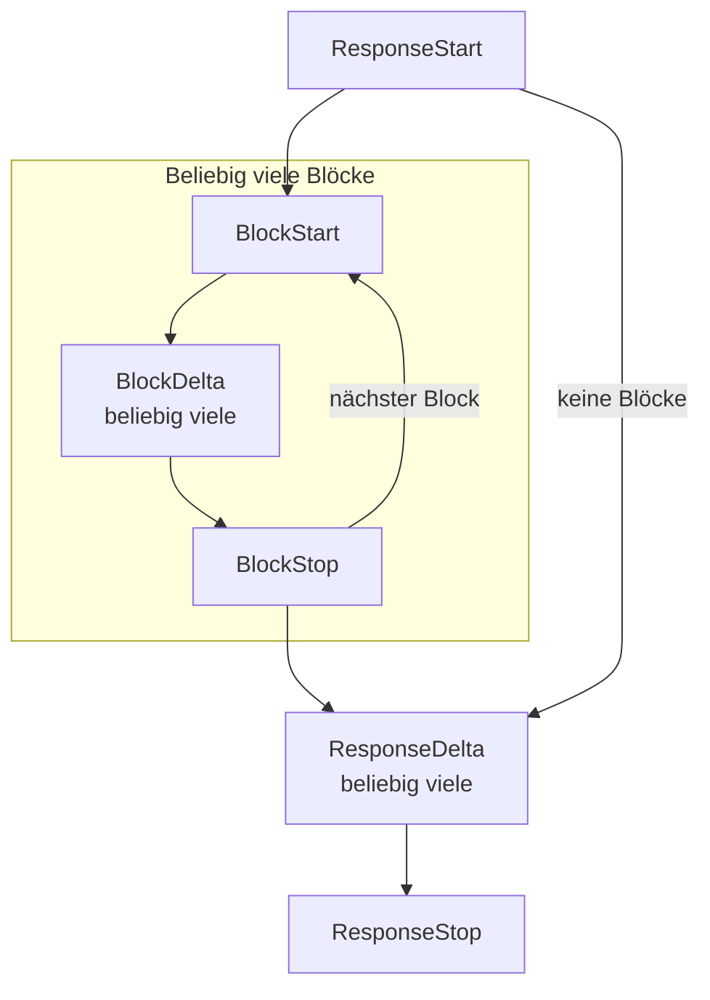

Die Codecs bleiben verlustfrei, weil die Typen, Streams und Wire-Structs von KPP so gebaut sind, wie diese Seite es beschreibt. [KPP-Interna](index.md) zeigt den Weg einer Anfrage und die Entwurfsprinzipien dahinter.

## Typen

Die Typen sind davon geprägt, was die Codecs brauchen, um verlustfrei zu bleiben:

- **`Extras`** hat drei Felder: `origin`, `fields` (rohes JSON, Byte für Byte) und `form` (Darstellungsmarkierungen). Round Trips im selben Dialekt müssen Schreibweisen reproduzieren, die KPP wegnormalisiert. Beispiele sind `content` als String oder Array, `null` oder fehlend, `1` oder `1.0`, Chunk-Grenzen und die Felder `id` und `retry` eines SSE-Frames. Diese Markierungen tragen keine Bedeutung; anders als unbekannte `fields` bringen sie einen anderen Dialekt daher nie dazu, eine Anfrage abzulehnen. Zwei leere `Extras` sind gleich, unabhängig von ihrem Ursprung.
- **Weitergegebene Header** (`anthropic-beta`, `anthropic-version`, `openai-beta`) werden in `Extras::fields` unter Schlüsseln gespeichert, die mit `header:` beginnen; wiederholte Header werden mit `", "` verbunden. Header sind wie jedes andere Extra an ihren Dialekt gebunden. Ein Body-Schlüssel, der mit `header:` beginnt, sähe wie ein weitergegebener Header aus. Die Codecs, die Bodies über `wire::Ext` lesen, also Anthropic Messages, OpenAI Chat Completions und OpenAI Embeddings, lehnen ihn deshalb ab ([Wire-Structs](#wire-structs)). OpenAI Responses behält solche Schlüssel im Body und gibt nur echte Header weiter.
- **Rohe Items.** `Box<RawValue>` ist in `RawJson` verpackt, das Byte für Byte vergleicht. Unbekannte Blöcke, Tools, Tool-Auswahlen, Stream-Events und Deltas sind `RawItem { origin, raw }`; Zitate sind `Citation { origin, raw }`, weil Zitatformate über Dialekte hinweg fast nichts gemeinsam haben.
- **Antworten.** `Reply` ist `Generate`, `CountTokens` oder `Embed`, und `RequestKind` benennt dieselben drei Arten.
- **Tools.** `ToolDef` ist ein Funktions-Tool oder ein unbekanntes Tool, das vollständig aufbewahrt wird; `ToolChoice` ist `Auto`, `None`, `Required`, ein benanntes Tool oder unbekannt. Die `parameters` eines Funktions-Tools sind optional, wie OpenAI es erlaubt.
- **Einstellungen für Ausgabe und Reasoning.** `OutputSpec::JsonSchema` hat einen optionalen Namen (Anthropic-Schemas haben keinen) und eine Beschreibung. `ReasoningConfig` enthält Modus, Aufwand, Budget, Zusammenfassung und die Angabe, ob verschlüsseltes Reasoning mitgeliefert werden soll; seine Enums bewahren unbekannte Werte in `Other(String)` auf, weil Anbieter oft neue Aufwandsstufen einführen.
- **Reasoning-Blöcke** enthalten Ursprung, Zusammenfassungen, Textteile und opake Teile. Ein OpenAI-Reasoning-Item trägt sowohl eine ID als auch verschlüsselten Inhalt und kann mehrere Textteile haben. Ein Block, der nur eine Zusammenfassung enthält, braucht trotzdem seinen Ursprung, um zu entscheiden, wohin er zurückgespielt werden darf.
- **Nutzung.** `Usage::input_tokens` schließt Cache-Lese- und -Schreibvorgänge aus, die eigene Felder sind ([Nutzung](cross-format.md#nutzung)); `Usage::raw` bewahrt das Nutzungsobjekt des Anbieters mit seinem Ursprung auf, sodass ein Encoder es nur für seinen eigenen Dialekt darüberlegt. Embedding-Vektoren sind `f64`, damit die Werte des Anbieters unverändert wieder ausgegeben werden.
- **Fehler.** `ErrorKind::Billing` gibt es für Anthropics `billing_error` (402) und OpenAIs `insufficient_quota`, die keine andere Art treffend beschreibt.

## Streams

Ein KPP-Stream ist `ResponseStart → (BlockStart → BlockDelta* → BlockStop)* → ResponseDelta* → ResponseStop`, wobei `Error` an jeder Stelle möglich ist und `Extra` Dialekt-Events trägt, die KPP nicht modelliert.

- **Blockindizes** gehören KPP selbst: 0, 1, 2, … in der Reihenfolge, in der Blöcke beginnen. Blöcke dürfen sich überlappen (OpenAI streamt parallele Tool-Aufrufe so), daher nennt jedes Event seinen Block.
- **Jedes Lifecycle-Event trägt `Extras`**, sodass eine Wiedergabe im selben Dialekt die ursprünglichen Events exakt reproduziert, einschließlich Feldern einzelner Events wie OpenAIs `obfuscation`.
- **Fehler werden im Stream gemeldet:** erst die bis dahin dekodierten Events, dann ein abschließendes `StreamEvent::Error`, sodass nichts verloren geht, was zuvor im selben Chunk dekodiert wurde.
- **Die Reihenfolge ändert sich nie, aber Events können zurückgehalten werden.** OpenAI-kompatible Anbieter senden die `id` und das `model` der Antwort oder die `id` und den `name` eines Tool-Aufrufs teils erst in einem späteren Chunk. Der Decoder für OpenAI Chat Completions hält dann das `ResponseStart` und die Chunks ohne Inhalt zurück, bis ein Chunk diese Werte oder Inhalt trägt. Auch das `BlockStart` eines Tool-Aufrufs hält er mit jedem Event danach zurück. Diese Events warten, bis `id` und `name` des Aufrufs beide angekommen sind, der Block endet oder der Stream endet oder abbricht ([OpenAI Chat Completions](openai-chat.md#streams-createchatcompletionstreamresponse)). Nutzung, die ein Anbieter sendet, solange noch Blöcke offen sind, hält er zurück, bis sie enden; `ResponseDelta`s kommen daher immer nach dem letzten `BlockStop`.

### Stream-Encoder

Jeder Stream-Encoder kann außerdem einen Keepalive-Frame schreiben; wann, steht unter [Keepalives](cross-format.md#keepalives).

**Anthropic Messages.** Anthropic streamt einen Content-Block nach dem anderen, während sich in KPP-Streams aus anderen Dialekten Blöcke überlappen können: OpenAI streamt parallele Tool-Aufrufe so und schließt jeden Block erst am Ende. Der Encoder ist ein expliziter Zustandsautomat:

- der erste Block, der beginnt, ist aktiv und wird geschrieben, sobald er ankommt;
- Blöcke, die beginnen, während ein anderer aktiv ist, warten und werden in Startreihenfolge gepuffert;
- stoppt der aktive Block, wird der nächste wartende geschrieben, mit seinem Start, seinen gepufferten Deltas und seinem Stopp, falls dieser schon kam;
- ein `ResponseDelta` mit einem Stoppgrund oder `ResponseStop` schließt zuerst jeden offenen Block, und mehrere `ResponseDelta`s werden zu einem `message_delta` zusammengeführt, weil die SDKs `stop_reason` mit jedem einzelnen überschreiben;
- ein `ResponseDelta` eines anderen Dialekts ohne Stoppgrund aktualisiert nur die Nutzung, die das abschließende `message_delta` meldet, und lässt die Blöcke offen.

Anthropic-Indizes werden in der Reihenfolge vergeben, in der Blöcke geschrieben werden. Ein Stream, der nicht mit `ResponseStart` beginnt, bekommt ein `message_start` mit leerer ID.

**OpenAI Chat Completions.** Aus Chat dekodierte Events werden mithilfe der Chunk-Form-Markierungen wieder zu ihren ursprünglichen Chunks gruppiert, sodass eine Wiedergabe im selben Dialekt jeden Frame reproduziert. Die Envelope-Schlüssel eines Chunks sind `id`, `object`, `created`, `model`, `service_tier` und `system_fingerprint`. Weichen sie von dem aus `ResponseStart` neu gebauten Envelope ab, hält der Chunk die Unterschiede als `env` und `env_absent` fest. Events aus anderen Dialekten werden zu je einem Chunk:

- der Stream beginnt mit einem Rollen-Chunk, sobald die Antwort startet (`delta: {"role": "assistant", "content": "", "refusal": null}`, OpenAIs eigener erster Chunk), sodass die App vom Stream hört, während das Modell denkt;
- ein Tool-Aufruf beginnt mit einem Header-Chunk, gefolgt von Argument-Chunks;
- die Nutzung wird nur gesendet, wenn die App danach gefragt hat (`stream_options.include_usage`), als letzter Chunk mit `choices: []`;
- `ResponseStop` schreibt `data: [DONE]`; ein `Error` schreibt `data: {"error": …}` und beendet den Stream ohne `[DONE]`.

**OpenAI Responses.** Für jedes KPP-Event erzeugt die Stream-Engine die SSE-Events in der Reihenfolge, in der OpenAI sie sendet, und vergibt `sequence_number`s. Dazu gehören alle redundanten: `.done`-Events, Part-Events, Item-Events und das abschließende Response-Objekt mit allen Ausgabe-Items. Der Decoder lässt dieselbe Engine als Schatten mitlaufen:

- jedes SSE-Event, das die Engine an dieser Stelle erzeugen würde, wird dem KPP-Event zugeordnet, und Abweichungen werden als Overrides mit Geltungsbereich festgehalten;
- zugeordnete Events, die das Original nicht hatte, werden in der Form-Markierung `skip` vermerkt;
- Events, die dort ankommen, wo die Engine keine erzeugen würde, werden als `Extra` weitergereicht.

Ein Stream im selben Dialekt wird exakt reproduziert, und ein Stream aus einem anderen Dialekt wird zu einem vollständigen, gültigen Responses-Stream.

## Wire-Structs

Wire-Structs müssen jedes Feld behalten, auch solche, die das Struct nicht deklariert, und rohe Payloads (`RawValue`) Byte für Byte bewahren. `#[serde(flatten)]` kann nicht beides: Flattening puffert die Eingabe, und `RawValue` lässt sich nicht aus einem Puffer lesen, sodass Tool-Argumente und Schemas ihre Bytes verlören. `wire::Ext<T>` erledigt dieselbe Aufgabe ohne Puffern:

- Jeder Schlüssel des JSON-Objekts, den `T` nicht deklariert, wird roh in `Ext::extra` aufbewahrt und wird zu KPP-`Extras::fields`. Ein Schlüssel, dessen Name mit `header:` beginnt oder einen `.` enthält, würde mit einem weitergegebenen Header oder einem verschachtelten Schlüsselpfad verwechselt. Ein solches Objekt wird abgelehnt (`` the field `…` has a name Kaeso cannot carry; remove it ``): in einer Anfrage als `InvalidRequest`, in der Antwort eines Anbieters als `ProviderError`.
- Jeder deklarierte Schlüssel, dessen empfangene Schreibweise `T` nicht reproduzieren kann, wird roh in `Ext::verbatim` aufbewahrt und wird zu KPP-`Extras::form`. Beispiele sind `"x": null` für eine `Option`, die bei `None` übersprungen wird, `"flag": false` für einen `bool`, der bei false übersprungen wird, und `"list": []` für einen `Vec`, der übersprungen wird, wenn er leer ist.

Beim Serialisieren schreibt ein `Ext<T>` zuerst `T`, dann die verbatim-Schlüssel, die `T` nicht geschrieben hat, dann die zusätzlichen Schlüssel. Ein Round Trip aus Dekodieren und Kodieren ist daher exakt. Ein Codec, der ein typisiertes Feld ändert, etwa beim Übersetzen aus einem anderen Dialekt, setzt sich immer gegen eine veraltete verbatim-Schreibweise durch. `wire::Maybe<T>` unterscheidet fehlend von `null`, wo der Unterschied für den Codec sichtbar sein muss.

Wire-Structs, die in `Ext` verwendet werden, folgen diesen Regeln:

- kein `#[serde(flatten)]`, kein `alias`, kein `deny_unknown_fields`, keine untagged oder intern getaggten Enums;
- getaggte Unions werden mit `wire::type_tag` nach `"type"` unterschieden;
- JSON-Objekte mit doppelten Schlüsseln werden abgelehnt;
- ein Feld wird nur deklariert, wenn der Codec es auf ein typisiertes KPP-Feld abbildet; alles andere bleibt absichtlich undeklariert und reist als Extras mit.

Der Codec für OpenAI Responses liest typisierte Werte mit einfachen serde-Structs und schreibt mit einem geordneten JSON-Baum (`openai_responses::node::Node`), der rohes JSON Byte für Byte einbetten kann; `serde_json::Value` sortiert Objektschlüssel und würde rohe Payloads umformatieren. [Wie genaue Schreibweisen erhalten bleiben](openai-responses.md#wie-genaue-schreibweisen-erhalten-bleiben) beschreibt, wie er sie reproduziert.

## Grenzen einer Anfrage

Eine Anfrage zu decodieren kostet weit mehr Speicher als ihr Body: Jede Nachricht, jeder Inhaltsblock und jedes Werkzeug wird zu typisierten KPP-Werten mit ihren Extras. Ein Body aus winzigen Elementen brauchte deshalb früher mehr als das 100-Fache seiner Größe. Das `decode_request` jedes Codecs führt zuerst `limits::request_shape` aus, das den Body mit `IgnoredAny` von serde zählt und dafür nichts alloziert. Eine Anfrage über einer Grenze wird mit `InvalidRequest`, Status 400 und dem Feld in `param` abgelehnt, bevor etwas davon decodiert wird:

| Grenze | Wert | Zählt | Quelle |
| --- | --- | --- | --- |
| `MAX_MESSAGES` | 100.000 | `messages` (Anthropic Messages, Chat Completions) oder Elemente von `input` (Responses) | Die Grenze von Anthropic: 100.000 Nachrichten pro Anfrage |
| `MAX_BLOCKS_PER_MESSAGE` | 10.000 | Inhaltsblöcke einer Nachricht, eines Eingabeelements oder des System-Prompts, mit den Blöcken in ihren Werkzeugergebnissen | Weit über der Grenze jedes Anbieters für Bilder oder Dokumente pro Anfrage |
| `MAX_TOOLS` | 10.000 | `tools` und `functions` von Chat | Die Kataloggröße der Werkzeugsuche von Anthropic |
| `MAX_EMBEDDING_INPUTS` | 2.048 | Eingaben eines `input`-Arrays von OpenAI Embeddings | Die Grenze von OpenAI: 2.048 Eingaben |
| `MAX_DEPTH` | 127 | Ebenen von Objekten und Arrays irgendwo im Body, das äußerste Objekt mitgezählt | So viel liest serde_json unter seiner Rekursionsgrenze von 128 vollständig |

serde überspringt ignorierte und rohe Werte ohne seine Rekursionsgrenze, sonst könnten die Codecs einen rohen Wert beliebiger Tiefe mit einem Stack-Frame pro Ebene durchlaufen. `request_shape` zählt die Tiefe in einem Durchgang über die Bytes, außerhalb von Strings, und lehnt einen tieferen Body ohne `param` ab. Auch der Vergleich des Responses-Codecs mit seiner kanonischen Codierung hält bei `MAX_DEPTH` an und behält den Rest einer Antwort des Anbieters roh, damit auch eine tiefe Antwort den Stack nicht überlaufen lässt.

Ein Body, der kein JSON ist oder nicht wie eine Anfrage des Dialekts aufgebaut ist, wird gezählt, soweit er sich lesen lässt, und das Decodieren meldet dann, was falsch ist. Ein maskierter Schlüssel wie `"messages"` zählt wie der Schlüssel, den er schreibt. `request_shape` gibt die Zählung, die Token-IDs der Embedding-Eingaben und die Bytes des Bodys auch als `RequestShape` zurück, damit das Gateway den Speicher einer Anfrage schätzen kann, bevor es sie decodiert.

Die Bytes lassen den Leerraum aus, den das Decodieren verwirft, sodass Auffüllen dort nichts hinzufügt. Gemeint ist der Leerraum zwischen den Tokens des Anfrageobjekts, seiner Nachrichten, Elemente und Eingaben, ihrer Inhaltsblöcke und der Werkzeugliste. Leerraum in jedem anderen Wert zählt, weil ein roh behaltener Wert wie die `parameters` eines Werkzeugs ihn Byte für Byte behält.

Auch aller Leerraum in einer Nachricht oder einem Block, den der Decoder ganz als rohes JSON behält, zählt:

- eine `function`-Nachricht von Chat Completions;
- ein Inhaltsteil, der kein Objekt ist oder einen Typ hat, den die Rolle seiner Nachricht nicht annimmt;
- ein Messages-Block, der kein Objekt ist oder einen Typ oder eine `source` hat, die der Codec nicht kennt.

In einem Eingabeelement von OpenAI Responses zählt aller Leerraum. Dieser Decoder behält jedes Element und jeden Teil roh, der sich nicht als sein Typ lesen lässt, und das zeigt erst das Decodieren.

## Server-sent Events

`sse::SseParser` folgt dem [WHATWG-Algorithmus für Event-Streams](https://html.spec.whatwg.org/multipage/server-sent-events.html#event-stream-interpretation) bei Zeilen, Kommentaren, mehrzeiligen Daten, `id` (ein Wert mit NUL ist keine ID) und `retry` (nur ASCII-Ziffern, die in einen `u64` passen), mit bewussten Abweichungen, damit nichts verloren geht:

- Ein Frame ganz ohne `data:`-Zeile, etwa `retry: 3000` oder `event: ping` allein, ist laut Spezifikation kein Event; der Parser gibt ihn trotzdem zurück, mit `has_data: false` und leerem `data`, und der Writer schreibt ihn ohne `data:`-Zeile zurück.
- Kommentare und unbekannte Felder werden gemeldet statt ignoriert, und ein Wert für `id` oder `retry`, den die Spezifikation ignoriert, wird als unbekanntes Feld aufbewahrt (`SseEvent::other`).
- Ein letzter Frame, den keine Leerzeile abschließt, wird trotzdem gemeldet.
- Ein Stream, der mitten in einer Zeile endet, wird als `SseError::Truncated` gemeldet statt verworfen.
- Ein Frame, dessen erste Zeile ein Feld ist, dessen Name mit U+FEFF beginnt, wird nach einer Leerzeile geschrieben. Sonst hielte ein Leser diese Bytes am Anfang eines Streams für eine Byte-Order-Mark und verwürfe sie.

Jeder Stream-Decoder reicht einen Frame ohne Daten als `Extra` weiter, dessen rohes JSON keinen Schlüssel `data` hat. Jeder Encoder schreibt ein solches `Extra` ohne `data:`-Zeile zurück. In OpenAI Chat Completions ist ein Frame `event: error` ohne Daten ein solches `Extra`, kein Fehler.

Wird ein Frame zu KPP-Events dekodiert, werden seine Felder `id`, `retry` und die unbekannten Felder als `{"id", "retry", "other": [[name, value], …]}` festgehalten und zurückgeschrieben. Anthropic Messages hält sie in der Form-Markierung `sse`, OpenAI Chat Completions in `sse` innerhalb der Markierung `chunk` und OpenAI Responses im Form-Override mit Geltungsbereich `~sse`. Ein Frame, der als `Extra` weitergereicht wird, behält sie im `Extra`.

Bytes können in beliebigen Chunks eingespeist werden: Zeilen dürfen an jeder Stelle getrennt sein, auch zwischen `\r` und `\n` eines CRLF-Zeilenendes. Ein Frame, der größer ist als das Limit des Parsers (`sse::DEFAULT_MAX_FRAME_BYTES`, 16 MiB), ist ein Fehler; das begrenzt den Speicher, den jeder Stream belegen kann.

## Modelllisten

Modelllisten (`GET /v1/models`, `GET /v1/models/{id}`) gehören zu KPP, mit `ModelInfo`, `ModelLifecycle`, `ModelList` und `ModelsQuery`, sodass das Gateway die Wire-Formen nie selbst kennen muss.

- **Ingress.** Jeder Dialekt nutzt denselben Pfad, daher verrät der Pfad den Dialekt nicht: `dispatch::models_dialect` wählt ihn anhand der Header (`anthropic-version` bedeutet Anthropic, alles andere OpenAI). `ModelList::page` wendet `before_id`, `after_id`, `limit` und den Lifecycle-Filter für jeden Dialekt gleich an.
- **Egress.** Um zu erfahren, ob ein Anbieter einem Schlüssel ein Modell anbietet, sendet das Gateway das `GET /v1/models/{id}`, das `dispatch::encode_model_request` baut, mit der ID als einem prozentkodierten Pfadsegment. Die ID `.` oder `..` ist `InvalidRequest`, weil URL-Parser ein solches Segment auch prozentkodiert entfernen. Jede andere ID, auch `a/../b`, bleibt ein kodiertes Segment. Die Platform API ist strenger, wenn eine ID in einen Katalog kommt: Sie lehnt auch `.` oder `..` zwischen Schrägstrichen ab ([Modelle und Aliasse](../../console/models-and-aliases.md#modelle-hinzufügen)). Es liest die Antwort mit `decode_model`, und eine 404 wird zu `NotFound`. Eine 404 kann dort auch heißen, dass der Anbieter diesen Endpunkt nicht hat, daher liest das Gateway danach die Liste des Anbieters. `dispatch::encode_models_request` baut `GET /v1/models` aus einer `ModelsQuery`, nur mit dem Paging und den Filtern, die der Dialekt sendet; alles andere ist `Unsupported`. `decode_models` liest jede Seite.
- **Query-Strings** werden an `&` und `=` getrennt und als `application/x-www-form-urlencoded` prozentdekodiert (`+` ist ein Leerzeichen). Unbekannte Parameter werden zu Extras unter `query.<name>`.
- **Datumsangaben.** KPP speichert Unix-Sekunden. RFC-3339-Zeitangaben (Anthropic) und reine Datumsangaben (OpenAI `shutdown_date`) werden mit dem proleptischen gregorianischen Kalender umgerechnet, ohne Datumsbibliothek. Sekundenbruchteile und Zeitzonenversätze überstehen die Umrechnung nicht; der genau empfangene Text wird in der Form-Markierung `spelling` aufbewahrt, wann immer erneutes Kodieren ihn nicht reproduzieren würde. Ein Datum nach dem Jahr 9999 lässt sich nicht in RFC 3339 schreiben: Anthropics `created_at` bekommt dann den dokumentierten unbekannten Wert (die Epoche), andere Datumsangaben `null`.
- **Fehlende oder `null`-Felder.** Ein Encoder füllt ein Feld, für das KPP keinen Wert hat, mit dem dokumentierten Standardwert; hat der empfangene Body dieses Feld anders geschrieben, vermerkt das die Form-Markierung `none`.
