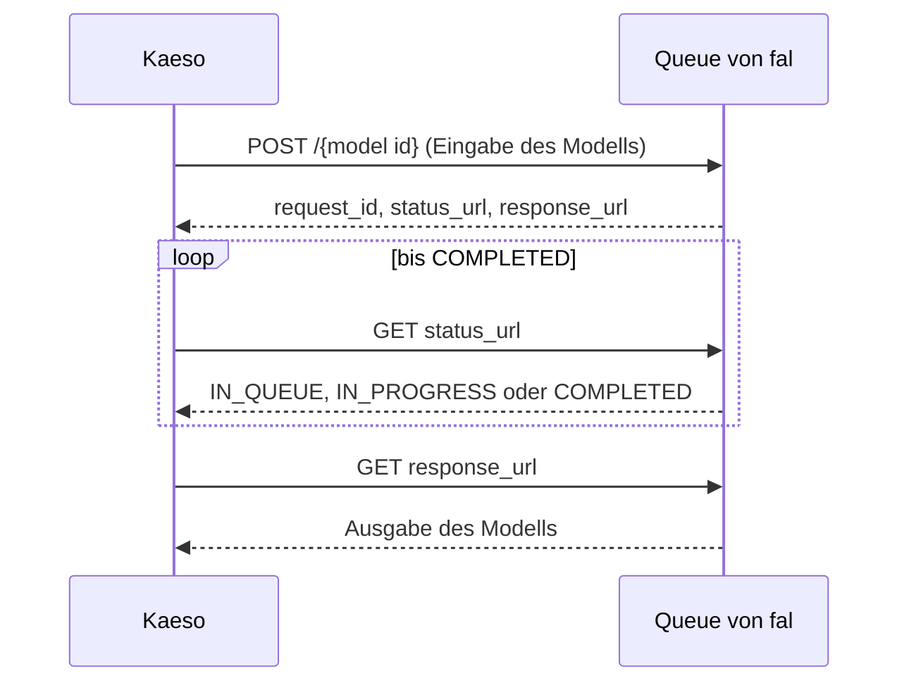

Schlagen Sie hier nach, wie eine Bildanfrage oder ein Videojob fal erreicht: welches Feld bei welchem Modell wohin gehört, wie Kaeso der Queue folgt und woher jede Abbildung stammt.

- **Codec:** `kaeso_codecs::fal::Fal` (`crates/kaeso-codecs/src/fal/`)
- **Pfade:** auf der Queue von fal, mit `Authorization: Key …`: `POST /{model id}` mit der Eingabe des Modells als Body, danach die `status_url` und `response_url`, die fal zurückgibt
- **Fixtures:** `crates/kaeso-codecs/fixtures/fal/`, aus der Dokumentation von fal und dem OpenAPI-Dokument jedes Modells gebaut, die abgelehnten Schlüssel und das unbekannte Modell live aufgezeichnet

**Quellen.** Die [Queue-API](https://fal.ai/docs/documentation/model-apis/inference/queue), die [Modellfehler](https://fal.ai/docs/documentation/model-apis/errors), die [Anfragefehler](https://fal.ai/docs/documentation/model-apis/request-errors) und die [Dateieingaben](https://fal.ai/docs/documentation/model-apis/fal-cdn) von fal sowie das OpenAPI-Dokument jedes Modells (`https://fal.ai/api/openapi/queue/openapi.json?endpoint_id=<model>`), gelesen am 2026-11-14.

## Die Queue

Kaeso folgt nur den URLs, die fal zurückgibt, und nur auf `queue.fal.run` und `queue.falrun.com`; es behält ihre Pfade und schickt sie an die Basis-URL des Providers. Wo fal nur das Ergebnis nennt, ist die Status-URL die Ergebnis-URL gefolgt von `/status`. Jede Anfrage trägt `X-Fal-Store-IO: 0`, damit fal Eingabe und Ausgabe nicht im Anfrageverlauf des Kontos behält.

Eine Bildanfrage wartet innerhalb ihres Zeitlimits auf ihr Ergebnis. Ein Videojob ist ein Job der [Videos-API](../../api/videos.md): Seine ID bei fal ist der Ergebnispfad, jeder Abruf fragt die Status-URL, und der Download holt den Link des Videos von der Ergebnis-URL.

## Modelle

Jedes Modell hat seine eigene Eingabe, deshalb bildet Kaeso nur diese Modelle ab und lehnt jedes andere mit der Liste ab:

| Modell | Art | Nimmt |
| --- | --- | --- |
| `fal-ai/flux/dev`, `fal-ai/flux/schnell` | Bild | `n` 1 bis 4, `size` bis 14142 je Seite, `seed`, `output_format` `png` oder `jpeg` |
| `fal-ai/flux-pro/v1.1` | Bild | Dasselbe |
| `bytedance/seedream/v5.5/text-to-image` | Bild | `n` 1 bis 6, `size` von 921.600 bis 4.624.220 Pixeln, `background`, `output_format`; kein `seed` |
| `bytedance/seedream/v5.5/edit` | Bildbearbeitung | Dasselbe, mit 1 bis 10 Bildern |
| `fal-ai/veo3.1` | Video | `seconds` 4, 6 oder 8; `size` in 720p, 1080p oder 4K, 16:9 oder 9:16; `audio`, `seed`, `negative_prompt` |
| `kling/v4/text-to-video` | Video | `seconds` 3 bis 30; `size` in 720p oder 1080p, 16:9, 9:16, 1:1 oder 21:9 |
| `kling/v4/image-to-video` | Video | Ein erstes und ein letztes Bild; `seconds` 3 bis 30; keine `size`: Die Form des ersten Bildes entscheidet |
| `alibaba/wan-3.0/text-to-video`, `alibaba/wan-3.0/image-to-video` | Video | `seconds` 2 bis 30; `size` in 480p, 720p oder 1080p, 16:9, 4:3, 1:1, 3:4 oder 9:16; `audio`, `seed`; das Bildmodell nimmt ein erstes und ein letztes Bild |

## Bildanfrage

| KPP | fal |
| --- | --- |
| `prompt` | `prompt` |
| `n` | `num_images` |
| `size` `WIDTHxHEIGHT` | `image_size` `{width, height}`; `auto` schickt keine, es gilt die Vorgabe des Modells |
| `output_format` | `output_format` |
| `background` | `background`, nur Seedream; `transparent` braucht `png` |
| `seed` | `seed`, nur FLUX |
| `response_format: b64_json` | `sync_mode: true`: fal legt jedes Bild als Data-URI ins Ergebnis |
| Bilder zum Bearbeiten | `image_urls`: Links wie gekommen, Uploads als Data-URIs |

Die Modelle von fal übergehen Felder, die ihr Schema nicht kennt, ohne ein Wort. Deshalb lehnt Kaeso `quality` außer `auto`, `output_compression`, `negative_prompt`, `user`, `aspect_ratio`, `resolution`, eine Maske, Streaming und Variationen vor dem Senden ab.

## Bildergebnis

| fal | KPP |
| --- | --- |
| `images[].url` | der Link des Bildes, oder seine Bytes, wenn es eine Data-URI ist |
| `images[].width`, `height` | die Größe der Antwort, wenn alle Bilder sie teilen |
| `has_nsfw_concepts` mit `true` | ein Fehler `content_filtered`: Der Sicherheitsfilter von FLUX schickt stattdessen ein schwarzes Bild |
| `seed`, `timings`, `prompt`, `content_type`, `file_name`, `file_size` | Extras |

## Videojob

| KPP | fal |
| --- | --- |
| `prompt` | `prompt` |
| `seconds` | `duration`: `"8s"` bei Veo, eine Zahl bei Kling und Wan |
| `size` | `resolution` aus der kurzen Seite (`2160` ist `4k`) und `aspect_ratio` |
| `audio` | `generate_audio` bei Veo, `audio` bei Wan |
| `seed`, `negative_prompt` | `seed`, `negative_prompt` |
| erstes und letztes Bild | `start_image_url`, `end_image_url`: Links wie gekommen, Uploads als Data-URIs |

Ein Videojob braucht `seconds`, weil fal jede Sekunde abrechnet. Kaeso lehnt `n` über 1, `user`, Referenzbilder und Remixe ab.

## Status

| fal | KPP |
| --- | --- |
| `IN_QUEUE` | `queued` |
| `IN_PROGRESS` | `in_progress` |
| `COMPLETED` | `completed`, mit dem Ergebnispfad als Datei des Videos |
| `COMPLETED` mit `error` und `error_type` | `failed`, mit `error_type` als Code; eine abgebrochene Anfrage ist `client_cancelled` |
| `video.url` des Ergebnisses | der Link des Videos |

## Fehler

| fal | KPP |
| --- | --- |
| `{"detail": [{loc, msg, type}]}` | `msg` als Meldung, das Feld aus `loc` als `param`; `content_policy_violation` ist `content_filtered`, `generation_timeout` ist `timeout` |
| `{"detail": "…", "error_type": "…"}` und `X-Fal-Error-Type` | die Meldung; `request_timeout` und `startup_timeout` sind `timeout`, Ausfälle des Runners `overloaded` |
| `{"detail": "…"}` mit 401, 403, 404 | `authentication`, `permission_denied`, `not_found` |
