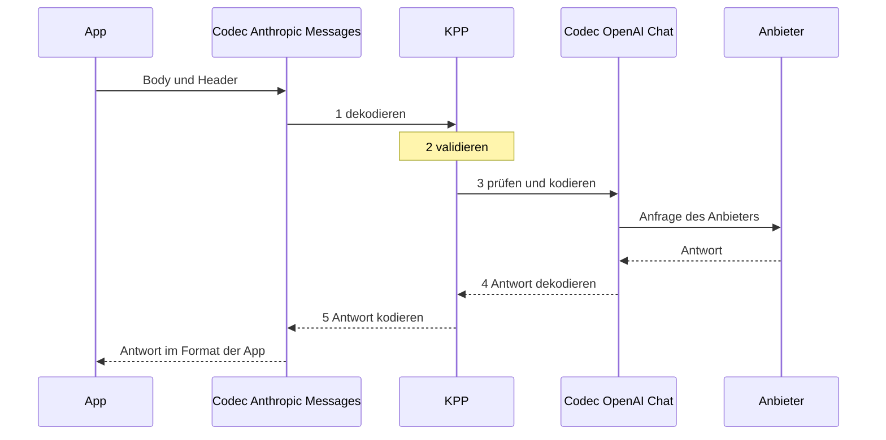

KPP, das Kaeso Provider Protocol, ist das kanonische Format, das jede Modellanfrage durchläuft. Das Gateway dekodiert, was eine App sendet, nach KPP und kodiert KPP für den Anbieter; die Antwort nimmt denselben Weg zurück. [Formatübersetzung](../../concepts/format-translation.md) beschreibt, was Aufrufer davon sehen; diese Seiten richten sich an alle, die KPP ändern.

- [Aufbau der Codecs](codec-design.md): Erfahren Sie, wie Typen, Streams und Wire-Structs jede Übersetzung verlustfrei halten.
- [Formatwechsel](cross-format.md): Schlagen Sie nach, was mit Daten geschieht, die von einem API-Format in ein anderes wechseln, und warum.
- [Reasoning über Formate hinweg](reasoning.md): Schlagen Sie nach, wie Reasoning, seine Einstellungen und seine Signaturen zwischen den Formaten wechseln.
- [Anthropic Messages](anthropic-messages.md): Finden Sie, wohin jedes Feld des Formats Anthropic Messages in KPP gehört.
- [OpenAI Chat Completions](openai-chat.md): Finden Sie, wohin jedes Feld des Formats Chat Completions in KPP gehört.
- [OpenAI Responses](openai-responses.md): Finden Sie, wohin jedes Feld des Formats Responses in KPP gehört.
- [OpenAI Embeddings](openai-embeddings.md): Finden Sie, wohin jedes Feld des Formats Embeddings in KPP gehört.
- [Fixtures und Aufzeichnungen](fixtures.md): Legen Sie die echten Payloads an, gegen die die Codecs getestet werden, und zeichnen Sie neue auf.

## Der Weg einer Anfrage

Eine App sendet eine Anfrage im Format Anthropic Messages, und das Modell wird über OpenAI Chat Completions bedient:

```rust
use kaeso_codecs::{EgressCtx, EncodeCtx, dispatch};
use kaeso_kpp::{DialectId, RequestKind};

let req = dispatch::decode_request(DialectId::AnthropicMessages, RequestKind::Generate, &body, &headers)?;
req.validate()?;
let mut egress = EgressCtx::new(&req).with_provider("openai");
let outgoing = dispatch::encode_request(DialectId::OpenAiChat, &req, &mut egress)?;

let reply = dispatch::decode_response(DialectId::OpenAiChat, status, &reply_headers, &reply_body, &egress)?;
let answer = dispatch::encode_response(DialectId::AnthropicMessages, &reply, &EncodeCtx::for_request(req))?;
```



1. **Dekodieren.** Der Codec der App liest Body und Header in einen KPP-`Request`. `decode_request` nimmt eine `RequestKind` entgegen, weil sich die Bodies von Anthropics `/v1/messages` und `/v1/messages/count_tokens` ohne den Endpunkt nicht unterscheiden lassen. Was KPP nicht modelliert, wird in `Extras` aufbewahrt, gebunden an den Dialekt, aus dem es kam.
2. **Validieren.** `validate()` prüft, was jeder Dialekt braucht, etwa ein Modell, Nachrichten mit Inhalt, eindeutige Tool-Aufruf-IDs und Tool-Namen und eine `tool_choice`, die ein definiertes Tool nennt.
3. **Prüfen und kodieren.** `encode_request` führt zuerst `check()` des Ziels aus, das mit `Unsupported` ablehnt, was das Ziel nicht ausdrücken kann, bevor irgendetwas gesendet wird ([Formatwechsel](cross-format.md)). Danach schreibt es die Anfrage an den Anbieter. `EgressCtx` trägt, was das Gateway über das Ziel weiß: Art der Anfrage und Stream-Modus, den Anbieter und ob das Modell Reasoning beherrscht oder adaptives Thinking hat. Der Encoder ergänzt die Tool-IDs und -Namen, die er umschreiben musste.
4. **Die Antwort dekodieren.** Der Codec des Anbieters liest die Antwort nach KPP und übersetzt umgeschriebene Tool-IDs und -Namen über `EgressCtx` zurück.
5. **Die Antwort kodieren.** Der Codec der App schreibt die Antwort im Format der App. `EncodeCtx` trägt die dekodierte Anfrage der App, weil OpenAI Responses Anfragefelder in seiner Antwort wiederholt, und ein `created_at`, weil ein Sans-IO-Encoder eine deterministische Uhr braucht.

Streams nehmen denselben Weg mit `dispatch::stream_decoder` und `dispatch::stream_encoder`, Fehler mit `dispatch::decode_error` und `dispatch::encode_error`. Das Gateway erfährt beide Dialekte erst pro Anfrage, daher bietet `dispatch` jede Codec-Funktion mit einer `DialectId` an; ein Dialekt ohne Codec ergibt `Unsupported`.

`Codec` selbst ist ein versiegelter Trait aus assoziierten Funktionen, die zur Compile-Zeit gewählt werden: Anfragen, Antworten, Fehler, Stream-Decoder und -Encoder sowie Modelllisten, für beide Seiten des Gateways. Auf der Ingress-Seite spricht eine App das Format mit Kaeso; auf der Egress-Seite spricht Kaeso es mit einem Anbieter.

## Crates und Module

| Crate | Inhalt |
| --- | --- |
| `kaeso-kpp` | Nur die KPP-Typen: Anfragen, Antworten, Stream-Events, Fehler, Token-Zählungen, Embeddings und Modelllisten, mit `validate()` und `required_capabilities()`. Keine Codec-Logik, kein I/O. |
| `kaeso-codecs` | Ein Sans-IO-Codec pro API-Format, im Code Dialekt genannt (`DialectId`), und die Bausteine, die sie teilen. Ein Codec macht aus Bytes KPP-Werte und aus KPP-Werten Bytes; Streams werden Chunk für Chunk eingespeist und erzeugen Events. |

Beide Crates sind auf crates.io veröffentlicht. Ihr Bibliothekscode darf nur von `serde`, `serde_json`, `bytes`, `thiserror`, `indexmap`, `base64` und `mime` abhängen, und `cargo deny` verbietet ihnen `tokio`, `reqwest`, `hyper` und `axum` ([Abhängigkeit hinzufügen](../contributing.md#abhängigkeit-hinzufügen)).

| Modul | Dialekt |
| --- | --- |
| `anthropic_messages` | Anthropic Messages (`/v1/messages`, `/v1/messages/count_tokens`) |
| `openai_chat` | OpenAI Chat Completions (`/v1/chat/completions`) |
| `openai_responses` | OpenAI Responses (`/v1/responses`, `/v1/responses/input_tokens`) |
| `openai_embeddings` | OpenAI Embeddings (`/v1/embeddings`) |
| `openai_models` | Die OpenAI Models API, die sich die drei OpenAI-Codecs teilen |

| Gemeinsames Modul | Aufgabe |
| --- | --- |
| `codec` | Der Trait `Codec`, `EgressCtx` und `EncodeCtx` |
| `dispatch` | Die Codec-Funktionen, zur Laufzeit nach `DialectId` gewählt |
| `wire` | serde-Bausteine für verlustfreie Wire-Structs ([Wire-Structs](codec-design.md#wire-structs)) |
| `sse` | Parser und Writer für Event-Streams ([Server-sent Events](codec-design.md#server-sent-events)) |
| `cross` | Die Regeln für Daten, die den Dialekt wechseln, und die Extras-Allowlist |
| `continuity` | Reasoning, das mit der Unterhaltung mitreist ([Reasoning über Runden hinweg](reasoning.md#reasoning-über-runden-hinweg)) |
| `keepalive` | Frames, die laufende Streams nicht verstummen lassen ([Keepalives](cross-format.md#keepalives)) |
| `models` | Hilfsfunktionen für Modelllisten ([Modelllisten](codec-design.md#modelllisten)) |
| `testing` | Vergleich von JSON und SSE, auch für Crates, die die Codecs nutzen |

## Entwurfsprinzipien

- **Zustandslos.** Ein `GenerateRequest` trägt immer die ganze Unterhaltung.
- **Nachrichten aus geordneten Content-Blöcken.** Die Reihenfolge der Blöcke bleibt von Anfang bis Ende erhalten.
- **Roh, wo es auf Bytes ankommt.** Tool-Argumente, JSON-Schemas, unbekannte Blöcke und Zitate sind `RawJson`; opakes Reasoning wird so aufbewahrt, wie es ankam, und mit seinem `Origin` versehen.
- **Semantisch oder Hinweis.** Jedes Feld ist entweder semantisch (ein Ziel muss es einhalten oder mit `Unsupported` ablehnen) oder ein Hinweis (es darf ignoriert werden). [Feldklassen](#feldklassen) listet sie auf.
- **Gebundene Extras.** Was KPP nicht modelliert, wird in `Extras` aufbewahrt, mit dem Dialekt versehen, aus dem es kam, und nur in diesen Dialekt zurückgeschrieben. `fields` sind semantisch: Ein anderer Dialekt lehnt sie ab, außer sie stehen auf der [Allowlist](cross-format.md#extras). `form` ist Darstellung (ein String oder ein Array, `null` oder fehlend, wie Chunks gruppiert waren), und andere Dialekte ignorieren es. Unbekannte Schlüssel verschachtelter Objekte verwenden Schlüsselpfade mit Punkten, etwa `function.x`, daher lässt sich ein Schlüssel, der selbst einen `.` enthält, nicht mitführen ([Wire-Structs](codec-design.md#wire-structs)).
- **Ablehnen vor dem Senden.** `check()` gibt `Unsupported` zurück und nennt die Funktion, die ein Ziel nicht ausdrücken kann, bevor irgendetwas gesendet wird.
- **Nichts fällt stillschweigend weg.** Jedes Feld und jeder Block einer eingehenden Payload landet an genau einer Stelle: in einem typisierten KPP-Feld, einem dialektgebundenen `Extras`-Eintrag, einem `Unknown`-Item oder einem `KppError` der Art `Unsupported`. Ein Match-Arm, der Daten verwirft, ist ein Bug.
- **Additive öffentliche API.** Öffentliche Enums und erweiterbare Structs sind `#[non_exhaustive]`; Enum-Varianten umschließen `#[non_exhaustive]`-Structs mit Konstruktoren (`TextBlock::new`, `Block::text`, …), sodass Felder hinzukommen können, ohne Code zu brechen, der Werte baut oder matcht. Der `Codec`-Trait ist versiegelt.

KPP-Werte und Fehler werden als Wert zurückgegeben. `KppError` und einige Enum-Varianten sind groß, aber ein Wert wird einmal pro Anfrage gebaut, und Fehler sind der kalte Pfad; sie zu boxen würde jede Signatur umständlicher machen, daher erlaubt der Workspace `clippy::large_enum_variant` und `clippy::result_large_err`.

Jeder KPP-Typ implementiert `serde` für Logs und Snapshots. Diese JSON-Form ist über Patch-Releases hinweg stabil, aber kein Wire-Format. Ihre Namen stehen in Snake Case und schreiben OpenAI als `openai`, wie `DialectId` (`openai_chat`): `OpaqueKind::OpenAiEncryptedReasoning` ist `openai_encrypted_reasoning`.

## Feldklassen

Jedes KPP-Feld ist entweder semantisch oder ein Hinweis:

- **Semantisch.** Das Ziel muss das Feld einhalten. Kann der Zieldialekt oder das Modell es nicht ausdrücken, gibt `check()` des Codecs `Unsupported` zurück und nennt das Feld, und es wird nichts gesendet.
- **Hinweis.** Das Ziel darf das Feld ignorieren. Der Codec lässt es nur weg, wo das Ziel keine Entsprechung hat; ein Ziel, das einen Hinweis ausdrücken kann, bekommt ihn immer.

### `GenerateRequest`

| Feld | Klasse | Anmerkungen |
| --- | --- | --- |
| `model` | semantisch | Wird vom Gateway vor dem Kodieren aufgelöst. |
| `system` | semantisch | |
| `messages` | semantisch | |
| `tools` (`Function`) | semantisch | Sein `cache` ist ein Hinweis, wie bei Blöcken ([Cache-Hinweise](cross-format.md#cache-hinweise)). |
| `tools` (`Unknown`) | semantisch | Nur im Ursprungsdialekt ausdrückbar. |
| `tool_choice` | semantisch | `Unknown` nur im Ursprungsdialekt ausdrückbar. |
| `parallel_tool_calls` | semantisch | |
| `output` | semantisch | `JsonObject` hat bei Anthropic keine Entsprechung und ist `Unsupported`, ohne Nachbildung ([strukturierte Ausgabe](cross-format.md#strukturierte-ausgabe)). |
| `reasoning.mode`, `.effort`, `.budget_tokens` | semantisch | Aufwand und Budget werden nach der Tabelle unter [Aufwand und Budget](reasoning.md#aufwand-und-budget) ineinander umgerechnet. |
| `reasoning.summary` | Hinweis | Steuert nur, ob Zusammenfassungen zurückkommen. Anthropic: `thinking.display: "summarized"` ([lesbares Reasoning und Zusammenfassungen](reasoning.md#lesbares-reasoning-und-zusammenfassungen)). |
| `reasoning.include_encrypted` | Hinweis | Steuert nur, ob verschlüsseltes Reasoning zurückkommt; nur OpenAI Responses ([lesbares Reasoning und Zusammenfassungen](reasoning.md#lesbares-reasoning-und-zusammenfassungen)). |
| `sampling.max_output_tokens` | semantisch | |
| `sampling.temperature`, `.top_p` | semantisch | Ihre Schreibweise (`1` oder `1.0`) ist Form und bleibt nur innerhalb des Dialekts erhalten ([Sampling](cross-format.md#sampling)). |
| `sampling.top_k` | semantisch | Nur Anthropic; anderswo `Unsupported` ([Sampling](cross-format.md#sampling)). |
| `sampling.stop` | semantisch | OpenAI Chat Completions nimmt höchstens vier; OpenAI Responses hat keine und gibt `Unsupported` zurück ([Sampling](cross-format.md#sampling)). |
| `sampling.seed` | semantisch | Nur OpenAI Chat Completions; anderswo `Unsupported` ([Sampling](cross-format.md#sampling)). |
| `sampling.frequency_penalty`, `.presence_penalty` | semantisch | Nur OpenAI Chat Completions; anderswo `Unsupported` ([Sampling](cross-format.md#sampling)). |
| `user` | Hinweis | Eine Endbenutzer-ID zur Missbrauchsüberwachung; sie ändert nie die Ausgabe. |
| `stream` | semantisch | |
| `extras.fields` | semantisch | Wird nur in den Ursprungsdialekt zurückgeschrieben; anderswo `Unsupported`, außer das Feld steht auf der [Extras-Allowlist](cross-format.md#extras). |
| `extras.form` | Hinweis | Form-Markierungen für die Darstellung; andere Dialekte ignorieren sie. |

### `Message`

| Feld | Klasse | Anmerkungen |
| --- | --- | --- |
| `role` | semantisch | Eine `System`-Nachricht nach dem Beginn der Unterhaltung ist für Anthropic `Unsupported`, außer die Anfrage kam aus Anthropic Messages ([Systemnachrichten](cross-format.md#systemnachrichten)). |
| `blocks` | semantisch | Die Reihenfolge der Blöcke bleibt erhalten. |
| `extras` | wie bei der Anfrage | |

### `Block`

| Variante / Feld | Klasse | Anmerkungen |
| --- | --- | --- |
| `Text.text` | semantisch | |
| `Text.citations` | semantisch | Roh und an den Ursprung gebunden; ein anderer Dialekt bekommt `Unsupported`. |
| `Text.cache`, `Image.cache`, `Document.cache`, `ToolCall.cache`, `ToolResult.cache` | Hinweis | Für OpenAI weggelassen, weil OpenAI selbst cacht ([Cache-Hinweise](cross-format.md#cache-hinweise)). |
| `Image.source` | semantisch | Eine `FileId` funktioniert nur beim Anbieter, der sie ausgegeben hat ([Dateien](cross-format.md#dateien)). OpenAI Chat Completions nimmt Bilder nur als URL oder Base64. |
| `Document.source` | semantisch | Textquellen nur für Anthropic. OpenAI Chat Completions lehnt auch URL-Quellen ab. |
| `Document.title`, `.context` | semantisch | Nur Anthropic; für OpenAI `Unsupported`. |
| `Document.citations` | semantisch | Nur Anthropic; für OpenAI `Unsupported`, da OpenAI keine Dokumente zitieren kann. |
| `ToolCall.*` | semantisch | IDs und Namen bleiben erhalten; lehnt ein Ziel einen Wert wegen seiner Zeichen oder seiner Länge ab, wird er auf feste Weise umgeschrieben und auf dem Rückweg zurückübersetzt. |
| `ToolResult.call_id`, `.content` | semantisch | |
| `ToolResult.is_error` | Hinweis für Ziele ohne Fehler-Flag | Für OpenAI Chat und Responses weggelassen; der Inhalt trägt den Fehlertext ([Tool-Fehler](cross-format.md#tool-fehler)). |
| `Reasoning.summary`, `.text` | Hinweis | Lesbares Reasoning wird in der Anfrage eines anderen Dialekts weggelassen ([Reasoning](reasoning.md)). In Antworten wird es zusammen mit dem Originalblock in einem [Reasoning-Blob](reasoning.md#reasoning-blobs) gezeigt. |
| `Reasoning.opaque` | semantisch für den Ursprung | Wird Byte für Byte an Ursprungsdialekt und -anbieter zurückgespielt; nie anderswohin gesendet, dort fällt der ganze Block weg ([Reasoning](reasoning.md)). |
| `Reasoning.origin` | — | Entscheidet über das Zurückspielen ([Reasoning](reasoning.md)). Ein Anthropic-`thinking`-Block ohne Signatur geht nur an Anthropic zurück, wenn er aus Anthropic Messages gelesen wurde. |
| `Refusal.text` | semantisch | Anthropic hat keinen Verweigerungsblock: in Anfragen dorthin `Unsupported`, in Antworten an Anthropic-Apps ein Textblock. |
| `Unknown` | semantisch | Nur im Ursprungsdialekt. Eine `function`-Nachricht von OpenAI Chat wird vollständig als ein solcher Block aufbewahrt ([Anfragen](cross-format.md#anfragen)). |
| `extras` jedes Blocks | wie bei der Anfrage | Auf der Allowlist je Blockart freigegeben ([Extras-Allowlist](cross-format.md#extras)). |

### `CacheHint`

| Feld | Klasse | Anmerkungen |
| --- | --- | --- |
| `ttl` | Hinweis | |
| `extras` | Hinweis | Fällt mit dem Hinweis weg. |

### `EmbedRequest`

| Feld | Klasse | Anmerkungen |
| --- | --- | --- |
| `model`, `input`, `dimensions`, `encoding` | semantisch | |
| `user` | Hinweis | |
| `extras` | wie bei `GenerateRequest` | |

### Antworten und Stream-Events

Antworten und Stream-Events fließen von einem Anbieter zu einer App. Sie haben keine Hinweise: Ein Feld, das der Dialekt der App nicht ausdrücken kann, ist entweder ableitbar, etwa ein Stoppgrund, der auf die nächstliegende Entsprechung abgebildet wird, oder es wird für das Zurückspielen im selben Dialekt in den Extras mitgeführt. Die Mapping-Seite jedes Dialekts listet diese Abbildungen auf: [Anthropic Messages](anthropic-messages.md), [OpenAI Chat Completions](openai-chat.md), [OpenAI Responses](openai-responses.md).

Reasoning erreicht eine App eines anderen Dialekts, wo deren Format es tragen kann, und zwar so verpackt, dass es zurückkommen kann ([Reasoning-Blobs](reasoning.md#reasoning-blobs), `cross::reasoning_reply_policy`). Unbekannte Blöcke erreichen nur Apps ihres eigenen Dialekts. Alles andere bleibt für die App unsichtbar ([Antworten](cross-format.md#antworten), `cross::reply_policy`), in Streams ersetzt durch [Keepalive](cross-format.md#keepalives)-Frames. Das Gateway protokolliert die vollständige KPP-Antwort.

## Codec ändern

1. Legen Sie die echte Payload in `crates/kaeso-codecs/fixtures/<dialect>/` ab, mit einer Herkunftszeile in der `README.md` dieses Ordners ([Fixtures](fixtures.md)).
2. Nennen Sie die Quelle jeder Abbildung auf der Mapping-Seite des Dialekts. Die Quellen sind die [OpenAPI-Spezifikation von OpenAI](https://github.com/openai/openai-openapi), die auf der Seite [Anthropic Messages](anthropic-messages.md) genannte OpenAPI-Spezifikation von Anthropic, die Typen der offiziellen SDKs ([openai-python](https://github.com/openai/openai-python), [anthropic-sdk-python](https://github.com/anthropics/anthropic-sdk-python)) und die Dokumentation der Anbieter. Wo sie mehrdeutig sind, wählen Sie `Unsupported` und eröffnen ein Issue.
3. Schreiben Sie einen fehlschlagenden Test, dann den Code. Jedes Wire-Feld wird auf ein typisiertes KPP-Feld, einen an den Ursprung gebundenen `Extras`-Eintrag, ein `Unknown`-Item oder einen `Unsupported`-Fehler abgebildet.
4. Aktualisieren Sie die Mapping-Seite des Dialekts in allen drei Sprachen, im selben Pull Request.

Schreiben Sie Fehlermeldungen für die Person, die Kaeso aufgerufen hat: Nennen Sie das Feld, das das Ziel nicht unterstützt, und sagen Sie, was zu tun ist.

## Tests

| Suite | Was sie belegt |
| --- | --- |
| `crates/kaeso-kpp/tests/types.rs` | Die KPP-Typen allein: stabile Namen der Fehlerarten und Blöcke, `validate()` und `required_capabilities()`. |
| Fixture-Round-Trips (die `tests`-Module jedes Dialekts) | `decode → KPP → encode` reproduziert jede [Fixture](fixtures.md) eines Dialekts als gleichen JSON-Wert (bei Streams als gleiche Event-Folge), bei Streams unter vielen Chunk-Aufteilungen. Fixtures, die abgelehnt werden müssen, scheitern mit der genannten `Unsupported`-Funktion. |
| `crates/kaeso-codecs/tests/cross_matrix.rs` | Für jede Generierungs-Fixture von Dialekt A und jeden anderen Dialekt B: Anfragen durchlaufen `decode_A → check_B → encode_B` und müssen sich mit dem Decoder von B wieder dekodieren lassen, ohne dass sich die Unterhaltung ändert; Antworten und Streams durchlaufen `decode_A → encode_B → decode_B` und müssen Text, Verweigerungen und Tool-Aufrufe behalten, auch zurück in A. Anfragen und Antworten zur Token-Zählung wechseln zwischen Anthropic und Responses. Die Ergebnisse sind `insta`-Snapshots. |
| `crates/kaeso-codecs/tests/dispatch.rs` | `dispatch` dekodiert Anbieterfehler und kodiert Fehler mit einem Status in jedem Dialekt, der Embeddings-Codec lehnt Generierungsantworten ab, und er behält einen Base64-Vektor, wie er empfangen wurde, wenn keine Anfrage eine andere Kodierung verlangt. |
| `crates/kaeso-codecs/tests/number_spelling.rs` | `temperature: 1` kommt in Anthropic-, Chat- und Responses-Anfragen als `1` zurück und `1.0` als `1.0`, ein geänderter Wert wird als neuer Wert geschrieben, ein anderer Dialekt bekommt die eigene Schreibweise des Ziels, und Antworten von Responses behalten die Schreibweise der Zahlen, die sie wiedergeben. |
| `crates/kaeso-codecs/tests/kpp_proptest.rs` | Zufällige gültige KPP-Anfragen und -Antworten überstehen Kodieren und Dekodieren für jeden Generierungsdialekt, auf der Teilmenge, die jeder Dialekt unterstützt. |
| `crates/kaeso-codecs/tests/keepalive.rs` | Alles, was eine App nicht sehen kann, bringt trotzdem regelmäßig Keepalive-Frames auf die Leitung, und für den Parser der App sind die Frames unsichtbar. |
| `crates/kaeso-codecs/tests/reasoning_carry.rs` | Reasoning geht an eine App eines anderen Dialekts und kommt in der nächsten Runde Byte für Byte zurück, über Apps für Responses, Anthropic und Chat. |
| `crates/kaeso-codecs/tests/responses_on_anthropic.rs` | Apps für OpenAI Responses auf Anthropic-Modellen und Anthropic-Apps auf OpenAI-Modellen: Reasoning-Anfragen, Thinking-Streams in der Event-Reihenfolge von OpenAI und Tool-Schleifen. |
| `crates/kaeso-codecs/tests/nesting.rs` | Anthropic-Blöcke `tool_result`, die tiefer als das Limit verschachtelt sind, werden in Anfragen, Antworten und Streams abgelehnt, und eine Verschachtelung bis zum Limit lässt sich weiterhin dekodieren. |
| `crates/kaeso-codecs/tests/unknown_frames.rs` | Unbekannte SSE-Frames überstehen in jedem streamenden Dialekt einen Round Trip im selben Dialekt, mit ihrer JSON-Schreibweise, Strings in Anführungszeichen, SSE-Feldern und Kommentaren; Anthropic- und Chat-Streams behalten auch Frames, deren Daten reiner Text sind. |
| `e2e/conformance`, bedient von `crates/kpp-conformance` | Die offiziellen Python-SDKs von OpenAI und Anthropic parsen alles, was die Encoder erzeugen ([Tests](../testing.md#sdk-konformität)). |
| `fuzz/` | Jeder Decoder nimmt beliebige Bytes an, ohne einen Panic auszulösen, und der SSE-Parser liefert bei jeder Chunk-Aufteilung dieselben Items ([Fuzzing](../testing.md#fuzzing)). |

`kaeso_codecs::testing` vergleicht JSON strukturell: Die Reihenfolge der Schlüssel spielt nie eine Rolle, und Zahlen werden exakt so verglichen, wie `serde_json` sie liest, daher unterscheiden sich `1` und `1.0`, während `1e0` und `1.0` dieselbe Zahl sind.

KPP speichert `temperature`, `top_p` und die Penalties als `f64`, daher bewahren die Codecs die Schreibweise selbst. OpenAI Chat Completions und Anthropic Messages führen die als Ganzzahl geschriebenen Schlüssel in der Form-Markierung `integers` der Anfrage. Sie schreiben diese Schlüssel wieder als Ganzzahl, solange der Wert noch ganzzahlig ist. OpenAI Responses hält eine abweichende Schreibweise als Form-Override fest, der nur gilt, solange der Wert unverändert ist. Ein geänderter Wert wird als neuer Wert geschrieben, und ein anderer Dialekt bekommt die eigene Schreibweise des Ziels (`1.0`).

`testing::sse_diff` vergleicht Streams Item für Item. Es vergleicht den Event-Namen, dann die Daten als JSON oder als Text, wenn sie kein JSON sind, dann die Felder `id`, `retry` und die unbekannten Felder in ihrer Reihenfolge. `ComparableItem::Event.data` ist `None` für einen Frame ohne `data:`-Zeile, und Kommentare werden exakt verglichen.

Ändert eine Änderung die Ausgabe über Dialekte hinweg, prüfen Sie den Snapshot-Diff: Führen Sie `INSTA_UPDATE=always cargo test -p kaeso-codecs --test cross_matrix` aus und lesen Sie die geänderten `.snap`-Dateien, bevor Sie sie committen.
