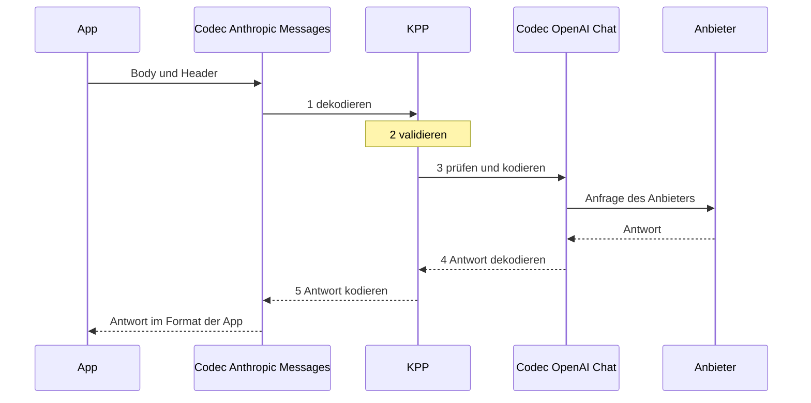
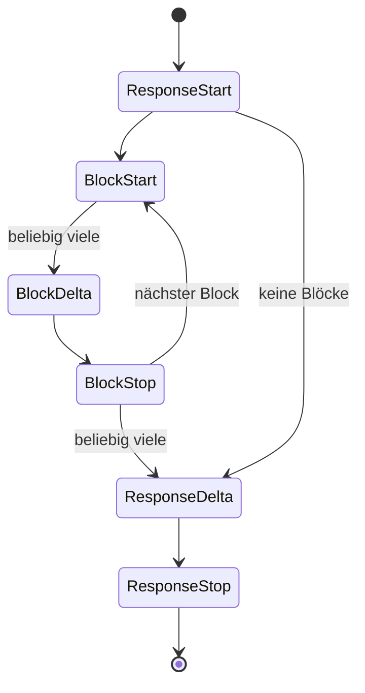

KPP, das Kaeso Provider Protocol, ist das kanonische Format, das jede Modellanfrage durchläuft. Das Gateway dekodiert, was eine App sendet, nach KPP und kodiert KPP für den Anbieter; die Antwort nimmt denselben Weg zurück. [Formatübersetzung](../../concepts/format-translation.md) beschreibt, was Aufrufer davon sehen; diese Seiten richten sich an alle, die KPP ändern.

Am besten mit [dem Weg einer Anfrage](#der-weg-einer-anfrage) und den [Entwurfsprinzipien](#entwurfsprinzipien) beginnen; der Rest dieser Seite und die Seiten darunter sind Nachschlagewerk.

## Der Weg einer Anfrage

Eine App sendet eine Anfrage im Format Anthropic Messages, und das Modell wird über OpenAI Chat Completions bedient:

```rust
use kaeso_codecs::{EgressCtx, EncodeCtx, dispatch};
use kaeso_kpp::{DialectId, RequestKind};

let req = dispatch::decode_request(DialectId::AnthropicMessages, RequestKind::Generate, &body, &headers)?;
req.validate()?;
let mut egress = EgressCtx::new(&req).with_provider("openai");
let outgoing = dispatch::encode_request(DialectId::OpenAiChat, &req, &mut egress)?;

let reply = dispatch::decode_response(DialectId::OpenAiChat, status, &reply_headers, &reply_body, &egress)?;
let answer = dispatch::encode_response(DialectId::AnthropicMessages, &reply, &EncodeCtx::for_request(req))?;
```



1. **Dekodieren.** Der Codec der App liest Body und Header in einen KPP-`Request`. `decode_request` nimmt eine `RequestKind` entgegen, weil sich die Bodies von Anthropics `/v1/messages` und `/v1/messages/count_tokens` ohne den Endpunkt nicht unterscheiden lassen. Was KPP nicht modelliert, wird in `Extras` aufbewahrt, gebunden an den Dialekt, aus dem es kam.
2. **Validieren.** `validate()` prüft, was jeder Dialekt braucht, etwa ein Modell, Nachrichten mit Inhalt, eindeutige Tool-Aufruf-IDs und Tool-Namen und eine `tool_choice`, die ein definiertes Tool nennt.
3. **Prüfen und kodieren.** `encode_request` führt zuerst `check()` des Ziels aus, das mit `Unsupported` ablehnt, was das Ziel nicht ausdrücken kann, bevor irgendetwas gesendet wird ([Formatwechsel](cross-format.md)). Danach schreibt es die Anfrage an den Anbieter. `EgressCtx` trägt, was das Gateway über das Ziel weiß: Art der Anfrage und Stream-Modus, den Anbieter und ob das Modell Reasoning beherrscht oder adaptives Thinking hat. Der Encoder ergänzt die Tool-IDs und -Namen, die er umschreiben musste.
4. **Die Antwort dekodieren.** Der Codec des Anbieters liest die Antwort nach KPP und übersetzt umgeschriebene Tool-IDs und -Namen über `EgressCtx` zurück.
5. **Die Antwort kodieren.** Der Codec der App schreibt die Antwort im Format der App. `EncodeCtx` trägt die dekodierte Anfrage der App, weil OpenAI Responses Anfragefelder in seiner Antwort wiederholt, und ein `created_at`, weil ein Sans-IO-Encoder eine deterministische Uhr braucht.

Streams nehmen denselben Weg mit `dispatch::stream_decoder` und `dispatch::stream_encoder`, Fehler mit `dispatch::decode_error` und `dispatch::encode_error`. Das Gateway erfährt beide Dialekte erst pro Anfrage, daher bietet `dispatch` jede Codec-Funktion mit einer `DialectId` an; ein Dialekt ohne Codec ergibt `Unsupported`.

`Codec` selbst ist ein versiegelter Trait aus assoziierten Funktionen, die zur Compile-Zeit gewählt werden: Anfragen, Antworten, Fehler, Stream-Decoder und -Encoder sowie Modelllisten, für beide Seiten des Gateways. Auf der Ingress-Seite spricht eine App das Format mit Kaeso; auf der Egress-Seite spricht Kaeso es mit einem Anbieter.

## Seiten

| Seite | Inhalt |
| --- | --- |
| [Formatwechsel](cross-format.md) | Die Regeln für Daten, die von einem API-Format in ein anderes wechseln, und ihre Gründe |
| [Feldklassen](field-classes.md) | Jedes KPP-Feld als semantisch oder Hinweis |
| [Extras-Allowlist](extras-allowlist.md) | Die Extras, die beim Formatwechsel einer Anfrage weggelassen werden dürfen |
| [Anthropic Messages](anthropic-messages.md), [OpenAI Chat Completions](openai-chat.md), [OpenAI Responses](openai-responses.md), [OpenAI Embeddings](openai-embeddings.md) | Jedes Wire-Feld jedes Formats, wohin es in KPP gehört, und seine Quelle |
| [Fixtures und Aufzeichnungen](fixtures.md) | Die echten Payloads, gegen die die Codecs getestet werden, und wie neue aufgezeichnet werden |

## Crates und Module

| Crate | Inhalt |
| --- | --- |
| `kaeso-kpp` | Nur die KPP-Typen: Anfragen, Antworten, Stream-Events, Fehler, Token-Zählungen, Embeddings und Modelllisten, mit `validate()` und `required_capabilities()`. Keine Codec-Logik, kein I/O. |
| `kaeso-codecs` | Ein Sans-IO-Codec pro API-Format, im Code Dialekt genannt (`DialectId`), und die Bausteine, die sie teilen. Ein Codec macht aus Bytes KPP-Werte und aus KPP-Werten Bytes; Streams werden Chunk für Chunk eingespeist und erzeugen Events. |

Beide Crates sind auf crates.io veröffentlicht. Ihr Bibliothekscode darf nur von `serde`, `serde_json`, `bytes`, `thiserror`, `indexmap`, `base64` und `mime` abhängen, und `cargo deny` verbietet ihnen `tokio`, `reqwest`, `hyper` und `axum` ([Abhängigkeiten](../dependencies.md#kpp)).

| Modul | Dialekt |
| --- | --- |
| `anthropic_messages` | Anthropic Messages (`/v1/messages`, `/v1/messages/count_tokens`) |
| `openai_chat` | OpenAI Chat Completions (`/v1/chat/completions`) |
| `openai_responses` | OpenAI Responses (`/v1/responses`, `/v1/responses/input_tokens`) |
| `openai_embeddings` | OpenAI Embeddings (`/v1/embeddings`) |
| `openai_models` | Die OpenAI Models API, die sich die drei OpenAI-Codecs teilen |

| Gemeinsames Modul | Aufgabe |
| --- | --- |
| `codec` | Der Trait `Codec`, `EgressCtx` und `EncodeCtx` |
| `dispatch` | Die Codec-Funktionen, zur Laufzeit nach `DialectId` gewählt |
| `wire` | serde-Bausteine für verlustfreie Wire-Structs ([Wire-Structs](#wire-structs)) |
| `sse` | Parser und Writer für Event-Streams ([Server-sent Events](#server-sent-events)) |
| `cross` | Die Regeln für Daten, die den Dialekt wechseln, und die Extras-Allowlist |
| `continuity` | Reasoning, das mit der Unterhaltung mitreist ([Reasoning über Runden hinweg](cross-format.md#reasoning-über-runden-hinweg)) |
| `keepalive` | Frames, die laufende Streams nicht verstummen lassen ([Keepalives](cross-format.md#keepalives)) |
| `models` | Hilfsfunktionen für Modelllisten ([Modelllisten](#modelllisten)) |
| `testing` | Vergleich von JSON und SSE, auch für Crates, die die Codecs nutzen |

## Entwurfsprinzipien

- **Zustandslos.** Ein `GenerateRequest` trägt immer die ganze Unterhaltung.
- **Nachrichten aus geordneten Content-Blöcken.** Die Reihenfolge der Blöcke bleibt von Anfang bis Ende erhalten.
- **Roh, wo es auf Bytes ankommt.** Tool-Argumente, JSON-Schemas, unbekannte Blöcke und Zitate sind `RawJson`; opakes Reasoning wird so aufbewahrt, wie es ankam, und mit seinem `Origin` versehen.
- **Semantisch oder Hinweis.** Jedes Feld ist entweder semantisch (ein Ziel muss es einhalten oder mit `Unsupported` ablehnen) oder ein Hinweis (es darf ignoriert werden). [Feldklassen](field-classes.md) listet sie auf.
- **Gebundene Extras.** Was KPP nicht modelliert, wird in `Extras` aufbewahrt, mit dem Dialekt versehen, aus dem es kam, und nur in diesen Dialekt zurückgeschrieben. `fields` sind semantisch: Ein anderer Dialekt lehnt sie ab, außer sie stehen auf der [Allowlist](extras-allowlist.md). `form` ist Darstellung (ein String oder ein Array, `null` oder fehlend, wie Chunks gruppiert waren), und andere Dialekte ignorieren es. Unbekannte Schlüssel verschachtelter Objekte verwenden Schlüsselpfade mit Punkten, etwa `function.x`, daher lässt sich ein Schlüssel, der selbst einen `.` enthält, nicht mitführen ([Wire-Structs](#wire-structs)).
- **Ablehnen vor dem Senden.** `check()` gibt `Unsupported` zurück und nennt die Funktion, die ein Ziel nicht ausdrücken kann, bevor irgendetwas gesendet wird.
- **Nichts fällt stillschweigend weg.** Jedes Feld und jeder Block einer eingehenden Payload landet an genau einer Stelle: in einem typisierten KPP-Feld, einem dialektgebundenen `Extras`-Eintrag, einem `Unknown`-Item oder einem `KppError` der Art `Unsupported`. Ein Match-Arm, der Daten verwirft, ist ein Bug.
- **Additive öffentliche API.** Öffentliche Enums und erweiterbare Structs sind `#[non_exhaustive]`; Enum-Varianten umschließen `#[non_exhaustive]`-Structs mit Konstruktoren (`TextBlock::new`, `Block::text`, …), sodass Felder hinzukommen können, ohne Code zu brechen, der Werte baut oder matcht. Der `Codec`-Trait ist versiegelt.

KPP-Werte und Fehler werden als Wert zurückgegeben. `KppError` und einige Enum-Varianten sind groß, aber ein Wert wird einmal pro Anfrage gebaut, und Fehler sind der kalte Pfad; sie zu boxen würde jede Signatur umständlicher machen, daher erlaubt der Workspace `clippy::large_enum_variant` und `clippy::result_large_err`.

Jeder KPP-Typ implementiert `serde` für Logs und Snapshots. Diese JSON-Form ist über Patch-Releases hinweg stabil, aber kein Wire-Format. Ihre Namen stehen in Snake Case und schreiben OpenAI als `openai`, wie `DialectId` (`openai_chat`): `OpaqueKind::OpenAiEncryptedReasoning` ist `openai_encrypted_reasoning`.

## Einen Codec ändern

1. **Zuerst die Fixture.** Die echte Payload in `crates/kaeso-codecs/fixtures/<dialect>/` ablegen, mit einer Herkunftszeile in der `README.md` dieses Ordners ([Fixtures](fixtures.md)).
2. **Die Quelle nennen.** Jede Abbildung nennt ihre Quelle auf der Mapping-Seite des Dialekts: die Dokumentation des Anbieters oder das OpenAPI-Schema beim festgelegten Spezifikations-Commit. Die Quellen sind die [OpenAPI-Spezifikation von OpenAI](https://github.com/openai/openai-openapi), die auf der Seite [Anthropic Messages](anthropic-messages.md) genannte OpenAPI-Spezifikation von Anthropic, die Typen der offiziellen SDKs ([openai-python](https://github.com/openai/openai-python), [anthropic-sdk-python](https://github.com/anthropics/anthropic-sdk-python)) und die Dokumentation der Anbieter. Wo die Quellen mehrdeutig sind, das vorsichtige Verhalten wählen, `Unsupported`, und ein Issue eröffnen.
3. **Erst ein fehlschlagender Test, dann Code.** Jedes Wire-Feld wird auf ein typisiertes KPP-Feld, einen an den Ursprung gebundenen `Extras`-Eintrag, ein `Unknown`-Item oder einen `Unsupported`-Fehler abgebildet.
4. **Die Mapping-Seite des Dialekts aktualisieren**, in allen drei Sprachen, im selben Pull Request.

Fehlermeldungen richten sich an die Person, die Kaeso aufgerufen hat: Sie nennen das Feld, das das Ziel nicht unterstützt, und was zu tun ist.
## Typen

Die Typen sind davon geprägt, was die Codecs brauchen, um verlustfrei zu bleiben:

- **`Extras`** hat drei Felder: `origin`, `fields` (rohes JSON, Byte für Byte) und `form` (Darstellungsmarkierungen). Round Trips im selben Dialekt müssen Schreibweisen reproduzieren, die KPP wegnormalisiert, etwa `content` als String oder Array, `null` oder fehlend, `1` oder `1.0`, Chunk-Grenzen und die Felder `id` und `retry` eines SSE-Frames; diese Markierungen tragen keine Bedeutung und bringen einen anderen Dialekt daher nie dazu, eine Anfrage abzulehnen, wie es unbekannte `fields` tun. Zwei leere `Extras` sind gleich, unabhängig von ihrem Ursprung.
- **Weitergegebene Header** (`anthropic-beta`, `anthropic-version`, `openai-beta`) werden in `Extras::fields` unter Schlüsseln gespeichert, die mit `header:` beginnen; wiederholte Header werden mit `", "` verbunden. Header sind wie jedes andere Extra an ihren Dialekt gebunden. Ein Body-Schlüssel, der mit `header:` beginnt, sähe wie ein weitergegebener Header aus, daher lehnen ihn die Codecs ab, die Bodies über `wire::Ext` lesen, also Anthropic Messages, OpenAI Chat Completions und OpenAI Embeddings ([Wire-Structs](#wire-structs)); OpenAI Responses behält solche Schlüssel im Body, und nur echte Header werden weitergegeben.
- **Rohe Items.** `Box<RawValue>` ist in `RawJson` verpackt, das Byte für Byte vergleicht. Unbekannte Blöcke, Tools, Tool-Auswahlen, Stream-Events und Deltas sind `RawItem { origin, raw }`; Zitate sind `Citation { origin, raw }`, weil Zitatformate über Dialekte hinweg fast nichts gemeinsam haben.
- **Antworten.** `Reply` ist `Generate`, `CountTokens` oder `Embed`, und `RequestKind` benennt dieselben drei Arten.
- **Tools.** `ToolDef` ist ein Funktions-Tool oder ein unbekanntes Tool, das vollständig aufbewahrt wird; `ToolChoice` ist `Auto`, `None`, `Required`, ein benanntes Tool oder unbekannt. Die `parameters` eines Funktions-Tools sind optional, wie OpenAI es erlaubt.
- **Einstellungen für Ausgabe und Reasoning.** `OutputSpec::JsonSchema` hat einen optionalen Namen (Anthropic-Schemas haben keinen) und eine Beschreibung. `ReasoningConfig` enthält Modus, Aufwand, Budget, Zusammenfassung und die Angabe, ob verschlüsseltes Reasoning mitgeliefert werden soll; seine Enums bewahren unbekannte Werte in `Other(String)` auf, weil Anbieter oft neue Aufwandsstufen einführen.
- **Reasoning-Blöcke** enthalten Ursprung, Zusammenfassungen, Textteile und opake Teile, weil ein OpenAI-Reasoning-Item sowohl eine ID als auch verschlüsselten Inhalt trägt und mehrere Textteile haben kann, und weil ein Block, der nur eine Zusammenfassung enthält, trotzdem seinen Ursprung braucht, um zu entscheiden, wohin er zurückgespielt werden darf.
- **Nutzung.** `Usage::input_tokens` schließt Cache-Lese- und -Schreibvorgänge aus, die eigene Felder sind ([Nutzung](cross-format.md#nutzung)); `Usage::raw` bewahrt das Nutzungsobjekt des Anbieters mit seinem Ursprung auf, sodass ein Encoder es nur für seinen eigenen Dialekt darüberlegt. Embedding-Vektoren sind `f64`, damit die Werte des Anbieters unverändert wieder ausgegeben werden.
- **Fehler.** `ErrorKind::Billing` gibt es für Anthropics `billing_error` (402) und OpenAIs `insufficient_quota`, die keine andere Art treffend beschreibt.

## Streams

Ein KPP-Stream ist `ResponseStart → (BlockStart → BlockDelta* → BlockStop)* → ResponseDelta* → ResponseStop`, wobei `Error` an jeder Stelle möglich ist und `Extra` Dialekt-Events trägt, die KPP nicht modelliert.



- **Blockindizes** gehören KPP selbst: 0, 1, 2, … in der Reihenfolge, in der Blöcke beginnen. Blöcke dürfen sich überlappen (OpenAI streamt parallele Tool-Aufrufe so), daher nennt jedes Event seinen Block.
- **Jedes Lifecycle-Event trägt `Extras`**, sodass eine Wiedergabe im selben Dialekt die ursprünglichen Events exakt reproduziert, einschließlich Feldern einzelner Events wie OpenAIs `obfuscation`.
- **Fehler werden im Stream gemeldet:** erst die bis dahin dekodierten Events, dann ein abschließendes `StreamEvent::Error`, sodass nichts verloren geht, was zuvor im selben Chunk dekodiert wurde.
- **Die Reihenfolge ändert sich nie, aber Events können zurückgehalten werden.** OpenAI-kompatible Anbieter senden die `id` und das `model` der Antwort oder die `id` und den `name` eines Tool-Aufrufs teils erst in einem späteren Chunk. Der Decoder für OpenAI Chat Completions hält dann das `ResponseStart` und die Chunks ohne Inhalt zurück, bis ein Chunk diese Werte oder Inhalt trägt. Das `BlockStart` eines Tool-Aufrufs hält er mit jedem Event danach zurück, bis dessen `id` und `name` beide angekommen sind, der Block endet oder der Stream endet oder abbricht ([OpenAI Chat Completions](openai-chat.md#streams-createchatcompletionstreamresponse)).

### Stream-Encoder

Jeder Stream-Encoder kann außerdem einen Keepalive-Frame schreiben; wann, steht unter [Keepalives](cross-format.md#keepalives).

**Anthropic Messages.** Anthropic streamt einen Content-Block nach dem anderen, während sich in KPP-Streams aus anderen Dialekten Blöcke überlappen können: OpenAI streamt parallele Tool-Aufrufe so und schließt jeden Block erst am Ende. Der Encoder ist ein expliziter Zustandsautomat:

- der erste Block, der beginnt, ist aktiv und wird geschrieben, sobald er ankommt;
- Blöcke, die beginnen, während ein anderer aktiv ist, warten und werden in Startreihenfolge gepuffert;
- stoppt der aktive Block, wird der nächste wartende geschrieben, mit seinem Start, seinen gepufferten Deltas und seinem Stopp, falls dieser schon kam;
- ein `ResponseDelta` oder `ResponseStop` schließt zuerst jeden offenen Block, und mehrere `ResponseDelta`s werden zu einem `message_delta` zusammengeführt, weil die SDKs `stop_reason` mit jedem einzelnen überschreiben.

Anthropic-Indizes werden in der Reihenfolge vergeben, in der Blöcke geschrieben werden. Ein Stream, der nicht mit `ResponseStart` beginnt, bekommt ein `message_start` mit leerer ID.

**OpenAI Chat Completions.** Aus Chat dekodierte Events werden mithilfe der Chunk-Form-Markierungen wieder zu ihren ursprünglichen Chunks gruppiert, sodass eine Wiedergabe im selben Dialekt jeden Frame reproduziert; weichen die Envelope-Schlüssel eines Chunks (`id`, `object`, `created`, `model`, `service_tier`, `system_fingerprint`) von dem aus `ResponseStart` neu gebauten Envelope ab, hält er die Unterschiede als `env` und `env_absent` fest. Events aus anderen Dialekten werden zu je einem Chunk:

- der Stream beginnt mit einem Rollen-Chunk, sobald die Antwort startet (`delta: {"role": "assistant", "content": "", "refusal": null}`, OpenAIs eigener erster Chunk), sodass die App vom Stream hört, während das Modell denkt;
- ein Tool-Aufruf beginnt mit einem Header-Chunk, gefolgt von Argument-Chunks;
- die Nutzung wird nur gesendet, wenn die App danach gefragt hat (`stream_options.include_usage`), als letzter Chunk mit `choices: []`;
- `ResponseStop` schreibt `data: [DONE]`; ein `Error` schreibt `data: {"error": …}` und beendet den Stream ohne `[DONE]`.

**OpenAI Responses.** Die Stream-Engine erzeugt für jedes KPP-Event die SSE-Events in der Reihenfolge, in der OpenAI sie sendet, einschließlich aller redundanten (`.done`-Events, Part-Events, Item-Events, das abschließende Response-Objekt mit allen Ausgabe-Items), und vergibt `sequence_number`s. Der Decoder lässt dieselbe Engine als Schatten mitlaufen:

- jedes SSE-Event, das die Engine an dieser Stelle erzeugen würde, wird dem KPP-Event zugeordnet, und Abweichungen werden als Overrides mit Geltungsbereich festgehalten;
- zugeordnete Events, die das Original nicht hatte, werden in der Form-Markierung `skip` vermerkt;
- Events, die dort ankommen, wo die Engine keine erzeugen würde, werden als `Extra` weitergereicht.

Ein Stream im selben Dialekt wird exakt reproduziert, und ein Stream aus einem anderen Dialekt wird zu einem vollständigen, gültigen Responses-Stream.

## Wire-Structs

Wire-Structs müssen jedes Feld behalten, auch solche, die das Struct nicht deklariert, und rohe Payloads (`RawValue`) Byte für Byte bewahren. `#[serde(flatten)]` kann nicht beides: Flattening puffert die Eingabe, und `RawValue` lässt sich nicht aus einem Puffer lesen, sodass Tool-Argumente und Schemas ihre Bytes verlören. `wire::Ext<T>` erledigt dieselbe Aufgabe ohne Puffern:

- Jeder Schlüssel des JSON-Objekts, den `T` nicht deklariert, wird roh in `Ext::extra` aufbewahrt und wird zu KPP-`Extras::fields`, außer sein Name beginnt mit `header:` oder enthält einen `.`: Ein solcher Schlüssel würde mit einem weitergegebenen Header oder einem verschachtelten Schlüsselpfad verwechselt, daher wird das Objekt abgelehnt (`` the field `…` has a name Kaeso cannot carry; remove it ``), in einer Anfrage als `InvalidRequest` und in der Antwort eines Anbieters als `ProviderError`.
- Jeder deklarierte Schlüssel, dessen empfangene Schreibweise `T` nicht reproduzieren kann (`"x": null` für eine `Option`, die bei `None` übersprungen wird, `"flag": false` für einen `bool`, der bei false übersprungen wird, `"list": []` für einen `Vec`, der übersprungen wird, wenn er leer ist), wird roh in `Ext::verbatim` aufbewahrt und wird zu KPP-`Extras::form`.

Beim Serialisieren schreibt ein `Ext<T>` zuerst `T`, dann die verbatim-Schlüssel, die `T` nicht geschrieben hat, dann die zusätzlichen Schlüssel. Ein Round Trip aus Dekodieren und Kodieren ist daher exakt, und ein Codec, der ein typisiertes Feld ändert, etwa beim Übersetzen aus einem anderen Dialekt, setzt sich immer gegen eine veraltete verbatim-Schreibweise durch. `wire::Maybe<T>` unterscheidet fehlend von `null`, wo der Unterschied für den Codec sichtbar sein muss.

Wire-Structs, die in `Ext` verwendet werden, folgen diesen Regeln:

- kein `#[serde(flatten)]`, kein `alias`, kein `deny_unknown_fields`, keine untagged oder intern getaggten Enums;
- getaggte Unions werden mit `wire::type_tag` nach `"type"` unterschieden;
- JSON-Objekte mit doppelten Schlüsseln werden abgelehnt;
- ein Feld wird nur deklariert, wenn der Codec es auf ein typisiertes KPP-Feld abbildet; alles andere bleibt absichtlich undeklariert und reist als Extras mit.

Der Codec für OpenAI Responses liest typisierte Werte mit einfachen serde-Structs und schreibt mit einem geordneten JSON-Baum (`openai_responses::node::Node`), der rohes JSON Byte für Byte einbetten kann; `serde_json::Value` sortiert Objektschlüssel und würde rohe Payloads umformatieren. [Wie genaue Schreibweisen erhalten bleiben](openai-responses.md#wie-genaue-schreibweisen-erhalten-bleiben) beschreibt, wie er sie reproduziert.

## Server-sent Events

`sse::SseParser` folgt dem [WHATWG-Algorithmus für Event-Streams](https://html.spec.whatwg.org/multipage/server-sent-events.html#event-stream-interpretation) bei Zeilen, Kommentaren, mehrzeiligen Daten, `id` (ein Wert mit NUL ist keine ID) und `retry` (nur ASCII-Ziffern, die in einen `u64` passen), mit bewussten Abweichungen, damit nichts verloren geht:

- Ein Frame ganz ohne `data:`-Zeile, etwa `retry: 3000` oder `event: ping` allein, ist laut Spezifikation kein Event; der Parser gibt ihn trotzdem zurück, mit `has_data: false` und leerem `data`, und der Writer schreibt ihn ohne `data:`-Zeile zurück.
- Kommentare und unbekannte Felder werden gemeldet statt ignoriert, und ein Wert für `id` oder `retry`, den die Spezifikation ignoriert, wird als unbekanntes Feld aufbewahrt (`SseEvent::other`).
- Ein letzter Frame, den keine Leerzeile abschließt, wird trotzdem gemeldet.
- Ein Stream, der mitten in einer Zeile endet, wird als `SseError::Truncated` gemeldet statt verworfen.

Jeder Stream-Decoder reicht einen Frame ohne Daten als `Extra` weiter, dessen rohes JSON keinen Schlüssel `data` hat, und jeder Encoder schreibt ihn ohne `data:`-Zeile zurück; in OpenAI Chat Completions ist ein Frame `event: error` ohne Daten ein solches `Extra`, kein Fehler.

Die Felder `id`, `retry` und die unbekannten Felder eines Frames, der zu KPP-Events dekodiert wird, werden als `{"id", "retry", "other": [[name, value], …]}` festgehalten und zurückgeschrieben: in der Form-Markierung `sse` in Anthropic Messages, in `sse` innerhalb der Markierung `chunk` in OpenAI Chat Completions und im Form-Override mit Geltungsbereich `~sse` in OpenAI Responses. Ein Frame, der als `Extra` weitergereicht wird, behält sie im `Extra`.

Bytes können in beliebigen Chunks eingespeist werden: Zeilen dürfen an jeder Stelle getrennt sein, auch zwischen `\r` und `\n` eines CRLF-Zeilenendes. Ein Frame, der größer ist als das Limit des Parsers (`sse::DEFAULT_MAX_FRAME_BYTES`, 16 MiB), ist ein Fehler; das begrenzt den Speicher, den jeder Stream belegen kann.

## Modelllisten

Modelllisten (`GET /v1/models`, `GET /v1/models/{id}`) gehören zu KPP, mit `ModelInfo`, `ModelLifecycle`, `ModelList` und `ModelsQuery`, sodass das Gateway die Wire-Formen nie selbst kennen muss.

- **Ingress.** Jeder Dialekt nutzt denselben Pfad, daher verrät der Pfad den Dialekt nicht: `dispatch::models_dialect` wählt ihn anhand der Header (`anthropic-version` bedeutet Anthropic, alles andere OpenAI). `ModelList::page` wendet `before_id`, `after_id`, `limit` und den Lifecycle-Filter für jeden Dialekt gleich an.
- **Egress.** Um zu erfahren, ob ein Anbieter einem Schlüssel ein Modell anbietet, sendet das Gateway das `GET /v1/models/{id}`, das `dispatch::encode_model_request` baut, mit der ID als einem prozentkodierten Pfadsegment, und liest die Antwort mit `decode_model`; eine 404 wird zu `NotFound`. Weil eine 404 dort auch heißen kann, dass der Anbieter diesen Endpunkt nicht hat, liest das Gateway danach die Liste des Anbieters: `dispatch::encode_models_request` baut `GET /v1/models` aus einer `ModelsQuery` (nur das Paging und die Filter, die der Dialekt sendet; alles andere ist `Unsupported`), und `decode_models` liest jede Seite.
- **Query-Strings** werden an `&` und `=` getrennt und als `application/x-www-form-urlencoded` percent-dekodiert (`+` ist ein Leerzeichen). Unbekannte Parameter werden zu Extras unter `query.<name>`.
- **Datumsangaben.** KPP speichert Unix-Sekunden. RFC-3339-Zeitangaben (Anthropic) und reine Datumsangaben (OpenAI `shutdown_date`) werden mit dem proleptischen gregorianischen Kalender umgerechnet, ohne Datumsbibliothek. Sekundenbruchteile und Zeitzonenversätze überstehen die Umrechnung nicht; der genau empfangene Text wird in der Form-Markierung `spelling` aufbewahrt, wann immer erneutes Kodieren ihn nicht reproduzieren würde. Ein Datum nach dem Jahr 9999 lässt sich nicht in RFC 3339 schreiben: Anthropics `created_at` bekommt dann den dokumentierten unbekannten Wert (die Epoche), andere Datumsangaben `null`.
- **Fehlende oder `null`-Felder.** Ein Encoder füllt ein Feld, für das KPP keinen Wert hat, mit dem dokumentierten Standardwert; hat der empfangene Body dieses Feld anders geschrieben, vermerkt das die Form-Markierung `none`.

## Tests

| Suite | Was sie belegt |
| --- | --- |
| `crates/kaeso-kpp/tests/types.rs` | Die KPP-Typen allein: stabile Namen der Fehlerarten und Blöcke, `validate()` und `required_capabilities()`. |
| Fixture-Round-Trips (die `tests`-Module jedes Dialekts) | `decode → KPP → encode` reproduziert jede [Fixture](fixtures.md) eines Dialekts als gleichen JSON-Wert (bei Streams als gleiche Event-Folge), bei Streams unter vielen Chunk-Aufteilungen. Fixtures, die abgelehnt werden müssen, scheitern mit der genannten `Unsupported`-Funktion. |
| `crates/kaeso-codecs/tests/cross_matrix.rs` | Für jede Generierungs-Fixture von Dialekt A und jeden anderen Dialekt B: Anfragen durchlaufen `decode_A → check_B → encode_B` und müssen sich mit dem Decoder von B wieder dekodieren lassen, ohne dass sich die Unterhaltung ändert; Antworten und Streams durchlaufen `decode_A → encode_B → decode_B` und müssen Text, Verweigerungen und Tool-Aufrufe behalten, auch zurück in A. Anfragen und Antworten zur Token-Zählung wechseln zwischen Anthropic und Responses. Die Ergebnisse sind `insta`-Snapshots. |
| `crates/kaeso-codecs/tests/dispatch.rs` | `dispatch` dekodiert Anbieterfehler und kodiert Fehler mit einem Status in jedem Dialekt, der Embeddings-Codec lehnt Generierungsantworten ab, und er behält einen Base64-Vektor, wie er empfangen wurde, wenn keine Anfrage eine andere Kodierung verlangt. |
| `crates/kaeso-codecs/tests/number_spelling.rs` | `temperature: 1` kommt in Anthropic-, Chat- und Responses-Anfragen als `1` zurück und `1.0` als `1.0`, ein geänderter Wert wird als neuer Wert geschrieben, ein anderer Dialekt bekommt die eigene Schreibweise des Ziels, und Antworten von Responses behalten die Schreibweise der Zahlen, die sie wiedergeben. |
| `crates/kaeso-codecs/tests/kpp_proptest.rs` | Zufällige gültige KPP-Anfragen und -Antworten überstehen Kodieren und Dekodieren für jeden Generierungsdialekt, auf der Teilmenge, die jeder Dialekt unterstützt. |
| `crates/kaeso-codecs/tests/keepalive.rs` | Alles, was eine App nicht sehen kann, bringt trotzdem regelmäßig Keepalive-Frames auf die Leitung, und für den Parser der App sind die Frames unsichtbar. |
| `crates/kaeso-codecs/tests/reasoning_carry.rs` | Reasoning geht an eine App eines anderen Dialekts und kommt in der nächsten Runde Byte für Byte zurück, über Apps für Responses, Anthropic und Chat. |
| `crates/kaeso-codecs/tests/responses_on_anthropic.rs` | Apps für OpenAI Responses auf Anthropic-Modellen und Anthropic-Apps auf OpenAI-Modellen: Reasoning-Anfragen, Thinking-Streams in der Event-Reihenfolge von OpenAI und Tool-Schleifen. |
| `crates/kaeso-codecs/tests/nesting.rs` | Anthropic-Blöcke `tool_result`, die tiefer als das Limit verschachtelt sind, werden in Anfragen, Antworten und Streams abgelehnt, und eine Verschachtelung bis zum Limit lässt sich weiterhin dekodieren. |
| `crates/kaeso-codecs/tests/unknown_frames.rs` | Unbekannte SSE-Frames überstehen in jedem streamenden Dialekt einen Round Trip im selben Dialekt, mit ihrer JSON-Schreibweise, Strings in Anführungszeichen, SSE-Feldern und Kommentaren; Anthropic- und Chat-Streams behalten auch Frames, deren Daten reiner Text sind. |
| `e2e/conformance`, bedient von `crates/kpp-conformance` | Die offiziellen Python-SDKs von OpenAI und Anthropic parsen alles, was die Encoder erzeugen ([Tests](../testing.md#sdk-konformität)). |
| `fuzz/` | Jeder Decoder nimmt beliebige Bytes an, ohne einen Panic auszulösen, und der SSE-Parser liefert bei jeder Chunk-Aufteilung dieselben Items ([Fuzzing](../testing.md#fuzzing)). |

`kaeso_codecs::testing` vergleicht JSON strukturell: Die Reihenfolge der Schlüssel spielt nie eine Rolle, und Zahlen werden exakt so verglichen, wie `serde_json` sie liest, daher unterscheiden sich `1` und `1.0`, während `1e0` und `1.0` dieselbe Zahl sind.

KPP speichert `temperature`, `top_p` und die Penalties als `f64`, daher bewahren die Codecs die Schreibweise selbst: OpenAI Chat Completions und Anthropic Messages führen die als Ganzzahl geschriebenen Schlüssel in der Form-Markierung `integers` der Anfrage und schreiben sie wieder als Ganzzahl, solange der Wert noch ganzzahlig ist, und OpenAI Responses hält eine abweichende Schreibweise als Form-Override fest, der nur gilt, solange der Wert unverändert ist. Ein geänderter Wert wird als neuer Wert geschrieben, und ein anderer Dialekt bekommt die eigene Schreibweise des Ziels (`1.0`).

`testing::sse_diff` vergleicht Streams Item für Item: den Event-Namen, die Daten als JSON oder als Text, wenn sie kein JSON sind (`ComparableItem::Event.data` ist `None` für einen Frame ohne `data:`-Zeile), dann die Felder `id`, `retry` und die unbekannten Felder in ihrer Reihenfolge; Kommentare werden exakt verglichen.

Ändert eine Änderung die Ausgabe über Dialekte hinweg, den Snapshot-Diff prüfen: `INSTA_UPDATE=always cargo test -p kaeso-codecs --test cross_matrix` ausführen und die geänderten `.snap`-Dateien lesen, bevor sie committet werden.
