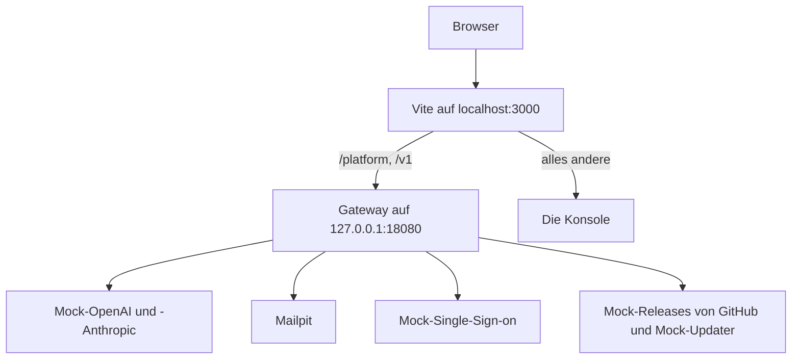

Diese Seite führt von einem frischen Klon zum aus dem Quellcode gebauten Gateway, zur Konsole mit Beispieldaten und zu bestandenen Tests. Jeder Befehl läuft vom Wurzelverzeichnis des Repositorys aus.

## Was benötigt wird

| Werkzeug | Version | Genutzt für |
| --- | --- | --- |
| [Git](https://git-scm.com) | Jede aktuelle | Den Code |
| [Node.js](https://nodejs.org) | 24, wie in `.node-version` | Konsole, UI-Bibliothek, Dokumentation und Skripte |
| pnpm | 11, in `package.json` festgelegt und von Corepack bereitgestellt | Den TypeScript-Workspace |
| [Rust](https://rustup.rs) über rustup | 1.99, in `rust-toolchain.toml` festgelegt | Gateway und KPP |
| Eine Docker-Engine mit Compose | Compose 2.24 oder neuer | Den Entwicklungs-Stack |
| [Python](https://www.python.org) | 3.13 | Nur die [End-to-End-Tests](testing.md#end-to-end-tests) |

Corepack ist bei Node.js dabei. Einmal einschalten, dann stellt es genau die pnpm-Version bereit, die das Repository festlegt:

```bash
corepack enable
```

rustup installiert Rust 1.99 mit rustfmt, clippy und llvm-tools beim ersten `cargo`-Aufruf im Repository; `rustup show` erledigt das vorab.

Jede Docker-Engine mit Compose betreibt den Stack: Docker Engine unter Linux oder [Colima](https://github.com/abiosoft/colima) unter macOS, das ohne Desktop-App auskommt. Mit Homebrew:

```bash
brew install colima docker docker-compose docker-buildx
colima start --cpu 4 --memory 8
```

Homebrew installiert Compose und Buildx als Plugins des Befehls `docker`. Damit `docker compose` sie findet, `"cliPluginsExtraDirs": ["/opt/homebrew/lib/docker/cli-plugins"]` in `~/.docker/config.json` eintragen, wie ihre Installationshinweise sagen. Acht Gigabyte Speicher lassen Platz für die Datenbanken des Stacks und den ersten Build des Gateways. Colima teilt nur den eigenen Home-Ordner mit seiner virtuellen Maschine, daher gehören der Checkout und jede ausprobierte Installation dort hinein.

## 1. Code holen

```bash
git clone https://github.com/logicplanes/kaeso
cd kaeso
```

## 2. Abhängigkeiten installieren

```bash
pnpm install
```

Das installiert Konsole, Dokumentation, Showcase und die Bibliotheken in `packages/`. Cargo holt die Rust-Abhängigkeiten beim ersten Build.

## 3. Entwicklungs-Stack starten

```bash
pnpm stack:up
```

Das baut das Image des Gateways aus dem Checkout (`kaeso-dev-gateway`, aus `deploy/gateway.Dockerfile`), startet es mit den Diensten unten und wartet, bis alle gesund sind. Der erste Build kompiliert das Gateway und dauert einige Minuten; spätere nutzen den Cache von Docker. Solange die Installation keine Benutzer hat, gibt der Befehl zum Schluss einen Einrichtungslink aus, `http://localhost:3000/setup#token=…`, den er über `kaeso setup-link` im Container des Gateways holt.

| Dienst | Was er ist | Auf dem eigenen Rechner |
| --- | --- | --- |
| `gateway` | Das aus dem Checkout gebaute Gateway | `127.0.0.1:18080` |
| `postgres`, `clickhouse`, `valkey` | Die Datenbanken des Gateways, auch von den Rust-Tests genutzt | `127.0.0.1:55432`, `127.0.0.1:58123`, `127.0.0.1:56379` |
| `mail` | Mailpit, das jede E-Mail des Gateways abfängt | `http://127.0.0.1:58025`, SMTP auf `127.0.0.1:51025` |
| `provider` | Eine nachgebildete OpenAI- und Anthropic-API, sodass kein echter Anbieter-Schlüssel nötig ist | Nur innerhalb des Stacks |
| `idp` | Ein nachgebildeter OpenID-Connect-Anbieter für Single Sign-on | `http://idp.localhost:18091` |
| `releases` | Mock-Releases von Kaeso und ein Mock-Updater für **Einstellungen** › **Instanz** › **Updates**; `POST /__scenario` mit `releases` (`patch`, `major`, `manual`, `none`, `error`), `updater` (`ready`, `down`) und `outcome` (`succeeded`, `rolled_back`) ändert, was sie antworten | `http://127.0.0.1:18092` |
| `master-key` | Schreibt den Hauptschlüssel des Gateways vor dessen Start in ein Volume | |

Der Stack ist das Compose-Projekt `kaeso-dev`, definiert in `deploy/compose.dev.yaml`. Die Rust-Tests brauchen nur die Datenbanken und Mailpit, die auch ohne Gateway starten:

```bash
docker compose -f deploy/compose.dev.yaml up -d --wait
```

## 4. Beispieldaten anlegen

```bash
pnpm seed
```

Das richtet die Installation über die Platform API ein, wie es eine Person täte, und füllt sie: die Organisation Northwind Labs mit fünf Projekten, sechs Mitgliedern, Schlüsseln, Modellen, Aliassen und Limits, einigen Hundert Anfragen über das Gateway an den nachgebildeten Anbieter und 70 Tagen früherer Anfragehistorie.

Wer die Installation lieber von Hand einrichtet, überspringt diesen Schritt und öffnet den Einrichtungslink, den `pnpm stack:up` ausgegeben hat.

## 5. Konsole öffnen

```bash
pnpm dev
```

Das baut die Bibliotheken in `packages/`, startet den Stack (und baut das Gateway neu, wenn sich sein Quellcode geändert hat) und liefert die Konsole unter http://localhost:3000 aus, die beim Speichern neu lädt.

Als `owner@example.com` anmelden, Instanz-Admin und Inhaber der Organisation, oder als `lin@example.com`, ein Entwickler. Beide haben das Passwort `correct horse battery staple`. E-Mails landen in Mailpit unter http://127.0.0.1:58025.



Die öffentliche URL des Gateways ist die Adresse des Entwicklungsservers. So ist das Sitzungscookie ein First-Party-Cookie, und der Browser sendet den `Origin`, den das Gateway erwartet. In Produktion liefert ein Reverse Proxy Konsole und Gateway auf die gleiche Weise unter einer Domain aus.

## 6. Tests ausführen

```bash
pnpm test
cargo test --workspace --all-features
```

`pnpm test` führt die TypeScript-Tests aus. Die Rust-Tests nutzen die Datenbanken des Stacks, und jeder Test legt eigene Datenbanken an; so laufen sie parallel und lassen die Beispieldaten unberührt. [Tests](testing.md) beschreibt jede Suite und die Prüfungen, die eine Änderung bestehen muss.

## Stack stoppen

```bash
pnpm stack:down
```

Das entfernt den Stack mit allen Daten, auch den Datenbanken der Rust-Tests. Das nächste `pnpm stack:up` beginnt leer.

## Ports und Images ändern

Diese Variablen ändern die Ports des Stacks, deren Standardwerte in `apps/console/scripts/stack.mjs` stehen: `KAESO_GATEWAY_PORT`, `KAESO_POSTGRES_PORT`, `KAESO_CLICKHOUSE_PORT`, `KAESO_VALKEY_PORT`, `KAESO_MAIL_PORT`, `KAESO_MAIL_SMTP_PORT` und `KAESO_IDP_PORT`. `KAESO_PUBLIC_URL` legt die Adresse der Konsole fest. Laufen die Datenbanken anderswo, zeigen `KAESO_TEST_POSTGRES_URL`, `KAESO_TEST_CLICKHOUSE_URL` und `KAESO_TEST_VALKEY_URL` den Rust-Tests den Weg.

Um den Stack mit einem anderswo gebauten Gateway-Image zu betreiben, etwa einem Release, dieses angeben; der Stack nutzt es dann, statt selbst zu bauen:

```bash
KAESO_GATEWAY_IMAGE=ghcr.io/logicplanes/kaeso-gateway:{{version}} pnpm stack:up
```

## Einen zweiten Stack betreiben

Ein zweiter Klon kann neben dem ersten einen eigenen Stack betreiben, mit einem anderen Compose-Projekt und anderen Ports. `KAESO_STACK_PROJECT` benennt das Projekt (standardmäßig `kaeso-dev`) und danach das Image des Gateways; `pnpm stack:up`, `pnpm seed` und `pnpm stack:down` arbeiten dann nur mit diesem Projekt. Im zweiten Klon:

```bash
export KAESO_STACK_PROJECT=kaeso-two KAESO_PUBLIC_URL=http://localhost:3001
export KAESO_GATEWAY_PORT=18180 KAESO_IDP_PORT=18191 KAESO_MAIL_PORT=58125 KAESO_MAIL_SMTP_PORT=51125
export KAESO_POSTGRES_PORT=55532 KAESO_CLICKHOUSE_PORT=58223 KAESO_VALKEY_PORT=56479
pnpm dev --port 3001
```

`pnpm seed` in derselben Shell füllt diesen Stack.

## Das Gateway aus dem Quellcode ausführen

Für ein Gateway, das sich in Sekunden neu starten lässt, mit Debugger oder zusätzlichem Logging, es mit Cargo gegen die Datenbanken des Stacks ausführen.

1. In einem zweiten Terminal den nachgebildeten Anbieter starten, damit keine Anfrage einen echten Anbieter erreicht:

   ```bash
   cargo run -p kaeso-testkit -- mock-provider 127.0.0.1:18090
   ```

2. Im ersten Terminal frische Datenbanken anlegen und ihre Einstellungen exportieren, beide Anbieter auf die Nachbildung zeigen lassen, eine öffentliche URL, eine Listen-Adresse, einen Hauptschlüssel und nur protokollierte E-Mails setzen, dann den Einrichtungslink ausgeben und das Gateway starten:

   ```bash
   export $(cargo run -q -p kaeso-testkit -- fresh-services)
   export KAESO_PROVIDERS_OPENAI_BASE_URL=http://127.0.0.1:18090
   export KAESO_PROVIDERS_ANTHROPIC_BASE_URL=http://127.0.0.1:18090
   export KAESO_PUBLIC_URL=http://localhost:3000
   export KAESO_LISTEN=127.0.0.1:8080
   export KAESO_MASTER_KEYS="$(cargo run -q -p kaeso -- master-key generate)"
   export KAESO_MAIL_TRANSPORT=log
   cargo run -q -p kaeso -- setup-link
   cargo run -p kaeso -- serve
   ```

3. In einem dritten Terminal die Konsole dagegen ausliefern und dann den Einrichtungslink öffnen:

   ```bash
   KAESO_GATEWAY_URL=http://127.0.0.1:8080 pnpm --filter kaeso-console dev
   ```

Um stattdessen die echten Anbieter anzusprechen, die beiden Zeilen mit `KAESO_PROVIDERS_…` weglassen. Die Datenbanken bleiben, bis sie im ersten Terminal gelöscht werden:

```bash
cargo run -q -p kaeso-testkit -- drop-services "$KAESO_CLICKHOUSE_DATABASE"
```

Jede Einstellung steht unter [Konfiguration](../self-hosting/configuration.md).

## Generierter Code

- **`openapi.json`**, das Dokument der Platform API im Wurzelverzeichnis, wird aus dem Code des Gateways erzeugt. Nach einer Änderung an der Platform API neu erzeugen und mit der Änderung committen, zusammen mit dem Teil der Änderung, der die Konsole betrifft:

  ```bash
  cargo run -q -p kaeso -- openapi > openapi.json
  ```

- **API-Client und Routenbaum der Konsole.** `pnpm --filter kaeso-console generate` schreibt die Typen des Clients aus `openapi.json` und den Routenbaum aus `apps/console/src/routes`. Die Skripte `dev`, `build`, `typecheck`, `test` und `e2e` der Konsole führen es zuerst aus; keines der Ergebnisse wird committet.

## Die Dokumentations-Website

```bash
pnpm build:packages
pnpm --filter kaeso-docs dev
```

Die Website läuft unter http://localhost:4480 und lädt neu, sobald eine Seite in `apps/docs/content` gespeichert wird. [Dokumentation schreiben](documentation.md) beschreibt den Rest.

## Die UI-Bibliothek

```bash
pnpm build:packages
pnpm --filter kaeso-showcase dev
```

Der Showcase läuft unter http://localhost:4321 und lädt neu, wenn sich der Quellcode der Bibliothek ändert. Konsole und Dokumentation lesen dagegen den Build der Bibliothek: nach Änderungen an `packages/ui` oder `packages/tokens` `pnpm build:packages` ausführen und ihre Entwicklungsserver neu starten.
