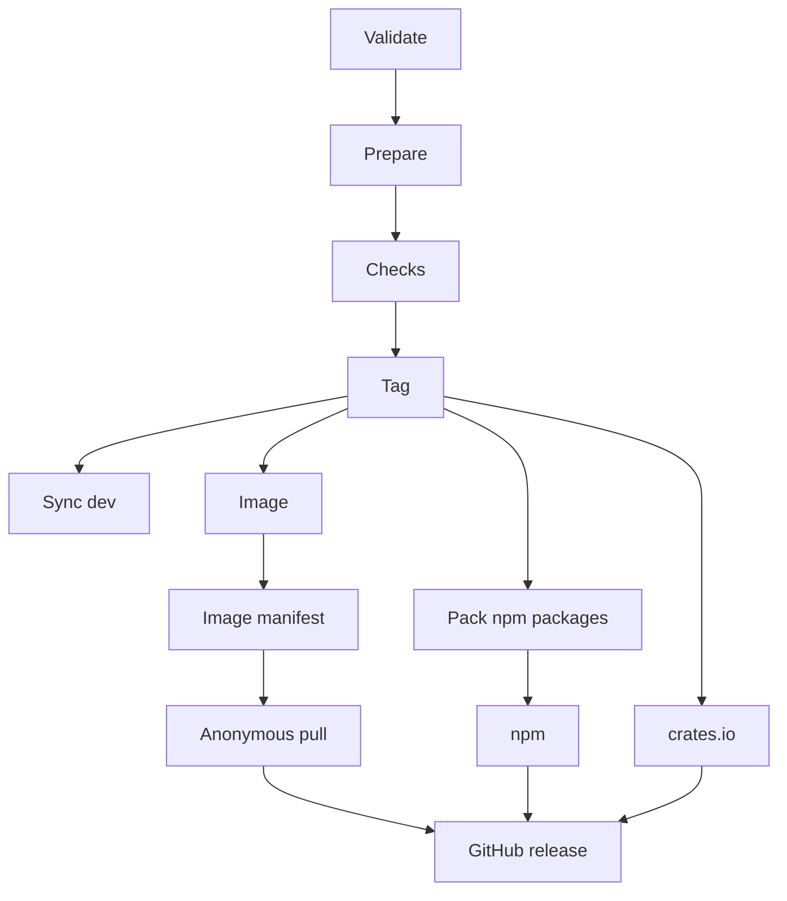

Kaeso wird als Ganzes veröffentlicht: Gateway, Konsole, die Crates von KPP und die Pakete der UI-Bibliothek teilen eine Version, und ein Release veröffentlicht sie alle. Der Maintainer erstellt jedes Release von `prod` aus mit dem Release-Workflow und stellt danach Dokumentation und Showcase aus dem Tag des Releases bereit. Mitwirkende erstellen nie Tags oder Releases.

## Versionen

Versionen folgen dem [Semantic Versioning](https://semver.org). Ein Release, das von Betreibenden einen manuellen Schritt verlangt, etwa eine Migration, die nicht von selbst laufen kann, ist ein Major-Release. Ein Pre-Release hängt ein Suffix an, etwa `0.2.0-rc.1`. Der Git-Tag eines Releases ist `v` und seine Version, etwa `v0.2.0`.

Gateway und Konsole eines Releases gehören zusammen: Die `compose.yaml` des Releases legt beide Images auf diese Version fest, und die Konsole erwartet genau die Platform API ihres Gateways.

## Die Version im Repository

Die `package.json` im Wurzelverzeichnis hält die Version des Repositorys, und nur ein Release ändert sie, mit `node scripts/version.mjs set <version>`. Dieser Befehl schreibt die Version in jede Datei, die sie nennt: jede `package.json`, die Manifeste der Crates (über `cargo set-version`), `Cargo.lock` und `fuzz/Cargo.lock`, `openapi.json`, beide Image-Tags in `deploy/compose.yaml` und die Abhängigkeitszeilen in den READMEs der Crates, etwa `kaeso-kpp = "0.2"`. `node scripts/version.mjs files` listet diese Dateien auf.

Alles andere liest die Version, statt sie zu nennen: Eine Dokumentationsseite schreibt `\{{version}}`, was der Build der Website ersetzt ([Alles andere](documentation.md#alles-andere)), das Gateway liest `env!("CARGO_PKG_VERSION")`, und der Showcase und die generierten Dateien der npm-Pakete lesen ihre `package.json`.

| Befehl | Schlägt fehl, wenn |
| --- | --- |
| `node scripts/version.mjs check` | Die Dateien oben sich widersprechen oder die aktuelle Version in irgendeiner anderen Datei steht. Er nennt Datei und Zeile. `pnpm test` führt ihn aus, ebenso der CI-Job **Repository tooling** |
| `node scripts/version.mjs check 0.2.0` | Eine andere Datei `0.2.0` bereits von Hand nennt, etwa ein Test, dessen Fixture diese Version zufällig nutzt. Der Release-Workflow führt ihn zuerst aus und lehnt das Release ab, bis die Dateien auf `dev` korrigiert sind |

Historie und Beispiele dürfen Versionen nennen: `CHANGELOG.md`, Test-Fixtures, Demodaten, diese Seite und die wenigen Zeilen zum ersten Release stehen in `ALLOWED` im Skript, jeweils mit Begründung.

## Branches

| Branch | Was er ist | Wer ihn ändert |
| --- | --- | --- |
| `dev` | Der Standard-Branch, auf dem alle Arbeit landet | Nur Pull Requests, als ein gesquashter Commit gemergt, sobald die Prüfung **CI** grün ist ([wie Änderungen nach dev gelangen](contributing.md#wie-änderungen-nach-dev-gelangen)) |
| `prod` | Das neueste Release oder der Commit, der gleich eines wird; der Release-Workflow läuft nur hier | Der Maintainer, immer als Fast-Forward |
| `hotfix/X.Y.Z` | Eine Korrektur für das neueste Release, vom Tag des Releases abgezweigt | Der Maintainer, der ihn auf `prod` pusht |

`dev` und `prod` lassen sich weder löschen noch per Force-Push überschreiben, und ein `v*`-Tag lässt sich weder verschieben noch löschen. Der Maintainer kann diese Regeln umgehen. Nach jedem Release versucht der Release-Workflow, das Release nach `dev` zu bringen, damit der nächste Push von `dev` auf `prod` wieder ein Fast-Forward ist.

## Was ein Release veröffentlicht

| Wo | Was |
| --- | --- |
| GitHub-Releases | Das Release `vX.Y.Z` mit dem Titel „Kaeso X.Y.Z“, seinen Notizen aus `CHANGELOG.md` und diesen Dateien: `compose.yaml`, die [Installationen](../self-hosting/installation.md) herunterladen; `kaeso.example.toml`; `env.example`; die beiden npm-Tarballs und die beiden `.crate`-Dateien |
| GitHub Container Registry | `ghcr.io/logicplanes/kaeso-gateway` und `ghcr.io/logicplanes/kaeso-console` für `linux/amd64` und `linux/arm64`, mit Build-Provenienz und einer Software-Stückliste (SBOM) |
| crates.io | `kaeso-kpp` und `kaeso-codecs` |
| npm | `@logicplanes/kaeso-ui` und `@logicplanes/kaeso-tokens`, mit Provenienz |

| Image-Tag | Erhält |
| --- | --- |
| Die Version, etwa `0.2.0` oder `0.2.0-rc.1` | Jedes Release |
| `MAJOR.MINOR`, etwa `0.2`, und `latest` | Jedes stabile Release |
| `MAJOR`, etwa `1` | Jedes stabile Release ab `1.0.0` |

Auf npm erhält ein stabiles Release den Tag `latest` und ein Pre-Release den Tag `next`. Auf GitHub ist ein Pre-Release als solches markiert und wird nie zum neuesten Release, sodass `releases/latest/download/compose.yaml` immer auf das neueste stabile Release zeigt.

## Das Changelog

`CHANGELOG.md` im Wurzelverzeichnis folgt [Keep a Changelog](https://keepachangelog.com/en/1.1.0/). Pull Requests ändern es nicht: Der Release-Workflow schreibt den Abschnitt jeder Version aus den Pull Requests, die seit dem letzten Release gemergt wurden, aus ihren Titeln und Labels. Der Titel eines Pull Requests ist deshalb seine Zeile im Changelog, ein Satz, der sagt, was sich geändert hat, für alle, die Kaeso nutzen, betreiben oder darauf aufbauen, etwa „Keep dialogs centered and resize them smoothly when their content changes“.

Jede Zeile ist der Titel ohne abschließenden Punkt und ein Link auf den Pull Request: `- Keep dialogs centered and resize them smoothly when their content changes ([#38](https://github.com/logicplanes/kaeso/pull/38))`. Markdown in einem Titel kann dem Changelog kein HTML, keine Links, Überschriften oder Listen hinzufügen; Code-Spans bleiben Code. Für die Zeilen gelten diese Regeln:

- **Abschnitt.** Ein Typ-Label wählt ihn; bei mehreren kommt `security` zuerst, dann die Reihenfolge von Keep a Changelog. Ohne Typ-Label entscheidet das erste Wort des Titels: Add oder Introduce stellt die Zeile unter Added, Deprecate unter Deprecated, Remove oder Drop unter Removed, Fix unter Fixed und jedes andere Wort unter Changed.
- **Thema.** Genau ein Bereichs-Label stellt die Zeile unter dieses Thema, etwa `#### Console`, nach den Zeilen des Abschnitts ohne Thema. Kein Bereichs-Label oder mehrere lassen sie ohne Thema.
- **Reihenfolge.** Die Abschnitte folgen Keep a Changelog: Added, Changed, Deprecated, Removed, Fixed, Security. Die Themen folgen der Tabelle unten, die Zeilen den Nummern der Pull Requests.
- **Breaking Changes.** Ein Pull Request mit dem Label `breaking` wird zusätzlich oben im Abschnitt der Version genannt, als **Breaking:** und sein Titel. Das Label ändert sonst nichts; die Version bleibt die, die der Maintainer wählt ([Versionen](#versionen)).
- **Abhängigkeiten.** Die Pull Requests von Dependabot und andere mit dem Label `dependencies` werden zu einer Zeile unter Changed, „Dependencies updated“, mit einem Link auf jeden.
- **Ausgelassen.** Pull Requests mit dem Label `internal`, etwa Änderungen an CI, Tests oder Werkzeugen, auch die Updates von Dependabot für die Actions der Workflows.

Von Hand unter `[Unreleased]` geschriebene Zeilen machen ein kuratiertes Release: Hat `[Unreleased]` welche, verwendet das Release nur sie und lässt die Pull Requests aus. Ein kuratiertes Release passt zu Notizen, die mehr verdienen als Titel, und zu einem Hotfix, dessen Commits keinen Pull Request haben.

Ein Release macht diese Zeilen zum Abschnitt der Version, `## [X.Y.Z] - YYYY-MM-DD`, lässt `## [Unreleased]` leer darüber stehen und aktualisiert die Links am Ende der Datei: `[Unreleased]` vergleicht mit dem neuen Tag, und ein neuer Link zeigt auf das Release der Version. Dieser Abschnitt wird zu den Notizen des Releases auf GitHub. Ein Release ohne Inhalt wird abgelehnt: nichts unter `[Unreleased]` und kein gemergter Pull Request ohne `internal`, es sei denn, `CHANGELOG.md` hat bereits einen Abschnitt für diese Version oder, bei einem stabilen Release, für eines ihrer Pre-Releases.

Ein stabiles Release nach Pre-Releases seiner Version, etwa `0.2.0` nach `0.2.0-rc.1` und `0.2.0-rc.2`, fasst deren Abschnitte und die seit dem letzten davon gemergten Pull Requests in dem einen Abschnitt `## [0.2.0] - YYYY-MM-DD` zusammen. Die Zeilen unter jeder Überschrift (etwa `### Added`) und unter jedem Thema darin (etwa `#### Console`) kommen zusammen, die neuesten zuerst, und Abschnitte und Links der Pre-Releases entfallen. Die Notizen des stabilen Releases führen so alles auf, was die Version seit dem letzten stabilen Release ändert. `scripts/changelog.mjs` nimmt diese Änderungen vor.

Beide Websites zeigen das Changelog unter `/changelog`. Die Dokumentation ([die Changelog-Seite](architecture/docs-site.md#das-changelog)) und der Showcase lesen `CHANGELOG.md` über `history` aus `scripts/changelog.mjs`, sodass ein Release für sie keinen eigenen Schritt braucht. Aus dem Tag eines Releases gebaut, haben sie nichts unter `[Unreleased]` und lassen es weg; aus `dev` gebaut, zeigen sie die von Hand unter `[Unreleased]` geschriebenen Zeilen zuerst, wenn es welche gibt, als noch nicht veröffentlicht markiert.

### Labels

| Label | In den Notizen des Releases |
| --- | --- |
| `added`, `changed`, `deprecated`, `removed`, `fixed`, `security` | Der Abschnitt, etwa Added; `changed` ist der Standard |
| `breaking` | Zusätzlich oben genannt, als Breaking Change |
| `internal` | Ausgelassen |
| `area: gateway`, `area: kpp`, `area: console`, `area: ui library`, `area: documentation`, `area: self-hosting` | Das Thema: Gateway, KPP, Console, UI library, Documentation oder Self-hosting |

Der Workflow **Labels** (`.github/workflows/labels.yml`) setzt die Bereichs-Labels und `internal` aus den Dateien, die ein Pull Request ändert, nach `.github/labeler.yml`, jedes Mal, wenn er geöffnet wird oder einen Push erhält, und entfernt die, die nicht mehr passen. Ein Pull Request erhält `area: console`, wenn er eine Datei in `apps/console` ändert, und `internal`, wenn jede Datei, die er ändert, ein Test, eine Fixture, ein Workflow, ein Skript, eine Anleitung für Mitwirkende oder anderes Werkzeug ist. Eines dieser Labels von Hand erst nach dem letzten Push setzen, denn der nächste Push setzt sie wieder aus den Dateien. Der Workflow läuft auf `pull_request_target` allein mit der Labeler-Action, checkt den Code des Pull Requests nie aus und darf nur das Repository lesen und Labels schreiben.

Der Maintainer setzt vor dem Mergen das Typ-Label, wenn das erste Wort des Titels nicht den richtigen Abschnitt wählt, und `breaking`, wenn Personen für ein Upgrade etwas ändern müssen. `node scripts/changelog.mjs labels` listet jedes Label mit seiner Farbe und Beschreibung auf, um sie in einem Repository anzulegen:

```bash
node scripts/changelog.mjs labels | while IFS=$'\t' read -r name color description; do
  gh label create "$name" --color "$color" --description "$description" --force
done
```

Validate sammelt die Pull Requests: Jeder Commit auf `prod`, den kein `v*`-Tag enthält, ohne Merge-Commits, nennt seinen Pull Request über das `(#123)` am Ende des Betreffs eines gesquashten Commits oder, ohne dieses, über GitHubs Liste der gemergten Pull Requests, zu denen ein Commit gehört. Validate liest sie mit einem Token, das nur das Repository und Pull Requests lesen darf, listet sie mit ihren Labels in seiner Zusammenfassung auf und übergibt sie Prepare als JSON, aus dem `scripts/changelog.mjs` den Abschnitt schreibt. `node scripts/changelog.mjs draft pulls.json` gibt den Abschnitt aus, den eine Datei mit Pull Requests in dieser Form ergibt.

### Geschriebene Release-Notizen

Hat das Repository das Secret `LOG_AI_KEY`, lässt Prepare den Abschnitt der Version von `claude-opus-5-5` über die Anthropic-Messages-API der Kaeso-Instanz des Maintainers schreiben. Der Release-Workflow setzt ihre Adresse als `RELEASE_NOTES_API_URL`, `https://ai.logicplanes.com`, und das Modell als `RELEASE_NOTES_MODEL`. `scripts/release-notes.mjs` sendet, was Validate über die gemergten Pull Requests gesammelt hat, die alle öffentlich sind: Nummer, Titel, Beschreibung (höchstens 4.000 Zeichen), Labels, Autor, Merge-Datum, die Pfade der geänderten Dateien mit den hinzugefügten und entfernten Zeilen, die Issues, die sie schließen, und ihre menschlichen Co-Autoren; Pull Requests mit dem Label `internal` bleiben weg. Dazu kommen der Abschnitt des vorigen Releases, für seinen Stil, die Zeilen unter `[Unreleased]` und die Abschnitte der Pre-Releases der Version. `LOG_AI_KEY` ist ein Repository-Secret, das nur dieser Schritt liest.

Die Antwort ist JSON in einem festen Schema: eine Zusammenfassung, die Breaking Changes, die Einträge nach Abschnitt und Thema mit den Pull Requests, die jeder beschreibt, und die Mitwirkenden. Das Skript nimmt sie nur an, wenn jeder für Personen sichtbare Pull Request in genau einem Eintrag steht und keine andere Nummer vorkommt, die Mitwirkenden genau die Personen des Releases sind und jeder Text schlicht ist: kein HTML, keine Links, Adressen, Überschriften, Emojis oder Erwähnungen anderer. Das Markdown schreibt es dann selbst: die Zusammenfassung, die Breaking Changes, die Mitwirkenden als `@login`, erste Beiträge markiert, einen Link auf die Änderungen seit dem vorigen Release und jeden Eintrag mit Links auf seine Pull Requests. Was auch immer ein Pull Request sagt, er kann dem Changelog keinen Link, kein HTML und keine Erwähnung hinzufügen. Ein erster Beitrag ist der einer Person ohne gemergten Pull Request oder Commit im Repository vor dem vorigen Release; Bots, Dependabot und Coding-Assistenten sind nie Mitwirkende.

Zeilen unter `[Unreleased]` gehen als eigener Wortlaut des Maintainers an das Modell, das ihn beibehält. Ohne das Secret, oder wenn die Anfrage fehlschlägt, abgelehnt oder abgeschnitten wird oder die Antwort eine Regel bricht, hinterlässt der Schritt einen Hinweis oder eine Warnung im Lauf, und das Release schreibt den Abschnitt wie oben aus den Zeilen unter `[Unreleased]` oder den Titeln und Labels. Der Schritt hält das Release nie auf: Er gibt nach höchstens 20 Minuten auf.

`pnpm release:notes --dry-run` zeigt die Notizen des nächsten Releases, ohne eine Datei zu ändern. Mit `LOG_AI_KEY` in der Umgebung gibt es aus, was das Modell schreibt, ohne ihn den Abschnitt, den das Release schreiben würde. `--since` wählt den Tag, nach dem es beginnt, `--head` einen anderen Commit als `HEAD` und `--version` die Version, die der Vergleichslink nennt:

```bash
pnpm release:notes --dry-run --since v{{version}} --head origin/dev
```

## Ein Release erstellen

1. **`dev` vorbereiten.** CI auf `dev` ist grün, jede Prüfung unter [Bevor eine Änderung fertig ist](testing.md#bevor-eine-änderung-fertig-ist) besteht, `pnpm release:check` eingeschlossen, und jeder seit dem letzten Release gemergte Pull Request hat die Labels, die seine Zeile braucht ([Labels](#labels)), oder die Zeilen unter `[Unreleased]` beschreiben alles, was das Release ändert.
2. **Die Modelldaten auffrischen**, damit eine frische Installation mit aktuellen Modellen und Preisen beginnt, und das Ergebnis über einen Pull Request nach `dev` mergen:

   ```bash
   cargo xtask models-dev
   ```

3. **`dev` auf `prod` pushen.** Der Push ist ein Fast-Forward. Wird er abgelehnt, fehlt `dev` noch das letzte Release; dann zuerst `prod` nach `dev` mergen, wie in Schritt 5.

   ```bash
   git switch dev
   git pull --ff-only
   git push origin dev:prod
   ```

4. **Den Release-Workflow auf `prod` ausführen**, mit der Version, etwa `0.2.0` oder `0.2.0-rc.1`; ein führendes `v` entfällt. Unter **Actions** im Repository **Release** wählen, dann **Run workflow** mit dem Branch `prod`, oder im Terminal:

   ```bash
   gh workflow run release.yml --repo logicplanes/kaeso --ref prod -f version=0.2.0
   ```

5. **Prüfen, dass `dev` das Release hat.** Der Job **Sync dev** des Laufs versucht, es nach `dev` zu bringen. Da `dev` nur Pull Requests annimmt, wird sein Push meist abgelehnt: Der Job endet dann mit einer Warnung, und seine Zusammenfassung zeigt den einen Befehl dafür, einen einfachen Push bei einem Fast-Forward oder den Merge unten. Schlägt der Job stattdessen fehl, ist das Release selbst trotzdem vollständig, und die Zusammenfassung nennt den Grund. In beiden Fällen `prod` von Hand nach `dev` mergen und pushen, was das Umgehungsrecht des Maintainers für die Regeln von `dev` erlaubt. Hält der Merge bei einem Konflikt an, ihn auflösen und vor dem Push mit `git commit --no-edit` abschließen:

   ```bash
   git fetch origin
   git switch dev
   git pull --ff-only
   git merge --no-ff -m "Merge release 0.2.0 into dev" origin/prod
   git push origin dev
   ```

6. **Die Websites bereitstellen**, aus dem Tag des Releases, wie unter [Die Websites](#die-websites) beschrieben. Nach einem Pre-Release ist das optional, da die Websites dann das Pre-Release beschreiben würden.

   ```bash
   git fetch origin --tags
   git checkout v0.2.0
   ```

## Pre-Releases

Ein Pre-Release, etwa `0.2.0-rc.1`, wird wie jedes Release von `prod` aus erstellt. Es erhält auf npm den Tag `next`, ist auf GitHub als Pre-Release markiert und bekommt als Image-Tag nur seine Version, sodass `latest` beim neuesten stabilen Release bleibt. Jedes Pre-Release erhält einen eigenen Abschnitt im Changelog, aus den Pull Requests, die seit dem Release davor gemergt wurden, bis das stabile Release sie zu einem zusammenfasst ([das Changelog](#das-changelog)), zusammen mit den Pull Requests, die nach dem letzten Pre-Release gemergt wurden.

## Hotfixes

Ein Hotfix korrigiert das neueste Release ohne das, was sich seitdem auf `dev` angesammelt hat. Das funktioniert, solange `prod` noch auf diesem Release steht.

1. **Vom Tag des Releases abzweigen**, etwa von `v0.2.0` für den Hotfix `0.2.1`:

   ```bash
   git fetch origin --tags
   git switch -c hotfix/0.2.1 v0.2.0
   ```

2. **Den Fehler beheben**, mit einem Test, der ihn zeigt, eine Zeile unter `[Unreleased]` in `CHANGELOG.md` ergänzen, committen und die Prüfungen ausführen. Die Commits des Hotfixes haben keinen Pull Request, daher ist diese Zeile sein Changelog ([das Changelog](#das-changelog)).
3. **Den Branch auf `prod` pushen.** Das ist ein Fast-Forward, weil `prod` auf dem Commit des Releases steht:

   ```bash
   git push origin hotfix/0.2.1:prod
   ```

4. **Den Release-Workflow auf `prod` ausführen**, mit der Version des Hotfixes:

   ```bash
   gh workflow run release.yml --repo logicplanes/kaeso --ref prod -f version=0.2.1
   ```

5. **Den Hotfix nach `dev` bringen.** Schlägt **Sync dev** fehl, von Hand mergen wie unter [Ein Release erstellen](#ein-release-erstellen). Hat `dev` Zeilen unter `[Unreleased]`, gerät `CHANGELOG.md` in Konflikt: die Zeilen von `dev` unter `[Unreleased]` behalten und den Abschnitt des Hotfixes darunter.

## Der Release-Workflow

`.github/workflows/release.yml` wird von Hand mit einer Version gestartet, und es läuft immer nur ein Lauf; ein zweiter wartet auf den ersten. Validate, Prepare, Checks und Tag laufen nacheinander. Sobald der Tag gepusht ist, starten Sync dev und die Veröffentlichungs-Jobs.



Die Jobs, die ins Repository schreiben oder etwas veröffentlichen, laufen in der Umgebung `release`, die nur Läufe von `prod` annimmt. Tag und Sync dev sind die einzigen Jobs, die ins Repository pushen: Sie bauen nichts, führen nur git aus und pushen mit dem eigenen Token des Laufs, sodass ihre Pushes die CI nicht erneut starten.

| Job | Was er tut |
| --- | --- |
| Validate | Lehnt ab: einen Lauf auf einem anderen Branch als `prod`, eine Version, die nicht semantisch ist, einen Tag, den es schon gibt, eine Version, die nicht neuer als der letzte Tag ist, ein Release ohne Inhalt (nichts unter `[Unreleased]`, kein gemergter Pull Request ohne `internal` und kein Abschnitt für die Version oder, bei einer stabilen Version, für eines ihrer Pre-Releases) sowie eine Version, die eine Datei bereits von Hand nennt. Sammelt die seit dem letzten Release gemergten Pull Requests mit ihren Beschreibungen, Dateien, geschlossenen Issues und Personen, listet sie mit ihren Labels in seiner Zusammenfassung auf und übergibt sie an Prepare ([das Changelog](#das-changelog)) |
| Prepare | Führt `node scripts/version.mjs set` mit der Version aus. Der Befehl schreibt sie in jede Datei, die sie nennt ([die Version im Repository](#die-version-im-repository)), und schlägt fehl, wenn die Version noch irgendwo von Hand steht. Lässt dann die Release-Notizen schreiben ([geschriebene Release-Notizen](#geschriebene-release-notizen)) und macht sie zum Abschnitt der Version im Changelog; ohne sie schreibt er den Abschnitt aus den Zeilen unter `[Unreleased]` oder, wenn es keine gibt, aus den gemergten Pull Requests und fasst dabei die Abschnitte der Pre-Releases einer stabilen Version in deren eigenen zusammen. Er kann das Repository nur lesen, hat keine Git-Zugangsdaten und übergibt seine Änderungen als Patch an Tag |
| Checks | Führt den ganzen CI-Workflow auf dem Commit von `prod` aus, jeden Job, unabhängig davon, was sich geändert hat |
| Tag | Wendet den Patch an und lehnt einen ab, der eine Datei anlegt, löscht oder umbenennt, den Modus einer Datei ändert oder eine andere Datei ändert als `CHANGELOG.md` und die, die `node scripts/version.mjs files` auflistet. Ändert der Patch Dateien, committet er „Release X.Y.Z“ auf `prod`; ändert er keine, wird der Commit von `prod` selbst getaggt. Lehnt ab, wenn sich `prod` seit Beginn des Laufs bewegt hat. Taggt `vX.Y.Z` und pusht `prod` und den Tag gemeinsam, beide oder keinen |
| Sync dev | Bringt das Release nach `dev`: nichts zu tun, wenn `dev` es schon hat, ein Fast-Forward, wenn `dev` nichts Neues hat, sonst der Merge-Commit „Merge release X.Y.Z into dev“, wenn er sich sauber mergen lässt. Lehnen die Regeln von `dev` den Push ab, endet er mit einer Warnung, und seine Zusammenfassung zeigt den Befehl, den ein Repository-Admin ausführt. Schlägt fehl, und seine Zusammenfassung erklärt den Merge von Hand, wenn der Merge in Konflikt gerät, wenn das Release eine Datei in `.github/workflows` ändert, die `dev` nicht hat, oder wenn sich `dev` während des Laufs bewegt hat |
| Image | Baut jedes Image für jede Plattform aus dem Tag, mit vollständiger Build-Provenienz und einer SBOM |
| Image manifest | Fasst beide Plattformen unter den Image-Tags oben zusammen, überträgt die `org.opencontainers.image`-Labels der Images als Annotationen auf den gemeinsamen Index und beglaubigt die Provenienz des Builds |
| Anonymous pull | Lädt beide Images der Version für `linux/amd64` und `linux/arm64` ohne Zugangsdaten, wie es eine Installation tut. Lehnt ghcr.io mit 401 oder 403 ab, sind die Pakete privat: Der Job schlägt fehl und sagt, dass sie in den Einstellungen des Pakets öffentlich zu stellen sind; danach schließt ein erneuter Lauf des Jobs das Release ab |
| Pack npm packages | Baut die Bibliotheken aus dem Tag und packt sie mit der Paketprüfung in der Version des Releases |
| npm | Veröffentlicht `@logicplanes/kaeso-tokens` und `@logicplanes/kaeso-ui` |
| crates.io | Veröffentlicht `kaeso-kpp` und `kaeso-codecs` |
| GitHub release | Sobald jeder die Images laden kann und beide Registries die Pakete haben, lädt er die veröffentlichten Tarballs und Crates herunter und erstellt das Release mit seinen Dateien und Notizen |

Die Jobs für npm und crates.io authentifizieren sich per Trusted Publishing, sodass das Repository keine Registry-Tokens hält. Beide überspringen eine bereits veröffentlichte Version; schlägt ein Veröffentlichungs-Job fehl, schließt ein erneuter Lauf der fehlgeschlagenen Jobs das Release ab.

## Die Websites

Die Dokumentation unter docs.kaeso.app und der Showcase unter ui.kaeso.app sind statische Websites. Der Maintainer baut sie aus dem Tag eines Releases und lädt sie auf einen statischen Host; kein Workflow stellt sie bereit.

```bash
pnpm install --frozen-lockfile && pnpm build:packages
pnpm --filter kaeso-docs build
pnpm --filter kaeso-showcase build
```

Danach enthält `apps/docs/dist` die Dokumentation und `apps/showcase/dist` den Showcase, jede Seite bereits auf Englisch, Deutsch und vereinfachtem Chinesisch gerendert. Die Links **Quelltext** des Showcases, seine `llms.txt` und die Links seines Changelogs ins Repository zeigen auf den Tag des Releases (`v` und die Version aus der `package.json` im Wurzelverzeichnis). Die Links **Auf GitHub bearbeiten** der Dokumentation zeigen auf `dev`, wo Änderungen an Seiten vorgeschlagen werden.

Jeder Ordner lässt sich so hochladen, wie er ist. Er enthält `robots.txt`, das alles erlaubt und die Sitemap nennt; `sitemap.xml` mit jeder Seite in jeder Sprache samt `hreflang`-Alternativen; eine `404.html` pro Sprache, als `noindex` markiert; `site.webmanifest`, die Icons und `og.png`, das Bild für Linkvorschauen. Der Host muss nur `/guides` mit `guides.html` beantworten und eine unbekannte Adresse mit der `404.html` ihrer Sprache.

Beide Builds enden mit `scripts/check-site.mjs`, das den Build fehlschlagen lässt, wenn

- eine Seite, die Suchmaschinen indexieren dürfen, in `sitemap.xml` fehlt oder die Sitemap eine Adresse nennt, die keine Seite des Builds ist;
- einer Seite ihre kanonische Adresse fehlt, ihre Alternativen in den drei Sprachen und `x-default`, ihr eigener Titel und ihre eigene Beschreibung, ihre Open-Graph- und Twitter-Tags mit einem Bild aus dem Build, ihre Icons oder ihr Web-Manifest.

Die Sitemap hat kein `lastmod`, denn nichts im Build weiß, wann sich eine Seite zuletzt geändert hat.

### Content Security Policy

Beide Builds schreiben zum Schluss mit `scripts/csp.mjs` die Policy ihrer Website. Sie steht in jeder Seite als `<meta http-equiv="content-security-policy">` direkt nach dem Charset, sodass sie auf jedem Host gilt, und in `csp.txt` und `_headers` (für Hosts, die diese Datei lesen). Sie zusätzlich als Header `Content-Security-Policy` senden: Nur der Header kann `frame-ancestors 'none'` hinzufügen, das die Websites aus den Frames anderer Seiten heraushält. Der Build schlägt bei einem Inline-Event-Handler oder einer `javascript:`-URL fehl, die keine Policy ohne `'unsafe-inline'` erlaubt, und bei einer Policy über 4 KB, die für die Header mancher Server zu lang ist.

Die Dokumentation hat keine Inline-Skripte oder -Styles, und ihr Build schlägt bei einem fehl, deshalb ist ihr Header immer:

```text
default-src 'self'; script-src 'self'; style-src 'self'; img-src 'self' data:; font-src 'self'; connect-src 'self'; object-src 'none'; base-uri 'self'; form-action 'self'; frame-ancestors 'none'
```

Die Seiten des Showcases enthalten Inline-Skripte: die, die Astro und React schreiben (den Loader der Islands und das Ende gestreamter Suspense-Grenzen), und die eigenen Sprach- und Theme-Skripte des Showcases, die vor dem ersten Zeichnen laufen müssen. Seine Policy listet den SHA-256-Hash jedes dieser Skripte und seiner wenigen Inline-`<style>`-Elemente in `script-src` und `style-src` auf. Sie erlaubt außerdem `style`-Attribute mit `style-src-attr 'unsafe-inline'`, weil das serverseitig gerenderte HTML der Komponenten sie setzt und CSS in einem Attribut keinen Code ausführen kann. Die Hashes ändern sich, sobald sich diese Skripte ändern, deshalb den Header des Showcases aus der `csp.txt` des Builds nehmen, der bereitgestellt wird.

Die End-to-End-Suites beider Websites laden ihre Seiten unter dem Header aus `csp.txt`, in beiden Themes und jeder Sprache, und schlagen bei jeder `securitypolicyviolation` fehl.
