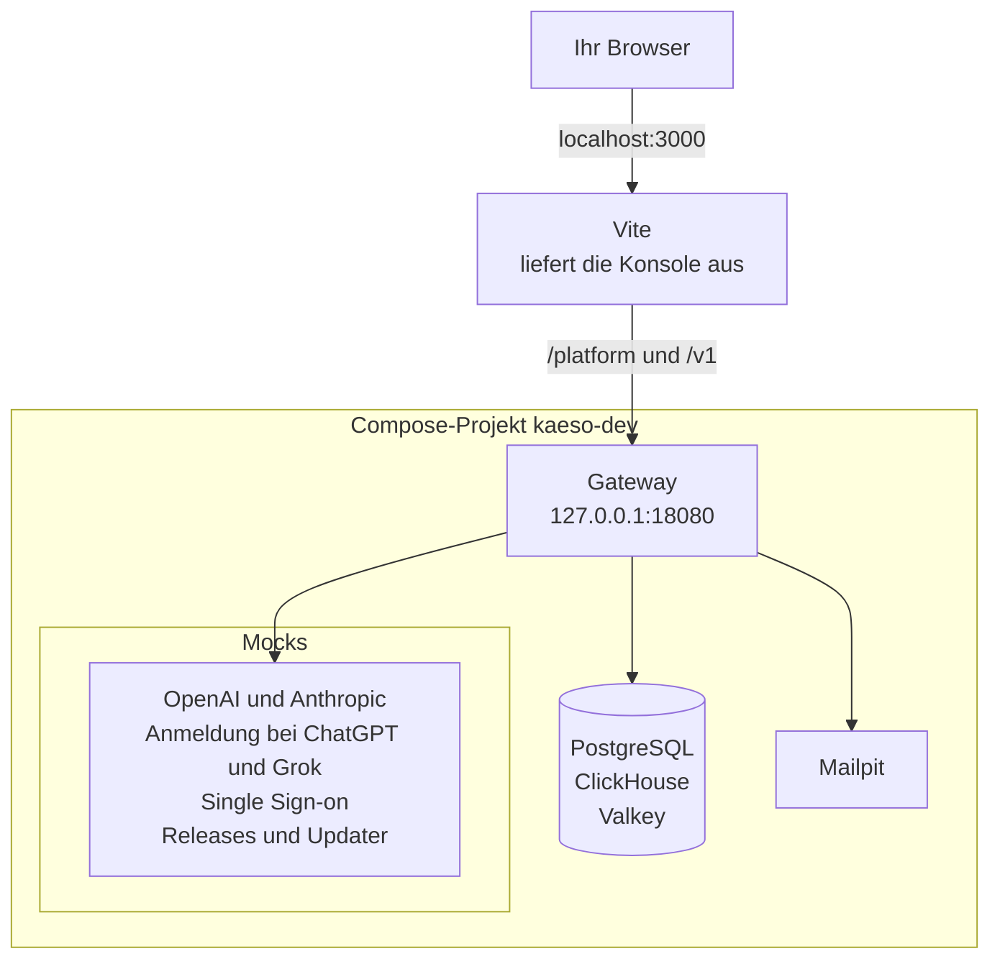

`pnpm stack:up` startet das Gateway aus Ihrem Checkout mit seinen Datenbanken und Mock-Diensten, sodass Sie ohne echten Anbieter an der Konsole arbeiten können. Der Stack ist das Compose-Projekt `kaeso-dev`, definiert in `deploy/compose.dev.yaml`.



Der Entwicklungsserver der Konsole leitet `/platform` und `/v1` an das Gateway weiter, sodass der Browser nur eine Adresse sieht. Das Sitzungscookie ist damit ein First-Party-Cookie, wie in Produktion hinter einem Reverse Proxy.

## Dienste ansehen

| Dienst | Was er ist | Auf Ihrem Rechner |
| --- | --- | --- |
| `gateway` | Das Gateway aus Ihrem Checkout | `127.0.0.1:18080` |
| `postgres`, `clickhouse`, `valkey` | Die Datenbanken des Gateways, auch von den Rust-Tests genutzt | `127.0.0.1:55432`, `127.0.0.1:58123`, `127.0.0.1:56379` |
| `mail` | Mailpit, das jede E-Mail des Gateways abfängt | `http://127.0.0.1:58025`, SMTP auf `127.0.0.1:51025` |
| `provider` | Eine Mock-API für OpenAI und Anthropic, sodass Sie keinen Anbieter-Schlüssel brauchen | Nur im Stack |
| `idp` | Ein Mock-Identitätsanbieter (OpenID Connect) für Single Sign-on | `http://idp.localhost:18091` |
| `releases` | Mock-Releases von Kaeso und ein Mock-Updater für **Einstellungen** › **Instanz** › **Updates** | `http://127.0.0.1:18092` |
| `accounts` | Ein Mock der ChatGPT-Anmeldung unter `auth.openai.com` sowie der Grok-Anmeldung und der xAI-API unter `auth.x.ai` und `api.x.ai` im Stack, mit einem Testzertifikat, dem das Gateway vertraut | `http://127.0.0.1:18093` |
| `master-key` | Schreibt den Hauptschlüssel des Gateways in ein Volume, bevor das Gateway startet | |

`pnpm stack:up` gibt den Einrichtungslink aus, solange die Installation keine Benutzer hat. Es liest den Link aus `kaeso setup-link` im Container des Gateways.

## Nur die Datenbanken starten

Die Rust-Tests brauchen nur die Datenbanken und Mailpit. Starten Sie sie, ohne das Gateway zu bauen:

```bash
docker compose -f deploy/compose.dev.yaml up -d --wait
```

## Update-Szenario wählen

Die Mock-Releases antworten so, als gäbe es ein Patch-Release und als funktioniere der Updater. Um einen anderen Zustand auf der Seite **Updates** zu sehen, senden Sie ein Szenario:

```bash
curl -X POST http://127.0.0.1:18092/__scenario -d '{"releases": "major", "outcome": "rolled_back"}'
```

Felder, die Sie weglassen, kehren zu ihrem Standard zurück:

| Feld | Werte |
| --- | --- |
| `releases` | `patch` (Standard), `major`, `manual`, `none`, `error` |
| `updater` | `ready` (Standard), `down` |
| `outcome` | `succeeded` (Standard), `rolled_back`, `needs_attention` |

## Stack stoppen

Entfernen Sie den Stack mit allen Daten, auch den Datenbanken der Rust-Tests:

```bash
pnpm stack:down
```

Das nächste `pnpm stack:up` beginnt leer.

## Ports und Images ändern

Setzen Sie diese Variablen vor `pnpm stack:up`, um einen Dienst auf einen anderen Port zu legen: `KAESO_GATEWAY_PORT`, `KAESO_POSTGRES_PORT`, `KAESO_CLICKHOUSE_PORT`, `KAESO_VALKEY_PORT`, `KAESO_MAIL_PORT`, `KAESO_MAIL_SMTP_PORT`, `KAESO_IDP_PORT`, `KAESO_RELEASES_PORT` und `KAESO_ACCOUNTS_PORT`. `KAESO_PUBLIC_URL` legt die Adresse der Konsole fest. Die Standardwerte stehen in `apps/console/scripts/stack.mjs`.

Um ein anderswo gebautes Image des Gateways zu nutzen, etwa ein Release, geben Sie es an. Der Stack überspringt dann den Build:

```bash
KAESO_GATEWAY_IMAGE=ghcr.io/logicplanes/kaeso-gateway:{{version}} pnpm stack:up
```

Laufen die Datenbanken anderswo, verweisen Sie die Rust-Tests mit `KAESO_TEST_POSTGRES_URL`, `KAESO_TEST_CLICKHOUSE_URL` und `KAESO_TEST_VALKEY_URL` darauf.

## Zweiten Stack betreiben

Ein zweiter Klon kann seinen eigenen Stack neben dem ersten betreiben. `KAESO_STACK_PROJECT` benennt sein Compose-Projekt, standardmäßig `kaeso-dev`, und das Image seines Gateways. `pnpm stack:up`, `pnpm seed` und `pnpm stack:down` arbeiten dann nur mit diesem Projekt.

Wählen Sie im zweiten Klon einen Projektnamen und freie Ports und starten Sie dann die Konsole:

```bash
export KAESO_STACK_PROJECT=kaeso-two KAESO_PUBLIC_URL=http://localhost:3001
export KAESO_GATEWAY_PORT=18180 KAESO_IDP_PORT=18191 KAESO_RELEASES_PORT=18192 KAESO_ACCOUNTS_PORT=18193
export KAESO_MAIL_PORT=58125 KAESO_MAIL_SMTP_PORT=51125
export KAESO_POSTGRES_PORT=55532 KAESO_CLICKHOUSE_PORT=58223 KAESO_VALKEY_PORT=56479
pnpm dev --port 3001
```

Führen Sie `pnpm seed` in derselben Shell aus, um diesen Stack zu füllen.

## Gateway aus dem Quellcode starten

Starten Sie das Gateway mit Cargo, wenn Sie es in Sekunden neu starten, einen Debugger anhängen oder mehr protokollieren wollen. Es nutzt die Datenbanken des Stacks.

1. Starten Sie den Mock-Anbieter in einem zweiten Terminal, damit keine Anfrage einen echten Anbieter erreicht:

   ```bash
   cargo run -p kaeso-testkit -- mock-provider 127.0.0.1:18090
   ```

2. Legen Sie im ersten Terminal frische Datenbanken an und richten Sie das Gateway auf sie und auf den Mock aus. Die Einstellungen legen außerdem eine öffentliche URL, eine Listen-Adresse, einen Hauptschlüssel und E-Mail fest, die nur protokolliert wird:

   ```bash
   export $(cargo run -q -p kaeso-testkit -- fresh-services)
   export KAESO_PROVIDERS_OPENAI_BASE_URL=http://127.0.0.1:18090
   export KAESO_PROVIDERS_ANTHROPIC_BASE_URL=http://127.0.0.1:18090
   export KAESO_PUBLIC_URL=http://localhost:3000
   export KAESO_LISTEN=127.0.0.1:8080
   export KAESO_MASTER_KEYS="$(cargo run -q -p kaeso -- master-key generate)"
   export KAESO_MAIL_TRANSPORT=log
   ```

3. Geben Sie den Einrichtungslink aus und starten Sie das Gateway:

   ```bash
   cargo run -q -p kaeso -- setup-link
   cargo run -p kaeso -- serve
   ```

4. Starten Sie in einem dritten Terminal die Konsole für dieses Gateway und öffnen Sie dann den Einrichtungslink:

   ```bash
   KAESO_GATEWAY_URL=http://127.0.0.1:8080 pnpm --filter kaeso-console dev
   ```

Um stattdessen die echten Anbieter aufzurufen, lassen Sie die beiden Zeilen `KAESO_PROVIDERS_…` weg. Die Datenbanken bleiben, bis Sie sie im ersten Terminal löschen:

```bash
cargo run -q -p kaeso-testkit -- drop-services "$KAESO_CLICKHOUSE_DATABASE"
```

[Konfiguration](../self-hosting/configuration.md) listet jede Einstellung auf.

## An der UI-Bibliothek arbeiten

Starten Sie den Showcase, der jede Komponente in jedem Zustand zeigt:

```bash
pnpm build:packages
pnpm --filter kaeso-showcase dev
```

Der Showcase läuft unter http://localhost:4321 und lädt neu, sobald Sie den Quellcode der Bibliothek ändern. Konsole und Dokumentation lesen dagegen den Build der Bibliothek. Nachdem Sie `packages/ui` oder `packages/tokens` geändert haben, führen Sie `pnpm build:packages` aus und starten ihre Entwicklungsserver neu.

## Docker mit Colima unter macOS betreiben

[Colima](https://github.com/abiosoft/colima) betreibt Docker unter macOS ohne Desktop-App. Installieren Sie es mit Homebrew und starten Sie es mit genug Platz für den Stack:

```bash
brew install colima docker docker-compose docker-buildx
colima start --cpu 4 --memory 8
```

Acht Gigabyte Speicher lassen Platz für die Datenbanken und den ersten Build des Gateways. Homebrew installiert Compose und Buildx als Plugins von `docker`. Damit `docker compose` sie findet, tragen Sie den Plugin-Ordner von Homebrew in `~/.docker/config.json` ein:

```json
{
  "cliPluginsExtraDirs": ["/opt/homebrew/lib/docker/cli-plugins"]
}
```

Auf einem Mac mit Intel-Prozessor liegt der Ordner stattdessen unter `/usr/local`. Colima teilt nur Ihren Home-Ordner mit seiner virtuellen Maschine, legen Sie den Checkout also dort ab.

## Nächste Schritte

- [Tests](testing.md): Führen Sie jede Prüfung aus, die eine Änderung bestehen muss.
- [Dokumentation schreiben](documentation.md): Starten Sie die Dokumentations-Website und schreiben Sie eine Seite.
- [Konsole](architecture/console.md): Sehen Sie, wie die Konsole Daten liest und ihren Code lädt.
