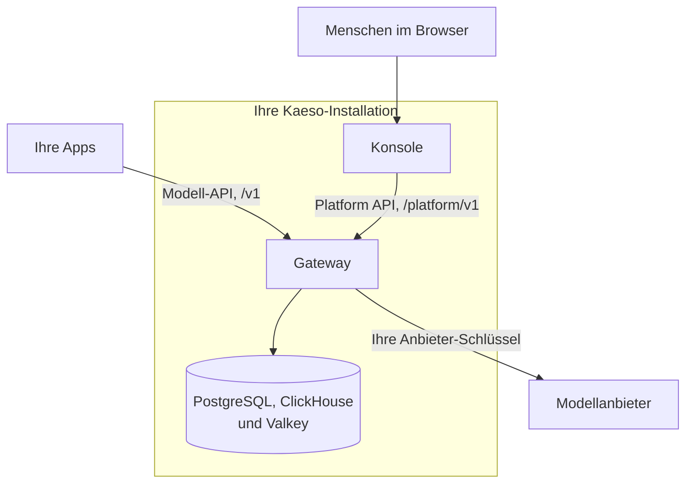

Kaeso ist ein Gateway, das Sie zwischen Ihren Apps und Modellanbietern wie OpenAI, Anthropic und Groq betreiben. Ihre Apps behalten die offiziellen SDKs, die sie schon nutzen, und ändern zwei Einstellungen: die Basis-URL und den Schlüssel. Kaeso prüft jede Anfrage gegen Ihre Schlüssel, Modelle und Limits, ruft den Anbieter mit Ihrem Anbieter-Schlüssel auf und protokolliert, was jede Anfrage gekostet hat.

So ruft eine App mit dem OpenAI SDK über Kaeso Claude auf:

```bash tab="curl"
curl https://kaeso.example.com/v1/responses \
  -H "Authorization: Bearer $KAESO_API_KEY" \
  -H "content-type: application/json" \
  -d '{"model": "claude-haiku-4-5", "input": "Write a haiku about gateways."}'
```

```python tab="Python"
import os
from openai import OpenAI

client = OpenAI(
    base_url="https://kaeso.example.com/v1",
    api_key=os.environ["KAESO_API_KEY"],
)

response = client.responses.create(
    model="claude-haiku-4-5",
    input="Write a haiku about gateways.",
)
print(response.output_text)
```

```ts tab="TypeScript"
import OpenAI from "openai";

const client = new OpenAI({
  baseURL: "https://kaeso.example.com/v1",
  apiKey: process.env.KAESO_API_KEY,
});

const response = await client.responses.create({
  model: "claude-haiku-4-5",
  input: "Write a haiku about gateways.",
});
console.log(response.output_text);
```

Diese Dokumentation beschreibt Kaeso {{version}}.

## Was Kaeso Ihnen bietet

- **Eine API für alle Anbieter.** Kaeso bedient OpenAI Chat Completions, Responses und Embeddings sowie Anthropic Messages. Jedes Chat-Format kann jedes Chat-Modell in Ihrem Katalog aufrufen, gleich welcher [Anbieter](concepts/providers.md) es bedient; ein OpenAI SDK spricht also auch mit Claude.
- **Anbieter-Schlüssel, die bei Ihnen bleiben.** Apps erhalten Kaeso-API-Schlüssel (`sk-kso-…`), die Sie begrenzen, befristen und deaktivieren können. Ihre Anbieter-Schlüssel sind mit einem Hauptschlüssel verschlüsselt, den nur Ihre Installation kennt.
- **Organisationen und Projekte.** Mitglieder, Rollen, Rechte und Dienstkonten sowie ein Modellkatalog mit Aliassen in jedem Projekt.
- **Limits und Budgets.** Anfrage- und Token-Raten sowie Token- und Ausgabenbudgets für ein Projekt, ein Mitglied oder einen einzelnen Schlüssel.
- **Anfrageprotokolle.** Status, Token, Kosten und Zeiten jeder Anfrage, und ihr Inhalt, wo Sie ihn behalten möchten.
- **Eine Konsole.** Eine Weboberfläche für all das, auf Englisch, Deutsch und vereinfachtem Chinesisch.

## Wie die Teile zusammenspielen



| Teil | Was es ist |
| --- | --- |
| Gateway | Der Server, den Ihre Apps aufrufen. Er stellt die Modell-API unter `/v1` und die Platform API unter `/platform/v1` bereit. Seine Daten speichert er in PostgreSQL, Anfrageprotokolle in ClickHouse und Zähler in Valkey. |
| Konsole | Die Weboberfläche, unter der Domain des Gateways ausgeliefert. Sie nutzt nur die Platform API; ein Skript kann also alles, was die Konsole kann. |
| KPP | Das Kaeso Provider Protocol: ein kanonisches Format für Modellanfragen, mit einem Codec, der jedes API-Format in beide Richtungen übersetzt. |

Der [Ablauf einer Anfrage](concepts/request-flow.md) verfolgt eine Anfrage durch das Gateway. Die [Formatübersetzung](concepts/format-translation.md) erklärt, was KPP zwischen Formaten überträgt und was es ablehnt.

## Wo Sie anfangen

- [Schnellstart](get-started/quick-start.md): Installieren Sie Kaeso auf einem Server, und senden Sie Ihre erste Anfrage.
- [Modelle aufrufen](get-started/calling-models.md): Rufen Sie Modelle aus Ihrem Code mit den SDKs von OpenAI und Anthropic auf.
- [Coding-Tools](get-started/coding-tools.md): Richten Sie Claude Code oder Codex auf Ihre Installation aus.
- [Konzepte](concepts/index.md): Erfahren Sie, wie Kaeso Anbieter, Anfragen, Formate und Rechte behandelt.
- [Die Konsole verwenden](console/index.md): Finden Sie sich in der Konsole zurecht.
- [API](api/index.md): Schlagen Sie die Modell-API und die Platform API nach.
- [Selbst hosten](self-hosting/index.md): Planen, betreiben und aktualisieren Sie eine Installation.
- [Entwicklung](development/index.md): Bauen, testen und ändern Sie Kaeso selbst.

Kaeso steht unter der MIT-Lizenz. Gateway, KPP, Konsole, UI-Bibliothek und diese Dokumentation liegen in einem Repository: [logicplanes/kaeso](https://github.com/logicplanes/kaeso).
