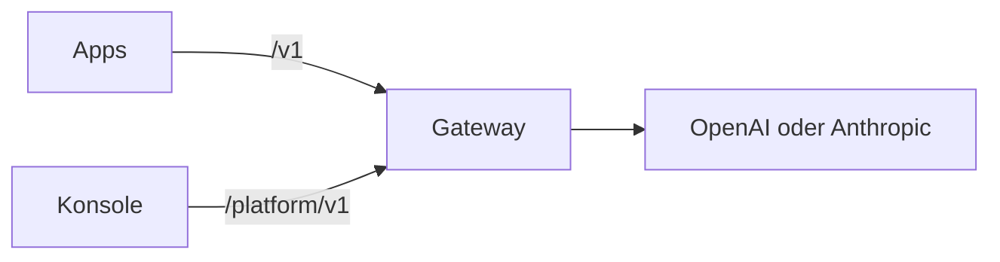

Kaeso steht zwischen den eigenen Apps und den Modellanbietern OpenAI und Anthropic. Apps rufen es mit den offiziellen SDKs auf, die sie ohnehin nutzen, und einem Kaeso-API-Schlüssel. Kaeso prüft Schlüssel, Modell und Limits, ruft den Anbieter mit dem eigenen Anbieter-Schlüssel auf und antwortet im Format, in dem die App gefragt hat. Jede Anfrage wird protokolliert und bepreist, sodass sichtbar ist, wer welches Modell genutzt hat und was es gekostet hat.

Der [Schnellstart](get-started/quick-start.md) führt von einem Server mit Docker bis zur ersten Anfrage.

Diese Dokumentation beschreibt Kaeso {{version}}.

## Was Kaeso bietet

- **Eine API für beide Anbieter.** Kaeso bedient OpenAI Chat Completions, Responses und Embeddings sowie Anthropic Messages. Jedes der drei Chat-Formate kann jedes Chat-Modell im Katalog aufrufen; ein OpenAI-SDK spricht also auch mit Claude.
- **Anbieter-Schlüssel bleiben im eigenen Haus.** Apps erhalten Kaeso-API-Schlüssel (`sk-kso-…`), die sich begrenzen, befristen und deaktivieren lassen. Anbieter-Schlüssel sind mit einem Hauptschlüssel verschlüsselt, den nur die eigene Installation kennt.
- **Organisationen und Projekte** mit Mitgliedern, Rollen und Rechten, Dienstkonten sowie einem Modellkatalog mit Aliassen in jedem Projekt.
- **Limits und Budgets**: Anfrage- und Token-Raten, Token- und Ausgabenbudgets für ein Projekt, ein Mitglied oder einen einzelnen Schlüssel.
- **Anfrageprotokolle und Nutzung**: Status, Tokens, Kosten und Zeiten jeder Anfrage, auf Wunsch auch ihr Inhalt.
- **Eine Konsole** für all das, auf Englisch, Deutsch und vereinfachtem Chinesisch.

## Wie die Teile zusammenspielen

| Teil | Was es ist |
| --- | --- |
| Gateway | Der Server, den Apps aufrufen. Er stellt die Modell-API unter `/v1` und die Platform API unter `/platform/v1` bereit und speichert seine Daten in PostgreSQL, Anfrageprotokolle in ClickHouse und Zähler in Valkey. |
| Konsole | Die Weboberfläche, unter der Domain des Gateways ausgeliefert. Sie nutzt nur die Platform API; ein Skript kann also alles, was die Konsole kann. |
| KPP | Das Kaeso Provider Protocol: ein kanonisches Format für Modellanfragen, mit einem Codec je API-Format, der in beide Richtungen übersetzt. |

Der [Ablauf einer Anfrage](concepts/request-flow.md) verfolgt eine Anfrage durch das Gateway, die [Formatübersetzung](concepts/format-translation.md) erklärt, was KPP zwischen Formaten überträgt und was es ablehnt.

## Wo anfangen

| Ziel | Seite |
| --- | --- |
| Kaeso installieren und die erste Anfrage senden | [Schnellstart](get-started/quick-start.md) |
| Modelle aus dem eigenen Code aufrufen | [Modelle aufrufen](get-started/calling-models.md) |
| Kaeso aus Claude Code oder Codex nutzen | [Coding-Tools](get-started/coding-tools.md) |
| Verstehen, wie Kaeso Anfragen und Rechte behandelt | [Konzepte](concepts/index.md) |
| Sich in der Konsole zurechtfinden | [Die Konsole nutzen](console/index.md) |
| Die APIs nachschlagen | [API](api/index.md) |
| Eine Installation planen und betreiben | [Selbst hosten](self-hosting/index.md) |
| An Kaeso selbst arbeiten | [Entwicklung](development/index.md) |

Kaeso steht unter der MIT-Lizenz. Gateway, KPP, Konsole, UI-Bibliothek und diese Dokumentation liegen in einem Repository: [logicplanes/kaeso](https://github.com/logicplanes/kaeso).
