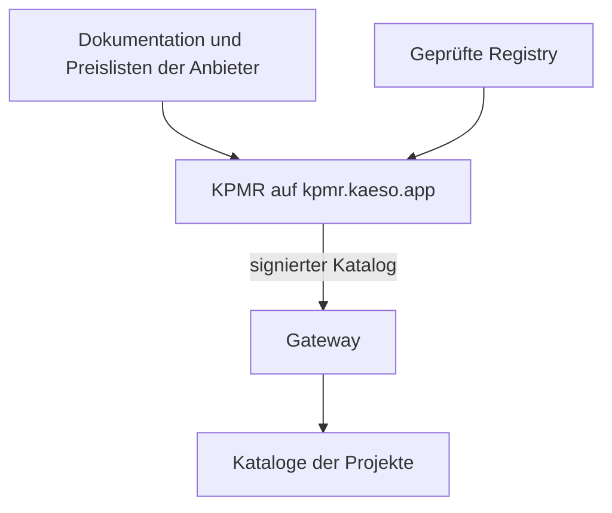

Jedes Modell im Katalog eines Projekts beginnt mit den Werten aus KPMR, der Kaeso Provider & Model Registry: Preise, Limits, Ein- und Ausgaben und was das Modell annimmt. Wenn Sie wissen, woher sie kommen, verstehen Sie, warum sich ein Preis von selbst ändert und wie Sie Kaeso ohne Internetzugang betreiben.

## Was KPMR ist

KPMR ist ein Dienst, den Logicplanes unter [kpmr.kaeso.app](https://kpmr.kaeso.app/de) betreibt. Er sammelt, was Anbieter über ihre Modelle veröffentlichen, prüft es in seiner eigenen Registry und liefert das Ergebnis als ein signiertes Dokument aus, den **KPMR-Katalog**. Jedes Kaeso-Gateway liest ihn, und auch alle anderen dürfen ihn lesen, ohne Schlüssel und ohne Konto.

## Warum Kaeso eine eigene Registry hat

Ein Gateway braucht mehr als eine Liste von Modellen: Es rechnet Budgets zu diesen Preisen ab und lehnt Anfragen ab, die ein Modell nicht annimmt. KPMR ergänzt, was Kaeso braucht:

- **Korrekturen und Überschreibungen.** Ein falscher Preis, ein falsches Limit oder eine falsche Fähigkeit wird zuerst in KPMR korrigiert, und die Korrektur erreicht jede Installation bei ihrer nächsten Prüfung.
- **Neue Modelle und Abschaltungen.** KPMR nimmt ein Modell oder einen Anbieter auf, sobald es erscheint, und hält fest, an welchem Tag ein Anbieter ein Modell abschaltet. Ein abgeschaltetes Modell bleibt gelistet, sodass seine Geschichte und seine früheren Preise lesbar bleiben.
- **Fakten für das Gateway.** Ob ein Claude-Modell adaptives Thinking oder eine erzwungene Tool-Wahl annimmt, welche Aufwandsstufen es kennt, den Preis für Ein-Stunden-Cache-Schreibvorgänge und in welchem API-Format Kaeso ein Modell aufruft.

Jeder Eintrag der Registry nennt seine Quellen, etwa die Dokumentation eines Anbieters oder eine aufgezeichnete Live-Anfrage. Die Seite eines Modells auf kpmr.kaeso.app listet sie mit dem Tag, an dem jede geprüft wurde.

## Begriffe

| Begriff | Bedeutung |
| --- | --- |
| Katalog | Das signierte JSON-Dokument, das KPMR ausliefert: jeder Anbieter, den es kennt, mit seinen Modellen und Modelllinien ([Katalogformat](catalogue.md)) |
| Registry | Die geprüften Einträge von KPMR, jeder mit seinen Quellen, die korrigieren und ergänzen, was Anbieter veröffentlichen |
| Revision | Die Version des Katalogs: der Zeitpunkt, zu dem er gebaut wurde, und ein Hash seines Inhalts. Sie ändert sich, sobald sich der Inhalt ändert |
| Modelllinie | Ein Name wie `claude-opus-latest`, den KPMR auf das neueste stabile Modell einer Familie eines Anbieters zeigen lässt ([Abschaltungen und Modelllinien](lifecycle-and-lines.md)) |
| Lebenszyklus | Die Tage, an denen ein Anbieter die Abschaltung eines Modells ankündigt, es abkündigt und abschaltet, und der Nachfolger, den er empfiehlt |
| Eingebauter Snapshot | Die Kopie des Katalogs, die jedes Kaeso-Release mitbringt und die gilt, bis das Gateway KPMR erreicht ([Modelldaten aktuell halten](sync.md)) |

## Die Registry ansehen

[kpmr.kaeso.app](https://kpmr.kaeso.app/de) zeigt die Registry auf Englisch, Deutsch und vereinfachtem Chinesisch. Seine Seiten listen nur die Anbieter, die Kaeso aufruft; die [KPMR-API](api.md) enthält jeden Anbieter.

| Seite | Was sie zeigt |
| --- | --- |
| [Modelle](https://kpmr.kaeso.app/de/models) | Jedes Modell der Anbieter, die Kaeso aufruft. Suchen Sie nach Name oder ID, filtern Sie nach Anbieter, Hersteller, Modalität, Fähigkeit, Kontext, Preis, Status und Erscheinungsdatum, und sortieren Sie nach Datum, Name, Preis oder Kontext. Die Filter stehen in der Adresse, sodass ein Link die Ansicht teilt |
| [Anbieter](https://kpmr.kaeso.app/de/providers) | Jeder Anbieter mit seinen Modellen, seinen Modelllinien und deren Verlauf |
| Ein Modell, etwa [Claude Opus 5.5](https://kpmr.kaeso.app/de/models/anthropic/claude-opus-5-5) | Preise, kommende Preise, Limits, Fähigkeiten, der Lebenszyklus, die Linien, die darauf zeigen, die Quellen des Registry-Eintrags und was ein Gateway dafür erhält, auch als JSON |
| [Abkündigungen](https://kpmr.kaeso.app/de/deprecations) | Jede angekündigte Abschaltung, die nächste zuerst, mit dem Nachfolger, den jeder Anbieter empfiehlt |
| [Katalog nutzen](https://kpmr.kaeso.app/de/catalogue) | Beispiele für Ihren eigenen Code: abrufen, eine Anfrage bepreisen, Modelle finden, die Signatur prüfen |

**Suchen** in der Seitenleiste findet Modelle, Anbieter und Seiten von jeder Seite aus.

## Nächste Schritte

- [Modelldaten aktuell halten](sync.md): Legen Sie fest, wie oft das Gateway den Katalog abruft, synchronisieren Sie sofort und betreiben Sie Kaeso ohne Internetzugang.
- [Katalogformat](catalogue.md): Schlagen Sie jedes Feld des Katalogs nach.
- [KPMR-API](api.md): Rufen Sie den Katalog und die kleineren Dokumente in Ihrem eigenen Code ab und prüfen Sie die Signatur.
- [Abschaltungen und Modelllinien](lifecycle-and-lines.md): Sehen Sie, wie KPMR Abschaltungen festhält und Namen wie `claude-opus-latest` weiterbewegt.
