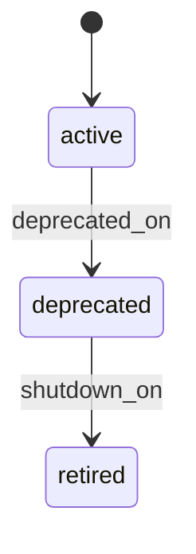

Anbieter schalten Modelle zu festen Terminen ab und veröffentlichen neue Modelle derselben Familie. KPMR hält beides im Katalog fest, sodass das Gateway die Projekte warnen kann, die ein auslaufendes Modell noch aufrufen, und ein Name wie `claude-opus-latest` das neueste Modell erreicht, ohne dass jemand einen Alias ändert.

## Wie KPMR eine Abschaltung festhält

KPMR liest die Abkündigungsseiten der Anbieter regelmäßig und schlägt jedes neue Datum zur Prüfung vor; nichts erreicht den Katalog ungeprüft. Die geprüften Daten kommen in den `lifecycle` des Modells, mit der Ankündigung des Anbieters als `source` und dem empfohlenen Nachfolger `replacement`, einem Modell desselben Anbieters ([Katalogformat](catalogue.md#lebenszyklus)).

Die Daten gelten ab ihrem Tag: `status` wird an `deprecated_on` zu `deprecated` und an `shutdown_on` zu `retired`, ohne neues Release von Kaeso. Das Gateway prüft den Abschalttag auch selbst, sodass ein Modell an diesem Tag schon vor dem nächsten Abruf als abgeschaltet gilt. Ein abgeschaltetes Modell bleibt mit seinen Preisen im Katalog, sodass seine Geschichte und die Kosten vergangener Anfragen lesbar bleiben.

Drei Stellen zeigen die Daten:

- **[Abkündigungen](https://kpmr.kaeso.app/de/deprecations)** auf kpmr.kaeso.app listet jede angekündigte Abschaltung der Anbieter, die Kaeso aufruft, die nächste zuerst, und filtert nach Anbieter.
- **Die Seite eines Modells** zeigt die Daten mit einem Countdown, den Nachfolger und die Quelle in ihrer Karte **Lebenszyklus**.
- **`/v1/deprecations.json`** listet dieselben Abschaltungen über alle Anbieter für Ihre eigenen Werkzeuge ([KPMR-API](api.md#abkündigungen)).

## Wie Projekte eine Abschaltung sehen

Sobald der Katalog die Daten trägt, handelt das Gateway in jedem Projekt, das das Modell im Katalog hat ([Modell-Lebenszyklus](../concepts/model-lifecycle.md)):

- **In der Konsole** listet der Tab **Läuft aus** die auslaufenden Modelle des Projekts mit ihren Aufrufern, und Hinweise auf der Seite **Modelle** und in der Übersicht der Organisation warnen vor kommenden Abschaltungen.
- **In Antworten** tragen die Header `Deprecation`, `Sunset` und `Link` die Daten und den Nachfolger zu SDKs, Proxys und Ihren Protokollen.
- **Als Benachrichtigungen** erhalten Mitglieder **Modell abgekündigt** und **Modell wird bald abgeschaltet**, die auch als Webhook-Ereignisse kommen.
- **Nach der Abschaltung** scheitert eine Anfrage an das Modell mit `410` und nennt den Tag und den Nachfolger. **Auf Nachfolger umstellen** stellt die Aliasse des Projekts vorher auf den Nachfolger um, und zwei Projekteinstellungen können sie am Tag selbst umstellen oder mit dem Nachfolger antworten.

## Modelllinien

Eine Modelllinie ist ein Name wie `claude-opus-latest`, der dem neuesten stabilen Modell einer Familie eines Anbieters folgt. KPMR bildet die Linien selbst, eine pro `family`, benannt `<family>-latest`.

Eine Linie zeigt auf das Modell der Familie mit dem neuesten `release_date`, das `active` ist, die Ausgabearten hat, die die meisten Modelle der Familie haben, und eine eigene Version ist. Vorschauen, die eigenen `-latest`-Namen des Anbieters, datierte Snapshots eines Modells, das der Anbieter auch undatiert anbietet, und Modelle, die nur entscheiden, führen nie eine Linie. Ein neues Release bewegt seine Linie im nächsten Build: `since` wird sein Erscheinungsdatum und `previous` das Modell, das vorher führte.

Wo die Familie allein nicht entscheiden kann, korrigiert die Registry eine Linie, mit einer Quelle wie jeder Eintrag:

| Eintrag | Was er tut |
| --- | --- |
| Halten | Lässt die Linie, wo sie ist, etwa solange ein neues Modell an seinem ersten Tag scheitert |
| Modell | Lässt die Linie auf ein gewähltes Modell des Anbieters zeigen, oder fügt eine Linie hinzu, die keine Familie nennt, etwa `gpt-mini-latest` |
| Ausschließen | Hält Modelle aus der Linie heraus |

Die Seite eines Anbieters auf kpmr.kaeso.app zeigt jede Linie mit dem Modell, auf das sie zeigt, ihrem Verlauf, wie sich die Preise beim letzten Wechsel geändert haben, und ob sie gehalten oder festgelegt ist.

## Wie Projekte einer Linie folgen

Ein Projekt fügt eine Linie wie ein Modell unter **Modelle hinzufügen** hinzu, und Apps rufen sie als `anthropic/claude-opus-latest` auf. Das Projekt wählt, wie es den Wechseln von KPMR folgt: sofort, nach Rückfrage, nach 1 bis 30 Tagen oder gar nicht. Eine Linie wechselt nie zu einem Modell, das das Projekt nicht aufrufen kann ([Modelllinien](../console/models-and-aliases.md#modelllinien)).

## Nächste Schritte

- [Modell-Lebenszyklus](../concepts/model-lifecycle.md): Sehen Sie, wie Kaeso Projekte vor auslaufenden Modellen warnt und sie auf den Nachfolger umstellt.
- [Modelle und Aliasse](../console/models-and-aliases.md#modelllinien): Fügen Sie einem Projekt eine Modelllinie hinzu und wählen Sie, wie sie folgt.
- [Katalogformat](catalogue.md#lebenszyklus): Schlagen Sie die Felder für Lebenszyklus und Linien nach.
