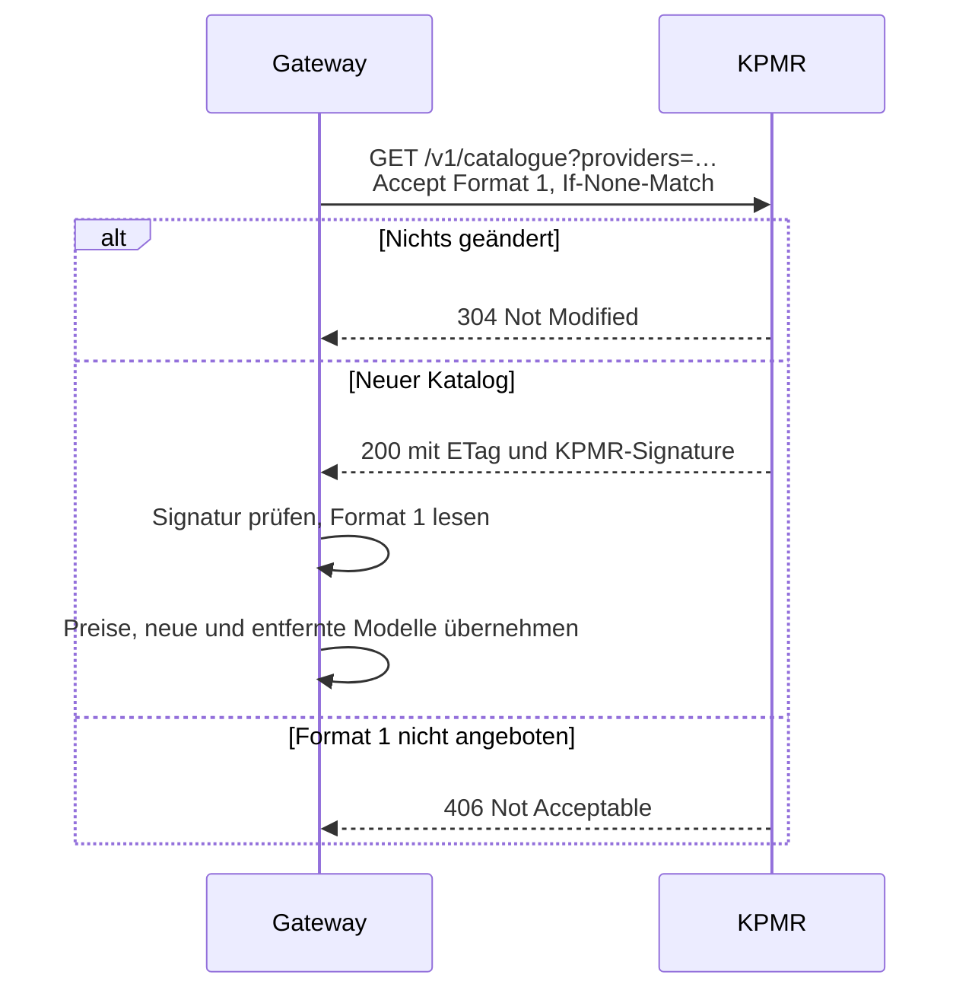

Das Gateway hält seine Modelldaten selbst aktuell: Es fragt KPMR regelmäßig nach dem Katalog, prüft die Signatur und übernimmt, was sich geändert hat. Sie legen fest, wie oft es fragt, können sofort abrufen und bestimmen, woher es abruft.



## Wie oft das Gateway fragt

Ein Job prüft alle fünf Minuten, ob das Gateway KPMR wieder fragen muss. `kpmr.interval` bestimmt, wann das der Fall ist ([Konfiguration](../self-hosting/configuration.md#kpmr)):

| `kpmr.interval` | Wann das Gateway fragt |
| --- | --- |
| `auto`, der Standard | Wann `refresh_seconds` des Katalogs es sagt, gehalten zwischen 5 Minuten und 24 Stunden. KPMR verlangt derzeit eine Stunde |
| Eine Dauer von mindestens `5m`, etwa `6h` | In diesem Abstand, gleich was der Katalog sagt |

Nach einem fehlgeschlagenen Versuch fragt das Gateway innerhalb einer Stunde erneut, auch bei einem längeren Intervall. Ein unveränderter Katalog kostet nur eine kurze Antwort `304`.

Ein Intervall unter 5 Minuten, etwa `1m` oder `0`, hält das Gateway beim Start an, bevor es die Datenbanken berührt. Frühere Releases nahmen jede Dauer an und riefen höchstens alle 5 Minuten ab; [Upgrade](../self-hosting/upgrades.md#upgrade-auf-070) beschreibt, wie ein Update mit einer solchen Einstellung endet. Der Fehler nennt die Einstellung und die Lösung:

```text wrap
KAESO_KPMR_INTERVAL (kpmr.interval) is 1m, and it must be `auto` or at least 5m: set KAESO_KPMR_INTERVAL=5m or longer, or `interval = "5m"` under `[kpmr]` in the configuration file, or remove it for `auto`
```

`kaeso config check` gibt denselben Fehler aus, ohne das Gateway zu starten ([Das Gateway startet immer wieder neu](../self-hosting/troubleshooting.md#das-gateway-startet-immer-wieder-neu)).

## Jetzt synchronisieren

Um den Katalog sofort abzurufen, etwa nachdem KPMR einen Preis korrigiert hat, wählen Sie **Jetzt synchronisieren** auf der Karte **Modelldaten** unter **Instanz** › **System** ([Instanzverwaltung](../console/instance-administration.md#system-prüfen)), oder führen Sie dies auf dem Server aus:

```bash
docker compose exec gateway kaeso kpmr sync
```

Der Befehl gibt aus, was sich geändert hat, und jedes Gateway der Installation übernimmt die neuen Daten:

```text
Applied new model data: 3 price changes, 0 models no longer listed, 0 listed again. Every gateway reloads it.
```

Hat KPMR nichts Neues, gibt er `The model data is current: KPMR has nothing new.` aus. Beide Wege brauchen `kpmr.sync` an. Schlägt der Abruf fehl, gibt der Befehl den Grund aus.

## Was das Gateway übernimmt

Die Anfrage nennt die Anbieter, die diese Version von Kaeso aufruft, verlangt `application/vnd.kaeso.kpmr+json; version=1` und sendet `User-Agent: kaeso-gateway/<version>`; Daten der Installation gehen nicht mit. Weiterleitungen müssen auf demselben Host bleiben und dürfen `https` nicht verlassen, höchstens drei. Ein Abruf, der länger als 60 Sekunden dauert, oder ein Dokument über 64 MiB scheitert.

Übernimmt das Gateway einen neuen Katalog:

- **Preise und Werte ändern sich** für die Modelle jedes Projekts, außer den Feldern, die ein Projekt [überschreibt](../console/models-and-aliases.md#werte-eines-modells-ändern).
- **Preisänderungen und nicht mehr geführte Modelle** kommen in das [Audit-Log](../console/instance-administration.md#audit-log-lesen) der Instanz, eine Preisänderung außerdem in das [Audit-Log](../console/organizations-and-projects.md#audit-log-lesen) jeder Organisation, deren Projekt den neuen Preis zahlt. Ein Projekt behält ein Modell, das KPMR nicht mehr führt, mit seinen letzten bekannten Werten.
- **Einen Modelleintrag, den es nicht lesen kann,** lässt es weg und protokolliert eine Warnung, die ihn nennt. Der Rest des Katalogs gilt trotzdem.

Schlägt ein Versuch fehl, bleiben die verwendeten Daten in Gebrauch, und **Instanz** › **System** zeigt den Fehler unter **Modelldaten**. Um von einer Synchronisierung zu erfahren, die immer wieder scheitert, alarmieren Sie auf `kaeso_kpmr_last_attempt_failed` ([Monitoring](../self-hosting/monitoring.md#metriken)).

## Signaturen und vertrauenswürdige Schlüssel

KPMR signiert jeden Katalog mit Ed25519 und sendet die Signatur im Header `KPMR-Signature` als `keyid=<key id>, ed25519=<signature>`, über die genauen Bytes des Bodys. Das Gateway vertraut dem eingebauten Schlüssel von KPMR, `kpmr-2026-10`, und den Schlüsseln in `kpmr.public_keys`. Es lehnt einen Katalog ab, der nicht signiert ist, mit einem Schlüssel signiert ist, dem es nicht vertraut, oder dessen Signatur nicht passt, und behält die Daten, die es hat.

Die Signatur macht einen Spiegel sicher: Er darf den Katalog von überall ausliefern, solange er die Antwort von KPMR Byte für Byte mit ihrem Header `KPMR-Signature` weitergibt, etwa als zwischenspeichernder Reverse Proxy, der die Header behält. Eine statische Kopie der Datei hat keinen Signatur-Header und wird abgelehnt. Betreiben Sie eine eigene Registry, tragen Sie ihren öffentlichen Schlüssel als `<key id>:<base64 Ed25519 public key>` in `kpmr.public_keys` ein.

## Ohne Internetzugang

Jedes Release von Kaeso enthält einen Snapshot des Katalogs. Eine neue Installation startet damit, und er bleibt in Gebrauch, solange das Gateway KPMR nicht erreicht. Für eine Installation ohne Internetzugang wählen Sie in der [Konfiguration](../self-hosting/configuration.md#kpmr) eines davon:

- `kpmr.sync = false` behält den eingebauten Snapshot. Jedes Upgrade bringt einen neueren mit.
- `kpmr.url` auf einen Spiegel in Ihrem Netz, der die Antwort von KPMR Byte für Byte mit ihrem Header `KPMR-Signature` weitergibt, etwa einen zwischenspeichernden Reverse Proxy; eine statische Datei wird abgelehnt.

## Nächste Schritte

- [Konfiguration](../self-hosting/configuration.md#kpmr): Schlagen Sie die Einstellungen `kpmr` nach.
- [Katalogformat](catalogue.md): Sehen Sie jedes Feld, das das Gateway liest.
- [Modelle und Aliasse](../console/models-and-aliases.md): Fügen Sie Modelle aus KPMR zu einem Projekt hinzu und überschreiben Sie ihre Werte.
- [Anforderungen](../self-hosting/requirements.md): Sehen Sie, welche Verbindungen eine Installation aufbaut, darunter die zu KPMR.
