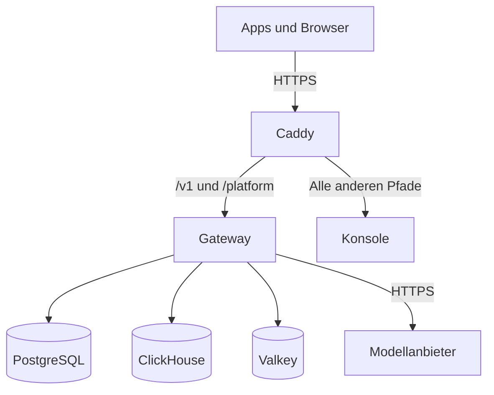

Eine Kaeso-Installation ist ein Docker-Compose-Projekt, das unter einer Domain antwortet. Wenn Sie seine Teile kennen, wissen Sie, was Sie sichern, welche Ports Sie öffnen und wo Sie bei einem Fehler nachsehen.

## Dienste

`compose.yaml` startet sechs Dienste. Die Datei legt jedes Image auf eine Version und einen Digest fest: die Images von Gateway, Konsole und Updater auf die Version des Releases und die Digests, die sein Release-Workflow gebaut hat. Caddy läuft aus dem Image der Konsole, das Kaesos eigenen Build von Caddy enthält.

| Dienst | Aufgabe | Seine Daten |
| --- | --- | --- |
| `caddy` | Terminiert TLS mit einem Zertifikat, das er selbst bezieht und erneuert, und leitet Anfragen weiter | Die Volumes `caddy_data` und `caddy_config` sowie `caddy_site`, das er nur liest |
| `gateway` | Stellt die Modell-API, die Platform API und die Health-Checks auf Port 8080 bereit und die Metriken auf Port 9100. Ruft die Anbieter auf und sendet E-Mails | Keine |
| `console` | Stellt die Weboberfläche bereit | Keine |
| `postgres` | Speichert Benutzer, Organisationen, Projekte, Schlüssel, verschlüsselte Anbieter-Schlüssel, Kataloge, Limits, Nutzung und Audit-Logs | Das Volume `postgres` |
| `clickhouse` | Speichert Anfrageprotokolle und Nutzungsaggregate | Das Volume `clickhouse` |
| `valkey` | Hält Raten- und Budgetzähler und gemeinsame Caches | Das Volume `valkey` |

Der optionale Updater fügt zwei Dienste hinzu, `updater` und `docker-proxy`, die Releases aus der Konsole installieren ([Der Updater](upgrades.md#der-updater)). Bevor Caddy startet, läuft `caddy-init` einmal und übergibt die Volumes von Caddy dem Benutzer, als der Caddy läuft. Außerdem legt es das Caddyfile und die Update-Seite aus der `compose.yaml` in `caddy_site` ab, da Compose einem Container mit schreibgeschütztem Dateisystem keine Dateien übergeben kann. Ebenso übergibt `updater-init` dem Updater seine Volumes. Der Gruppe des Updaters gibt es Lese- und Schreibrecht auf die `compose.yaml`, die der Updater an Ort und Stelle neu schreibt, und allen anderen nimmt es das Schreibrecht.

## Dateien

Eine Installation ist ein Ordner, den nur Sie lesen können. Er enthält diese Dateien:

| Datei | Enthält |
| --- | --- |
| `compose.yaml` | Die Dienste, aus dem Kaeso-Release. Ein Upgrade ersetzt sie. |
| `.env` | Ihre Einstellungen: die Domain, die Datenbankpasswörter und E-Mail ([Konfiguration](configuration.md#einstellungen-in-der-env)). |
| `master-keys` | Die Hauptschlüssel, die das Gateway als Docker-Secret `master_keys` liest. Nur der Benutzer des Gateways, 65532, kann sie lesen. |
| `compose.override.yaml` | Optional. Ihre eigenen Änderungen an den Diensten, die ein Upgrade beibehält. |

Bewahren Sie Kopien von `.env` und `master-keys` getrennt von den Datenbank-Backups auf ([Backups und Hauptschlüssel](backups.md)).

## Der erste Start

`docker compose up -d --wait` startet die Dienste in dieser Reihenfolge und kehrt zurück, sobald jeder als gesund gemeldet ist:

1. PostgreSQL, ClickHouse und Valkey starten. Das Gateway wartet, bis PostgreSQL und Valkey gesund sind.
2. Das Gateway prüft seine Einstellungen. Eine fehlende oder ungültige Einstellung hält es an, mit einer Meldung, die die Einstellung nennt, nie ihren Wert.
3. Das Gateway migriert PostgreSQL, bevor es irgendetwas bereitstellt. ClickHouse migriert es im Hintergrund und versucht es erneut, bis ClickHouse antwortet.
4. Solange die Installation keine Benutzer hat, protokolliert das Gateway, dass sie noch nicht eingerichtet ist. Den Einrichtungslink protokolliert es nie, denn wer das Protokoll liest, könnte damit die Installation übernehmen.
5. Sobald Gateway und Konsole gesund sind, startet Caddy und bezieht das Zertifikat im Hintergrund.

`kaeso setup-link` gibt den Einrichtungslink aus, der den ersten Benutzer anlegt. Dieser wird Instanz-Admin und Inhaber der ersten Organisation. Alle anderen kommen per Einladung dazu oder registrieren sich, wo die Instanz es erlaubt ([Instanzverwaltung](../console/instance-administration.md)).

## Isolation

Die Dienste teilen so wenig wie möglich:

- PostgreSQL, ClickHouse und Valkey liegen in einem internen Netzwerk ohne Weg nach außen, und nur das Gateway erreicht sie.
- Kein Container kann Rechte hinzugewinnen, und jeder startet ohne Linux-Capabilities. Caddy, Gateway, Konsole und Updater laufen als Benutzer ohne Sonderrechte auf schreibgeschützten Dateisystemen. Caddy belegt die Ports 80 und 443 ohne Capability, weil sein Container Benutzern ohne Sonderrechte jeden Port erlaubt, und sein Admin-Endpunkt ist aus.
- Valkey läuft von Anfang an als der eigene Benutzer seines Images, ohne Capabilities. PostgreSQL und ClickHouse bekommen nur die Capabilities zurück, die ihre Images beim Start brauchen. Damit übergibt jeder sein Datenverzeichnis dem eigenen Benutzer und läuft danach nicht mehr als root. `caddy-init` bekommt nur die Rechte, jedes Verzeichnis zu lesen und Eigentümer zu ändern, und `updater-init` zusätzlich das Recht, die Rechte einer Datei zu ändern.
- Jeder Dienst hat eine Speicher- und eine Prozessgrenze, und Docker rotiert sein Log bei 10 MB und behält fünf Dateien ([Container-Grenzen](configuration.md#container-grenzen)).
- Das Gateway meldet sich bei PostgreSQL als `kaeso` an. Diesem Benutzer gehört die Kaeso-Datenbank, ein Superuser ist er nicht. Der ClickHouse-Benutzer `kaeso` kann keine Benutzer und Berechtigungen verwalten, und Valkey verlangt von jeder Verbindung ein Passwort, das es aus einer Datei liest statt von seiner Befehlszeile.
- Cache-Einträge, die Instanzen über Valkey teilen, tragen eine Signatur mit einem aus dem Master-Schlüssel abgeleiteten Schlüssel, und ein Eintrag ohne sie wird erneut aus PostgreSQL geladen. Valkey hält trotzdem die Zähler der Limits und meldet jeder Instanz, was sich geändert hat, teilen Sie es also nie mit etwas außerhalb der Vertrauensgrenze der Installation.
- Caddy sendet `Strict-Transport-Security` und leitet den Metrik-Port des Gateways, 9100, nie weiter.

## Mehrere Gateways

Das Gateway hält keinen eigenen Zustand. Für mehrere Instanzen stellen Sie sie hinter denselben Proxy und verbinden sie mit denselben PostgreSQL-, ClickHouse- und Valkey-Diensten:

- Valkey meldet jeder Instanz, wenn sich ein Eintrag im Cache ändert. Solange eine Instanz Valkey nicht hört, behält sie Geladenes höchstens zwei Sekunden, sodass eine Änderung sie innerhalb von zwei Sekunden erreicht.
- Hintergrundjobs laufen jeweils auf einer Instanz, unter PostgreSQL-Sperren.
- Migrationen laufen unter einer Sperre, sodass eine Instanz migriert, während die anderen warten.
- Jede Instanz puffert und schreibt ihre eigenen Zeilen der Anfrageprotokolle und ihre eigene Nutzung.

## Namen, die bleiben

Jedes Release behält diese Namen, damit eine neue `compose.yaml` Ihre Daten findet:

- Das Compose-Projekt `kaeso` mit seinen Diensten `caddy-init`, `caddy`, `gateway`, `console`, `postgres`, `clickhouse` und `valkey`, dazu `updater-init`, `updater` und `docker-proxy` im Profil `updater`.
- Die Volumes `kaeso_postgres`, `kaeso_clickhouse` und `kaeso_valkey` für Daten, `kaeso_caddy_data` und `kaeso_caddy_config` für Zertifikate, `kaeso_caddy_site` für die Konfiguration von Caddy sowie `kaeso_maintenance` und `kaeso_updater` für den Updater.
- Die Images `ghcr.io/logicplanes/kaeso-gateway`, `ghcr.io/logicplanes/kaeso-console` und `ghcr.io/logicplanes/kaeso-updater`, getaggt mit der Version des Releases.

> [!WARNING]
> Führen Sie Compose im Ordner der Installation aus, ohne `-p` oder `COMPOSE_PROJECT_NAME`. Unter einem anderen Projektnamen startet Compose mit neuen, leeren Volumes.
