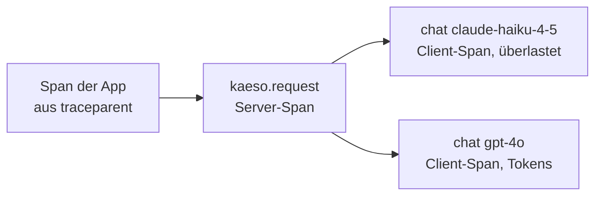

Das Gateway meldet seinen Zustand an zwei Endpunkten, stellt Prometheus-Metriken auf einem eigenen Port bereit und schreibt JSON-Protokolle. In der Konsole zeigt **Instanz** › **System** denselben Zustand, die laufende Version, den Puffer der Anfrageprotokolle und den Speicher.

## Health-Checks

| Endpunkt | Antwortet |
| --- | --- |
| `GET /healthz` | `{"status": "ok"}`, solange der Prozess läuft |
| `GET /readyz` | `ready`, `degraded` oder `not_ready`, mit dem Zustand von `postgres`, `valkey` und `clickhouse`, jeweils `ok` oder `down`, und `clickhouse` als `off`, solange Anfrageprotokolle aus sind |

`/readyz` antwortet 503 mit `not_ready`, wenn PostgreSQL oder Valkey nicht erreichbar sind. Ist ClickHouse nicht erreichbar, noch nicht migriert oder hat es das letzte Schreiben von Anfrageprotokollen abgelehnt, antwortet es 200 mit `degraded`, denn Anfrageprotokolle halten nie Anfragen auf. Die Protokolle warten im Speicher, bis die Migrationen gelaufen sind. Bei [ausgeschalteten Anfrageprotokollen](installation.md#festlegen-wie-anfrageprotokolle-gespeichert-werden) ist ClickHouse `off` und die Installation `ready`.

Beide Endpunkte liegen auf Port 8080 des Gateways. Caddy leitet dorthin nur `/v1/`, `/v1beta/`, `/v2/`, `/platform/`, `/mcp`, `/mcp/`, `/oauth/`, `/ingest/` und `/.well-known/oauth-` weiter, unter Ihrer Domain erreichen diese Pfade also die Konsole. Der Health-Check des Gateway-Containers ruft `/healthz` auf, und `docker compose ps` zeigt das Ergebnis. So lesen Sie `/readyz` auf dem Server:

```bash
docker compose exec gateway kaeso healthcheck --ready
```

Das Image des Gateways hat keine Shell und kein `curl`. Eine Plattform, die mit einem Befehl im Container prüft, verwendet daher `kaeso healthcheck`:

| Befehl | Fragt | Endet mit 0 | Passt zu |
| --- | --- | --- | --- |
| `kaeso healthcheck` | `/healthz` | solange der Prozess antwortet | einer Liveness-Prüfung, die den Container neu startet: Ein Datenbankausfall darf nicht jedes Gateway neu starten |
| `kaeso healthcheck --ready` | `/readyz`, und gibt die Antwort aus | bei `ready` und `degraded`, nicht bei `not_ready` | einer Readiness-Prüfung, die Verkehr von einem Gateway fernhält, das PostgreSQL oder Valkey nicht erreicht |

## Metriken

Das Gateway stellt Prometheus-Metriken unter `/metrics` auf Port 9100 bereit (`KAESO_METRICS_LISTEN`). Leiten Sie diesen Port nie öffentlich weiter. Auf Kubernetes gibt das [Helm-Chart](platforms/kubernetes.md#metriken) dem Port einen eigenen Service und auf Wunsch einen `ServiceMonitor`.

Ein Gateway, das Sie selbst starten, lauscht auf `127.0.0.1:9100`, solange Sie nichts anderes setzen. Das Gateway-Image lauscht in seinem Container auf `0.0.0.0:9100`, und Compose veröffentlicht den Port nirgends. Um ihn vom Server aus abzufragen, veröffentlichen Sie ihn in der `compose.override.yaml` auf der Loopback-Adresse:

```yaml title="compose.override.yaml"
services:
  gateway:
    ports:
      - "127.0.0.1:9100:9100"
```

Bei [mehreren Gateways](scaling.md) veröffentlichen Sie stattdessen einen Bereich, einen Port je Replikat, und fragen jeden Port ab:

```yaml title="compose.override.yaml"
services:
  gateway:
    ports:
      - "127.0.0.1:9100-9109:9100"
```

| Metrik | Worauf achten |
| --- | --- |
| `kaeso_requests_total{surface, route, status, provider, model}` | Ein Anstieg von `status=~"5.."` bei `surface="model_api"`. `model` ist `custom` für Modelle, die KPMR nicht führt |
| `kaeso_request_duration_seconds{surface, route}`, `kaeso_time_to_first_byte_seconds{provider}` | Veränderungen im 99. Perzentil je Route und je Anbieter |
| `kaeso_gateway_overhead_seconds{provider}` | Die eigene Zeit von Kaeso, bevor es den Anbieter aufruft, ohne den Upload der Anfrage und ohne die Zeit, die gescheiterte Schritte eines Alias auf ihre Anbieter gewartet haben: Schlüssel prüfen, übersetzen und Limits prüfen. Die Buckets beginnen bei 0,1 ms. Ein Anstieg, den `kaeso_time_to_first_byte_seconds` nicht zeigt, liegt bei Kaeso, nicht beim Anbieter |
| `kaeso_request_upload_seconds{provider}` | Die Zeit, die Apps zum Senden des Bodys ihrer Anfragen brauchen. Sie wächst mit der Größe des Prompts und der Verbindung der App; ein Anstieg liegt bei den Apps oder im Netz, nicht bei Kaeso |
| `kaeso_upstream_errors_total{kind, provider}` | `overloaded`, `timeout` oder `connect`: ein Ausfall beim Anbieter. `authentication` oder `billing`: ein Anbieter-Schlüssel muss geprüft werden |
| `kaeso_alias_fallbacks_total{provider, reason}` | Schritte von [Alias-Routen](../concepts/alias-routes.md), die scheiterten und auswichen oder übersprungen wurden, weil sie gerade gescheitert waren, nach dem Anbieter des Schritts. Ein Anstieg bei einem Anbieter ist ein Ausfall, den Ihre Routen abfangen |
| `kaeso_upstream_retries_total{provider, outcome}` | Anfragen, die ein Schritt nach einer abgebrochenen Verbindung, einem 5xx oder einer Überlastung erneut an sein Modell sendete ([Alias-Routen](../concepts/alias-routes.md#fallbacks)), danach, ob ein Versuch beantwortet wurde (`answered`) oder jeder fehlschlug (`gave_up`). Viele `gave_up` heißen, dass die Wiederholungen einen Fehler nur verzögern |
| `kaeso_retired_model_requests_total{outcome}` | Schritte, die ein Modell nach seinem Abschalttag nannten ([Modell-Lebenszyklus](../concepts/model-lifecycle.md)), danach, ob sie abgelehnt (`refused`) oder vom Nachfolger beantwortet wurden (`replaced`). Jedes `refused` ist eine App oder ein Alias, die noch ein abgeschaltetes Modell nutzen |
| `kaeso_stream_failures_total{kind, provider}` | Streams, die nach dem Senden ihrer Header scheiterten. `kaeso_requests_total` zählt sie als 200, das Anfrageprotokoll als Fehlschläge. `client_stalled`: Apps, die ihren Stream nicht mehr lasen |
| `kaeso_usage_estimates_total{reason, provider}` | Nutzung, die Kaeso schätzen musste. `unreported`: ein Anbieter hat eine Antwort ohne Nutzung beendet. `cancelled` und `failed`: Apps, die die Verbindung getrennt haben, und abgebrochene Streams |
| `kaeso_limit_refusals_total{kind, level}` | Budgets, die zur Neige gehen |
| `kaeso_reasoning_continuity_total{outcome}` | `unavailable`: Probleme mit Valkey. Viele `missing`: Unterhaltungen dauern länger als `KAESO_CONTINUITY_REASONING_TTL` |
| `kaeso_response_cache_lookups_total{result}`, `kaeso_response_cache_writes_total{outcome}` | Die Trefferquote des [Antwort-Caches](../console/response-cache.md), `hit` gegenüber `miss`. Schreibvorgänge mit `outcome="full"`: Valkey hat `KAESO_RESPONSE_CACHE_MEMORY_SHARE` überschritten. `failed`: Probleme mit Valkey |
| `kaeso_tokens_total{provider, kind}`, `kaeso_cost_microusd_total{provider}` | Entwicklung der Ausgaben |
| `kaeso_log_buffer_rows`, `kaeso_log_buffer_bytes` | Ein wachsender Puffer: ClickHouse nimmt keine Schreibvorgänge an |
| `kaeso_log_rows_dropped_total`, `kaeso_clickhouse_write_failures_total` | Jeder Anstieg: Protokollzeilen gingen verloren oder sind gefährdet |
| `kaeso_otel_spans_total{outcome}` | Spans für den [Trace-Collector](#traces): `exported`, `failed` für einen gescheiterten Export und `dropped` für Spans, die ein voller Puffer, die Ablehnung des Collectors oder das Herunterfahren kostete. Ein Anstieg bei `dropped`: Collector und `KAESO_OTEL_ENDPOINT` prüfen |
| `kaeso_usage_rows_dropped_total` | Jeder Anstieg: PostgreSQL hat Nutzung endgültig abgelehnt, und die Logzeile `a usage row cannot be recorded` nennt den Grund |
| `kaeso_valkey_failures_total{operation}`, `kaeso_limits_fail_open_total{reason}` | Probleme mit Valkey. Währenddessen lehnen harte Budgets Anfragen mit 503 ab, und andere Limits lassen sie ungeprüft durch |
| `kaeso_job_runs_total{job, outcome}` | `outcome="failed"` bei Hintergrundjobs. `job="kpmr_sync"` ist der Abgleich mit [KPMR](../kpmr/index.md) |
| `kaeso_kpmr_fetched_timestamp_seconds` | Wann KPMR die verwendeten Modelldaten veröffentlicht oder den eingebauten Snapshot erzeugt hat, wie **Instanz** › **System** es zeigt. Der Wert ändert sich nur, wenn KPMR neue Daten veröffentlicht; sein Alter zählt daher vor allem, wo `kpmr.sync` aus ist |
| `kaeso_kpmr_last_attempt_timestamp_seconds`, `kaeso_kpmr_last_attempt_failed` | Wann das Gateway zuletzt versucht hat, die Daten von KPMR zu holen, und 1, solange dieser Versuch fehlgeschlagen ist, 0 nach einem erfolgreichen. Ein Lauf, für den der Abgleich nicht fällig war, ist kein Versuch. Um von einem fehlschlagenden Abgleich zu erfahren, alarmieren Sie bei `kaeso_kpmr_last_attempt_failed == 1` über einige Stunden; bei mehreren Gateways mit `max()` über alle. `kaeso kpmr sync` versucht es sofort erneut und gibt aus, woran es scheitert |
| `kaeso_auth_failures_total{method, reason}` | Häufungen fehlgeschlagener Anmeldungen oder Schlüssel. `reason="throttled"` zählt Anfragen, die die [Drosselung von API-Schlüsseln](configuration.md#drosselung-von-api-schlüsseln) abgelehnt hat |
| `kaeso_key_failure_blocks_total` | Jeder Anstieg: Eine Adresse rät API-Schlüssel |
| `kaeso_emails_total{kind, outcome}` | `outcome="failed"` oder `dropped`: Prüfen Sie die Einstellungen für [E-Mail](email.md) |
| `kaeso_webhook_deliveries_total{outcome}` | Versuche, Ereignisse von [Webhooks](../console/webhooks.md) zuzustellen: `delivered`, `retried` für einen gescheiterten Versuch, der wiederholt wird, `failed` nach dem letzten Versuch und `dropped` für Ereignisse eines ausgeschalteten Webhooks. Ein Anstieg bei `failed`: Empfänger prüfen |
| `kaeso_build_info{version}` | Die laufende Version |
| `kaeso_connections_open`, `kaeso_connections_max` | Verbindungen, die das Gateway gerade bedient, und die meisten, die es gleichzeitig bedient (`server.max_connections`); an der Grenze warten neue. Alarmieren Sie bei `kaeso_connections_open / kaeso_connections_max` und fügen Sie Gateways hinzu, bevor der Wert 1 erreicht |
| `kaeso_model_requests_in_flight` | Modellanfragen, die gerade bedient werden, Streams und Echtzeitsitzungen eingeschlossen, bis jede endet |
| `kaeso_tool_calls_total{source, status, error_type}` | Tool-Aufrufe über das [MCP-Portal](../api/mcp.md) (`source="portal"`) und den Playground, nach `status` (`ok`, `refused`, `error`) und `error_type`, leer bei einem Aufruf, der funktioniert hat. `upstream_auth`, `upstream_unreachable` und `timeout` deuten auf den MCP-Server; `denied` und `limited` auf den Aufrufer |
| `kaeso_tool_call_duration_seconds{source, status}` | Wie lange Tool-Aufrufe dauerten |
| `kaeso_guardrail_runs_total{phase, action}` | Prüfungen durch [Guardrails](../console/guardrails.md) nach `phase` (`request`, `reply`) und `action` (`allow`, `block`, `replace`). Eine gescheiterte Guardrail zählt unter der Aktion, die ihre Einstellung für Fehler wählte |
| `kaeso_guardrail_duration_seconds{phase}` | Wie lange Guardrails für ihre Antwort brauchten |
| `kaeso_masked_values_total{detector, action}` | Werte, die [eingebaute Regeln](../console/guardrails.md#eingebaute-regeln) fanden, nach `detector` (`secrets`, `email`, `phone`, `iban`, `card`, `ip` oder `custom`) und `action` (`mask`, `block`, `flag`) |
| `kaeso_update_available{version}` | 1 mit dem neuesten Release des Kanals der Installation als `version`, solange es neuer als die laufende Version ist, sonst 0 mit der laufenden Version; fehlt, solange Update-Prüfungen aus sind ([Neue Releases](upgrades.md#neue-releases)) |

## Traces

Mit gesetztem `KAESO_OTEL_ENDPOINT` sendet das Gateway von jeder Modellanfrage und jedem Tool-Aufruf über das [MCP-Portal](../api/mcp.md) einen Trace über OTLP/HTTP an einen OpenTelemetry-Collector ([Konfiguration](configuration.md#traces)). Tempo, Jaeger, Honeycomb, Datadog, Langfuse und Arize Phoenix nehmen ihn an, direkt oder über den OpenTelemetry Collector.



- **Spans.** Eine Anfrage ist ein Server-Span, `kaeso.request`, von ihrem Eintreffen bis zum Ende ihrer Antwort oder ihres Streams. Darunter ist jeder Schritt, der einen Anbieter aufrief, ein Client-Span namens `{operation} {model}`, etwa `chat gpt-4o`: die gescheiterten Schritte einer [Alias-Route](../concepts/alias-routes.md) in der Reihenfolge der Versuche, dann der, der antwortete. Das Anfrageprotokoll behält, wie lange ein gescheiterter Schritt dauerte, nicht wann er begann, daher folgen die Client-Spans nacheinander auf Kaesos eigene Zeit. Eine Antwort aus dem [Antwort-Cache](../console/response-cache.md) hat keinen Client-Span. Ein Tool-Aufruf ist ein Server-Span, `execute_tool {tool}`.
- **Trace-Kontext.** Eine Anfrage mit dem Header `traceparent` setzt den Trace der App fort (W3C Trace Context), ebenso ein Tool-Aufruf mit `traceparent` in seinem `_meta`; `tracestate` kommt mit. Ohne ihn beginnt die Anfrage einen Trace. Kaeso sendet `traceparent` nie an den Anbieter.
- **Sampling.** Eine Anfrage mit `traceparent` folgt der Wahl der App. Andere bekommen einen Trace im Anteil `KAESO_OTEL_SAMPLE_RATIO`, nach ihrer Trace-ID.
- **Konventionen.** Die Attribute folgen den GenAI Semantic Conventions von OpenTelemetry, die noch in Entwicklung sind. Kaeso folgt ihnen im Stand von Commit `e6658f1` von `open-telemetry/semantic-conventions-genai` (6. November 2026), auf den Kernkonventionen 1.45.0.
- **Zustellung.** Spans warten im Speicher, höchstens `KAESO_OTEL_BUFFER_SIZE`, und gehen alle `KAESO_OTEL_FLUSH_INTERVAL` in Stapeln bis 512 hinaus, und noch einmal beim Herunterfahren. Ein Collector, der nicht erreichbar ist oder mit 429, 502, 503 oder 504 antwortet, bekommt sie beim nächsten Intervall erneut; jede andere Ablehnung verwirft sie. Der Export verzögert nie eine Anfrage und lässt keine scheitern.

| Attribut | Span | Was es enthält |
| --- | --- | --- |
| `gen_ai.operation.name` | Jeder Span | `chat`, `generate_content` für die Gemini-API, `embeddings` oder der Endpunkt, den das Anfrageprotokoll nennt, etwa `images/generations`; `execute_tool` für einen Tool-Aufruf |
| `gen_ai.request.model` | Anfrage, Schritt | An der Anfrage das Modell oder der Alias, den die App nannte; an einem Schritt das Modell des Anbieters |
| `gen_ai.provider.name` | Anfrage, Schritt | Der Anbieter, mit dem Namen der Konventionen, wo sie einen haben, etwa `aws.bedrock`, `gcp.gemini` oder `x_ai`, sonst mit Kaesos ID |
| `gen_ai.response.model` | Anfrage, antwortender Schritt | Das Modell, das laut Anbieter antwortete |
| `gen_ai.usage.input_tokens`, `gen_ai.usage.output_tokens`, `gen_ai.usage.cache_read.input_tokens`, `gen_ai.usage.cache_write.input_tokens`, `gen_ai.usage.reasoning.output_tokens` | Antwortender Schritt, oder die Anfrage bei einer Antwort aus dem Cache | Tokens. Die Eingabe zählt Cache-Lese- und -Schreibvorgänge mit, wie die Konventionen |
| `gen_ai.system_instructions`, `gen_ai.input.messages`, `gen_ai.output.messages` | Antwortender Schritt, mit `KAESO_OTEL_CONTENT` | Prompt und Antwort als JSON in der Form der Konventionen, ohne Medien. Eines über 128 KiB fällt weg, und `kaeso.content_omitted` sagt es |
| `gen_ai.request.stream`, `http.response.status_code`, `error.type` | Anfrage, Schritt | Ob die Antwort gestreamt wurde, der Status und bei einem Fehler Kaesos Fehlerart, etwa `overloaded` |
| `gen_ai.tool.name`, `kaeso.mcp_server.id`, `kaeso.tool_call.status` | Tool-Aufruf | Das Tool, wie das Portal es nennt, sein Server und `ok`, `refused` oder `error` |
| `kaeso.request_id`, `kaeso.organization.id`, `kaeso.project.id`, `kaeso.key.id`, `kaeso.user.id`, `kaeso.service_account.id` | Anfrage | Wer sie sandte, mit den IDs der Platform API |
| `kaeso.alias`, `kaeso.route.path`, `kaeso.skipped`, `kaeso.retried` | Anfrage, Schritt | Der Alias, die Stelle eines gescheiterten Schritts in seiner Route, ein Schritt, der übersprungen wurde, weil er kurz zuvor scheiterte, und ein Versuch, den der Schritt wiederholte ([Wiederholungen](../concepts/alias-routes.md#fallbacks)) |
| `kaeso.cost_microusd`, `kaeso.ttfb_ms`, `kaeso.overhead_ms`, `kaeso.upstream_request_id`, `kaeso.response_cache`, `kaeso.cancelled`, `kaeso.usage_estimated`, `kaeso.tags`, `kaeso.endpoint`, `kaeso.source` | Anfrage | Wie das [Anfrageprotokoll](../console/request-logs.md) sie führt; `kaeso.usage_estimated` steht bei den Tokens |

Wie die Protokolle enthalten Traces nie das Geheimnis eines API-Schlüssels, einen Anbieterschlüssel oder einen Authorization-Header.

## Protokolle

Das Gateway schreibt JSON auf die Standardausgabe, eine Zeile je Ereignis:

```bash
docker compose logs -f gateway
```

Jede Zeile, die eine Anfrage auslöst, trägt ihre `request_id`, die die Antwort auch im Header `kaeso-request-id` sendet. Secrets, Anbieter-Schlüssel und Authorization-Header werden nie protokolliert. `KAESO_LOG_LEVEL` setzt das Level oder einen Filter, etwa `info,kaeso_server=debug`, und `KAESO_LOG_FORMAT=text` schreibt für die Entwicklung einfache Zeilen.

Hintergrundjobs protokollieren einen Lauf mit `info`, wenn er etwas geändert hat, und einen fehlgeschlagenen Lauf mit `error`. Ein Lauf, der nichts zu tun fand, steht unter `debug`; `info,kaeso_server::jobs=debug` zeigt auch diese.

## Nächste Schritte

- [Fehlerbehebung](troubleshooting.md): Finden Sie die Lösung für ein Problem, das Health-Checks, Metriken oder Protokolle zeigen.
- [Konfiguration](configuration.md): Ändern Sie die Adresse der Metriken, das Log-Level und jede andere Einstellung.
- [Backups und Hauptschlüssel](backups.md): Sichern Sie die Datenbanken und Hauptschlüssel, bevor etwas schiefgeht.
