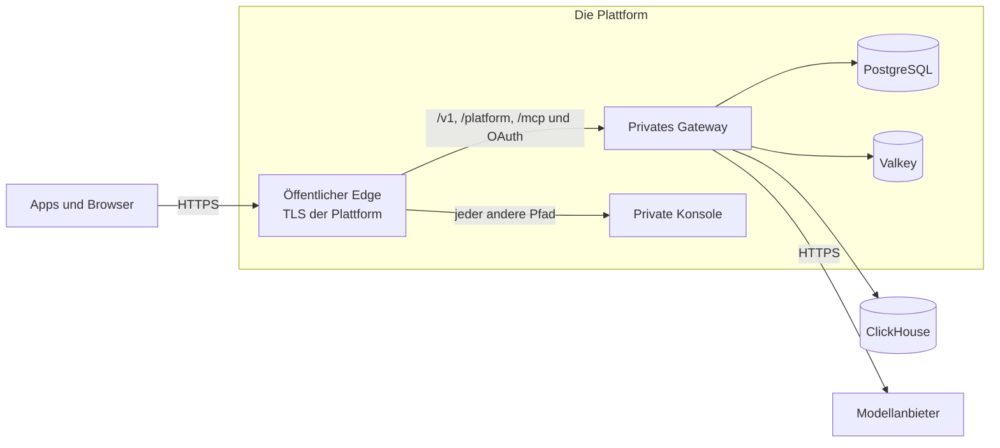

Das Compose-Paket betreibt Kaeso auf einem Server, den Sie verwalten. Die Vorlagen im Repository betreiben dasselbe Release stattdessen auf einer verwalteten Plattform, die TLS terminiert, die Datenbanken hält und neue Versionen ausrollt.

## Zwei Arten von Wegen

| Weg | Was es ist | Wo |
| --- | --- | --- |
| Plattformvorlage | Eine Datei, die die Plattform liest, mit öffentlichem Edge, privatem Gateway und privater Konsole sowie PostgreSQL und Valkey der Plattform | [Render](render.md), [Railway](railway.md), [DigitalOcean](digitalocean.md) |
| Schneller Server | Eine virtuelle Maschine mit dem Compose-Paket, Caddy, gebündeltem ClickHouse und dem Updater, wie auf Ihrem eigenen Server | [AWS](aws.md), [Google Cloud](gcp.md) |
| Verwalteter Betrieb | Die Container, der Load Balancer, PostgreSQL und Valkey der Plattform, mit Geheimnissen in ihrem Secret Store | [AWS](aws.md), [Google Cloud](gcp.md) |

AWS und Google Cloud sind kein Ein-Klick-Weg: Sie wählen Region, Domain und ihr Zertifikat, die Größen der Datenspeicher, wohin Anfrageprotokolle gehen, einen SMTP-Server und wo der Hauptschlüssel liegt.

## Was jeder Weg beibehält

- **Ein Ursprung.** Konsole und APIs antworten auf einer Domain. `/v1/*`, `/platform/*`, `/mcp`, `/mcp/*`, `/oauth/*` und `/.well-known/oauth-*` erreichen das Gateway; jeder andere Pfad erreicht die Konsole. Auf Render und Railway übernimmt das `kaeso-edge`, ein zweiter Befehl im Konsolen-Image; auf DigitalOcean die Ingress-Regeln der App; auf AWS und Google Cloud die Pfadregeln des Load Balancers.
- **Streams bleiben ungepuffert.** Der Edge leitet jeden Chunk sofort weiter, und das Leerlauf-Timeout eines Load Balancers ist länger als das Keepalive-Intervall des Gateways ([lange Streams](../domains-and-tls.md#lange-streams)).
- **Die Client-Adresse wird nur dem Proxy der Plattform geglaubt.** Der Edge nimmt `X-Forwarded-For` nur aus dem privaten Netz der Plattform an und sendet dem Gateway eine Adresse; das Gateway vertraut allein dem Edge ([`KAESO_TRUSTED_PROXIES`](../configuration.md#einstellungen)).
- **Health-Checks** nutzen `/healthz` für den Prozess und `/readyz` für PostgreSQL, Valkey und ClickHouse ([Zustand und Metriken](../monitoring.md)). Der Metrik-Port ist nie öffentlich.
- **Der Updater ist aus.** Die Plattform rollt ein neues Release aus und zurück; die Migrationen eines Releases laufen nur vorwärts ([Upgrades](../upgrades.md)).
- **Eine Version.** Gateway, Konsole und Edge sind auf dasselbe Release festgelegt; ein Release aktualisiert die Vorlagen.

## Was jeder Weg braucht

| Bedarf | Wie |
| --- | --- |
| Ein Hauptschlüssel | `docker run --rm ghcr.io/logicplanes/kaeso-gateway:{{version}} master-key generate`, aufbewahrt im Secret Store der Plattform und in einem Passwort-Manager ([Backups und Hauptschlüssel](../backups.md)) |
| E-Mail | Ein SMTP-Server; `KAESO_MAIL_TRANSPORT=log` nur zum Ausprobieren ([E-Mail](../email.md)) |
| Der erste Benutzer | `KAESO_SETUP_EMAIL`: Das Gateway sendet den einmaligen Einrichtungslink bei jedem Start per E-Mail, bis der erste Benutzer existiert, denn das Gateway-Image hat keine Shell für `kaeso setup-link` ([Konfiguration](../configuration.md#einstellungen)) |
| Anfrageprotokolle | Ein externes ClickHouse, etwa ClickHouse Cloud, in `KAESO_CLICKHOUSE_URL`; ohne es sind Anfrageprotokolle aus, und Nutzung, Limits und Budgets funktionieren gleich ([festlegen, wie Anfrageprotokolle gespeichert werden](../installation.md#festlegen-wie-anfrageprotokolle-gespeichert-werden)) |
| Eine öffentliche Adresse | `KAESO_PUBLIC_URL`, die `https`-Adresse, die Personen und Apps nutzen |

## Was geprüft wurde

Edge, Gateway und Konsole wurden am 2026-11-06 lokal mit Docker geprüft: Pfadweiterleitung, gestreamte Antworten, gefälschte Client-Adressen und die Fehlerformate der APIs, während das Gateway nicht erreichbar war (`e2e/install/test_edge.py`). CI wiederholt die Prüfungen der Vorlagen, Linter und Formatierung.

Am 2026-11-07 wurden die schnellen Server aus leeren Cloud-Konten angelegt: die AWS-Vorlage als CloudFormation-Stack in `us-east-1` und die Google-Cloud-Konfiguration in einem neuen Projekt in `europe-west3`; beide installierten `v0.6.0-rc.8`. Beide legten den ersten Benutzer an, lieferten Konsole und APIs über einen HTTPS-Ursprung aus, streamten fünf SSE-Ereignisse mit exakt dem Text `Kaeso stream works.`, schrieben die Anfrage nach ClickHouse und ignorierten ein gefälschtes `X-Forwarded-For`.

Der Render-Blueprint wurde am selben Tag aus einem leeren Render-Projekt in Frankfurt erstellt. Er legte alle fünf Ressourcen aus der release-gebundenen `render.yaml` an, versandte den einmaligen Einrichtungslink per E-Mail, bestand die Health- und Readiness-Prüfungen, streamte dieselbe Antwort und protokollierte die Anfrage. Der Test fand, dass Render an das vom Aufrufer gesetzte `X-Forwarded-For` anhängt; der Edge liest bei Render jetzt den von Cloudflare überschriebenen Header `CF-Connecting-IP`. Mit dieser Korrektur bestand der Test auch mit einem gefälschten `X-Forwarded-For`.

| Plattform | Live-Test aus einem leeren Konto |
| --- | --- |
| Render | Blueprint und Einrichtung per E-Mail am 2026-11-07 bestanden |
| AWS, schneller Server | CloudFormation-Stack und Einrichtungslink am 2026-11-07 bestanden |
| Google Cloud, schneller Server | Terraform-Konfiguration und Einrichtungslink am 2026-11-07 bestanden |
| AWS und Google Cloud, verwaltete Stacks | In CI gelintet und formatiert; in diesem Durchlauf nicht ausgerollt |
| Railway | Blockiert: Die Testversion des angemeldeten Test-Workspace war abgelaufen; Railway verlangt vor neuer Infrastruktur einen Tarif |
| DigitalOcean | In diesem Durchlauf nicht getestet |

## Nächste Schritte

- [Render](render.md): Rollen Sie den Blueprint mit Render Postgres und Key Value aus.
- [Railway](railway.md): Wenden Sie die Infrastrukturdatei mit Railway Postgres und Redis an.
- [DigitalOcean](digitalocean.md): Legen Sie die App aus der Spec an, mit einer Dev-PostgreSQL und einer verwalteten Valkey.
- [AWS](aws.md): Starten Sie einen EC2-Server oder ECS Fargate mit Application Load Balancer, RDS und ElastiCache.
- [Google Cloud](gcp.md): Starten Sie einen Compute-Engine-Server oder Cloud Run mit Load Balancer, Cloud SQL und Memorystore.
