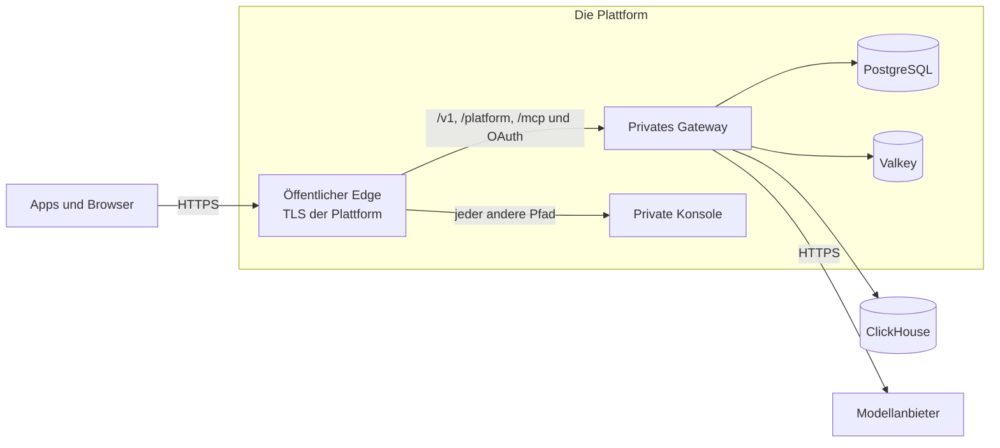

Das Compose-Paket betreibt Kaeso auf einem Server, den Sie verwalten. Die Vorlagen im Repository betreiben dasselbe Release stattdessen auf einer verwalteten Plattform, die TLS terminiert, die Datenbanken hält und neue Versionen ausrollt. Andere betreiben es auf einer Plattform wie Coolify auf Ihrem eigenen Server.

## Vier Arten von Wegen

| Weg | Was es ist | Wo |
| --- | --- | --- |
| Plattformvorlage | Dateien, die die Plattform liest, mit öffentlichem Edge, privatem Gateway und privater Konsole sowie PostgreSQL und Valkey auf der Plattform | [Render](render.md), [Railway](railway.md), [DigitalOcean](digitalocean.md), [Fly.io](fly.md) |
| Schneller Server | Eine virtuelle Maschine mit dem Compose-Paket, Caddy, gebündeltem ClickHouse und dem Updater, wie auf Ihrem eigenen Server | [AWS](aws.md), [Azure](azure.md), [Google Cloud](gcp.md) |
| Verwalteter Betrieb | Die Container, der Load Balancer, PostgreSQL und Valkey der Plattform, mit Geheimnissen in ihrem Secret Store | [AWS](aws.md), [Google Cloud](gcp.md) |
| Selbst betriebene Plattform | Eine Compose-Datei oder One-Click-App für eine Plattform auf Ihrem eigenen Server, mit öffentlichem Edge hinter ihrem Proxy sowie PostgreSQL, ClickHouse und Valkey des Compose-Pakets | [Coolify](coolify.md), [Dokploy](dokploy.md), [CapRover](caprover.md) |

Die verwalteten Stacks auf AWS und Google Cloud sind kein Ein-Klick-Weg: Sie wählen Region, Domain und ihr Zertifikat, die Größen der Datenspeicher, wohin Anfrageprotokolle gehen, einen SMTP-Server und wo der Hauptschlüssel liegt. Fly.io braucht einige Befehle, da es keinen Button für ein Projekt aus mehreren Apps hat.

## Was jeder Weg beibehält

- **Ein Ursprung.** Konsole und APIs antworten auf einer Domain. `/v1/*`, `/v1beta/*`, `/v2/*`, `/platform/*`, `/mcp`, `/mcp/*`, `/oauth/*` und `/.well-known/oauth-*` erreichen das Gateway; jeder andere Pfad erreicht die Konsole. Auf Render, Railway, Fly.io, Coolify, Dokploy und CapRover übernimmt das `kaeso-edge`, ein zweiter Befehl im Konsolen-Image; auf DigitalOcean die Ingress-Regeln der App; bei den verwalteten Stacks auf AWS und Google Cloud die Pfadregeln des Load Balancers; auf einem schnellen Server Caddy.
- **Streams bleiben ungepuffert.** Der Edge leitet jeden Chunk sofort weiter, und das Leerlauf-Timeout eines Load Balancers ist länger als das Keepalive-Intervall des Gateways ([lange Streams](../domains-and-tls.md#lange-streams)).
- **Die Client-Adresse wird nur dem Proxy der Plattform geglaubt.** Der Edge nimmt die Adresse des Clients nur vom Proxy der Plattform an, aus einem Header, den der Proxy setzt, und sendet dem Gateway eine Adresse; das Gateway vertraut allein dem Edge ([`KAESO_TRUSTED_PROXIES`](../configuration.md#einstellungen)).
- **Health-Checks** nutzen `/healthz` für den Prozess und `/readyz` für PostgreSQL, Valkey und ClickHouse ([Zustand und Metriken](../monitoring.md)). Der Metrik-Port ist nie öffentlich.
- **Der Updater ist aus.** Die Plattform rollt ein neues Release aus und zurück; die Migrationen eines Releases laufen nur vorwärts ([Upgrades](../upgrades.md)).
- **Eine Version.** Gateway, Konsole und Edge sind auf dasselbe Release festgelegt; ein Release aktualisiert die Vorlagen.

## Was jeder Weg braucht

| Bedarf | Wie |
| --- | --- |
| Ein Hauptschlüssel | `docker run --rm ghcr.io/logicplanes/kaeso-gateway:{{version}} master-key generate`, aufbewahrt im Secret Store der Plattform und in einem Passwort-Manager; Coolify und Dokploy erzeugen ihn, und Sie kopieren ihn in einen Passwort-Manager ([Backups und Hauptschlüssel](../backups.md)) |
| E-Mail | Ein SMTP-Server; `KAESO_MAIL_TRANSPORT=log` nur zum Ausprobieren ([E-Mail](../email.md)) |
| Der erste Benutzer | `KAESO_SETUP_EMAIL`: Das Gateway sendet den einmaligen Einrichtungslink bei jedem Start per E-Mail, bis der erste Benutzer existiert, denn das Gateway-Image hat keine Shell für `kaeso setup-link`; auf Coolify, Dokploy und CapRover führt es auch `docker exec` auf dem Server aus ([Konfiguration](../configuration.md#einstellungen)) |
| Anfrageprotokolle | Ein externes ClickHouse, etwa ClickHouse Cloud, in `KAESO_CLICKHOUSE_URL`; ohne es sind Anfrageprotokolle aus, und Nutzung, Limits und Budgets funktionieren gleich; Coolify, Dokploy und CapRover betreiben ClickHouse neben Kaeso ([festlegen, wie Anfrageprotokolle gespeichert werden](../installation.md#festlegen-wie-anfrageprotokolle-gespeichert-werden)) |
| Eine öffentliche Adresse | `KAESO_PUBLIC_URL`, die `https`-Adresse, die Personen und Apps nutzen |

## Was geprüft wurde

Edge, Gateway und Konsole wurden am 2026-11-06 lokal mit Docker geprüft: Pfadweiterleitung, gestreamte Antworten, gefälschte Client-Adressen und die Fehlerformate der APIs, während das Gateway nicht erreichbar war (`e2e/install/test_edge.py`). CI wiederholt die Prüfungen der Vorlagen, Linter und Formatierung.

Am 2026-11-07 wurden die schnellen Server aus leeren Cloud-Konten angelegt: die AWS-Vorlage als CloudFormation-Stack in `us-east-1` und die Google-Cloud-Konfiguration in einem neuen Projekt in `europe-west3`; beide installierten den achten Release-Kandidaten. Die Google-Cloud-Bereitstellung legte den ersten Benutzer an, lieferte Konsole und APIs über einen HTTPS-Ursprung aus, streamte fünf SSE-Ereignisse mit exakt dem Text `Kaeso stream works.`, schrieb die Anfrage nach ClickHouse und ignorierte ein gefälschtes `X-Forwarded-For`. Bei AWS legte die Bereitstellung den ersten Benutzer an und bestand dieselben Prüfungen erst, nachdem die Schlüsseldatei auf der Testinstanz wieder dem Installer gehörte. Die Vorlage ändert den Besitz jetzt nicht mehr, wurde aber noch nicht erneut aus einem leeren Konto ausgerollt.

Der Render-Blueprint wurde am selben Tag aus einem leeren Render-Projekt in Frankfurt erstellt. Er legte alle fünf Ressourcen aus der release-gebundenen `render.yaml` an, versandte den einmaligen Einrichtungslink per E-Mail, bestand die Health- und Readiness-Prüfungen, streamte dieselbe Antwort und protokollierte die Anfrage. Der Live-Test fand außerdem, dass Render an das vom Aufrufer gesetzte `X-Forwarded-For` anhängt; der Edge liest bei Render jetzt den von Cloudflare überschriebenen Header `CF-Connecting-IP`. Diese Korrektur besteht den lokalen Edge-Integrationstest und die Prüfung der Render-Konfiguration, wurde aber noch nicht erneut auf einer Live-Bereitstellung getestet.

| Plattform | Live-Test aus einem leeren Konto |
| --- | --- |
| Render | Blueprint, Einrichtung per E-Mail, Routing, Streaming und Protokollierung am 2026-11-07 bestanden; die korrigierte Client-Adresse hat lokale Regressionstests, aber keinen neuen Live-Test |
| AWS, schneller Server | Stack und App-Prüfungen am 2026-11-07 nach der Korrektur des Master-Key-Besitzes auf der Testinstanz bestanden; die korrigierte Vorlage wurde nicht erneut ausgerollt |
| Google Cloud, schneller Server | Terraform-Konfiguration und Einrichtungslink am 2026-11-07 bestanden |
| AWS und Google Cloud, verwaltete Stacks | In CI gelintet und formatiert; in diesem Durchlauf nicht ausgerollt |
| Railway | Datei und Vorlage des Buttons am 9. November 2026 jeweils in ein leeres Projekt ausgerollt, mit Einrichtung und Anmeldung über den Edge; E-Mail-Zustellung und Streaming nicht getestet |
| DigitalOcean | Nicht ausgerollt; die Validierungs- und Proposal-API von App Platform hat die Spec des Buttons am 9. November 2026 angenommen |
| Fly.io | Nicht ausgerollt; die Dateien bestehen das SchemaStore-Schema für `fly.toml` |
| Azure, schneller Server | Nicht ausgerollt; die Vorlage besteht das ARM Template Test Toolkit |
| Coolify, Dokploy | Nicht auf den Plattformen ausgerollt; beide Dateien liefen am 9. November 2026 lokal mit Docker, mit gesunden Diensten, Pfadweiterleitung und Einrichtungslink |
| CapRover | Nicht ausgerollt; die Vorlage lässt sich lesen und nutzt nur Felder, die CapRover liest |

## Nächste Schritte

- [Render](render.md): Rollen Sie den Blueprint mit Render Postgres und Key Value aus.
- [Railway](railway.md): Rollen Sie mit dem Button aus, oder wenden Sie die Infrastrukturdatei mit der Railway-CLI an.
- [DigitalOcean](digitalocean.md): Rollen Sie mit dem Button aus, oder legen Sie die App mit einer verwalteten Valkey mit `doctl` an.
- [Fly.io](fly.md): Rollen Sie vier Apps im privaten Netz mit `fly` und Fly Managed Postgres aus.
- [AWS](aws.md): Starten Sie einen EC2-Server oder ECS Fargate mit Application Load Balancer, RDS und ElastiCache.
- [Azure](azure.md): Starten Sie eine virtuelle Maschine per Button Deploy to Azure oder mit der Azure CLI.
- [Google Cloud](gcp.md): Starten Sie einen Compute-Engine-Server oder Cloud Run mit Load Balancer, Cloud SQL und Memorystore.
- [Coolify](coolify.md): Rollen Sie die Compose-Datei mit dem Proxy von Coolify und erzeugten Passwörtern aus.
- [Dokploy](dokploy.md): Importieren Sie die Vorlage mit Traefik und erzeugten Passwörtern.
- [CapRover](caprover.md): Rollen Sie die One-Click-App aus der Vorlage aus.
