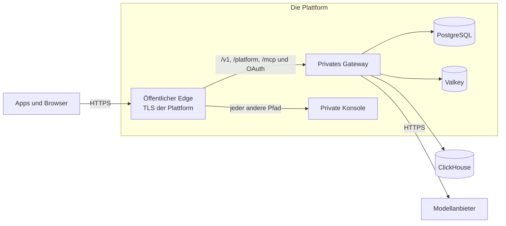

Das Compose-Paket betreibt Kaeso auf einem Server, den Sie verwalten. Die Vorlagen im Repository betreiben dasselbe Release stattdessen auf einer verwalteten Plattform, die TLS terminiert, die Datenbanken hält und neue Versionen ausrollt.

## Zwei Arten von Wegen

| Weg | Was es ist | Wo |
| --- | --- | --- |
| Plattformvorlage | Eine Datei, die die Plattform liest, mit öffentlichem Edge, privatem Gateway und privater Konsole sowie PostgreSQL und Valkey der Plattform | [Render](render.md), [Railway](railway.md) |
| Schneller Server | Eine virtuelle Maschine mit dem Compose-Paket, Caddy, gebündeltem ClickHouse und dem Updater, wie auf Ihrem eigenen Server | [AWS](aws.md), [Google Cloud](gcp.md) |
| Verwalteter Betrieb | Die Container, der Load Balancer, PostgreSQL und Valkey der Plattform, mit Geheimnissen in ihrem Secret Store | [AWS](aws.md), [Google Cloud](gcp.md) |

AWS und Google Cloud sind kein Ein-Klick-Weg: Sie wählen Region, Domain und ihr Zertifikat, die Größen der Datenspeicher, wohin Anfrageprotokolle gehen, einen SMTP-Server und wo der Hauptschlüssel liegt.

## Was jeder Weg beibehält

- **Ein Ursprung.** Konsole und APIs antworten auf einer Domain. `/v1/*`, `/platform/*`, `/mcp`, `/mcp/*`, `/oauth/*` und `/.well-known/oauth-*` erreichen das Gateway; jeder andere Pfad erreicht die Konsole. Auf Render und Railway übernimmt das `kaeso-edge`, ein zweiter Befehl im Konsolen-Image; auf AWS und Google Cloud die Pfadregeln des Load Balancers.
- **Streams bleiben ungepuffert.** Der Edge leitet jeden Chunk sofort weiter, und das Leerlauf-Timeout eines Load Balancers ist länger als das Keepalive-Intervall des Gateways ([lange Streams](../domains-and-tls.md#lange-streams)).
- **Die Client-Adresse wird nur dem Proxy der Plattform geglaubt.** Der Edge nimmt `X-Forwarded-For` nur aus dem privaten Netz der Plattform an und sendet dem Gateway eine Adresse; das Gateway vertraut allein dem Edge ([`KAESO_TRUSTED_PROXIES`](../configuration.md#einstellungen)).
- **Health-Checks** nutzen `/healthz` für den Prozess und `/readyz` für PostgreSQL, Valkey und ClickHouse ([Zustand und Metriken](../monitoring.md)). Der Metrik-Port ist nie öffentlich.
- **Der Updater ist aus.** Die Plattform rollt ein neues Release aus und zurück; die Migrationen eines Releases laufen nur vorwärts ([Upgrades](../upgrades.md)).
- **Eine Version.** Gateway, Konsole und Edge sind auf dasselbe Release festgelegt; ein Release aktualisiert die Vorlagen.

## Was jeder Weg braucht

| Bedarf | Wie |
| --- | --- |
| Ein Hauptschlüssel | `docker run --rm ghcr.io/logicplanes/kaeso-gateway:{{version}} master-key generate`, aufbewahrt im Secret Store der Plattform und in einem Passwort-Manager ([Backups und Hauptschlüssel](../backups.md)) |
| E-Mail | Ein SMTP-Server; `KAESO_MAIL_TRANSPORT=log` nur zum Ausprobieren ([E-Mail](../email.md)) |
| Der erste Benutzer | `KAESO_SETUP_EMAIL`: Das Gateway sendet den einmaligen Einrichtungslink bei jedem Start per E-Mail, bis der erste Benutzer existiert, denn das Gateway-Image hat keine Shell für `kaeso setup-link` ([Konfiguration](../configuration.md#einstellungen)) |
| Anfrageprotokolle | Ein externes ClickHouse, etwa ClickHouse Cloud, in `KAESO_CLICKHOUSE_URL`; ohne es sind Anfrageprotokolle aus, und Nutzung, Limits und Budgets funktionieren gleich ([festlegen, wie Anfrageprotokolle gespeichert werden](../installation.md#festlegen-wie-anfrageprotokolle-gespeichert-werden)) |
| Eine öffentliche Adresse | `KAESO_PUBLIC_URL`, die `https`-Adresse, die Personen und Apps nutzen |

## Was geprüft wurde

Edge, Gateway und Konsole wurden in diesem Aufbau mit den Release-Images am 6. November 2026 lokal mit Docker getestet: Pfadweiterleitung, Streams in Chunks, gefälschte Client-Adressen und das Fehlerformat jeder API, während das Gateway fehlt (`e2e/install/test_edge.py`). Der Render-Blueprint und die Railway-Datei wurden gegen die Spezifikationen der Plattformen geprüft, die CloudFormation-Vorlagen mit `cfn-lint` und das Terraform mit `tofu validate`; CI wiederholt jede Prüfung.

Keiner der vier Wege wurde bisher von einem leeren Konto aus auf seiner Plattform ausgerollt. Bis dieser Test existiert, gibt es keinen Deploy-Button, und jede Seite sagt, worauf sie beruht.

## Nächste Schritte

- [Render](render.md): Rollen Sie den Blueprint mit Render Postgres und Key Value aus.
- [Railway](railway.md): Wenden Sie die Infrastrukturdatei mit Railway Postgres und Redis an.
- [AWS](aws.md): Starten Sie einen EC2-Server oder ECS Fargate mit Application Load Balancer, RDS und ElastiCache.
- [Google Cloud](gcp.md): Starten Sie einen Compute-Engine-Server oder Cloud Run mit Load Balancer, Cloud SQL und Memorystore.
