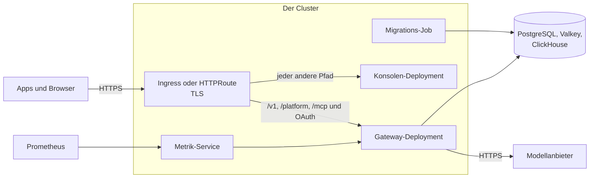

Das Helm-Chart in `deploy/helm/kaeso` betreibt Gateway und Konsole auf einem Kubernetes-Cluster. Jedes Release veröffentlicht es neben den Images als `oci://ghcr.io/logicplanes/charts/kaeso`, mit derselben signierten Herkunft, und pinnt es auf die Images dieses Releases.



## Was das Chart anlegt

| Ressource | Was sie ist |
| --- | --- |
| Gateway-Deployment und -Service | Das Image `kaeso-gateway`, 2 Replikate, bereit über `/readyz` und lebendig über `/healthz` auf Port 8080. Es läuft als Nicht-Root-Benutzer mit schreibgeschütztem Root-Dateisystem, ohne Capabilities und ohne Rechteausweitung, wie das Compose-Paket es betreibt |
| Metrik-Service | Nur Port 9100, sodass kein Ingress und keine Route je die Metriken erreicht. Ein `ServiceMonitor` für den Prometheus Operator ist optional |
| Konsolen-Deployment und -Service | Das Image `kaeso-console` auf Port 3000, schreibgeschützt, mit Arbeitsverzeichnissen für Caddy |
| Migrations-Job | `kaeso migrate` als Helm-Hook, bevor jede Installation und jedes Upgrade die Gateways erreicht, damit sie nie nebeneinander migrieren |
| Ingress oder HTTPRoute | Die APIs zum Gateway und jeder andere Pfad zur Konsole, auf einem Host |
| PodDisruptionBudgets, HorizontalPodAutoscaler | Höchstens ein Gateway und eine Konsole gleichzeitig nicht verfügbar; Gateways nach CPU zu skalieren ist optional |
| Secret `<release>-generated` | Die Master-Keys, die das Chart erzeugt hat, und die Passwörter der mitgelieferten Datenspeicher |
| Mitgelieferte Datenspeicher | Optional je ein StatefulSet für PostgreSQL, ClickHouse und Valkey, mit den Images, die das Compose-Paket pinnt |

Der [Updater](../upgrades.md#der-updater) steuert Docker und gehört nicht zum Chart; eine Helm-Installation aktualisiert mit `helm upgrade`.

## Bevor Sie beginnen

- Ein Cluster mit Kubernetes 1.30 oder neuer und Helm 3.14 oder neuer.
- Ein Ingress-Controller oder eine Implementierung der Gateway API und ein Zertifikat für die Domain, etwa eines von cert-manager.
- PostgreSQL, Valkey oder Redis mit `maxmemory-policy noeviction` und ClickHouse, wenn Sie [Anfrageprotokolle](../installation.md#festlegen-wie-anfrageprotokolle-gespeichert-werden) behalten. Produktive Cluster nutzen verwaltete Dienste oder Operatoren; die mitgelieferten Datenspeicher sind zum Ausprobieren.
- Einen SMTP-Server ([E-Mail](../email.md)).

## Installieren

1. Legen Sie die Verbindungs-URL jedes Datenspeichers in ein Secret. Das Gateway liest sie von dort, nie aus den Werten des Charts.

   ```bash
   kubectl create namespace kaeso
   kubectl --namespace kaeso create secret generic kaeso-stores \
     --from-literal=postgres='postgres://kaeso:<password>@postgres.example.com:5432/kaeso' \
     --from-literal=clickhouse='https://kaeso:<password>@clickhouse.example.com:8443' \
     --from-literal=valkey='rediss://:<password>@valkey.example.com:6380'
   kubectl --namespace kaeso create secret generic kaeso-smtp --from-literal=password='<password>'
   ```

2. Schreiben Sie die Werte:

   ```yaml
   publicUrl: https://kaeso.example.com
   postgres: { existingSecret: kaeso-stores, key: postgres }
   clickhouse: { existingSecret: kaeso-stores, key: clickhouse }
   valkey: { existingSecret: kaeso-stores, key: valkey }
   mail:
     smtp:
       host: smtp.example.com
       user: kaeso@example.com
       from: Kaeso <kaeso@example.com>
       password: { existingSecret: kaeso-smtp, key: password }
   ingress:
     className: nginx
     tls:
       certManager: { issuer: letsencrypt }
   ```

3. Installieren Sie das Chart:

   ```bash
   helm install kaeso oci://ghcr.io/logicplanes/charts/kaeso --version {{version}} \
     --namespace kaeso --values values.yaml --wait
   ```

4. Geben Sie den einmaligen Einrichtungslink aus und öffnen Sie ihn. Helm gibt diese Befehle ebenfalls aus.

   ```bash
   kubectl --namespace kaeso exec deployment/kaeso-gateway -- kaeso setup-link
   ```

`helm show values oci://ghcr.io/logicplanes/charts/kaeso` listet jeden Wert mit seiner Wirkung. Das Chart prüft Werte gegen sein Schema, sodass ein falsch geschriebener die Installation scheitern lässt, statt übergangen zu werden.

### Kaeso ausprobieren

`--set bundled.enabled=true` betreibt je eine Kopie von PostgreSQL, ClickHouse und Valkey im Release, mit Passwörtern, die das Chart erzeugt. Sie haben keine Replikate und keine Sicherungen und laufen mit den Capabilities, die das Compose-Paket ihnen gibt; ein Namespace, der den Pod Security Standard „restricted“ durchsetzt, lehnt sie deshalb ab. Mit ihnen und `mail.transport=log` braucht Kaeso außerhalb des Clusters nur das Ingress, das `publicUrl` erreicht.

## Master-Keys

Die Master-Keys verschlüsseln Anbieterschlüssel und andere Geheimnisse im Ruhezustand ([Sicherungen und Master-Keys](../backups.md)). Ohne `masterKeys.existingSecret` erzeugt das Chart bei der ersten Installation einen, behält ihn bei jedem Upgrade in `<release>-generated` und lässt dieses Secret bei `helm uninstall` stehen. Kopieren Sie ihn in einen Passwortmanager:

```bash
kubectl --namespace kaeso get secret kaeso-generated -o jsonpath='{.data.master-keys}' | base64 -d
```

Ein Werkzeug, das das Chart ohne den Cluster rendert, etwa Argo CD, sieht den zuletzt erzeugten Schlüssel nicht. Geben Sie ihm stattdessen ein eigenes Secret, mit der Ausgabe von `master-key generate` unter `masterKeys.key`:

```bash
kubectl --namespace kaeso create secret generic kaeso-master-keys \
  --from-literal=master-keys="$(docker run --rm ghcr.io/logicplanes/kaeso-gateway:{{version}} master-key generate)"
```

Das Gateway liest die Schlüssel als die Datei, die `KAESO_MASTER_KEYS_FILE` nennt, nie aus einer Umgebungsvariablen.

## Routing und lange Streams

Das Ingress schickt `/v1`, `/v1beta`, `/v2`, `/platform`, `/mcp`, `/oauth`, `/ingest`, `/.well-known/oauth-authorization-server` und `/.well-known/oauth-protected-resource` zum Gateway und jeden anderen Pfad zur Konsole, wie Caddy im Compose-Paket. TLS kommt aus `ingress.tls.secretName` oder vom cert-manager-Issuer in `ingress.tls.certManager.issuer`.

Streams können minutenlang still sein, und Bild- und Audio-Uploads reichen bis 64 MiB. Mit einer `ingress.className`, die `nginx` enthält, setzt das Chart die Timeouts von ingress-nginx aus `ingress.streamTimeoutSeconds`, hebt sein Body-Limit auf 64 MiB und schaltet sein Puffern ab. Andere Controller nehmen dasselbe in ihren eigenen Annotationen, unter `ingress.annotations` ([lange Streams](../domains-and-tls.md#lange-streams)).

Für die Gateway API setzen Sie `httpRoute.enabled` und `httpRoute.parentRefs` auf Ihr Gateway und `ingress.enabled` auf false. `httpRoute.timeouts`, etwa `{ request: "0s" }`, schaltet das Timeout der Route ab, wo Ihre Implementierung es unterstützt.

## Einstellungen

Das Chart setzt, was Kubernetes bestimmt, und Sie setzen den Rest:

- `gateway.env` nimmt [Einstellungen](../configuration.md#einstellungen) als Variablen, etwa `KAESO_CORS_ALLOWED_ORIGINS`; `gateway.extraEnv` und `gateway.extraEnvFrom` nehmen sie in der Form von Kubernetes, etwa aus einem Secret.
- `gateway.config` nimmt Einstellungen in der Form der Konfigurationsdatei, etwa `{ upstream: { request_timeout: 900s } }`. Das Chart rendert sie in eine TOML-Datei und startet die Gateways neu, wenn sie sich ändert.
- `gateway.trustedProxies` nennt die Netze, deren `X-Forwarded-For` das Gateway glaubt. Sein Standard deckt die privaten Bereiche ab, die die meisten Pod-Netze nutzen; nennen Sie das Pod-Netz Ihres Ingress-Controllers, um genau zu sein.
- `serviceAccount.annotations` gibt den Pods eine Cloud-Identität, etwa `eks.amazonaws.com/role-arn`.

Das Chart setzt `KAESO_UPDATES_INSTALLED_WITH` auf `helm`, sodass die Seite **Updates** der Konsole `helm upgrade` statt des Installers zeigt.

## Skalieren

`gateway.replicaCount` setzt die Zahl der Gateways, oder `gateway.autoscaling.enabled` skaliert sie nach CPU zwischen `minReplicas` und `maxReplicas`. Rollouts starten ein neues Gateway, bevor ein altes stoppt. Ein stoppendes Gateway nimmt für `gateway.preStopSeconds` weiter Verbindungen an, während der Service es austrägt, und beendet dann seine Streams innerhalb von `gateway.terminationGracePeriodSeconds`, 75 Sekunden ([Skalierung](../scaling.md)).

## Metriken

Das Gateway liefert Prometheus-Metriken auf Port 9100 des Service `<release>-gateway-metrics`. Mit dem Prometheus Operator legt `gateway.metrics.serviceMonitor.enabled` einen `ServiceMonitor` an, mit den Labels aus `gateway.metrics.serviceMonitor.labels` für das Prometheus, das ihn finden soll ([Health und Metriken](../monitoring.md)).

## Upgrade

1. Lesen Sie die Release Notes und [sichern](../backups.md) Sie die Datenspeicher.
2. Upgraden Sie:

   ```bash
   helm upgrade kaeso oci://ghcr.io/logicplanes/charts/kaeso --version <version> \
     --namespace kaeso --reset-then-reuse-values --wait
   ```

Der Migrations-Job läuft zuerst, einmal; die Gateways wechseln auf das neue Release, nachdem er gelungen ist, und ein Upgrade, dessen Migration scheitert, ändert nichts. Ein Release, dessen Notes Schritte von Hand verlangen, oder eine neue Hauptversion kann außerdem verlangen, dass kein altes Gateway läuft, während es migriert: Skalieren Sie die Gateways dann vor dem Upgrade mit `kubectl --namespace kaeso scale deployment/kaeso-gateway --replicas 0` auf 0. Die Seite **Updates** der Konsole sagt, wenn ein Release das verlangt ([Upgrades](../upgrades.md)).

## Deinstallieren

`helm uninstall kaeso --namespace kaeso` entfernt die Workloads. Es behält das Secret `<release>-generated` mit den Master-Keys und die Volumes der mitgelieferten Datenspeicher, sodass eine erneute Installation im Namespace beide findet.

## Was geprüft wurde

CI rendert das Chart mit seinen Standardwerten und mit den mitgelieferten Datenspeichern und prüft jedes Manifest gegen die Schemas von Kubernetes. Auf einem kind-Cluster installiert es das Chart mit den mitgelieferten Datenspeichern und den Images der Änderung, öffnet den Einrichtungslink, schickt eine Anfrage an einen Mock-Anbieter und findet sie im Anfrageprotokoll, upgradet dann, während Anfragen weiterlaufen, und prüft, dass keine scheiterte (`e2e/kubernetes`). Auf einem verwalteten Cluster wie EKS, GKE oder AKS wurde das Chart noch nicht installiert.

## Nächste Schritte

- [Upgrades](../upgrades.md): Lesen Sie, was ein Release ändert, bevor Sie upgraden.
- [Skalierung](../scaling.md): Wählen Sie die Zahl der Gateways.
- [Health und Metriken](../monitoring.md): Beobachten Sie die Gateways.
- [Sicherungen und Master-Keys](../backups.md): Bewahren Sie Master-Keys und Datenspeicher sicher auf.
