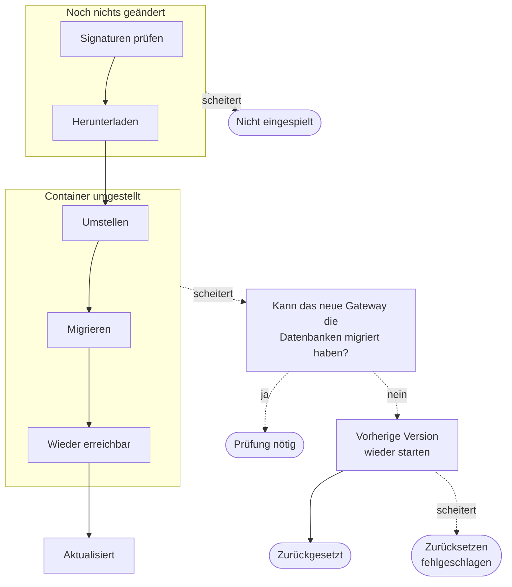

Jedes Release gibt allen Teilen von Kaeso eine Versionsnummer und folgt Semantic Versioning. Seine `compose.yaml` legt jedes Image auf eine Version und einen Digest fest. Aktualisieren Sie von Hand, was immer funktioniert, oder über den Updater: aus der Konsole oder automatisch in einem Fenster, das Sie festlegen.

## Von Hand aktualisieren

1. Lesen Sie die Release-Notizen auf Schritte, die etwas von Ihnen verlangen. Sie stehen auf der [Release-Seite](https://github.com/logicplanes/kaeso/releases) und unter **Instanz** › **Updates**.
2. [Sichern](backups.md) Sie PostgreSQL, und ClickHouse, solange es Anfrageprotokolle speichert, damit Sie bei Bedarf [zurückgehen](#downgrade) können.
3. Setzen Sie im Ordner der Installation `version` auf das Release, auf das Sie aktualisieren, und laden, prüfen und starten Sie es dann. Die Befehle laden `compose.yaml` und `release.json` in einen temporären Ordner und prüfen sie, mit der angemeldeten [GitHub CLI](https://cli.github.com) und `jq`:
   - die Signatur des Release-Workflows von Kaeso auf `release.json`;
   - den Hash der `compose.yaml`, den `release.json` nennt, und damit den Digest jedes Kaeso-Images;
   - die Version, die `release.json` nennt.

   Erst dann verschieben sie beide Dateien in den Ordner der Installation, laden die Images und starten sie. `.env`, `master-keys` und `compose.override.yaml` bleiben, wie sie sind.

```bash
version={{version}}
(
  set -euo pipefail
  dir="$(mktemp -d)"
  url="https://github.com/logicplanes/kaeso/releases/download/v$version"
  curl -fsSL -o "$dir/compose.yaml" "$url/compose.yaml"
  curl -fsSL -o "$dir/release.json" "$url/release.json"
  gh attestation verify "$dir/release.json" --repo logicplanes/kaeso \
    --signer-workflow logicplanes/kaeso/.github/workflows/release.yml \
    --source-ref refs/heads/prod
  sum="$(jq -r .compose.sha256 "$dir/release.json")"
  echo "$sum  $dir/compose.yaml" | sha256sum -c -
  jq -e --arg version "$version" '.version == $version' "$dir/release.json"
  mv "$dir/compose.yaml" "$dir/release.json" .
  rmdir "$dir"
  docker compose pull
  docker compose up -d --wait
)
```

Die Befehle halten beim ersten an, der scheitert, und lassen die Installation, wie sie war. Docker prüft jedes geladene Image gegen den Digest in der `compose.yaml`. Der letzte Befehl kehrt zurück, sobald das neue Gateway und die neue Konsole gesund sind, und scheitert, wenn eines von beiden es nicht ist.

Das Gateway migriert die Datenbanken beim Start. Migrationen laufen nur vorwärts und der Reihe nach, sodass Sie Versionen überspringen können.

Wenn der Updater ein Release nicht installieren kann, zeigt die Konsole diese Befehle mit der genauen Version.

## Neue Releases

Das Gateway sucht alle 5 Minuten unter `update.kaeso.app` nach neuen Releases, nach einem Fehler 15 Minuten später. Bittet der Feed, länger zu warten, wartet es höchstens eine Stunde. Die Anfrage verrät nichts über Ihre Installation außer der Version des Gateways, und eine unveränderte Liste kostet nur eine kurze Antwort `304`.

Instanz-Admins sehen das Ergebnis unter **Instanz** › **Updates**. Die Seite zeigt die laufende Version, das neueste Release mit den Release-Notizen aller Releases seither und wann das Gateway zuletzt gesucht hat.

`instance/updates/check` der Platform API sucht sofort, auch wenn die Suche abgeschaltet ist oder der Feed das Gateway warten lässt. Den Feed fragt sie höchstens einmal pro Minute. Die Markierung **Neu** neben **Updates** ist der einzige Hinweis; Kaeso sendet keine E-Mails oder Banner zu Releases.

| Einstellung | Standard | Was sie bewirkt |
| --- | --- | --- |
| **Releases** | **Stabile Releases** | **Stabile und Vorabversionen** bietet auch Release Candidates an. Eine Installation, die eine Vorabversion ausführt, erhält das stabile Release angeboten, das darauf folgt. |
| **Wie Updates installiert werden** | **Von Hand** | **Automatisch** installiert neue Releases über den Updater im [Update-Fenster](#automatisch-aktualisieren). |

Auf einer neuen Installation beginnen diese Einstellungen mit `KAESO_UPDATES_CHANNEL` und `KAESO_UPDATES_MODE` ([Konfiguration](configuration.md#updates)). Danach ändern Instanz-Admins sie auf der Seite, und das Audit-Log der Instanz hält jede Änderung fest. Nur `KAESO_UPDATES_CHECK` hält das Gateway von der Suche ab, für Installationen ohne Internetzugang.

### Installationen ohne Internetzugang

Schalten Sie vor dem ersten Start die ausgehenden Abfragen des Gateways in der `compose.override.yaml` ab:

```yaml title="compose.override.yaml"
services:
  gateway:
    environment:
      KAESO_UPDATES_CHECK: "false"
      KAESO_KPMR_SYNC: "false"
```

Das Gateway verwendet dann die Modelldaten, die im Release enthalten sind, die Seite **Updates** zeigt die laufende Version, und Sie aktualisieren von Hand. Betreiben Sie einen Spiegel, der wie `update.kaeso.app` oder die Releases-API von GitHub antwortet, richten Sie stattdessen `KAESO_UPDATES_RELEASES_URL` darauf, und einen Spiegel des KPMR-Katalogs tragen Sie in `KAESO_KPMR_URL` ein ([KPMR](../concepts/kpmr.md#ohne-internetzugang)).

## Der Updater

Der Updater ist ein optionaler Dienst in der `compose.yaml`, mit einem eigenen Proxy für den Docker-Socket. Er ist der einzige Teil von Kaeso, der mit Docker spricht, und deshalb aus, bis Sie ihn einschalten.

### Updater einschalten

Der Updater braucht Docker Engine 25 oder neuer.

1. Geben Sie im Ordner der Installation Gateway und Updater ein gemeinsames Token, schalten Sie das Profil `updater` ein und nennen Sie den Ordner der Installation:

```bash
echo "KAESO_UPDATER_TOKEN=$(openssl rand -hex 32)" >> .env
echo "COMPOSE_PROFILES=updater" >> .env
echo "KAESO_DIR=$PWD" >> .env
docker compose up -d --wait
```

2. Unter **Instanz** › **Updates** aktualisiert **Auf … aktualisieren** die Installation jetzt, und **Automatisch** lässt sie in einem Fenster aktualisieren. Beides verlangt eine Anmeldung innerhalb der letzten 15 Minuten.

Die Seite sagt, wenn der Updater nicht installiert ist, nicht antwortet oder für ein Release zu alt ist. Liegt der Docker-Socket nicht unter `/var/run/docker.sock`, etwa bei rootless Docker, setzen Sie `DOCKER_SOCKET` in der `.env`. Startet `docker-proxy` nicht und verlangt sein Log `KAESO_DIR`, ergänzen Sie es wie in Schritt 1.

Um das Token aus der `.env` herauszuhalten, legen Sie es in eine Datei und geben es beiden Diensten als [Compose-Secret](https://docs.docker.com/compose/how-tos/use-secrets/). Beide lesen `KAESO_UPDATER_TOKEN_FILE`:

```yaml title="compose.override.yaml"
services:
  gateway:
    environment:
      KAESO_UPDATER_TOKEN_FILE: /run/secrets/updater_token
    secrets: [updater_token]
  updater:
    environment:
      KAESO_UPDATER_TOKEN_FILE: /run/secrets/updater_token
    secrets: [updater_token]
secrets:
  updater_token:
    file: ./updater-token
```

### Welche Releases der Updater installiert

Der Updater installiert ein Release, wenn alles hier zutrifft. Sonst zeigt die Konsole seine Release-Notizen und die Befehle für das Update von Hand.

- Es ist keine neue Hauptversion. Eine Migration, die einen Schritt von Hand braucht, führt immer zu einer neuen Hauptversion.
- Kein Release auf dem Weg verlangt Schritte von Hand. Das tut ein Release, wenn seine `compose.yaml` sich über die Image-Versionen hinaus ändert oder wenn die Maintainer es so kennzeichnen.
- Es bringt `release.json` mit, das signierte Manifest, das der Updater liest.

### Aus der Konsole aktualisieren

Wählen Sie **Auf … aktualisieren** und bestätigen Sie. Die Konsole verfolgt das Update Schritt für Schritt, und es dauert etwa eine Minute:

1. **Signaturen des Release prüfen.** Der Updater prüft, dass das Release und jedes Image vom Release-Workflow von Kaeso gebaut wurden. Scheitert eine Prüfung, wird nichts eingespielt, und Kaeso läuft weiter.
2. **Images herunterladen.** Er lädt die neuen Images von Gateway, Konsole und Updater.
3. **Auf die neue Version umstellen.** Er ersetzt erst die Konsole, dann das Gateway durch Container aus den neuen Images, mit denselben Einstellungen. Währenddessen antwortet Caddy an ihrer Stelle ([Während Kaeso aktualisiert wird](#während-kaeso-aktualisiert-wird)).
4. **Datenbank migrieren.** Das neue Gateway migriert beim Start die Datenbanken. Der Updater gibt ihm bis zu 10 Minuten, um gesund zu werden.
5. **Wieder erreichbar.** Der Updater schreibt die neuen Versionen in die `compose.yaml`, sodass ein späteres `docker compose up -d --wait` dieselben Images startet.

Der Updater ersetzt weder sich selbst noch Caddy, während er läuft. Das nächste `docker compose up -d --wait` im Ordner der Installation startet ihre neuen Versionen. Es läuft immer nur ein Update, und das Audit-Log der Instanz hält jedes fest.

[Updates](../development/architecture/updates.md) erklärt, wie der Updater ein Release prüft und Container umstellt.

### Automatisch aktualisieren

Wählen Sie unter **Wie Updates installiert werden** die Option **Automatisch**, und legen Sie dann das Update-Fenster fest: **Täglich** oder **Wöchentlich** an einem Tag, zu einer Stunde. Die Stunde gilt in der Zeitzone der Installation, die Sie unter **Allgemein** festlegen, Sommerzeit eingeschlossen. Das Fenster bleibt eine Stunde offen, und die Seite zeigt, wann sich das nächste öffnet.

Im Fenster sucht das Gateway nach Releases, wenn es das in der letzten Stunde nicht getan hat. Dann aktualisiert es auf das neueste Release, das der Updater installiert, genau wie **Auf … aktualisieren**. Eine neue Hauptversion oder ein Release mit Schritten von Hand wartet auf Sie.

Läuft das Gateway während eines Fensters nicht, verstreicht es, und das nächste zählt. Verlauf und Audit-Log halten jedes automatische Update ohne Person fest.

### Ergebnisse

Jedes Update endet mit einem von fünf Ergebnissen, je nachdem, wo es aufhört:



Der Verlauf der Seite zeigt, wie jedes Update ausgegangen ist:

| Ergebnis | Bedeutung |
| --- | --- |
| **Aktualisiert** | Die neue Version läuft. Meldet das Ergebnis, dass der Updater die `compose.yaml` nicht schreiben konnte, laden Sie die `compose.yaml` des neuen Releases darüber, wie unter [von Hand aktualisieren](#von-hand-aktualisieren). |
| **Nicht eingespielt** | Nichts hat sich geändert. |
| **Zurückgesetzt** | Die neue Version startete nicht, und die vorherige läuft wieder. |
| **Zurücksetzen fehlgeschlagen** | Die neue Version startete nicht, die vorherige auch nicht. |
| **Prüfung nötig** | Jemand muss nachsehen. Die Details sagen, was passiert ist und was zu tun ist. |

Der Updater setzt selbst zurück, wann immer das sicher geht. Das geht nicht, wenn das neue Gateway scheitert, nachdem es die Datenbanken womöglich migriert hat, denn das vorherige Gateway kann nicht mit ihnen laufen. Dann endet das Update mit **Prüfung nötig**, das neue Gateway und die neue Konsole bleiben, und die vorherigen bleiben angehalten als `kaeso-gateway-1-previous` und `kaeso-console-1-previous`. Wählen Sie einen Weg:

- Finden Sie mit `docker compose logs gateway` heraus, warum das neue Gateway nicht startet, beheben Sie es und laden Sie die `compose.yaml` des neuen Releases, wie unter [von Hand aktualisieren](#von-hand-aktualisieren).
- Oder stellen Sie das Backup wieder her und führen Sie die alte Version aus, wie unter [Downgrade](#downgrade) beschrieben.

Entfernen Sie danach beide `…-previous`-Container mit `docker rm`. Solange einer existiert, startet der Updater kein weiteres Update.

### Was der Updater darf

Der Updater kommt root auf dem Server gleich. Er kann Container anlegen, und `docker-proxy`, der als root läuft, um den Docker-Socket zu erreichen, prüft bei jedem Aufruf nur Methode und Pfad und woher Bind-Mounts kommen. Wer den Updater oder den Proxy kontrolliert, kontrolliert den Server. Der Updater ist so gebaut, dass diese Befugnis möglichst begrenzt bleibt:

- Er antwortet nur dem Gateway, in einem internen Netzwerk und nur mit dem gemeinsamen Token. Das Gateway übergibt ihm eine Versionsnummer und sonst nichts.
- Er erreicht Docker nur über `docker-proxy`, der nur die Aufrufe durchlässt, die ein Update braucht. Bind-Mounts erlaubt er nur aus `KAESO_DIR`, dem Ordner der Installation; ändern Sie `KAESO_DIR` also, wenn Sie den Ordner verschieben.
- Er ersetzt nur die Gateway- und Konsolen-Container seines eigenen Compose-Projekts, mit Images, die er geprüft hat.
- Er legt keinen Container an, dessen Rechte, Capabilities, Geräte, Namespaces, Netzwerk, Mounts, Ports, Namensauflösung, Gruppen oder Limits von denen des ersetzten abweichen. Er lädt nur die Images von Kaeso, per Digest.
- Er ändert in der `compose.yaml` nur die Image-Versionen und Digests und lässt eine Datei unangetastet, die von der des Releases abweicht.

Der Proxy kann nicht prüfen, was ein neuer Container verlangt, etwa Rechte oder Geräte des Hosts. Außerdem lässt er den Updater die Einstellungen jedes Containers lesen, auch die Datenbankpasswörter in ihrer Umgebung. Diese Prüfungen liegen allein im Updater. Ohne das Profil `updater` hat nichts in Kaeso Zugriff auf Docker.

## Während Kaeso aktualisiert wird

Während der Updater die Version umstellt oder wann immer Gateway oder Konsole nicht antworten, antwortet Caddy an ihrer Stelle:

| Anfrage | Antwort |
| --- | --- |
| Eine Konsolenseite | 503 mit einer Seite in der Sprache des Browsers, die sagt, was gerade passiert, alle 5 Sekunden prüft und zurückkehrt, sobald Kaeso wieder da ist |
| `/platform/v1/*`, `/mcp`, `/oauth/*` und `/.well-known/oauth-*` | 503 mit dem Fehler der Platform API, Typ `unavailable` |
| `/v1/messages` und andere `/v1/*` mit einem `anthropic-version`-Header, außer `/v1/chat/completions`, `/v1/responses` und `/v1/embeddings` | 529 mit Anthropics `overloaded_error` |
| Andere `/v1/*` | 503 mit OpenAIs `service_unavailable_error` |

Jede Antwort trägt `Retry-After: 30`, das die SDKs von OpenAI und Anthropic bei Wiederholungen beachten.

## Downgrade

Migrationen lassen sich nicht rückgängig machen. Ein Gateway startet nicht mit einer PostgreSQL-Datenbank, die ein neueres Release migriert hat, und sagt das. Mit einer ClickHouse-Datenbank, die ein neueres Release migriert hat, startet es, schreibt aber keine Anfrageprotokolle und protokolliert `ClickHouse migrations failed; request logs are not written`.

So gehen Sie zu einem älteren Release zurück:

1. Stellen Sie das PostgreSQL-Backup von vor dem Upgrade wieder her ([Backups](backups.md#postgresql-wiederherstellen)).
2. Hat das neuere Release ClickHouse migriert, stellen Sie auch ClickHouse wieder her.
3. Laden Sie die `compose.yaml` des älteren Releases und starten Sie sie mit `docker compose up -d --wait`.

## Nächste Schritte

- [Backups und Hauptschlüssel](backups.md): Sichern Sie vor jedem Upgrade.
- [So funktioniert eine Installation](how-it-works.md#namen-die-bleiben): Sehen Sie die Namen, die jedes Release behält, damit ein Upgrade Ihre Daten findet.
