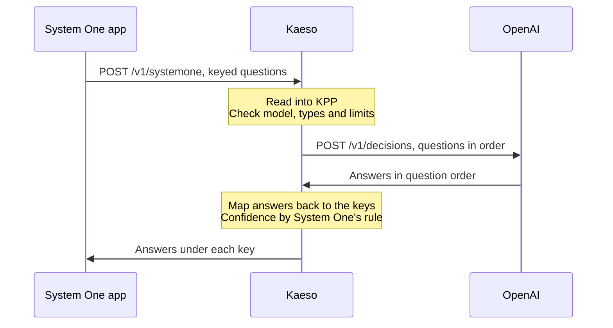

Apps ask decision models typed questions through Kaeso and get each answer with its probabilities. Kaeso takes OpenAI's Decisions API, TypeSafe's System One API and Gemini's Decisions API, and sends each request to the model's provider in that provider's own format.

```bash tab="curl"
curl https://kaeso.example.com/v1/systemone \
  -H "Authorization: Bearer $KAESO_API_KEY" \
  -H "content-type: application/json" \
  -d '{"model": "gpt-6-luna", "state": "I was charged twice; please refund me.", "questions": {"refund": {"type": "noul", "instructions": "Does the customer ask for a refund?"}, "team": {"type": "choice", "instructions": "Which team handles it?", "criteria": {"billing": "Payments and refunds.", "support": "Everything else."}}}}'
```

```python tab="Python"
import os
from openai import OpenAI

client = OpenAI(base_url="https://kaeso.example.com/v1", api_key=os.environ["KAESO_API_KEY"])

decision = client.decisions.create(
    model="gpt-6-luna",
    input="I was charged twice; please refund me.",
    questions=[
        {"type": "predicate", "name": "refund", "instructions": "Does the customer ask for a refund?"},
        {"type": "choice", "name": "team", "instructions": "Which team handles it?",
         "choices": [{"value": "billing"}, {"value": "support"}]},
    ],
)
print(decision.answers[0].probability, decision.answers[1].choice)
```

```ts tab="TypeScript"
import OpenAI from "openai";

const client = new OpenAI({ baseURL: "https://kaeso.example.com/v1", apiKey: process.env.KAESO_API_KEY });

const decision = await client.decisions.create({
  model: "gpt-6-luna",
  input: "I was charged twice; please refund me.",
  questions: [
    { type: "predicate", name: "refund", instructions: "Does the customer ask for a refund?" },
    { type: "choice", name: "team", instructions: "Which team handles it?", choices: [{ value: "billing" }, { value: "support" }] },
  ],
});
console.log(decision.answers);
```

TypeSafe's Python SDK and google-genai work the same way. Point both clients at Kaeso's root:

```python tab="TypeSafe SDK"
import os
from typesafe_sdk import TypeSafeClient

with TypeSafeClient(api_key=os.environ["KAESO_API_KEY"], base_url="https://kaeso.example.com") as client:
    decision = client.system_one(
        "I was charged twice; please refund me.",
        {"refund": {"type": "noul", "instructions": "Does the customer ask for a refund?"}},
        model="typesafe/jev-1.14",
    )
print(decision.answers["refund"].noul)
```

```python tab="google-genai"
import os
from google import genai
from google.genai import types

client = genai.Client(
    api_key=os.environ["KAESO_API_KEY"],
    http_options=types.HttpOptions(base_url="https://kaeso.example.com"),
)
decision = client.decisions.create(
    model="gemini-decision-1",
    input="I was charged twice; please refund me.",
    questions={"refund": {"type": "noul", "instructions": "Does the customer ask for a refund?"}},
)
print(decision.answers["refund"].noul)
```

## Endpoints

| Endpoint | Format | Key | Body |
| --- | --- | --- | --- |
| `POST /v1/decisions` | OpenAI's Decisions API | `Authorization: Bearer` | JSON: `model`, `input`, `questions`, `prompt_cache_key`, `prompt_cache_options`, `safety_identifier` |
| `POST /v1/systemone` | TypeSafe's System One API | `Authorization: Bearer` | JSON, or an upload whose first part `request` holds the JSON and whose other parts the images `assets` name; gzip or zstd |
| `POST /v1beta/decisions`, or `POST /v1/decisions` with Gemini's key | Gemini's Decisions API | `x-goog-api-key` or `?key=` | JSON: `model`, `input`, `questions` |

`/v1/decisions` takes Gemini's body when the request carries `x-goog-api-key` or `?key=` and no `Authorization` header, as `google-genai` 3 sends it by default; the OpenAI SDK sends `Authorization: Bearer` and gets OpenAI's format. Decision replies are never streamed. The body of each endpoint is bounded by [`body_limits.decisions`](../self-hosting/configuration.md#request-and-response-bodies), 64 MiB by default. A System One body sent to `/v1/decisions`, as some SDKs do, is refused with a 400 that points to `/v1/systemone`; Kaeso never guesses a format from a body's shape. TypeSafe's `GET /v1/models` isn't served: no header tells its SDK from OpenAI's, so `/v1/models` answers in OpenAI's shape and lists decision models like any model.

Keys, model resolution with aliases and routes, limits and budgets, request logs and errors in the app's own format work as for every other model request.

## How a request crosses formats

Any of the three formats reaches any decision model Kaeso knows. Kaeso reads the request into KPP, checks it against the model and its provider, and writes it in the provider's format. Answers come back in question order, mapped to the app's names.



The mapping of every field, the confidence rule of each format and the adaptations are on [decisions across formats](../development/kpp/decisions-across-formats.md).

## Providers

Kaeso sends decisions through each provider's own decisions API, whatever format the model's chat requests use.

| Provider | Format sent | Path | Notes |
| --- | --- | --- | --- |
| OpenAI | OpenAI Decisions | `/v1/decisions` | `gpt-6-luna`; at most 400 questions |
| Google AI Studio | Gemini Decisions | `/v1beta/decisions` | `gemini-decision-1`; text, images, audio, video and PDF |
| OpenRouter | System One | `/api/v1/systemone` | images in the state or as assets |
| Vercel AI Gateway | OpenAI Decisions | `/v1/decisions` | the decision models Vercel lists |
| Baseten | System One | `/v1/systemone` | images in a user message, at most 16; no box questions |
| Fireworks AI | System One | `/inference/v1/systemone` | text only; no box questions |
| Perplexity | System One | `/v1/decisions` | Decider models; images as data URLs in the state, at most 8; no box questions |
| TypeSafe | System One | `/v1/systemone` | Jev; images as assets or uploaded parts; box questions on Jev 1.14; long context when a request needs it |
| A custom provider | System One or OpenAI Decisions | the path its admin sets | once an org admin turns decisions on, with the image placement they choose ([custom providers](../console/custom-providers.md#decisions)) |

Every other provider and Gemini Enterprise Agent Platform have no decisions API in Kaeso yet. A request to one is refused before anything is sent, for example "Anthropic offers no decisions API Kaeso can call, so `claude-haiku-4-5` can't make decisions.". So is a request to OpenAI in a project whose OpenAI key is a [ChatGPT account](../console/provider-keys.md#sign-in-with-a-chatgpt-account).

Decision models come from [KPMR](../concepts/kpmr.md#decision-models): a model of the kind `decision` answers questions only, and a model with a `decisions` entry, such as `gpt-6-luna`, also generates text. A custom model on a provider with a decisions API becomes a decision model with the `decisions` field ([models and aliases](../console/models-and-aliases.md#decision-models)).

## What is refused

Kaeso refuses before sending what the model or its provider can't take, with a 400 in the app's format:

- a generation model: "The model `gpt-5.5` is a generation model; it can't answer decision questions.";
- a question type the model doesn't answer, such as box questions, which only TypeSafe's Jev 1.14 answers;
- more questions, options, levels or images than the model takes;
- images, audio, video or PDF the model doesn't accept;
- an image URL to a provider that takes only data: send the image as a data URL, as Kaeso never fetches URLs;
- a conversation to System One or Gemini: send one user message.

A decision-only model refuses chat, token counts and embeddings: "The model `gemini-decision-1` is a decision model; send it to `/v1/decisions` or `/v1/systemone`.". Kaeso doesn't emulate decisions on chat models and never splits a request.

## Answers, adaptations and hints left out

- **Confidence** means something different at each provider. When an answer crosses formats, Kaeso works it out from the probabilities by the app's format's rule; a reply in the provider's own format keeps the provider's value.
- **Refusals.** OpenAI may refuse single questions. A System One app gets `{"type": "refusal"}` under the question's key; a Gemini app, which has no per-question refusal, gets a 400 that names the refused questions.
- **`kaeso-adapted`** names what the provider takes only in another form: `names` (questions renamed `q0`, `q1` and so on), `booleans` (choice values `true` and `false` as text), `levels`, `criteria` (yes/no criteria folded into OpenAI's instructions), `state` (JSON state sent as text), `instructions` and `long_context` (TypeSafe's long-context header, sent for a request Kaeso estimates beyond TypeSafe's default context).
- **`kaeso-left-out`** names hints the provider's format has no place for: `cache` (OpenAI's `prompt_cache_*`) and `user` (`safety_identifier`).

## Costs, cache and logs

- **Costs.** A decision costs its input, cache-read and cache-write tokens at the model's prices. Output is never billed, even for a model with an output price; TypeSafe and Perplexity report output tokens that cost nothing. A model without an input price costs **Unknown**, and [budgets](../console/limits-and-budgets.md) refuse it.
- **Usage.** OpenAI's cached and cache-write tokens are counted apart, and Gemini's image, video and document tokens count as image tokens and its audio tokens as audio tokens.
- **Response cache.** Decisions are never streamed, so the [response cache](../console/response-cache.md) answers a repeated decision like a repeated chat request.
- **Logs.** The [request log](../console/request-logs.md) shows the endpoint, `decisions` or `systemone`, the questions and each answer with its probabilities. Images are left out of the logged request unless the project keeps media.

## Next steps

- [Decisions across formats](../development/kpp/decisions-across-formats.md): See how each field crosses between the three formats.
- [Models and aliases](../console/models-and-aliases.md): Add decision models and route between them.
- [Request logs](../console/request-logs.md): Find a decision and read its answers.
