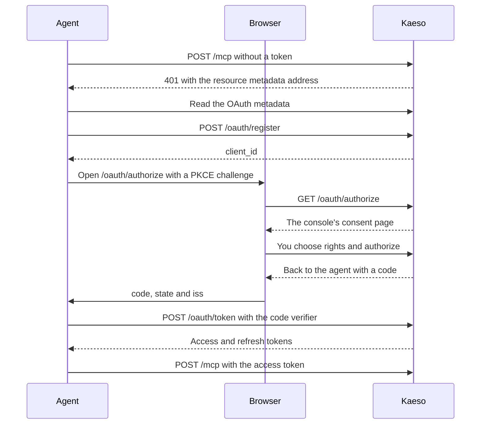

The MCP server lets an agent, such as Claude Code or Codex, manage your install through the Platform API. The agent signs in through your browser, and you choose what it may do. The server answers at `/mcp` on your install's domain.

Add it to Claude Code with your install's address:

```bash
claude mcp add --transport http kaeso https://kaeso.example.com/mcp
```

Then run `/mcp` in Claude Code and choose `kaeso` to sign in. Your browser opens the console, which asks what the agent may do. After **Authorize**, the agent's tools are ready.

## Clients

Each client below signs in with OAuth on its own. It finds Kaeso's sign-in from the server's first answer, registers itself and opens your browser, so you never copy a key.

**Account** › **Agents** in the console shows your install's MCP address next to the marks of Claude Code, Cursor and GitHub Copilot. Each opens the steps for that client, with your install's address filled in: the plugin and command for Claude Code, **Add to Cursor**, and **Add to VS Code** for GitHub Copilot.

### Claude Code

The command above adds the server to the current project. Add `--scope user` to make it available in every project. `/mcp` signs in, and signs in again after you revoke the agent.

Or install the Kaeso plugin, which asks for your install's address when you enable it:

```text
/plugin install kaeso --marketplace logicplanes/kaeso
```

`/plugin configure kaeso@kaeso` changes the address later. To get each release of the plugin, turn on auto-update for the `kaeso` marketplace under `/plugin` › **Marketplaces**.

### Codex

Add the server to `~/.codex/config.toml`:

```toml
[mcp_servers.kaeso]
url = "https://kaeso.example.com/mcp"
```

Then sign in from a terminal:

```bash
codex mcp login kaeso
```

### Cursor

Add the server to `.cursor/mcp.json` in a project, or to `~/.cursor/mcp.json` for every project:

```json
{
  "mcpServers": {
    "kaeso": {
      "url": "https://kaeso.example.com/mcp"
    }
  }
}
```

Cursor lists the server in its MCP settings and asks you to sign in there. You can also install **Kaeso** from the Cursor Marketplace, which asks for your install's address as `KAESO_URL`.

### VS Code and GitHub Copilot

Add the server to `.vscode/mcp.json` in a project, or choose **Add to VS Code** in the console:

```json
{
  "servers": {
    "kaeso": {
      "type": "http",
      "url": "https://kaeso.example.com/mcp"
    }
  }
}
```

VS Code asks you to sign in when GitHub Copilot first uses the server in agent mode.

### Gemini CLI

Add the server to `~/.gemini/settings.json`:

```json
{
  "mcpServers": {
    "kaeso": {
      "httpUrl": "https://kaeso.example.com/mcp"
    }
  }
}
```

Then run `/mcp auth kaeso` in Gemini CLI.

### OpenCode

Add the server to `opencode.json`:

```json
{
  "$schema": "https://opencode.ai/config.json",
  "mcp": {
    "kaeso": {
      "type": "remote",
      "url": "https://kaeso.example.com/mcp"
    }
  }
}
```

OpenCode signs in the first time it uses the server. To sign in ahead of that, run `opencode mcp auth kaeso`.

### Other clients

Any MCP client that speaks Streamable HTTP and OAuth 2.1 with dynamic client registration connects the same way.

## Sign-in

The agent signs in as a public OAuth client with PKCE. You decide in the console what it may do:



The consent page is at `https://kaeso.example.com/authorize`, and the console asks you to sign in first if you aren't. It shows:

- The agent's name, as its client registered it.
- The presets **Observer**, **Builder**, **Operator** and **Full access**, with **Builder** chosen, and a short list of what the choice allows. It includes organizations you join later, unless you turn that off.
- That it keeps working until you revoke it.
- **Customize**, which opens a dialog with the agent's name and a tab for each level of rights: **Organizations**, **Instance** and **Account**. Nothing changes until you authorize.
- The account you are signed in as, and the host your browser returns to.

**Authorize** sends your browser back to the agent with a code. **Deny** sends it back with `access_denied`. A sign-in request lasts 15 minutes, and its code 5 minutes.

## Rights

An agent acts for the user who authorized it. On every request, it gets only the rights in all four of these:

1. The rights you gave it.
2. Your own rights now. When you lose a right, your agents lose it at their next request.
3. The organization's agent policy.
4. The instance's agent policy.

The rights you can give come in three levels:

| Level | Rights | Who can give them |
| --- | --- | --- |
| Instance | `instance.*` | Instance admins, within the instance's agent policy. The instance preset is **None**, **Read**, **Configure** or **Admin** |
| Organizations | Organization and project rights from the [rights](../concepts/rights.md#organization-rights) catalogue | Every member, within each organization's agent policy |
| Account | `account.*` | Everyone. `account.view` is always on |

Under **Organizations**, check each organization the agent may act in. **Also orgs I join later** gives the same choice to organizations you join afterwards. Organizations you belong to now and leave unchecked stay closed to it. In each organization, choose its organization rights, and either **All projects**, which includes projects created later, or single projects with rights of their own.

[Agents](../concepts/rights.md#agents) lists what each preset holds, how the levels combine and which rights no agent gets.

### Sensitive rights

The console marks sensitive rights with ⚠. Giving one needs a sign-in within the last 15 minutes and a confirmation in the console. Once given, the agent uses it without a recent sign-in of its own: you confirmed when you gave it.

### Your sign-in

The agent keeps the sign-in you authorized it from. An organization that requires single sign-on or two-factor authentication lets the agent in only if that sign-in met the requirement, as it would your session.

### Missing rights

When a tool needs a right the agent doesn't have, the call fails with `insufficient_rights` and a link for you:

```json wrap
{
  "error": {
    "type": "insufficient_rights",
    "right": "limits.manage",
    "message": "This agent doesn't have `limits.manage`; its user can grant it in the console.",
    "approve_url": "https://kaeso.example.com/settings/account/agents/agt_…?add=limits.manage&org=org_…&project=proj_…"
  }
}
```

The agent asks you to open the link. The console offers exactly that right, in that organization and project, and the same rules apply as on the consent page. Kaeso doesn't announce the new tools, so the agent lists them again afterwards.

## Tools

Every Platform API operation an agent can use is a tool, named after its operation id in snake case. `GET /platform/v1/orgs/{org}/usage` is `get_orgs_org_usage`.

- **Listing.** `tools/list` shows only the tools the agent can use now, in any of its organizations and projects.
- **Arguments.** A tool takes the operation's path parameters, such as `org` and `project`, its query parameters, and `body` for the request body. Path parameters are required, and Kaeso refuses an argument the tool doesn't have.
- **Results.** A tool answers with the Platform API's JSON as text and as `structuredContent`. An answer over 200 KB is cut; ask for a smaller page with `limit`.
- **Model.** Every tool takes `agent_model`, the model family the agent runs on: `claude`, `gpt`, `gemini`, `gemma`, `grok`, `llama`, `mistral`, `deepseek`, `qwen`, `kimi`, `glm`, `minimax`, `command`, `nova`, `phi`, `granite`, `jamba`, `ernie`, `hunyuan`, `doubao`, `yi`, `nemotron`, `olmo`, `sonar`, `reka` or `unknown`. Kaeso stores it with each call and shows the family's name next to the agent; any other value counts as `unknown`. Until its first call, an agent shows as `unknown`.
- **Hints.** Tools that read are marked `readOnlyHint`, and tools that delete `destructiveHint`.
- **Instructions.** The server tells the agent to list its organizations with `get_me_memberships` first.

These need a console session, so no agent has a tool for them:

- Your agents and their rights, and the consent page.
- Your sessions, email address, password, two-factor authentication, recovery codes and links to single sign-on, creating an organization and deleting your account.
- Making someone an instance admin, single sign-on for instance admins, the instance's agent policy, and deleting a user or an organization at once.
- An organization's agent policy, and closing an organization to an agent.
- Creating or rotating platform keys, creating keys with platform access, and the Playground.

An agent can create API keys that call models only in projects where it holds `api.request`.

## Protocol

| Topic | Rule |
| --- | --- |
| Address | `POST https://kaeso.example.com/mcp` |
| Transport | Streamable HTTP with one JSON-RPC message per request, answered with JSON. Kaeso opens no event stream: `GET` and `DELETE` get 405 with `Allow: POST` |
| Protocol versions | `2025-11-25`, `2025-06-18` and `2025-03-26`. `initialize` gets the client's version when Kaeso speaks it, otherwise the newest |
| Methods | `initialize`, `ping`, `tools/list` and `tools/call`. Notifications get 202 |
| Authentication | `Authorization: Bearer kso_at_…` |
| `Origin` | Optional. When sent, it must be your install's origin or one of `KAESO_CORS_ALLOWED_ORIGINS` |
| Body | At most `KAESO_BODY_LIMITS_PLATFORM_API`, 1 MiB by default |

## Errors

| Status | When |
| --- | --- |
| 400 | The body isn't JSON (`-32700`), holds a batch (`-32600`), or `MCP-Protocol-Version` names a version Kaeso doesn't speak. |
| 401 | No token, or one that ended. `WWW-Authenticate` carries `Bearer resource_metadata="https://kaeso.example.com/.well-known/oauth-protected-resource/mcp"`, with `error="invalid_token"` for an ended token. |
| 403 | The install doesn't allow agents, or `Origin` names another site. |
| 405 | `GET` or `DELETE` on `/mcp`. |
| 413 | The body is too large. |
| 503 | Kaeso can't reach its database. |

An unknown method gets the JSON-RPC error `-32601`, and an unknown tool `-32602`. A tool call that fails answers 200 with `isError: true` and the text `<type>: <message>`. The type is the Platform API's [error type](platform-api.md#errors), or `insufficient_rights` for a [missing right](#missing-rights).

## Tokens

| Token | Starts with | Lasts |
| --- | --- | --- |
| Access token | `kso_at_` | 1 hour |
| Refresh token | `kso_rt_` | Until the agent is revoked or goes 90 days unused. Every use replaces it with a new one |
| Authorization code | `kso_ac_` | 5 minutes, and one use |

Using a refresh token or a code a second time ends that whole sign-in, because one of them must have leaked. Every token from it stops working, and the agent has to be connected again.

An agent keeps working until you revoke it, or until it goes 90 days without a request. Deactivating its user stops it too, and so does turning agents off for the install.

## OAuth endpoints

Kaeso is its own authorization server. Its issuer is the install's public URL, such as `https://kaeso.example.com` ([`KAESO_PUBLIC_URL`](../self-hosting/configuration.md#listening)).

| Endpoint | Does |
| --- | --- |
| `GET /.well-known/oauth-protected-resource/mcp` | The resource metadata: the `/mcp` address, Kaeso as its authorization server and the scope `kaeso`. Also at `/.well-known/oauth-protected-resource` |
| `GET /.well-known/oauth-authorization-server` | The authorization server metadata: the endpoints below, `S256` as the only PKCE method, public clients only (`none`), and `iss` in every redirect (RFC 9207) |
| `POST /oauth/register` | Registers a client (RFC 7591) with 1 to 10 redirect URIs and answers with its `client_id` (`cli_…`). A redirect URI uses HTTPS, a loopback address on any port, or a private-use scheme |
| `GET /oauth/authorize` | Takes `response_type=code`, `client_id`, `redirect_uri`, `state` and `code_challenge` with `code_challenge_method=S256`. `scope` may only be `kaeso`, and `resource`, when sent, must be the `/mcp` address |
| `POST /oauth/token` | Form-encoded. `grant_type=authorization_code` with `code`, `client_id`, `redirect_uri` and `code_verifier`, or `grant_type=refresh_token` with `refresh_token` and `client_id` |
| `POST /oauth/revoke` | Form-encoded `token`. Ends the sign-in the token belongs to, and answers 200 for a token it doesn't know |

A loopback redirect URI may change its port at every sign-in, as RFC 8252 allows. Its host and path must stay as registered.

An agent keeps its `client_id` across restarts, but Kaeso deletes registrations that never led to a sign-in, and a new database has none. When an agent signs in with a `client_id` Kaeso doesn't know and a loopback redirect URI, Kaeso registers it again under that id as "MCP client", and the sign-in goes on. You can rename it on the consent page. For any other redirect URI, the console says it doesn't know the agent.

## Policies

Two policies limit every agent, and no agent can change them:

| Policy | Settings | Default | Changed by |
| --- | --- | --- | --- |
| The instance's | Whether agents may sign in at all, and the most instance admins' agents may have on the instance | On, **Configure** | An instance admin ([instance administration](../console/instance-administration.md#let-agents-in)) |
| An organization's | Whether members' agents may act in it, and the most they may have there | On, **Full access** | A member with **Change member roles** ([organizations and projects](../console/organizations-and-projects.md#let-members-agents-in)) |

Narrowing a policy applies to every agent at its next request. With agents off for the install, every agent gets 403. With agents off for an organization, agents get 403 there and keep working elsewhere.

## Activity and audit

Kaeso keeps every tool call an agent makes for 90 days: the tool, its target, the result, the time and the IP address. You read it on the agent's page under **Account** › **Agents** ([manage your agents](../console/account.md#manage-your-agents)).

A change an agent makes goes to the audit log like any other, with the actor kind `agent`. `actor.id` is the user it acts for, and `actor.agent` names it with its `id`, `name` and `model`. `by_agents=true` lists only changes by agents, in the instance's, an organization's and a project's audit log.

| Action | Recorded when |
| --- | --- |
| `agent.authorize` | You authorize an agent |
| `agent.update` | You rename an agent |
| `agent.rights_update` | You change an agent's rights |
| `agent.revoke` | You revoke an agent |
| `agent.org_access_revoke` | An organization admin closes the organization to an agent |
| `instance.agents_policy` | An instance admin changes the instance's agent policy |
| `security.agents_policy` | An organization changes its agent policy |

## Platform API routes

The console manages agents through these routes, tagged `agents` in [`openapi.json`](platform-api.md#openapi-document). Routes under `me` need a console session.

| Route | Access | Does |
| --- | --- | --- |
| `GET me/agents`, `GET me/agents/{agent}` | Session | Your agents, newest first, with their model family, client, rights (`grant`), creation and last use |
| `PATCH me/agents/{agent}` | Session | Changes `name` |
| `PUT me/agents/{agent}/rights` | Session | Replaces the agent's rights. Giving a sensitive right it didn't have needs a [recent sign-in](platform-api.md#recent-sign-in) |
| `DELETE me/agents/{agent}` | Session | Revokes the agent. Its tokens stop working at once |
| `GET me/agents/{agent}/activity` | Session | Its tool calls, newest first |
| `GET me/agents/catalogue` | Session | Every right an agent can be given by level, the presets and their ceilings, the instance presets, the rights no agent gets and the model families |
| `GET me/agents/grantable` | Session | What you could give an agent now, in each organization and project |
| `POST me/agent-requests/view`, `…/approve`, `…/deny` | Session | The consent page. Each takes the `request` from the page's `#request=` |
| `GET orgs/{org}/agents` | `members.view` | The members' agents that may act in the organization |
| `DELETE orgs/{org}/agents/{agent}` | `members.rights.update`, session | Closes the organization to the agent. Its member can open it again |
| `GET orgs/{org}/security/agents` | `org.view` | The organization's agent policy, `{"allowed": true, "max": "full"}` |
| `PUT orgs/{org}/security/agents` | `members.rights.update`, session | Sets it. `max` is `observer`, `builder`, `operator` or `full` |
| `GET instance/settings/agents` | `instance.system.view` | The instance's agent policy, `{"allowed": true, "max": "configure"}` |
| `PUT instance/settings/agents` | Instance admin, session | Sets it. `max` is `none`, `read`, `configure` or `admin` |

An agent's rights are a `grant`, the same in every route that reads or sets them:

```json
{
  "preset": "builder",
  "customized": false,
  "instance": [],
  "account": ["account.view", "account.keys.view"],
  "orgs": [
    {
      "org": "org_…",
      "included": true,
      "rights": ["org.view", "usage.org.view"],
      "projects": {
        "all": true,
        "rights": ["project.view", "models.view"],
        "selected": []
      }
    }
  ],
  "future_orgs": null
}
```

- `orgs` has one entry per organization of the user. An organization left out, or with `"included": false`, is closed to the agent.
- With `"all": false`, `selected` lists projects as `{"project": "proj_…", "rights": […]}`, and other projects stay closed.
- `future_orgs` is `null`, or `{"rights": […], "project_rights": […]}` for organizations the user joins later.
- `customized` says whether rights changed after choosing the preset. The console then shows the preset it started from.
