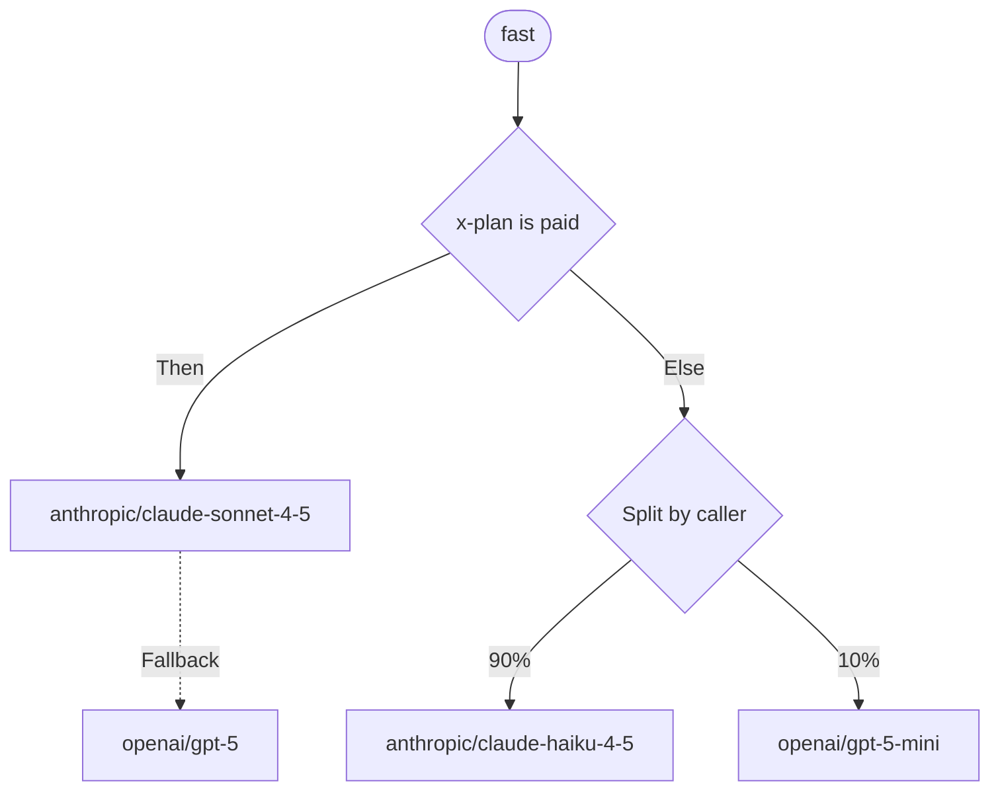

An alias holds a route: the steps a request takes when an app sends the alias as `model`. A route can fall back to another model when one fails, branch on what the request asks for, and split traffic between models by weight.



## Steps

A route is a tree of three kinds of steps. A route of one model is the alias as it always was.

| Step | What it does |
| --- | --- |
| Model | Calls a model of the project's catalogue. Its fallback, a step of any kind, takes over when the model fails for a reason the step lists |
| Condition | Takes `then` when its rules hold for the request, otherwise `else`. `all` needs every rule, `any` one of them |
| Split | Sends each request down one of 2 to 8 branches, by weights from 1 to 99 percent that add up to 100 |

A route has at most 32 steps and is at most 12 steps deep. Every model it names must be in the project's catalogue when you save it.

## Conditions

A condition has 1 to 10 rules. Each rule reads one fact about the request:

| Field | Holds when |
| --- | --- |
| `header` | A request header `equals`, `not_equals` or `contains` a value, or is `present` or `absent`. Names are lowercase, values are compared exactly and have up to 200 characters. A header sent twice holds for `equals` and `contains` when either value does |
| `format` | The app's API format is `in` or `not_in` a list: `openai_chat`, `openai_responses`, `anthropic_messages`, `openai_embeddings` |
| `feature` | The request uses, or doesn't use, `images`, `pdfs`, `tools`, `reasoning`, `structured_output` (a JSON schema) or `streaming` |
| `input_tokens` | The input is `at_least` or `below` a number of tokens, estimated from the request's size at 4 bytes a token |
| `key`, `member`, `service_account` | The API key, the member or the service account that sent the request is `in` or `not_in` a list of up to 100 |

Routes can't read `authorization`, `proxy-authorization`, `cookie`, `x-api-key`, `x-goog-api-key` or `api-key`, since they carry credentials. To route by your own users, send a header such as `x-plan` from your app.

## Splits

A split draws a number for each request and takes the branch its weight covers:

- `by: request` draws anew for every request, from its request id.
- `by: caller` keeps each caller on one branch: the API key, or else the member, or else the service account. Use it for A/B tests, so one app sees one model. While the split keeps its place in the route, changing the weights moves only the callers whose draw crosses a new boundary.
- `by: header` keeps each value of the header named in `header` on one branch, such as `x-user-id` with your own user's id, so each of your users sees one model behind one API key. Requests without the header are drawn anew.

## Fallbacks

When a model step fails, Kaeso moves on to its fallback if the step's `fall_back_on` lists the reason. Any other failure, and the last step's failure, goes back to the app as it would without a route.

| Reason | Failures |
| --- | --- |
| `unavailable` | The provider can't be reached, times out, is overloaded or answers 5xx; it refuses the project's provider key or doesn't serve the model; the project has no provider key for it |
| `limited` | The provider's rate limit or quota (429), or a Kaeso [limit or budget](../console/limits-and-budgets.md) for the step's model: 429, or 403 for a spend budget that can't price the request. When Kaeso can't check limits at all (503), no step falls back |
| `unsupported` | The model can't take something the request uses, such as images, PDFs, tools or a JSON schema. Kaeso knows this from the catalogue before it sends anything |
| `rejected` | The provider refuses the request itself: 400 or 413, such as a context that is too long or content it filters |

A step falls back on `unavailable`, `limited` and `unsupported` unless it lists others. Add `rejected` only for a fallback that can take what the first model refused, such as a model with a longer context.

A step's `timeout_seconds`, 1 to 3600, is how long Kaeso waits for the model's first byte, and for a reply that isn't streamed, before the step fails as `unavailable`. Without it, the model's own timeout applies.

Nothing falls back once the provider has answered: a stream that breaks off later ends with an error event, as without a route.

### Steps that are skipped

- **A model the key may not use.** Kaeso skips the step without naming it, so a restricted key learns nothing about the route. A request that finds no step it may use gets 404, as for an unknown model.
- **A model removed from the catalogue.** Kaeso skips the step. Removing a model deletes the aliases that route only to it; a route that also uses other models keeps it as a step, which the alias's `models` list shows without a `target`. When no other step is left, the request gets 404: ``The alias `fast` has no model left for this request; ask a project admin.`` The alias can still be renamed; to change its route, replace or remove that step first.

## Limits, costs and the cache

- Every step a request tries counts against the limits for its model, request rates included. A step that fails gives back what it held of a budget before the next step asks.
- Usage and cost are the answering step's, at its model's prices. Failed steps cost nothing in Kaeso. A provider may still bill a request it worked on before a step timed out.
- The [response cache](../console/response-cache.md) is looked up for each step's model, so a cached reply of any step answers.

## What apps and logs see

- `kaeso-model` and `kaeso-provider` name the step that answered, or the one that failed last.
- `kaeso-route` names every step the request reached, in order, by its path in the route as a trace names it, with its model and status, and its time in milliseconds when it failed: `"route";model="anthropic/claude-sonnet-4-5";status=529;dur=1204, "route.fallback";model="openai/gpt-5";status=200`. A skipped step carries `skipped` and no model ([response headers](../api/model-api.md#response-headers)).
- The [request log](../console/request-logs.md) keeps the alias as the requested model and lists the steps it tried first, each with its status, error and time.
- `/v1/models` lists the alias with the details of its main model: the `then` side of conditions and the heaviest branch of splits. When the key may not use that model, the alias shows the first other model it may use.
- `kaeso_alias_fallbacks_total{provider, reason}` counts the steps that fell back ([health and metrics](../self-hosting/monitoring.md)).

## Test a route

A trace sends a request through a route without calling a model or logging anything: it shows each condition with the rules that held, the number each split draws and the branch it takes, and every model the request would try, in order. The route needn't be saved. In the console, use the alias's **Test** tab ([models and aliases](../console/models-and-aliases.md#test-a-route)); from a script, send the route and the request's facts to the Platform API:

```bash
curl -X POST "https://kaeso.example.com/platform/v1/orgs/$ORG/projects/$PROJECT/aliases/trace" \
  -H "Authorization: Bearer $KAESO_PLATFORM_KEY" \
  -H "Content-Type: application/json" \
  -d '{
    "alias": "alias_01k7a3f8m2xq4v9c5r6t8w0yz3",
    "route": {
      "type": "model",
      "model": "model_01k7a3f8m2xq4v9c5r6t8w0yz1",
      "fallback": { "type": "model", "model": "model_01k7a3f8m2xq4v9c5r6t8w0yz2" }
    },
    "request": {
      "headers": [{ "name": "x-plan", "value": "enterprise" }],
      "format": "openai_chat",
      "input_tokens": 1200
    }
  }'
```

With `alias`, splits by caller and by header draw as they do for that alias's requests. Splits that draw per request use `seed` in place of the request's id, so the same `seed` draws the same branches. Agents get the same trace as a read-only tool ([MCP](../api/mcp.md)).

To send a real request through a route, saved or not, give the [Playground](../console/playground.md)'s request the route as `route`, the alias it edits as `alias` and the headers as `headers`. The request runs as you, is charged and logged with the source `playground`, and its `kaeso-route` header shows each step it tried.

## Set a route

In the console, build the route on the alias's page ([models and aliases](../console/models-and-aliases.md#create-an-alias)). From a script, send it as `route` when you create or change an alias on the [Platform API](../api/platform-api.md). This alias tries Claude Sonnet, and GPT-5 when Sonnet is unavailable or rate limited:

```bash
curl -X PATCH "https://kaeso.example.com/platform/v1/orgs/$ORG/projects/$PROJECT/aliases/$ALIAS" \
  -H "Authorization: Bearer $KAESO_PLATFORM_KEY" \
  -H "Content-Type: application/json" \
  -d '{
    "route": {
      "type": "model",
      "model": "model_01k7a3f8m2xq4v9c5r6t8w0yz1",
      "fall_back_on": ["unavailable", "limited"],
      "fallback": { "type": "model", "model": "model_01k7a3f8m2xq4v9c5r6t8w0yz2" }
    }
  }'
```

Requests take the new route at once. A route Kaeso refuses names the field in the error's `param`, such as `route.fallback.model`; a trace refuses the same routes.

## Next steps

- [Models and aliases](../console/models-and-aliases.md): Add models to the catalogue and give them aliases.
- [Request flow](request-flow.md): See every check a request passes, and which error it gets.
- [Limits and budgets](../console/limits-and-budgets.md): Cap a model, so its requests move on to a fallback.
