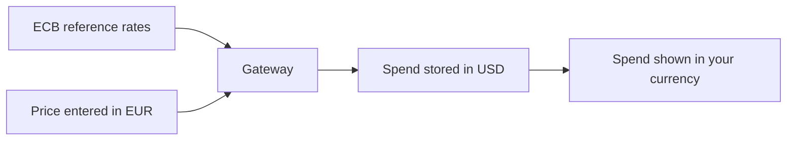

Kaeso stores and calculates every price and every cost in US dollars, so limits, logs, exports and the Platform API stay exact and add up. Other currencies appear only at two edges: where you enter a price, and where you read spend.

## Where the rates come from

The rates are the European Central Bank's [euro foreign exchange reference rates](https://www.ecb.europa.eu/stats/policy_and_exchange_rates/euro_reference_exchange_rates/html/index.en.html), about 30 currencies against the euro. The ECB publishes them around 16:00 CET on every working day.

- **Daily fetch.** The gateway fetches them in the background and checks again every six hours; a failed fetch is tried again after 15 minutes. Requests never wait for it.
- **First fetch.** An install without rates fetches the last 90 days, so recent spend converts at the rates of its own days.
- **US dollar rates.** A rate per US dollar is a cross rate of the same day: the ECB's rate of the currency divided by its rate of the US dollar, kept to 12 decimal places.
- **Kept rates.** When a fetch fails, Kaeso keeps the rates it has and the console shows their date. An install without any rates, such as one without internet access, offers US dollars only.

Instance admins turn the fetch off under **Exchange rates** in [instance administration](../console/instance-administration.md#change-install-settings); the rates already fetched stay. Operators point it at a mirror with `exchange_rates.url` ([configuration](../self-hosting/configuration.md#exchange-rates)).

## Prices in another currency

A model's prices can carry a `currency`, such as `EUR`, where you set them by hand: overrides of a project's model, and custom models, also those of custom providers. Without one, prices are in US dollars.

- **Kept as entered.** The model keeps €2.50 as €2.50, and its sheet in the console shows the US dollar equivalent next to it.
- **Costed in US dollars.** Each request is costed at the latest rate, so €2.50 per million tokens costs $2.7535 at 1.1014 dollars to the euro. Converted prices keep nine decimal places.
- **No rate, no price.** A currency needs a rate when you enter it. Should its rate later be missing, requests at those prices show an unknown cost instead of a wrong one.

Prices KPMR supplies stay in US dollars. Spend budgets and alerts stay in US dollars too, because a budget in another currency would change its meaning with the rate.

## Spend in another currency

Pick a currency under **Appearance** in your account, or with the currency menu on **Analytics** and **Request logs**. The choice is saved to your account; `USD` shows US dollars only.

- **An estimate.** Spend shows in US dollars first, with the amount in your currency next to it, such as `≈ €12.40`.
- **Each day's rate.** A total converts each day's spend at that day's rate, a weekend or holiday at the working day before. Days before the oldest rates use the latest, and the page says so.
- **Your locale's format.** The symbol, its position and the separators follow your language, such as `€12.40` in English and `12,40 €` in German.

On the Platform API, the usage endpoints and the request log take `currency=EUR` and add `converted_cost`, and `GET /platform/v1/me/exchange-rates` lists the rates ([Platform API](../api/platform-api.md)).

## Next steps

- [Models and aliases](../console/models-and-aliases.md): Override a model's prices, in US dollars or another currency.
- [Limits and budgets](../console/limits-and-budgets.md): Set spend budgets, which stay in US dollars.
- [KPMR](kpmr.md): Learn where the model prices in US dollars come from.
