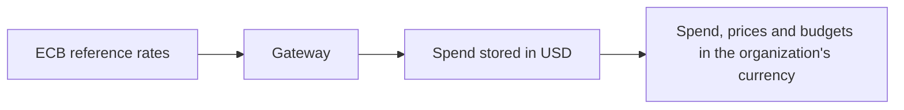

Each organization has a currency, US dollars unless an owner or admin sets another. The console shows every amount of the organization in it: spend, model prices and spend budgets. Underneath, Kaeso stores and calculates every price and every cost in US dollars, so limits, logs and the Platform API stay exact and add up, and it converts at the European Central Bank's daily rates where people read and enter money.

## Choose the organization's currency

Under **Organization settings** › **General**, **Currency** lists US dollars and every currency the install has a rate for, each with its name. Changing it needs **Edit organization** and is written to the audit log; every member sees the new currency at once. An install without rates offers US dollars only and says why.

## Where the rates come from

The rates are the European Central Bank's [euro foreign exchange reference rates](https://www.ecb.europa.eu/stats/policy_and_exchange_rates/euro_reference_exchange_rates/html/index.en.html), about 30 currencies against the euro. The ECB publishes them around 16:00 CET on every working day.

- **Daily fetch.** The gateway fetches them in the background and checks again every six hours; a failed fetch is tried again after 15 minutes. Requests never wait for it.
- **First fetch.** An install without rates fetches the last 90 days, so recent spend converts at the rates of its own days.
- **US dollar rates.** A rate per US dollar is a cross rate of the same day: the ECB's rate of the currency divided by its rate of the US dollar, kept to 12 decimal places.
- **Kept rates.** When a fetch fails, Kaeso keeps the rates it has and the console shows their date. A currency the ECB stops listing keeps its last rate.

Instance admins turn the fetch off under **Exchange rates** in [instance administration](../console/instance-administration.md#change-install-settings); the rates already fetched stay. Operators point it at a mirror with `exchange_rates.url` ([configuration](../self-hosting/configuration.md#exchange-rates)).

## Spend

Analytics, the overviews, the breakdowns, the request logs, the Playground, shared links and the weekly and monthly cost emails show spend in the organization's currency, such as `€12.40`.

- **Each day's rate.** Spend converts at the rate of the day it was spent, a weekend or holiday at the working day before; a total adds up each day's amount. Days before the oldest rates use the latest, and Analytics says which rates it used.
- **Your locale's format.** The symbol, its position and the separators follow your language, such as `€12.40` in English and `12,40 €` in German.
- **Downloads.** A breakdown's CSV and the request log's CSV export have the cost in the organization's currency, named by its code, and the cost in US dollars beside it for accounting.

The instance's own pages, which span organizations, stay in US dollars.

## Prices

Prices KPMR supplies are in US dollars; the console shows them in the organization's currency at the latest rate.

Where you set prices by hand, in overrides of a project's model and in custom models, the editor starts in the organization's currency, and **Currency** takes any other currency with a rate. Prices are kept as entered and costed in US dollars at the latest rate, so €2.50 per million tokens costs $2.7535 at 1.1014 dollars to the euro; converted prices keep nine decimal places. A currency needs a rate when you enter it, and should its rate later be missing, requests at those prices show an unknown cost instead of a wrong one.

## Spend budgets

A spend budget is set and shown in the organization's currency and kept in it. Kaeso checks it in US dollars at the latest rate, so a budget of €40 refuses requests once the month's spend reaches what €40 buys that day. Changing the organization's currency converts every spend budget of its projects at the latest rate, to the cent, and writes each to the audit log. Budget alerts and their emails name the budget in its currency.

## On the Platform API

`GET /platform/v1/orgs/{org}` returns `currency`, and `PATCH` sets it. The usage and timeline endpoints, the request log and shared links give each `cost` in US dollars and `converted_cost` in the organization's `currency`. A spend budget's `amount` and `used` are in its `currency`, and the request log's `min_cost` filter takes an amount in the organization's currency. `GET /platform/v1/me/exchange-rates` lists the rates ([Platform API](../api/platform-api.md)).

## Next steps

- [Organizations and projects](../console/organizations-and-projects.md#change-organization-settings): Set the organization's currency.
- [Models and aliases](../console/models-and-aliases.md): Override a model's prices.
- [Limits and budgets](../console/limits-and-budgets.md): Set spend budgets in the organization's currency.
